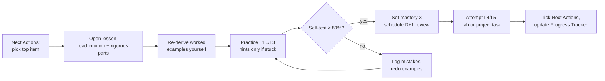

# Semester 6 Dashboard

> [!todo] ▶ Your next action
> Open **[[Next Actions]]**. The first unticked item is what you do now.
> **First time here?** Start Week 1 of the [[Semester Roadmap]]: [[PY-01 How Python Executes Programs and Environment Setup]], then follow the Week 1 row.

> [!warning] The curriculum is PROVISIONAL
> Topics are a professionally designed standard curriculum, not your official syllabus, which was not available. See [[Syllabus Verification Log]].

## Your six modules

| Module | Code | Credits | Dashboard | First lesson | Mind map |
|---|---|---|---|---|---|
| Cyber Security | ITT06102 | 12 | [[CS 00 Dashboard]] | [[CS-01 Security Foundations - CIA, Threats, Vulnerabilities and Risk]] | [[MM-CS Cyber Security Mind Map]] |
| Discrete Mathematics | GST06106 | 9 | [[DM 00 Dashboard]] | [[DM-01 Propositions, Connectives and Truth Tables]] | [[MM-DM Discrete Mathematics Mind Map]] |
| Final Year Project I | CST06103 | 12 | [[FYP 00 Dashboard]] | [[FYP-01 Identifying and Narrowing a Research Problem]] | [[MM-FYP Final Year Project Mind Map]] |
| Information System Project Management | ITT06105 | 12 | [[PM 00 Dashboard]] | [[PM-01 Project Fundamentals and Organizational Context]] | [[MM-PM Project Management Mind Map]] |
| Python Programming | CST06102 | 12 | [[PY 00 Dashboard]] | [[PY-01 How Python Executes Programs and Environment Setup]] | [[MM-PY Python Programming Mind Map]] |
| Software Design and Development | CST06101 | 10 | [[SD 00 Dashboard]] | [[SD-01 Software Engineering Fundamentals]] | [[MM-SD Software Design Mind Map]] |

## Navigation

| I want to… | Go to |
|---|---|
| Know what to do now | [[Next Actions]] |
| See the whole semester plan | [[Semester Roadmap]] |
| Plan this week | [[Weekly Study Planner]] |
| Track my mastery | [[Progress Tracker]] · [[Mastery Rubric]] |
| Review old topics | [[Review Schedule]] |
| Fix weaknesses | [[Weak Area Tracker]] · [[Mistake Log]] |
| Practise exam questions | [[Question Bank Index]] · [[Exam Technique and Assessment Strategy]] |
| See how modules connect | [[X 00 Cross-Module Index]] · [[MM Semester Concept Map]] |
| Do practical work | [[Labs and Projects Index]] |
| Look up a term | [[Glossary Index]] |
| Check sources | [[Source Register]] |
| See the full topic list | [[Master Curriculum Inventory]] |
| Understand the vault | [[README]] · [[BUILD-STATUS]] |

## How one study session works

*Text version: take the top item from Next Actions → study the lesson → redo the worked examples → practise Levels 1–3 → self-test. Pass (≥ 80%): record mastery 3 and schedule reviews. Fail: log the mistakes and practise again. Then attempt the transfer-level work and update your trackers.*

## Weekly rhythm (summary)

- **Mon–Fri:** one new lesson per module slot (see [[Weekly Study Planner]]) plus 20 minutes of reviews due.
- **Saturday:** a lab or project milestone.
- **Sunday:** weekly review: blank-page recall of the week's topics, update [[Progress Tracker]], plan next week.
