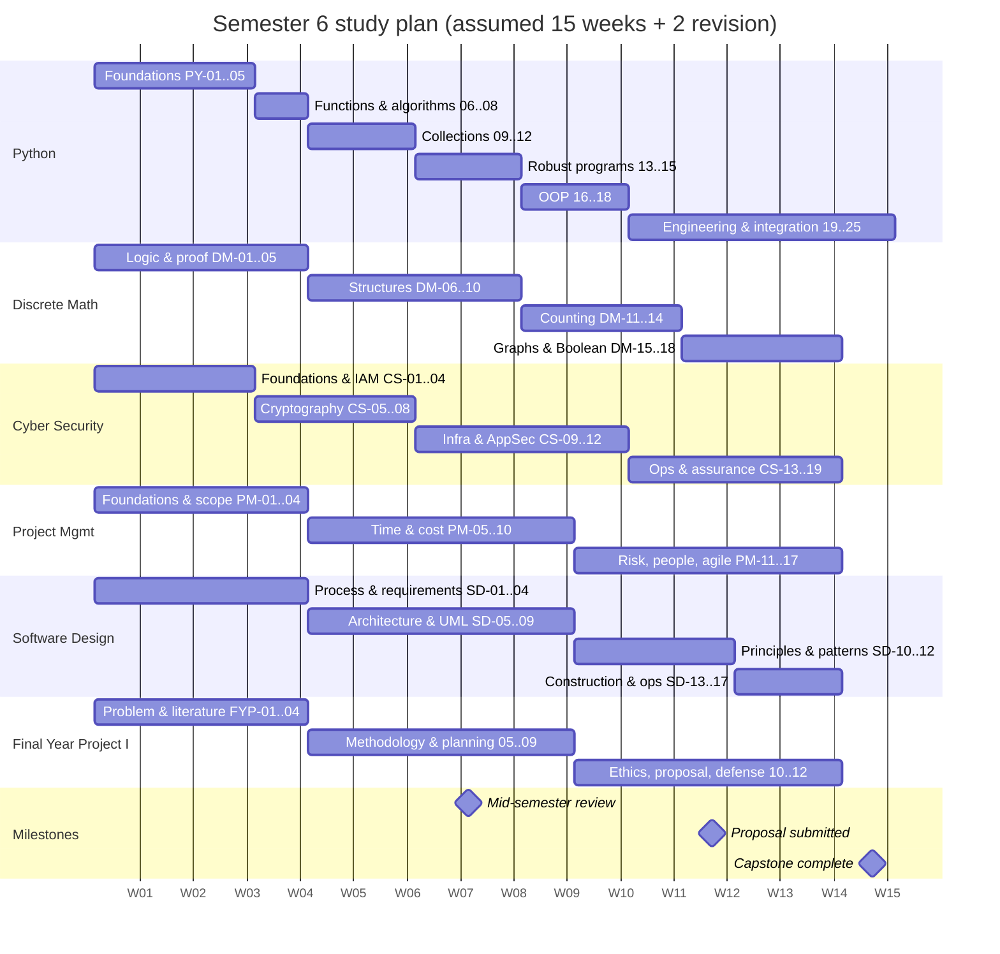

# Semester Roadmap (15 teaching weeks + revision)

> [!note] Assumptions
> Your official semester calendar was not supplied, so this roadmap assumes **15 teaching weeks followed by 2 revision/examination weeks**. Align Week 1 with your real first week and move rows if your lecturers teach in a different order. Lessons are ordered by **prerequisites**: within a module, never move a lesson ahead of one it depends on (see each module's curriculum map).

Throughout this roadmap, **"Lx"** means the lesson's Level-x practice set.

## Week-by-week plan

| Wk | Python CST06102 | Discrete Math GST06106 | Cyber Security ITT06102 | IS Project Mgmt ITT06105 | Software Design CST06101 | Final Year Project I CST06103 | Practical milestone |
|---|---|---|---|---|---|---|---|
| 1 | [[PY-01 How Python Executes Programs and Environment Setup\|PY-01]], [[PY-02 Variables, Types, Expressions and Operators\|PY-02]] | [[DM-01 Propositions, Connectives and Truth Tables\|DM-01]] | [[CS-01 Security Foundations - CIA, Threats, Vulnerabilities and Risk\|CS-01]] | [[PM-01 Project Fundamentals and Organizational Context\|PM-01]] | [[SD-01 Software Engineering Fundamentals\|SD-01]] | [[FYP-01 Identifying and Narrowing a Research Problem\|FYP-01]] | Install Python and run the validator |
| 2 | [[PY-03 Input, Output and String Formatting\|PY-03]], [[PY-04 Conditions and Branching\|PY-04]] | [[DM-02 Logical Equivalence and Laws of Logic\|DM-02]], [[DM-03 Predicates and Quantifiers\|DM-03]] | [[CS-02 Threat Modeling and Security Requirements\|CS-02]] | [[PM-02 Project Lifecycles, Process Groups and Methodologies\|PM-02]] | [[SD-02 Software Process Models\|SD-02]] | [[FYP-02 Problem Statements, Research Questions, Objectives and Scope\|FYP-02]] | Shortlist 3 project ideas ([[FYP-T01 Project Idea Evaluation]]) |
| 3 | [[PY-05 Loops and Iteration\|PY-05]], [[PY-06 Functions, Parameters, Return Values and Scope\|PY-06]] | [[DM-04 Rules of Inference\|DM-04]] | [[CS-03 Authentication and Identity\|CS-03]], [[CS-04 Authorization and Access Control\|CS-04]] | [[PM-03 Project Initiation, Business Case and Charter\|PM-03]] | [[SD-03 Requirements Engineering\|SD-03]] | [[FYP-03 Literature Searching and Critical Reading\|FYP-03]] | — |
| 4 | [[PY-07 Recursion\|PY-07]], [[PY-08 Algorithmic Thinking, Pseudocode, Flowcharts and Tracing\|PY-08]] | [[DM-05 Direct Proof, Contrapositive and Contradiction\|DM-05]] | [[CS-05 Cryptography Foundations and Symmetric Encryption\|CS-05]] | [[PM-04 Scope Management, Requirements Traceability and WBS\|PM-04]] | [[SD-04 Use Cases, User Stories and Traceability\|SD-04]] | [[FYP-04 Literature Review Synthesis, Research Gaps and Contribution\|FYP-04]] | [[PRJ-PY-01 Student Marks and Grading System]] |
| 5 | [[PY-09 Strings and String Processing\|PY-09]], [[PY-10 Lists and Tuples\|PY-10]] | [[DM-06 Sets, Set Operations, Power Sets and Cartesian Products\|DM-06]], [[DM-07 Functions\|DM-07]] | [[CS-06 Hashes, MACs and Integrity\|CS-06]] | [[PM-05 Activity Sequencing, Network Diagrams and Gantt Charts\|PM-05]] | [[SD-05 Software Architecture and Architectural Styles\|SD-05]] | [[FYP-05 Research Paradigms and Methodology\|FYP-05]] | [[LAB-CS-02 Hashing and Integrity Verification]] |
| 6 | [[PY-11 Dictionaries, Sets and Comprehensions\|PY-11]], [[PY-12 Searching, Sorting and Complexity\|PY-12]] | [[DM-08 Sequences and Summations\|DM-08]] | [[CS-07 Public-Key Cryptography, Signatures and Key Management\|CS-07]], [[CS-08 Password Storage and Authentication Security\|CS-08]] | [[PM-06 Critical Path Method and Float\|PM-06]] | [[SD-06 Modular Design, Cohesion and Coupling\|SD-06]] | [[FYP-06 Requirements Gathering, Stakeholder and Feasibility Analysis\|FYP-06]] | [[LAB-CS-01 Password Strength and Secure Password Storage]], [[LAB-CS-03 Toy Ciphers and Why They Fail]] |
| 7 | [[PY-13 Modules, Packages, Imports and Virtual Environments\|PY-13]], [[PY-14 Files, CSV and JSON\|PY-14]] | [[DM-09 Mathematical Induction\|DM-09]] | [[CS-09 Network Security and Secure Communication\|CS-09]] | [[PM-07 PERT and Schedule Estimation\|PM-07]], [[PM-08 Resource Allocation and Levelling\|PM-08]] | [[SD-07 UML Class Diagrams\|SD-07]] | [[FYP-07 Data Collection Instruments, Sampling and Evaluation Planning\|FYP-07]] | [[PRJ-PY-02 Personal Expense Tracker]] |
| 8 | [[PY-15 Exceptions and Defensive Programming\|PY-15]], [[PY-16 Classes and Objects\|PY-16]] | [[DM-10 Relations, Equivalence Relations and Partial Orders\|DM-10]] | [[CS-10 Operating System Security and Hardening\|CS-10]] | [[PM-09 Cost Estimation and Budgeting\|PM-09]] | [[SD-08 UML Sequence, Activity and State Diagrams\|SD-08]] | [[FYP-08 Technical Architecture and Design Planning\|FYP-08]] | [[LAB-CS-04 File Permission Audit]] · **mid-semester review week** |
| 9 | [[PY-17 Inheritance, Composition and Polymorphism\|PY-17]] | [[DM-11 Counting Principles, Permutations and Combinations\|DM-11]] | [[CS-11 Web Application Security\|CS-11]] | [[PM-10 Earned Value Management\|PM-10]] | [[SD-09 Data Modeling and Interface Design\|SD-09]] | [[FYP-09 Project Scheduling, Milestones and Risk Assessment\|FYP-09]] | [[LAB-CS-05 Security Headers and Configuration Analysis]], [[LAB-CS-06 Input Validation and SQL Injection Prevention]] |
| 10 | [[PY-18 Iterators, Generators, Decorators and Context Managers\|PY-18]], [[PY-19 Type Hints, Documentation, Clean Code and Refactoring\|PY-19]] | [[DM-12 Pigeonhole Principle and Inclusion-Exclusion\|DM-12]], [[DM-13 Binomial Theorem and Pascal's Triangle\|DM-13]] | [[CS-12 Secure Software Development and Database Security\|CS-12]] | [[PM-11 Risk Management\|PM-11]] | [[SD-10 SOLID Principles\|SD-10]] | [[FYP-10 Research Ethics, Privacy, Academic Integrity and Citation\|FYP-10]] | [[PRJ-PY-03 Library Management System]] |
| 11 | [[PY-20 Testing, Debugging and Test-Driven Development\|PY-20]] | [[DM-14 Recurrence Relations\|DM-14]] | [[CS-13 Social Engineering and Security Awareness\|CS-13]], [[CS-14 Malware and Defensive Detection\|CS-14]] | [[PM-12 Stakeholder and Communication Management\|PM-12]], [[PM-13 Quality Management\|PM-13]] | [[SD-11 Creational and Structural Design Patterns\|SD-11]] | [[FYP-11 Writing the Research Proposal\|FYP-11]] (draft) | [[LAB-CS-07 Threat Modeling a Sample Web Application]] |
| 12 | [[PY-21 Data Structures and Algorithm Design\|PY-21]], [[PY-22 SQL and Database Integration\|PY-22]] | [[DM-15 Graphs, Representations, Paths and Connectivity\|DM-15]] | [[CS-15 Logging, Monitoring, Incident Response and Recovery\|CS-15]] | [[PM-14 Procurement and Change Management\|PM-14]], [[PM-15 Team Leadership and Conflict Management\|PM-15]] | [[SD-12 Behavioral Design Patterns\|SD-12]], [[SD-13 Implementation, Code Organization and Version Control\|SD-13]] | FYP-11 (final proposal) | [[LAB-CS-08 Log Analysis and Incident Response]], [[PRJ-PY-04 Weather API Client]] |
| 13 | [[PY-23 HTTP APIs and External Services\|PY-23]], [[PY-24 Secure Programming and Input Validation\|PY-24]] | [[DM-16 Trees and Spanning Trees\|DM-16]] | [[CS-16 Risk Analysis, Policy, Governance and Compliance\|CS-16]], [[CS-17 Digital Forensics Fundamentals\|CS-17]] | [[PM-16 Agile, Scrum and Hybrid Delivery\|PM-16]] | [[SD-14 Software Testing, Verification and Validation\|SD-14]], [[SD-15 Refactoring, Technical Debt, Code Review and Quality\|SD-15]] | [[FYP-12 Presentation, Defense and Working with Supervisor Feedback\|FYP-12]] | Start [[PRJ-PY-05 Hostel Maintenance System]] |
| 14 | [[PY-25 Performance, Packaging and Project Organization\|PY-25]] | [[DM-17 Boolean Algebra and Logic Circuits\|DM-17]], [[DM-18 Introductory Discrete Probability\|DM-18]] | [[CS-18 Security Testing and Vulnerability Management\|CS-18]], [[CS-19 Cloud Security and Privacy\|CS-19]] | [[PM-17 Monitoring, Control, Closure and Lessons Learned\|PM-17]] | [[SD-16 Deployment, Maintenance and Documentation\|SD-16]], [[SD-17 Secure and Reliable Software Design\|SD-17]] | [[MOCK-FYP-01 Mock Proposal Defense]] | [[X-CAPSTONE Hostel Maintenance System Full Lifecycle]] |
| 15 | Integrated cases: [[X-CASE-01 Secure Exam Results Portal]], [[X-CASE-02 SME Inventory Rollout]] | | | | | | Finish capstone |
| 16–17 | **Revision:** one mock exam per module ([[Question Bank Index]]), [[Weak Area Tracker]] and [[Review Schedule]] reviews | | | | | | |

## The same plan as a Gantt chart

*The dates in the Gantt chart are placeholders that only make the chart render. Week 1 is drawn as 2026-01-05. Ignore the dates and read the bars as week positions.*

## Why this order?

- **Python first in every week:** practice builds automaticity, and Software Design (SD-07 onwards), Cyber Security labs and the capstone all depend on Python skills.
- **Logic before proof, proof before induction:** see [[DM 01 Curriculum Map]].
- **Hashes (CS-06) before password storage (CS-08):** you cannot understand salting and work factors without hash properties.
- **WBS (PM-04) before CPM (PM-06):** activities come from work packages.
- **FYP-09 after PM-06:** you schedule your own project with the CPM you just learned ([[X-07 Scheduling Your Own Semester with CPM]]).
