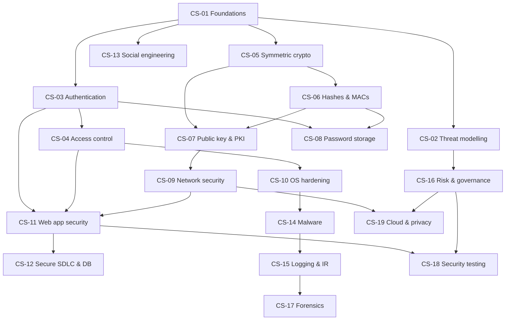

# Cyber Security: Curriculum Map

Back to [[CS 00 Dashboard]]

## 1. Units
| Unit | Topics | Practical |
|---|---|---|
| U1 Foundations | CS-01 CIA, threats, risk · CS-02 threat modelling | LAB-CS-07 |
| U2 Identity and access | CS-03 authentication · CS-04 authorisation | (part of LAB-CS-01) |
| U3 Cryptography | CS-05 symmetric · CS-06 hashes and MACs · CS-07 public key and PKI · CS-08 passwords | LAB-CS-01, 02, 03 |
| U4 Infrastructure | CS-09 network · CS-10 OS hardening | LAB-CS-04 |
| U5 Application security | CS-11 web · CS-12 secure SDLC and databases | LAB-CS-05, 06 |
| U6 Human and threat landscape | CS-13 social engineering · CS-14 malware | |
| U7 Operations | CS-15 logging and IR · CS-16 risk and governance · CS-17 forensics | LAB-CS-08 |
| U8 Assurance | CS-18 security testing · CS-19 cloud and privacy | |

## 2. Prerequisite graph

*Text version: foundations (01) feed threat modelling, authentication, crypto and social engineering. Crypto flows from symmetric ciphers (05) to hashes (06) to public key (07), and passwords (08) need hashes plus authentication. Network security (09) needs public-key crypto (TLS). Web security (11) builds on authentication, access control and networks, and leads to the secure SDLC (12) and testing (18). Operations: malware (14), then logging/IR (15), then forensics (17). Risk (16) underpins testing and cloud (19).*

## 3. Review alerts
| Before… | Review | Why |
|---|---|---|
| CS-05 | [[DM-07 Functions]] | Encryption must be a bijection for each key |
| CS-06 | [[DM-12 Pigeonhole Principle and Inclusion-Exclusion]], [[DM-18 Introductory Discrete Probability]] | Collisions exist, and birthday bounds |
| CS-07 | [[DM-05 Direct Proof, Contrapositive and Contradiction]], [[DM-10 Relations, Equivalence Relations and Partial Orders]] | Primes and modular arithmetic |
| CS-08 | [[DM-11 Counting Principles, Permutations and Combinations]] | Password keyspaces |
| CS-11/12 | [[PY-22 SQL and Database Integration]], [[PY-24 Secure Programming and Input Validation]] | Injection prevention in code |
| CS-15 | [[DM-18 Introductory Discrete Probability]] | Base rates and alert fatigue |
| CS-16 | [[PM-11 Risk Management]] | The same risk vocabulary, in the project context |

## 4. Cross-module links
[[X-03 Security Requirements in Software Architecture]] · [[X-05 Security Risk in Project Management]] · [[SD-17 Secure and Reliable Software Design]] · [[X-CASE-01 Secure Exam Results Portal]]
