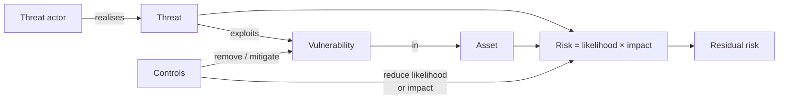

# CS-01 Security Foundations: CIA, Threats, Vulnerabilities and Risk

> [!info] Topic card
> **Unit:** U1 · **Time:** 3 h · This vocabulary is used in every later lesson and in [[PM-11 Risk Management]].

## 1. Learning objectives
1. **Define** confidentiality, integrity and availability, plus authenticity, accountability and non-repudiation, and **classify** incidents by which properties they violate.
2. **Distinguish** asset, threat, threat actor, vulnerability, exploit, risk, impact and control, and **use** them correctly in a scenario.
3. **Estimate** risk qualitatively as likelihood × impact, and **identify** the attack surface of a system.
4. **Classify** controls by type (preventive, detective, corrective, deterrent) and by nature (technical, administrative, physical).
5. **Apply** the core design principles: defence in depth, least privilege, fail-safe defaults, separation of duties, economy of mechanism, open design.

## 2. Why it matters
Security discussions fail when people use words loosely ("we had a vulnerability attack risk"). Precise terms let you reason about **what** to protect, **from whom**, and **which control** actually reduces **which risk**. Examiners test this vocabulary heavily, and the risk register in your project ([[FYP-09 Project Scheduling, Milestones and Risk Assessment]]) uses it.

## 3. Prerequisites
None. Basic familiarity with computers and networks is assumed.

## 4. Intuition
Think of a **house**. Your laptop and passport are the **assets**. A burglar is a **threat actor**, and "burglary" is the **threat**. A window that doesn't lock is a **vulnerability**, and climbing through it is the **exploit**. The **risk** is how likely a burglary is, combined with how bad it would be. A lock, an alarm and insurance are **controls**: they prevent, detect, and recover.

## 5. Rigorous explanation

### 5.1 Security properties
| Property | Meaning | Violation example | Typical controls |
|---|---|---|---|
| **Confidentiality** | Only authorised parties can read the information | Exam marks leaked before release | Encryption, access control |
| **Integrity** | Information and systems aren't altered without authorisation, and changes are detectable | A student edits their own marks | Hashes/MACs, signatures, access control, audit logs |
| **Availability** | Authorised users can access systems when needed | The registration portal crashes on the deadline day (DoS, outage) | Redundancy, backups, DDoS protection, capacity planning |
| Authenticity | The data or the party really is who or what it claims to be | A fake "registrar" email | Authentication, signatures |
| Accountability | Actions can be traced to an entity | Nobody knows who deleted the records | Unique accounts, logging |
| Non-repudiation | A party can't plausibly deny an action | "I never approved that payment" | Digital signatures plus logs |

Together, CIA is the **CIA triad**. Note that "integrity" in security covers **both** prevention and *detection* of unauthorised change.

### 5.2 Core terms
| Term | Definition (after ISO/IEC 27000 and NIST usage) | Example (university portal) |
|---|---|---|
| **Asset** | Anything of value to the organisation | The student records database |
| **Threat** | A potential cause of an unwanted incident | Unauthorised modification of marks |
| **Threat actor (agent)** | The entity that realises the threat | An insider, a student, criminals, a nation state |
| **Vulnerability** | A weakness that a threat can exploit | SQL injection in the marks search page |
| **Exploit** | The technique or code that uses a vulnerability | A crafted input `' OR '1'='1` |
| **Attack** | An attempt to realise a threat | A student running the exploit |
| **Impact** | The consequence if the threat is realised | Wrong transcripts, reputational damage, legal liability |
| **Likelihood** | The probability or frequency of occurrence | "Possible: the page is public" |
| **Risk** | The combination of likelihood and impact | High |
| **Control (countermeasure, safeguard)** | A measure that modifies risk | Parameterised queries, a WAF, audit logs |
| **Residual risk** | The risk remaining after controls | Low |
**A vulnerability with no threat** (an unpatched server with no network access and no users) is low risk. **A threat with no vulnerability** is also low risk. Risk needs both, plus a valuable asset.

### 5.3 Qualitative risk
$\text{Risk} = \text{Likelihood} \times \text{Impact}$, often on 1–5 scales.
| Likelihood \\ Impact | 1 Negligible | 2 Minor | 3 Moderate | 4 Major | 5 Severe |
|---|---|---|---|---|---|
| 5 Almost certain | 5 | 10 | 15 | 20 | 25 |
| 4 Likely | 4 | 8 | 12 | 16 | 20 |
| 3 Possible | 3 | 6 | 9 | 12 | 15 |
| 2 Unlikely | 2 | 4 | 6 | 8 | 10 |
| 1 Rare | 1 | 2 | 3 | 4 | 5 |
Example bands: 1–4 low, 5–9 medium, 10–16 high, 20–25 critical. *Bands differ between organisations. Use your organisation's scale.* Quantitative methods (ALE = SLE × ARO) are in [[CS-16 Risk Analysis, Policy, Governance and Compliance]].

### 5.4 Attack surface
The **attack surface** is the set of all points where an attacker can try to enter or extract data: network ports, web forms, APIs, file uploads, admin interfaces, physical ports, employees (via social engineering), and third-party dependencies. **Reducing the attack surface** (disabling unused services, removing old endpoints) is one of the cheapest controls.

### 5.5 Controls
| By function | Purpose | Example |
|---|---|---|
| Preventive | Stop the incident | MFA, firewall rules, input validation |
| Detective | Notice it | IDS, log monitoring, file-integrity monitoring |
| Corrective | Limit and repair the damage | Restore from backup, patch |
| Deterrent | Discourage attempts | Warning banners, the visible prospect of prosecution |
| Compensating | An alternative when the ideal control isn't feasible | Extra monitoring for a legacy system that can't be patched |

| By nature | Example |
|---|---|
| Technical (logical) | Encryption, access-control lists |
| Administrative (managerial) | Policies, training, background checks |
| Physical | Locks, CCTV, server-room access cards |

### 5.6 Security design principles (Saltzer & Schroeder, 1975, and later practice)
| Principle | Meaning | Example |
|---|---|---|
| Least privilege | Grant only the access needed | A marks-entry clerk can't delete courses |
| Defence in depth | Several independent layers | Firewall + validation + parameterised SQL + monitoring |
| Fail-safe defaults | Deny unless explicitly allowed | A new user has no roles until assigned |
| Complete mediation | Check every access, not just the first | Re-check authorisation on each API call |
| Separation of duties | No single person can complete a sensitive task alone | The person who enters marks isn't the person who approves them |
| Economy of mechanism | Keep it simple | Simple code is easier to review |
| Open design | Security shouldn't depend on secrecy of the design | Use published algorithms (Kerckhoffs's principle, [[CS-05 Cryptography Foundations and Symmetric Encryption]]) |
| Psychological acceptability | Security must be usable, or people will bypass it | Password managers, SSO |

## 6. Terminology
See §5.2, plus: **zero-day** (a vulnerability unknown to the vendor, with no patch), **CVE** (Common Vulnerabilities and Exposures, a public identifier for a vulnerability), **threat landscape** (the current set of relevant threats), **security posture** (the overall security status).

## 7. Step-by-step: analysing a scenario
*Scenario:* the hostel maintenance web app ([[X-CAPSTONE Hostel Maintenance System Full Lifecycle]]) lets students report faults. The admin page `/admin` has no login, but "nobody knows the URL".
1. **Assets:** request data (room numbers, student names and phone numbers, i.e. personal data), the system's availability.
2. **Threat actors:** curious or malicious students, outsiders who find the URL through search engines or browser history.
3. **Vulnerability:** missing authentication on `/admin`. Reliance on obscurity violates *open design* and *complete mediation*.
4. **Threats:** disclosure of personal data (C), altering or deleting requests (I), mass deletion (A).
5. **Risk:** likelihood 4 (URLs leak easily) × impact 4 (privacy breach, service disruption) = 16, **high**.
6. **Controls:** authentication + role-based authorisation (preventive, technical), audit logging of admin actions (detective), backups (corrective), and a privacy policy and staff training (administrative).

## 8. Diagram: how the concepts connect

*Text version: a threat actor realises a threat by exploiting a vulnerability in an asset. Risk combines the likelihood and the impact. Controls mitigate vulnerabilities and reduce likelihood or impact, leaving residual risk, which management accepts or treats further.*

## 9. Worked examples

### Example 1 (basic): CIA classification
| Incident | C | I | A |
|---|---|---|---|
| Ransomware encrypts the registry server | (often also data theft: C) | I | **A** |
| Lecturer's laptop with exam papers stolen (unencrypted) | **C** | | (A if there's no backup) |
| Attacker changes the bank account number on a supplier invoice | | **I** | |
| DDoS on the e-learning site during exams | | | **A** |
| Website defaced | | **I** | (A) |

### Example 2 (intermediate): correct use of terms
Wrong: "The vulnerability attacked our server." Right: "**An attacker** (threat actor) **exploited** an **unpatched vulnerability** (CVE-xxxx) in our web server to **gain access** (attack), which **violated the confidentiality** of student records (impact)."
Wrong: "We eliminated all risk by installing antivirus." Right: "Antivirus is one **detective/preventive control** that **reduces** the likelihood of malware incidents. **Residual risk** remains from phishing, unknown malware and insiders."

### Example 3 (challenging): prioritising with a risk matrix
| Risk | L | I | Score | Rank |
|---|---|---|---|---|
| R1 Phishing leads to staff account takeover | 4 | 4 | 16 | 1 |
| R2 Server room flood | 1 | 5 | 5 | 4 |
| R3 SQL injection in the public marks search | 3 | 5 | 15 | 2 |
| R4 Laptop theft (encrypted disks) | 3 | 2 | 6 | 3 |
**Decision:** treat R1 (MFA, training) and R3 (fix the code, parameterised queries) first. R4's impact is already reduced by encryption, and R2 is rare but severe, so consider insurance and off-site backups (risk *transfer* and *mitigation*). Note that two scores of 16 and 15 aren't meaningfully different. Qualitative scores guide judgement rather than replacing it.

## 10. Application: case study (generic, fictional)
A small college keeps all its student records on one server, with a single administrator account shared by three staff, and no backups. **Analysis:** shared accounts destroy *accountability*. A single server and no backups threaten *availability*. One compromised password gives total access, so there's no *least privilege* or *defence in depth*. **Recommendations,** in priority order: individual accounts with MFA, offline backups tested by restoration, role-based access, audit logging, and a second server or cloud replica for critical services.

## 11. Common mistakes
| Mistake | Correct |
|---|---|
| "Threat" and "vulnerability" used interchangeably | A threat is a potential harm. A vulnerability is the weakness it exploits. |
| Security = confidentiality only | Integrity and availability matter as much (often more for operations) |
| Security through obscurity as the main control | Obscurity may add a little depth, but never rely on it |
| "Risk eliminated" | Risk is reduced. Residual risk is accepted consciously. |
| Controls chosen without linking them to risks | Every control should map to the risk it reduces |
| Forgetting people and processes | Many incidents start with humans ([[CS-13 Social Engineering and Security Awareness]]) |

## 12. Comparison
| Pair | Difference |
|---|---|
| Vulnerability vs exploit | Weakness vs the method that uses it |
| Threat vs risk | Potential harm vs harm weighted by likelihood and impact |
| Preventive vs detective | Stops it vs notices it |
| Authentication vs authorisation | Who are you? vs What may you do? ([[CS-03 Authentication and Identity]], [[CS-04 Authorization and Access Control]]) |
| Privacy vs confidentiality | Rights over personal data vs keeping any data secret ([[CS-19 Cloud Security and Privacy]]) |

## 13. Practice
**L1** 1. Define the CIA triad with one example each. 2. Define vulnerability, threat and risk.

**L2** 3. Classify each control by function and nature: (a) CCTV in the server room (b) an acceptable-use policy (c) nightly backups (d) a login warning banner (e) an IDS. 4. For a mobile-money app, list five assets and two threat actors per asset.

**L3** 5. Analyse the scenario using the §7 steps: "Lecturers email exam drafts as attachments to a shared Gmail account whose password is written on the staff-room whiteboard." 6. Score three risks of your choice for your Final Year Project, and rank them.

**L4** 7. A manager says: "Our system is on an internal network, so we don't need encryption or authentication between services." Evaluate this, using at least two design principles and one realistic threat actor. 8. Map each Saltzer–Schroeder principle in §5.6 to one concrete feature of the hostel system.

**L5** 9. Write a one-page **security brief** for the registrar introducing an online results portal: the assets, the top 5 risks (with scores), the recommended controls by type, the residual risks, and what you need the registrar to *decide* (risk acceptance).

## 14. Hints
> [!tip]- Hints
> 3: ask "does it stop, notice, repair or discourage?" 5: the whiteboard password affects authentication and accountability, and the shared account breaks both. 7: think of insiders and of lateral movement after a phishing compromise ("zero trust"). 9: structure it as assets → risks → controls → residual risk → decision.

## 15. Worked solutions
> [!success]- Solutions 1–2
> 1. C: only authorised people see the marks. I: the marks can't be altered without authorisation, and alterations are detectable. A: the portal is reachable on results day. 2. See §5.2.

> [!success]- Solution 3
> (a) Detective (and deterrent), physical. (b) Preventive/deterrent, administrative. (c) Corrective, technical. (d) Deterrent, technical/administrative. (e) Detective, technical.

> [!success]- Solution 4 (sample)
> Assets: customer balances (actors: fraudsters, insiders), PINs and credentials (phishers, malware authors), the transaction ledger (insiders, criminal groups), personal data (identity thieves, data brokers), service availability (DDoS extortionists, outages from natural causes).

> [!success]- Solution 5
> **Assets:** the exam drafts (confidentiality before the exam, integrity). **Threat actors:** students who see the whiteboard, cleaners and visitors, anyone with the leaked password. **Vulnerabilities:** a shared credential, written in plain view, with no MFA, and email used as a document store. **Threats:** exam leakage (C), tampering with drafts (I), account lockout or deletion (A). **Risk:** likelihood 5 (visible to everyone in the room) × impact 5 (exam compromise, re-setting costs, reputation) = 25, **critical**. **Controls:** individual accounts with MFA (preventive), an access-controlled document repository with audit logs (preventive/detective), encrypted storage, removing the password and rotating it immediately (corrective), and staff training (administrative).

> [!success]- Solution 7
> The claim relies on **perimeter trust**. It violates **defence in depth** (one breach of the perimeter exposes everything) and **complete mediation** (services don't check who calls them). **Threat actors:** a malicious insider, or an external attacker who phished one employee and now moves laterally inside the network. Without authentication between services, they can call internal APIs freely. Without encryption, they can sniff credentials and data on the internal network. **Recommendation:** mutual TLS or service tokens, least-privilege service accounts, and network segmentation ("zero trust", [[CS-09 Network Security and Secure Communication]]). The cost is modest compared with the impact of a breach.

> [!success]- Solution 9 (outline)
> **Assets:** results data, student personal data, portal availability, institutional reputation. **Top risks:** (1) account takeover of results staff via phishing, 4×5 = 20. (2) An injection or broken-access-control flaw letting students alter or see others' results, 3×5 = 15. (3) DoS or overload on release day, 4×3 = 12. (4) Data leakage through misconfigured cloud storage, 2×5 = 10. (5) An insider altering results, 2×5 = 10. **Controls:** MFA and least privilege for staff (preventive), a secure SDLC with testing and code review (preventive), capacity testing and a CDN (preventive/corrective), audit logs and alerts for result changes (detective), maker–checker approval of changes (separation of duties), and backups with tested restore (corrective). **Residual risks:** sophisticated targeted phishing, unknown zero-days, and insider collusion. **Decision required:** accept these residual risks, or fund the extras (an external penetration test, 24/7 monitoring). Name the risk owner.

## 16. Self-test (pass ≥ 4/5)
1. Which CIA property does a DDoS attack violate? 2. Is antivirus preventive or detective? 3. Risk needs which two factors? 4. What is residual risk? 5. Name three design principles.
> [!success]- Answers
> 1. Availability. 2. Both: it blocks known malware and detects infections. 3. Likelihood and impact (with a threat, a vulnerability and a valuable asset). 4. The risk remaining after controls. 5. For example, least privilege, defence in depth and fail-safe defaults.

## 17. Flashcards
#flashcards/cyber-security
CIA triad?::Confidentiality, Integrity, Availability.
Vulnerability vs threat?::A vulnerability is a weakness; a threat is a potential cause of harm that may exploit it.
Risk formula (qualitative)?::Risk = Likelihood × Impact.
Residual risk?::Risk remaining after controls are applied.
Preventive vs detective vs corrective control?::Stops an incident / identifies it / restores after it.
Least privilege?::Grant only the minimum access needed to perform a task.
Defence in depth?::Multiple independent layers of controls so one failure doesn't cause compromise.
Non-repudiation?::Assurance that a party cannot deny having performed an action (e.g. via digital signatures).

## 18. Blank-page recall
Draw the §8 concept diagram and the 5×5 risk matrix, and list eight design principles with one example each.

## 19. Revision summary
- CIA (+ authenticity, accountability, non-repudiation).
- Asset, threat (actor), vulnerability, exploit, risk = L × I, control, residual risk.
- Attack surface: every entry point. Reduce it.
- Controls by function (prevent, detect, correct, deter, compensate) and by nature (technical, administrative, physical).
- Principles: least privilege, defence in depth, fail-safe defaults, complete mediation, separation of duties, economy of mechanism, open design, usability.

## 20. Links
Next: [[CS-02 Threat Modeling and Security Requirements]] · Related: [[CS-16 Risk Analysis, Policy, Governance and Compliance]], [[PM-11 Risk Management]], [[X-05 Security Risk in Project Management]], [[SD-17 Secure and Reliable Software Design]]

## 21. Sources
- ISO/IEC 27000:2018, *Information security management systems: Overview and vocabulary* (definitions of asset, threat, vulnerability, risk, control).
- NIST SP 800-30 Rev. 1, *Guide for Conducting Risk Assessments*, 2012: https://csrc.nist.gov/pubs/sp/800/30/r1/final
- Saltzer, J. H. & Schroeder, M. D., "The protection of information in computer systems", *Proceedings of the IEEE*, 63(9), 1975, pp. 1278–1308.
- Stallings, W. & Brown, L., *Computer Security: Principles and Practice*, 4th ed., Pearson, 2018, ch. 1.

## 22. Mastery checklist
- [ ] I use the core terms precisely in written scenario answers
- [ ] I can score and rank risks and justify the treatment
- [ ] Security brief (practice 9) written · reviews scheduled
