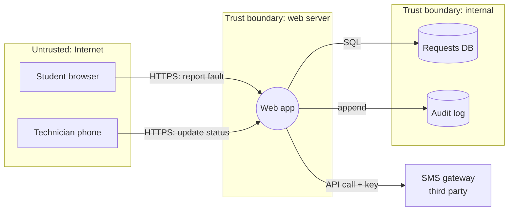
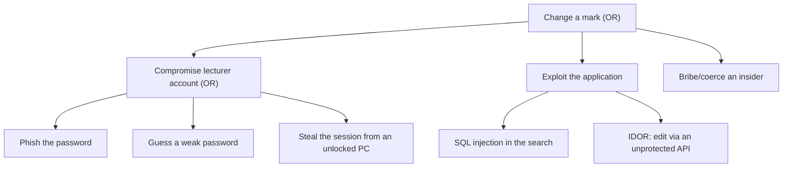

# CS-02 Threat Modeling and Security Requirements

> [!info] Topic card
> **Unit:** U1 · **Time:** 4 h · **Lab:** [[LAB-CS-07 Threat Modeling a Sample Web Application]] · **Used in:** [[SD-03 Requirements Engineering]], [[X-03 Security Requirements in Software Architecture]]

## 1. Learning objectives
1. **Explain** the purpose and timing of threat modelling (design time, then revisited when the design changes).
2. **Draw** a data-flow diagram (DFD) with processes, data stores, external entities, data flows and **trust boundaries**.
3. **Apply** STRIDE systematically to each DFD element, and **map** each category to the security property it violates.
4. **Build** simple attack trees and misuse cases.
5. **Derive** testable security requirements and controls from the identified threats, and **prioritise** them by risk.

## 2. Why it matters
Fixing a security design flaw after release can cost far more than fixing it at design time (studies report large multipliers, and the exact figures vary). Threat modelling finds the flaws while they're still cheap: missing authentication on an admin API, secrets passed in URLs, unvalidated uploads. It also produces the **security requirements** that a project specification needs ([[FYP-06 Requirements Gathering, Stakeholder and Feasibility Analysis]]).

## 3. Prerequisites
[[CS-01 Security Foundations - CIA, Threats, Vulnerabilities and Risk]] (assets, threats, risk, controls).

## 4. Intuition
Threat modelling is **structured pessimism**. You sit with a diagram of your system and ask, at every arrow and box, "what could go wrong here?" STRIDE is a checklist that stops you forgetting whole categories of attack.

## 5. Rigorous explanation

### 5.1 The four questions (Shostack)
1. **What are we working on?** Model the system (a DFD).
2. **What can go wrong?** Identify threats (STRIDE, attack trees).
3. **What are we going to do about it?** Mitigate, eliminate, transfer or accept.
4. **Did we do a good job?** Validate: are the diagram and threats complete, and are the mitigations implemented and tested?

### 5.2 DFD elements
| Element | Symbol (convention) | Example |
|---|---|---|
| External entity | rectangle | Student, technician, SMS gateway |
| Process | circle / rounded box | Web app, request API |
| Data store | two parallel lines / cylinder | Requests database, log files |
| Data flow | arrow | HTTPS request, SQL query |
| **Trust boundary** | dashed line | Internet ↔ server, app ↔ database, user ↔ admin |
Threats concentrate where data **crosses a trust boundary**.

### 5.3 STRIDE
| Threat | Violates | Question to ask | Typical mitigations |
|---|---|---|---|
| **S**poofing | Authenticity | Can someone pretend to be another user or system? | Strong authentication, MFA, mutual TLS |
| **T**ampering | Integrity | Can data be modified in transit or at rest? | TLS, MACs/signatures, input validation, access control |
| **R**epudiation | Non-repudiation | Can someone deny an action? | Audit logs (protected), signatures |
| **I**nformation disclosure | Confidentiality | Can data leak (errors, logs, URLs, storage)? | Encryption, access control, minimal error messages |
| **D**enial of service | Availability | Can someone exhaust resources? | Rate limiting, quotas, redundancy |
| **E**levation of privilege | Authorisation | Can a user gain rights they shouldn't have? | Authorisation checks on every request, least privilege |
**STRIDE-per-element:** external entities → S, R. Processes → all six. Data stores → T, R, I, D. Data flows → T, I, D.

### 5.4 Attack trees
The root is the attacker's **goal**. The children are ways to achieve it (**OR** nodes), or steps that must all succeed (**AND** nodes). Leaves are concrete attacks, and you can annotate them with cost or likelihood. Attack trees show which **single control** cuts off the most branches.

### 5.5 Misuse (abuse) cases
These are the counterpart of use cases ([[SD-04 Use Cases, User Stories and Traceability]]): "As a malicious student, I want to change another student's request status so that…". Each one leads to a requirement and a test.

### 5.6 From threats to requirements
A good security requirement is **specific, testable and traceable** to a threat:
- Weak: "The system must be secure."
- Strong: "**SR-03** All endpoints under `/admin` shall require an authenticated session with role `warden` or `admin`. A request without one returns HTTP 403 and is logged with the user ID, timestamp and source IP. *(Mitigates T-07 Elevation of privilege. Verified by test `test_admin_requires_role`.)*"
Sources of standard requirements: the **OWASP ASVS** (Application Security Verification Standard), the NIST SP 800-53 control catalogue, and regulations ([[CS-16 Risk Analysis, Policy, Governance and Compliance]]).

## 6. Terminology
| Term | Meaning |
|---|---|
| Threat model | Structured representation of a system's threats and mitigations |
| DFD | Data-flow diagram |
| Trust boundary | Where the level of trust changes |
| STRIDE | Spoofing, Tampering, Repudiation, Information disclosure, DoS, Elevation of privilege |
| Attack tree | Goal-decomposition tree of attacks |
| Misuse case | Use case describing hostile behaviour |
| Mitigation | A control reducing a threat's risk |
| ASVS | OWASP's catalogue of verifiable application-security requirements |

## 7. Step-by-step: threat-modelling a login flow
1. **Model:** Browser → (HTTPS) → Web app → (SQL) → Users DB. Trust boundaries: Internet|server and app|database.
2. **STRIDE on the data flow Browser→Web app:** T (modify the request) and I (sniff the password) are mitigated by TLS, and D (credential stuffing at volume) by rate limiting.
3. **STRIDE on the process "Web app login":** S (password guessing or stuffing) is mitigated by MFA and lockout/throttling. E (logic flaws in the login) by tests and code review. R (denying a login) by logging authentication events.
4. **STRIDE on the "Users DB" store:** I (database dump exposes passwords) is mitigated by a salted slow KDF ([[CS-08 Password Storage and Authentication Security]]). T (direct DB modification) by a least-privilege DB account.
5. **Requirements:** SR-01 TLS only (HSTS). SR-02 password hashing with a slow, salted KDF. SR-03 throttling after 5 failed attempts per account per 15 minutes. SR-04 an auth event log. SR-05 MFA for staff.
6. **Validate:** each SR gets a test case or review item.

## 8. Diagram: DFD of the hostel maintenance system with trust boundaries

*Text version: students and technicians connect over HTTPS from the untrusted internet to the web app. The web app reads and writes the requests database and appends to an audit log inside the internal zone, and calls a third-party SMS gateway with an API key. Each arrow crossing a zone is a place to apply STRIDE.*

## 9. Worked examples

### Example 1 (basic): STRIDE classification
| Scenario | STRIDE |
|---|---|
| A student changes `request_id=17` to `18` in the URL and sees someone else's request | **I** (and E: a broken access-control check) |
| An attacker floods the report form with 100 000 fake requests | **D** |
| A technician claims "I never closed that job" | **R** |
| A phishing site captures a warden's password and logs in | **S** |
| An SMS API key in the JavaScript lets anyone send SMS on the college's account | **I**, leading to S and financial D |
| A student's form submission edits the `status` field to "resolved" | **T** / **E** |

### Example 2 (intermediate): an attack tree
Goal: **change a mark in the results system**.

**Analysis:** MFA cuts A1 and A2. Parameterised queries cut B1. Server-side authorisation cuts B2. Screen locking and short sessions cut A3. **Maker–checker approval** (separation of duties) plus audit logs reduces *every* branch, including C, because no single compromised account can change a mark alone. That's the highest-value control.

### Example 3 (challenging): from misuse case to requirement and test
Misuse case **MC-04**: "A student uploads a 2 GB file, or an HTML file containing script, as a 'fault photo'."
Threats: D (storage exhaustion), and I/T through stored XSS if the file is later served inline.
Requirements: **SR-11** uploads ≤ 5 MB; **SR-12** only JPEG/PNG, verified by *content* (magic bytes), not by extension; **SR-13** files are stored outside the web root, served with `Content-Disposition: attachment` and `X-Content-Type-Options: nosniff`, and renamed to random identifiers.
Tests: upload 6 MB → 413 rejected. Upload `evil.html` renamed to `.jpg` → rejected by the content check. Upload a valid image → stored with a random name.

## 10. Application
Do [[LAB-CS-07 Threat Modeling a Sample Web Application]], then threat-model **your own Final Year Project**. The resulting security requirements go into your specification ([[FYP-T08 Requirements Specification]]), and the high-risk items into your project risk register ([[FYP-T11 Risk Register]]).

## 11. Common mistakes
| Mistake | Fix |
|---|---|
| Threat modelling once, at the end | Do it at design time and update it with design changes |
| Missing trust boundaries in the DFD | Mark every change of trust (internet, DB, admin, third party) |
| "Use HTTPS" as the answer to everything | TLS protects data in transit only, not authorisation, logic or storage |
| Untestable requirements ("must be secure") | Specific, measurable, linked to a threat and a test |
| Ignoring insiders and third parties | Include them as external entities and threat actors |
| Listing threats without prioritising them | Rate the risk and treat the highest first |

## 12. Comparison
| Technique | Strength | Best for |
|---|---|---|
| STRIDE per element | Systematic coverage | Software designs |
| Attack trees | Attacker-goal focus, shows which control matters most | High-value assets |
| Misuse cases | Fits requirements engineering | Specifications and tests |
| PASTA, LINDDUN | Risk-centric / privacy-centric methodologies | Larger programmes / privacy (LINDDUN) |

## 13. Practice
**L1** 1. Expand STRIDE and give the violated property for each letter. 2. What's a trust boundary?

**L2** 3. Classify by STRIDE: (a) replaying a captured "approve payment" request (b) verbose error pages showing SQL queries (c) deleting the audit log after an attack. 4. List the DFD elements of a mobile banking app's "transfer money" feature.

**L3** 5. Apply STRIDE-per-element to the hostel DFD (§8): at least 8 threats, each with a mitigation. 6. Write 5 testable security requirements derived from your threats.

**L4** 7. Build an attack tree for "obtain a copy of the exam paper before the exam", and identify the single control that cuts the most branches. 8. A team says "we use cloud hosting, so the provider handles security". Use the shared responsibility model ([[CS-19 Cloud Security and Privacy]]) to identify the threats they still own.

**L5** 9. Produce a complete threat model (DFD, STRIDE table, risk ratings, requirements, test ideas) for the LabBook computer-lab booking system ([[SD-CASE LabBook Running Case Study]]). Then critique your own model: what did STRIDE make you think of that you would have missed?

## 14. Hints
> [!tip]- Hints
> 3(a): replay is a form of spoofing or tampering, mitigated by nonces and timestamps. 5: walk each arrow and each box. 7: physical theft, printing, email, the cloud drive, insiders, an unattended printer. 8: identity and access, data classification, application code, configuration.

## 15. Worked solutions
> [!success]- Solutions 1–2
> 1. Spoofing (authenticity), Tampering (integrity), Repudiation (non-repudiation), Information disclosure (confidentiality), DoS (availability), Elevation of privilege (authorisation). 2. A boundary in the system where data or control passes between parts trusted to different degrees, such as the internet and the server.

> [!success]- Solution 3
> (a) **S/T** (replay): the attacker reuses an authenticated message to impersonate the user. Mitigate with nonces or one-time tokens, timestamps, and CSRF protection. (b) **I**: mitigate with generic error pages and server-side logging. (c) **R** (and T): mitigate with append-only or remote log storage and log integrity protection.

> [!success]- Solution 5 (selected)
> | Element | STRIDE | Threat | Mitigation |
> |---|---|---|---|
> | Student browser (entity) | S | Impersonating another student | Authentication via the student portal (SSO) |
> | Student → Web (flow) | T, I | MITM on public Wi-Fi | TLS + HSTS |
> | Web app (process) | E | A student calls the technician "update status" endpoint | Role check on every request |
> | Web app | D | Spamming fault reports | Rate limit per user, CAPTCHA after N reports |
> | Web app | I | A stack trace shows the DB credentials | Generic errors, secrets in env/vault |
> | Requests DB (store) | I | DB backup on an open share | Encrypted backups, ACLs |
> | Audit log | T/R | An admin deletes their own traces | Append-only remote log |
> | Web → SMS (flow) | I | API key leaked in the repo or client | Server-side only, a secret store, key rotation |
> | SMS gateway (entity) | S | A fake gateway callback | Signed webhooks |

> [!success]- Solution 7
> Root (OR): obtain the paper. Branches: (1) access the digital file: compromise the lecturer's email/cloud account, a shared drive with weak permissions, or an unencrypted USB stick. (2) The print stage: copies at an unattended departmental printer, or a bribed print-room staff member. (3) Physical: an unlocked office or an exam store with weak locks. (4) Insider: collusion. **The single most effective control** is a controlled workflow: papers kept in one encrypted, access-logged repository with MFA, printed only through a secure-release printer (or by a designated custodian), and stored sealed. This touches branches 1 and 2 and supports detection for 4. Physical controls are still needed for branch 3.

> [!success]- Solution 8
> Under the shared responsibility model the provider secures the **cloud infrastructure** (data centres, hypervisors, physical network). The customer remains responsible for **identity and access** (IAM roles, MFA), **data** (classification, encryption choices, public bucket settings), **application code** (injection, authorisation), **configuration** (security groups, open ports, logging), and, depending on the service model, OS patching. Most cloud breaches come from customer misconfiguration (for example publicly readable storage), not from provider failures.

> [!success]- Solution 9
> This is an open-ended deliverable. Use [[LAB-CS-07 Threat Modeling a Sample Web Application]] as the template, and assess it with the lab rubric. A good critique notes threats such as repudiation of bookings (needing an audit log), booking-overlap tampering through concurrent requests (needing a database constraint or transaction), and DoS through block-booking every lab (needing quotas). These are easy to miss without a systematic checklist.

## 16. Self-test (pass ≥ 4/5)
1. Shostack's four questions? 2. Which STRIDE categories apply to a data store? 3. What mitigates repudiation? 4. What makes a security requirement good? 5. What does an attack tree's root represent?
> [!success]- Answers
> 1. What are we working on? What can go wrong? What are we going to do about it? Did we do a good job? 2. Tampering, Repudiation, Information disclosure, DoS. 3. Protected audit logs and digital signatures. 4. It's specific, testable, and traceable to a threat. 5. The attacker's goal.

## 17. Flashcards
#flashcards/cyber-security
STRIDE?::Spoofing, Tampering, Repudiation, Information disclosure, Denial of service, Elevation of privilege.
Which property does Tampering violate?::Integrity.
What is a trust boundary?::A point where data/control passes between components with different trust levels.
Four threat-modelling questions?::What are we working on? What can go wrong? What will we do about it? Did we do a good job?
Attack tree AND vs OR nodes?::OR: any child achieves the parent; AND: all children required.
Good security requirement?::Specific, testable, traceable to a threat and a verification test.

## 18. Blank-page recall
Draw a DFD for "student submits assignment", mark the trust boundaries, and list one STRIDE threat per element with its mitigation.

## 19. Revision summary
- Model (DFD + trust boundaries), identify threats (STRIDE, attack trees), mitigate, validate.
- STRIDE maps to: authenticity, integrity, non-repudiation, confidentiality, availability, authorisation.
- Attack trees show the control that cuts the most branches.
- The output is testable security requirements, traced to threats and tests.

## 20. Links
Prev: [[CS-01 Security Foundations - CIA, Threats, Vulnerabilities and Risk]] · Next: [[CS-03 Authentication and Identity]] · Lab: [[LAB-CS-07 Threat Modeling a Sample Web Application]] · SD: [[SD-17 Secure and Reliable Software Design]], [[SD-03 Requirements Engineering]] · Integration: [[X-03 Security Requirements in Software Architecture]]

## 21. Sources
- Shostack, A., *Threat Modeling: Designing for Security*, Wiley, 2014.
- Microsoft, *STRIDE threat model* (the original categories by Kohnfelder & Garg, 1999); Microsoft Threat Modeling Tool documentation: https://learn.microsoft.com/azure/security/develop/threat-modeling-tool
- OWASP, *Application Security Verification Standard (ASVS)*, version 4.0.3 (check for newer versions): https://owasp.org/www-project-application-security-verification-standard/
- Schneier, B., "Attack Trees", *Dr. Dobb's Journal*, 24(12), 1999.
- Threat Modeling Manifesto (2020): https://www.threatmodelingmanifesto.org/

## 22. Mastery checklist
- [ ] I can draw a DFD with trust boundaries in 10 minutes
- [ ] STRIDE table of ≥ 8 threats with mitigations produced
- [ ] Requirements are testable and traced · LAB-CS-07 completed · reviews scheduled
