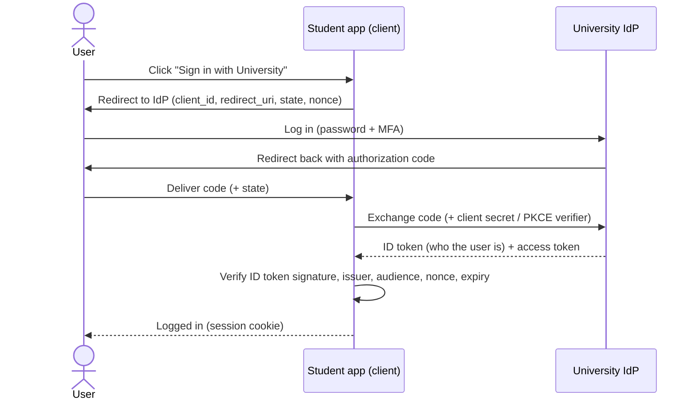

# CS-03 Authentication and Identity

> [!info] Topic card
> **Unit:** U2 · **Time:** 4–5 h · **Code:** a TOTP implementation verified against the RFC test vectors (§9 Example 3) · **Lab:** [[LAB-CS-01 Password Strength and Secure Password Storage]]

## 1. Learning objectives
1. **Distinguish** identification, authentication, authorisation and accounting (the "AAA" model).
2. **Classify** authentication factors (knowledge, possession, inherence), and **evaluate** MFA schemes (SMS, TOTP, push, FIDO2/passkeys) against phishing and SIM-swap attacks.
3. **Explain** how HOTP/TOTP one-time codes work, and **implement** TOTP.
4. **Describe** session management (cookies, tokens, expiry, the `Secure`/`HttpOnly`/`SameSite` attributes), and identity federation (SSO, SAML, OAuth 2.0 vs OpenID Connect).
5. **Analyse** authentication attacks (brute force, credential stuffing, phishing, MFA fatigue, session hijacking), and **choose** proportionate defences, including modern password-policy guidance.

## 2. Why it matters
Most breaches involve compromised credentials. Authentication is the front door. Get it wrong, and every other control is bypassed by an attacker who simply logs in as a legitimate user.

## 3. Prerequisites
[[CS-01 Security Foundations - CIA, Threats, Vulnerabilities and Risk]], and basic web knowledge (HTTP requests, cookies).

## 4. Intuition
- **Identification:** "I am Amina" (a username).
- **Authentication:** "prove it" (a password, a code from your phone, your fingerprint).
- **Authorisation:** "now that we know it's you, here's what you may do" ([[CS-04 Authorization and Access Control]]).
- **Accounting:** "and we're writing down what you did" ([[CS-15 Logging, Monitoring, Incident Response and Recovery]]).

## 5. Rigorous explanation

### 5.1 Factors
| Factor | Examples | Weaknesses |
|---|---|---|
| Something you **know** | Password, PIN, security answers | Guessed, phished, reused, leaked in breaches |
| Something you **have** | Phone app (TOTP), hardware key, smart card, SIM | Theft, SIM swap (for SMS), phishing of codes |
| Something you **are** | Fingerprint, face, iris | Can't be changed if compromised. False accept/reject rates. Privacy. |
| (Context) | Location, device, behaviour | Used for risk-based authentication, not as a sole factor |
**MFA** requires factors from **different categories**. A password plus a security question is still single-factor (both are knowledge).

### 5.2 Comparing MFA methods
| Method | Phishing-resistant? | Main risks |
|---|---|---|
| SMS one-time code | No | SIM swap, SS7 interception, real-time phishing proxies |
| TOTP app (RFC 6238) | No (a code can be relayed in real time) | Phishing relay, seed theft |
| Push approval | No | "MFA fatigue" (spamming prompts until the user approves) |
| Push with number matching | Partially | Still relayable through social engineering |
| **FIDO2/WebAuthn (security keys, passkeys)** | **Yes**: the key signs a challenge bound to the website's origin | Device loss (needs recovery procedures) |
**Why FIDO2 resists phishing:** the authenticator signs a challenge together with the **origin** (domain) of the site. A fake site at another domain gets a signature that's useless on the real site.

### 5.3 HOTP and TOTP
HOTP (RFC 4226): $\text{code} = \text{Truncate}(\text{HMAC-SHA1}(K, C)) \bmod 10^d$, where $K$ is a shared secret and $C$ a counter. TOTP (RFC 6238) uses $C = \lfloor (\text{unix time} - T_0)/30\rfloor$, so the code changes every 30 s. The server computes the same value and compares, usually allowing ±1 time step for clock drift. Security depends on keeping the secret $K$ confidential (stored encrypted on the server), and on rate limiting the guesses: a 6-digit code has only $10^6$ values.

### 5.4 Biometrics
| Metric | Meaning |
|---|---|
| FAR (false accept rate) | An impostor is accepted (a security failure) |
| FRR (false reject rate) | A genuine user is rejected (a usability failure) |
| EER (equal error rate) | The threshold where FAR = FRR. Lower is better. |
Raising the threshold lowers the FAR but raises the FRR, so it's a trade-off. Biometric templates are sensitive personal data, so store them locally (as on-device face or fingerprint unlock does) where possible.

### 5.5 Sessions
After a successful login, the server issues a **session identifier** (a random value in a cookie) or a signed **token** (e.g. a JWT).
- Session IDs must be long and random (≥ 128 bits, see [[DM-18 Introductory Discrete Probability]] practice 9), regenerated on login (preventing *session fixation*), expired on inactivity, and invalidated on logout.
- Cookie attributes: `Secure` (HTTPS only), `HttpOnly` (not readable by JavaScript, limiting XSS theft), and `SameSite=Lax/Strict` (limiting CSRF, [[CS-11 Web Application Security]]).

### 5.6 Federation and SSO
- **SSO:** log in once and use many applications (a university portal → LMS, email, library).
- **SAML 2.0:** an XML-based enterprise SSO protocol. The identity provider (IdP) sends a signed assertion to the service provider (SP).
- **OAuth 2.0:** **delegated authorisation** ("let this app access my calendar"). It issues *access tokens*, and it is **not** an authentication protocol by itself.
- **OpenID Connect (OIDC):** an authentication layer on top of OAuth 2.0 that adds an **ID token** stating who the user is. "Sign in with Google" uses OIDC.

### 5.7 Password guidance (summary of NIST SP 800-63B)
Require a minimum length (at least 8 characters, with longer encouraged and long passphrases allowed); check new passwords against **blocklists** of common and breached passwords; **don't** impose arbitrary composition rules; **don't** force periodic changes without evidence of compromise; allow paste (so password managers work); rate-limit attempts. *Check the current revision of SP 800-63B: the guidance is periodically updated.* Storage is covered in [[CS-08 Password Storage and Authentication Security]].

### 5.8 Account lifecycle
**Provisioning** (verify identity before creating the account) → **use** (least privilege) → **review** (periodic access recertification) → **deprovisioning** (disable promptly when a person leaves, because orphaned accounts are a common entry point).

## 6. Terminology
| Term | Meaning |
|---|---|
| AAA | Authentication, Authorisation, Accounting |
| MFA | Multi-factor authentication (≥ 2 different factor types) |
| OTP / HOTP / TOTP | One-time password / HMAC-based / time-based |
| FIDO2 / WebAuthn / passkey | Standards for public-key, origin-bound authentication |
| Credential stuffing | Trying username/password pairs leaked from other sites |
| Session fixation / hijacking | Forcing a known session ID / stealing an active one |
| IdP / SP | Identity provider / service (relying) provider |
| OAuth vs OIDC | Delegated authorisation vs authentication on top of it |

## 7. Step-by-step: designing authentication for a student portal
1. **Identify the users and the risk:** students (medium risk) and staff with marks access (high risk).
2. **Primary factor:** a password (≥ 12 characters suggested, a blocklist, no composition rules, no forced rotation), or a passkey.
3. **MFA:** required for staff (FIDO2 keys or passkeys for the registry staff, TOTP as a minimum), and offered to students.
4. **Throttling:** progressive delays per account and per IP, plus alerts on credential stuffing patterns.
5. **Sessions:** a random ID, `Secure; HttpOnly; SameSite=Lax`, a 30-minute idle timeout for staff, and rotation at login.
6. **Recovery:** the "forgot password" link sends a single-use, short-lived token to a verified email, and the reset invalidates existing sessions. *Recovery is often the weakest link*, so treat it as an authentication path in its own right.
7. **Logging:** log successes and failures (without passwords!), MFA enrolments and changes.

## 8. Diagram: OpenID Connect authorization-code flow (simplified)

*Text version: the app redirects the user to the identity provider, which authenticates them and returns a one-time code. The app exchanges the code directly with the IdP for an ID token, verifies the token, and creates its own session. The `state` and `nonce` values prevent CSRF and replay.*

## 9. Worked examples

### Example 1 (basic): is it MFA?
| Scheme | MFA? | Why |
|---|---|---|
| Password + PIN | No | Both knowledge |
| Password + TOTP app | Yes | Knowledge + possession |
| Fingerprint unlocking a phone passkey | Yes | Inherence (unlocking) + possession (the device key) |
| Password + "mother's maiden name" | No | Both knowledge (and the answer is often public) |
| Smart card + PIN | Yes | Possession + knowledge |

### Example 2 (intermediate): credential stuffing vs brute force
- **Brute force:** many passwords against **one** account. Per-account lockout or delays stop it.
- **Credential stuffing:** **one** leaked password per account across **many** accounts. Per-account lockout barely triggers. Defences: MFA, checking passwords against breach corpora, detecting many failed logins from one IP or ASN, bot detection, and encouraging password managers to prevent reuse.

### Example 3 (challenging): implement TOTP and verify it against the RFC
```python
import hashlib
import hmac
import struct
import time

def hotp(key: bytes, counter: int, digits: int = 6) -> str:
    mac = hmac.new(key, struct.pack(">Q", counter), hashlib.sha1).digest()
    offset = mac[-1] & 0x0F                                   # dynamic truncation (RFC 4226 §5.3)
    code = (int.from_bytes(mac[offset:offset + 4], "big") & 0x7FFFFFFF) % 10 ** digits
    return str(code).zfill(digits)

def totp(key: bytes, at: float | None = None, step: int = 30, digits: int = 6) -> str:
    t = time.time() if at is None else at
    return hotp(key, int(t // step), digits)

def verify_totp(key: bytes, code: str, at: float, window: int = 1) -> bool:
    return any(hmac.compare_digest(hotp(key, int(at // 30) + d), code) for d in range(-window, window + 1))

key = b"12345678901234567890"                  # RFC test key: NEVER use in practice
print([hotp(key, c) for c in range(3)])        # ['755224', '287082', '359152']  (RFC 4226 Appendix D)
print(totp(key, at=59, digits=8))              # 94287082                     (RFC 6238 Appendix B)
```
**Executed during the build:** the outputs match the published test vectors (RFC 4226 for counters 0–2, and RFC 6238 SHA-1 for T = 59, 1111111109, 1111111111, 1234567890, 2000000000 and 20000000000: 94287082, 07081804, 14050471, 89005924, 69279037, 65353130). `compare_digest` avoids timing leaks, and `window` tolerates clock drift. A production system must also rate-limit verification and prevent reuse of a code within its time step.

## 10. Application: an MFA-fatigue incident (generic pattern)
An attacker with a phished password triggers push notifications repeatedly late at night, until a tired employee taps "Approve". **Controls:** number matching (the user types a number shown on the login screen), limits on push attempts, alerting on repeated denials, phishing-resistant FIDO2 for privileged staff, and training ("an unexpected prompt means someone has your password, so report it"). This pattern has appeared in several publicly reported breaches, and it illustrates *psychological acceptability* ([[CS-01 Security Foundations - CIA, Threats, Vulnerabilities and Risk]]).

## 11. Common mistakes
| Mistake | Fix |
|---|---|
| Treating OAuth access tokens as proof of identity | Use OIDC ID tokens, and validate them |
| Two knowledge factors called "2FA" | Factors must come from different categories |
| SMS OTP for high-risk accounts | Prefer phishing-resistant methods |
| Session IDs not rotated at login | Regenerate them, to prevent fixation |
| A weak recovery flow (security questions) | Recovery needs strength equal to the login |
| Forced 90-day password changes and complex rules | Follow the current NIST guidance: length + blocklists |
| Error messages that reveal whether a username exists | Use a generic "invalid credentials" message |

## 12. Comparison
| | Session cookie | Self-contained token (JWT) |
|---|---|---|
| State | Server stores the session | Stateless (claims inside the signed token) |
| Revocation | Easy (delete the server session) | Hard until expiry (needs short lifetimes or a deny-list) |
| Typical use | Web apps | APIs, microservices |
| Pitfalls | Session store scaling | `alg: none`, unverified signatures, long lifetimes |

## 13. Practice
**L1** 1. Define identification, authentication, authorisation and accounting. 2. Name the three factor categories, with two examples each.

**L2** 3. Rank SMS OTP, TOTP, push with number matching, and FIDO2 by phishing resistance, and justify the ranking. 4. Which cookie attributes should a session cookie have, and what does each prevent?

**L3** 5. Compute the HOTP values for counter 3 and 4 with the RFC key (use the code). 6. Design a password-reset flow and list three attacks it must resist.

**L4** 7. A university wants "Sign in with Google" for students. Explain why it should use OIDC rather than "OAuth login", and list the checks the app must perform on the ID token. 8. Analyse the trade-off when setting a biometric threshold for (a) a phone unlock and (b) a nuclear facility door.

**L5** 9. Write an **authentication policy** (one page) for your Final Year Project's system, covering the user classes, factors, MFA requirements, session rules, recovery, lockout/throttling, logging, and how it aligns with current NIST guidance. Justify each choice by risk.

## 14. Hints
> [!tip]- Hints
> 3: does the code or approval depend on the site's origin? 5: run `hotp(key, 3)` and `hotp(key, 4)` (the RFC lists them too). 6: account enumeration, token guessing or reuse, session persistence after a reset. 7: signature, `iss`, `aud`, `exp`, `nonce`.

## 15. Worked solutions
> [!success]- Solutions 1–2
> 1. Identification: claiming an identity. Authentication: proving it. Authorisation: deciding what's permitted. Accounting: recording the actions. 2. Know (password, PIN), have (TOTP phone, hardware key), are (fingerprint, face).

> [!success]- Solution 3
> From weakest to strongest: SMS (SIM swap, interception, relay) < TOTP (relay, but no SIM swap) < push with number matching (resists blind fatigue approvals, but is still relayable through social engineering) < **FIDO2** (cryptographically bound to the origin, so a phishing site can't use the response).

> [!success]- Solution 4
> `Secure` keeps the cookie off plain HTTP (sniffing). `HttpOnly` blocks JavaScript access (XSS cookie theft). `SameSite=Lax` or `Strict` stops cross-site requests carrying the cookie (CSRF). Also set a narrow `Path`/`Domain`, and an expiry.

> [!success]- Solution 5
> RFC 4226 Appendix D lists counter 3 → **969429** and counter 4 → **338314**. (The lab script prints them, and the test suite checks them.)

> [!success]- Solution 6
> **Flow:** the user submits an email address, and the response is *always* "if an account exists, we've sent a link" (no enumeration). The server creates a random token (≥ 128 bits) and stores only **its hash**, with a 15–30 minute expiry and single use. The emailed link contains the token. On reset, verify the hash and expiry, set the new password (subject to the blocklist), **invalidate every existing session**, notify the user, and log the event. **Attacks resisted:** account enumeration, token guessing (entropy plus throttling), a leaked token DB (only hashes are stored), token reuse (single use), and session persistence (sessions invalidated). Also throttle reset requests to prevent email bombing.

> [!success]- Solution 7
> OAuth 2.0 grants *access* to resources. An access token isn't meant to prove to the app who the user is, so using it as a login has led to "confused deputy" flaws. OIDC adds a signed ID token whose purpose is authentication. **Checks:** a valid signature using the IdP's published keys, `iss` equal to the expected issuer, `aud` containing your client ID, `exp` not passed (and `iat` reasonable), `nonce` matching the one you sent (anti-replay), and the authorization-code flow with PKCE (state checked against CSRF).

> [!success]- Solution 8
> (a) Phone unlock: favour a **low FRR** for usability, accepting a somewhat higher FAR, because there's a fallback PIN and the attack needs physical possession of the phone. (b) Nuclear facility: favour a **very low FAR**, accept a higher FRR (a guard can verify rejected people manually), and combine it with a card and PIN (MFA).

> [!success]- Solution 9
> This is an open deliverable. Judge it on whether every choice is tied to a risk, and whether the guidance cited is current. Include password length, a blocklist, MFA for privileged users, session timeouts, the recovery design from solution 6, throttling, and logging without secrets.

## 16. Self-test (pass ≥ 4/5)
1. Is password + security question MFA? 2. Why is FIDO2 phishing-resistant? 3. OAuth 2.0 vs OIDC? 4. Credential stuffing defence? 5. What does `HttpOnly` prevent?
> [!success]- Answers
> 1. No. 2. Its signatures are bound to the site's origin. 3. OAuth is delegated authorisation, and OIDC adds authentication (the ID token). 4. MFA, breached-password checks, anomaly and bot detection (per-account lockout alone isn't enough). 5. JavaScript reading the cookie (which mitigates XSS session theft).

## 17. Flashcards
#flashcards/cyber-security
Authentication vs authorisation?::Authentication proves identity; authorisation decides permitted actions.
Three authentication factor categories?::Something you know, have, are.
Most phishing-resistant common MFA?::FIDO2/WebAuthn (security keys, passkeys): origin-bound signatures.
How does TOTP work?::HMAC of a shared secret and the current 30-second time step, truncated to 6–8 digits.
OAuth 2.0 vs OpenID Connect?::OAuth = delegated authorisation (access tokens); OIDC = authentication layer (ID token).
Credential stuffing?::Trying credentials leaked from other breaches across many accounts.
Session cookie attributes?::Secure, HttpOnly, SameSite (plus expiry, narrow scope).

## 18. Blank-page recall
Draw the OIDC flow, the MFA comparison table, and the cookie-attribute list.

## 19. Revision summary
- Identification → authentication → authorisation → accounting.
- MFA needs different factor types. FIDO2 is phishing-resistant, while SMS, TOTP and push can be relayed.
- TOTP = HMAC(secret, time step), verified with a drift window, rate limiting and constant-time comparison.
- Sessions: random IDs, rotation, expiry, Secure/HttpOnly/SameSite.
- Federation: SAML or OIDC for authentication, OAuth for delegation.
- Passwords: length + blocklists, no arbitrary rules or forced rotation (NIST).

## 20. Links
Prev: [[CS-02 Threat Modeling and Security Requirements]] · Next: [[CS-04 Authorization and Access Control]] · Related: [[CS-08 Password Storage and Authentication Security]], [[CS-06 Hashes, MACs and Integrity]] (HMAC), [[CS-11 Web Application Security]] (CSRF/XSS), [[PY-24 Secure Programming and Input Validation]]

## 21. Sources
- NIST SP 800-63B, *Digital Identity Guidelines: Authentication and Lifecycle Management* (consult the latest revision): https://pages.nist.gov/800-63-4/ and https://pages.nist.gov/800-63-3/sp800-63b.html
- IETF RFC 4226 *HOTP* (2005): https://www.rfc-editor.org/rfc/rfc4226 · RFC 6238 *TOTP* (2011): https://www.rfc-editor.org/rfc/rfc6238 (test vectors verified by executing the code above)
- OpenID Foundation, *OpenID Connect Core 1.0*: https://openid.net/specs/openid-connect-core-1_0.html · IETF RFC 6749 *OAuth 2.0*
- W3C, *Web Authentication (WebAuthn) Level 2*: https://www.w3.org/TR/webauthn-2/ · FIDO Alliance: https://fidoalliance.org/
- OWASP *Authentication* and *Session Management* cheat sheets: https://cheatsheetseries.owasp.org/

## 22. Mastery checklist
- [ ] I can justify an MFA choice by threat
- [ ] TOTP implemented and verified against the RFC vectors
- [ ] Authentication policy (practice 9) written · reviews scheduled
