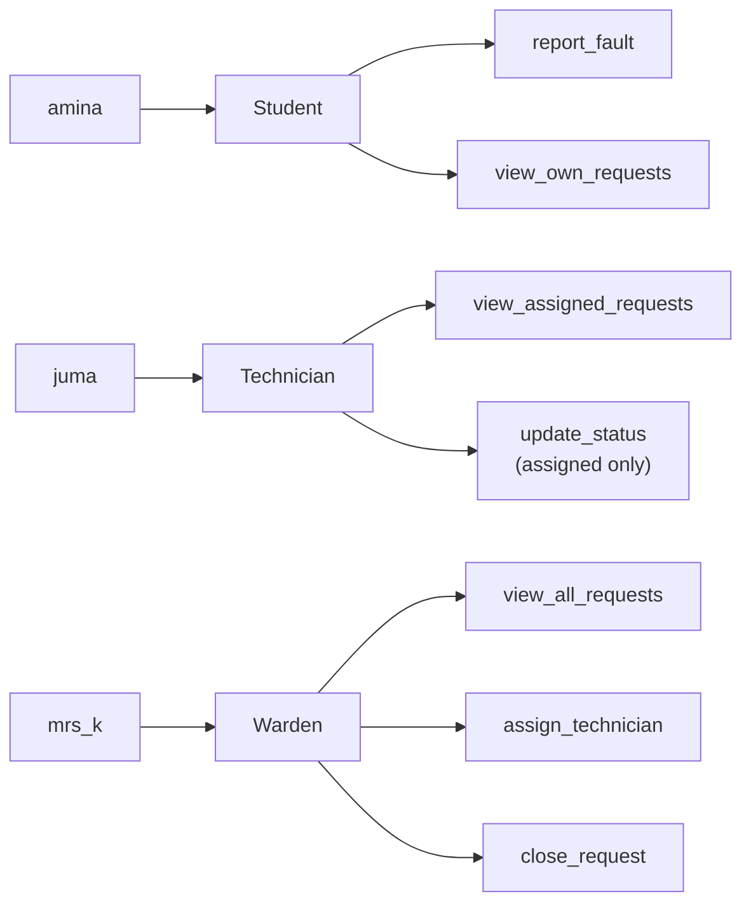

# CS-04 Authorization and Access Control

> [!info] Topic card
> **Unit:** U2 · **Time:** 4 h · **Code example:** an RBAC check plus an IDOR fix (§9) · Broken access control is the #1 category of the OWASP Top 10 (2021).

## 1. Learning objectives
1. **Explain** the access-control matrix, and its implementations as ACLs and capability lists.
2. **Compare** the DAC, MAC, RBAC and ABAC models, and **choose** one for a scenario.
3. **Apply** Bell–LaPadula (confidentiality) and Biba (integrity) rules to read and write requests.
4. **Design** an RBAC scheme with least privilege and separation of duties.
5. **Identify and fix** broken access control in code (IDOR, missing function-level checks, client-side enforcement), and **distinguish** horizontal from vertical privilege escalation.

## 2. Why it matters
Authentication says *who* you are. Authorisation decides *what you can touch*. Most serious application breaches involve users accessing data or functions that should have been forbidden: another student's results, the admin panel, someone else's invoice. In the OWASP Top 10 (2021), broken access control is ranked first.

## 3. Prerequisites
[[CS-03 Authentication and Identity]] (the user is already authenticated), and [[DM-06 Sets, Set Operations, Power Sets and Cartesian Products]] / [[DM-10 Relations, Equivalence Relations and Partial Orders]] (permissions as sets and relations; security levels as a partial order).

## 4. Intuition
Picture a building where every door has a **guest list** (an ACL), or where every person carries a **set of keys** (capabilities). RBAC adds **job badges**: "Warden", "Technician", "Student". Doors check the badge, so when someone changes job, you swap their badge instead of updating every door.

## 5. Rigorous explanation

### 5.1 The access-control matrix
Rows are subjects (users, processes), columns are objects (files, records, functions), and the cells are rights (r, w, x, approve…).
| | request_17 | request_18 | /admin/users |
|---|---|---|---|
| amina (student) | read, comment | — | — |
| juma (technician) | read, update_status | read, update_status | — |
| warden | read, assign | read, assign | read |
- **ACL:** store each **column** with its object ("who may access request_17?"). Easy per-object review.
- **Capability list:** store each **row** with its subject ("what may Juma access?"). Easy per-user review and delegation.

### 5.2 Models
| Model | Who decides | Basis | Example |
|---|---|---|---|
| **DAC** (discretionary) | The resource **owner** | Owner-granted permissions | Unix file permissions, Google Docs sharing |
| **MAC** (mandatory) | A **central policy** (users can't override it) | Security labels/clearances | Military classification, SELinux |
| **RBAC** (role-based) | Administrators assign **roles**, and roles hold permissions | Job function | University systems (student, lecturer, registrar) |
| **ABAC** (attribute-based) | Policy rules over **attributes** of the user, resource, action and environment | `user.department == resource.department AND time in office_hours` | Fine-grained cloud policies |
| ReBAC (relationship-based) | Graph relationships | "owner of", "member of group that…" | Social apps, document sharing |

### 5.3 Bell–LaPadula (confidentiality) and Biba (integrity)
Security levels form a **partial order** (e.g. Public < Internal < Confidential < Secret).
| Model | Read rule | Write rule | Protects against |
|---|---|---|---|
| **Bell–LaPadula** | **No read up** (simple security property) | **No write down** (*-property) | Leaking secrets downward |
| **Biba** | **No read down** | **No write up** | Corrupting trusted data with untrusted data |
They are duals: BLP protects confidentiality, Biba protects integrity.

### 5.4 RBAC concepts
Users → (assigned) **roles** → (granted) **permissions** on objects. A role **hierarchy** lets senior roles inherit junior permissions. **Constraints:** *static separation of duties* (no user holds both "enter marks" and "approve marks"), and *dynamic separation* (they may hold both, but not activate both in one session). **Least privilege:** each role gets the minimum needed. **Role explosion** (thousands of narrowly defined roles) is a warning sign that ABAC may fit better.

### 5.5 Enforcement in software
- Enforce on the **server**, at a **policy enforcement point** on **every** request (*complete mediation*). Hiding buttons in the UI isn't access control.
- **Deny by default** (fail-safe): a new endpoint is inaccessible until a rule allows it.
- Check **both** the function ("may a student call update_status?", which guards against *vertical* escalation) **and** the object ("may Amina read request 18?", which guards against *horizontal* escalation, a.k.a. IDOR).
- Centralise the checks (a decorator or middleware) to avoid forgotten endpoints, and test them ([[PY-20 Testing, Debugging and Test-Driven Development]]).

## 6. Terminology
| Term | Meaning |
|---|---|
| Subject / object / right | Actor / resource / permitted operation |
| ACL / capability | Per-object list / per-subject token or list |
| Least privilege / need-to-know | Minimum rights / access only to the data needed for the task |
| Separation of duties | Splitting critical tasks among different people |
| Vertical escalation | Gaining a higher role's functions (student → admin) |
| Horizontal escalation / IDOR | Accessing a peer's objects (Amina → Baraka's record) through Insecure Direct Object References |
| PEP / PDP | Policy enforcement point / policy decision point |

## 7. Step-by-step: designing RBAC for the hostel system
1. **List the functions:** report fault, view own requests, view all requests, assign technician, update status, close request, manage users, view audit log.
2. **Define the roles from job functions:** Student, Technician, Warden, Admin, Auditor.
3. **Map the permissions with least privilege:**
| Permission | Student | Technician | Warden | Admin | Auditor |
|---|---|---|---|---|---|
| report_fault | ✔ | | | | |
| view_own_requests | ✔ | | | | |
| view_assigned_requests | | ✔ | | | |
| view_all_requests | | | ✔ | | ✔ (read-only) |
| assign_technician | | | ✔ | | |
| update_status | | ✔ (only assigned jobs) | | | |
| close_request | | | ✔ | | |
| manage_users | | | | ✔ | |
| view_audit_log | | | | | ✔ |
4. **Add constraints:** an Admin can't also be an Auditor (separation of duties: whoever manages users shouldn't audit themselves). A technician can only update requests **assigned to them** (an object-level rule).
5. **Implement:** a central `authorize(user, action, resource)` function, used by every handler. Deny by default.
6. **Review:** quarterly access recertification, with leavers deprovisioned the same day.

## 8. Diagram: RBAC structure

*Text version: users are assigned roles, and roles hold permissions. Changing Juma's job means changing his role assignment, not every permission. Object-level conditions (assigned only) refine the role permissions.*

## 9. Worked examples

### Example 1 (basic): Bell–LaPadula decisions
Levels: Public < Internal < Confidential. A user cleared at **Internal**:
| Request | Allowed? | Rule |
|---|---|---|
| Read a Public file | ✔ | reading down is allowed |
| Read a Confidential file | ✘ | no read up |
| Write to a Public file | ✘ | no write down (could leak Internal information) |
| Write to a Confidential file | ✔ (BLP allows writing up) | *-property |
Under **Biba** with integrity levels, the same user would be forbidden to read Public (lower-integrity) data and allowed to write it.

### Example 2 (intermediate): IDOR. Incorrect → bug → corrected
```python
# INCORRECT: authenticated, but no object-level check
def get_request(current_user, request_id, repo):
    return repo.get(request_id)          # any logged-in user can read ANY request by changing the id
```
The attack: Amina (a student) requests `/requests/18`, which is Baraka's, and sees his name, room and phone number. That's a **horizontal escalation** and a confidentiality breach.
```python
# CORRECTED: central policy, deny by default, object-level rule
PERMISSIONS = {
    "student": {"view_own_requests"},
    "technician": {"view_assigned_requests", "update_status"},
    "warden": {"view_all_requests", "assign_technician", "close_request"},
}

class Forbidden(Exception):
    pass

def authorize(user, action, req=None):
    perms = PERMISSIONS.get(user["role"], set())
    if action == "view_request":
        if "view_all_requests" in perms:
            return
        if "view_own_requests" in perms and req and req["reporter"] == user["id"]:
            return
        if "view_assigned_requests" in perms and req and req.get("technician") == user["id"]:
            return
    elif action in perms:
        if action == "update_status" and (not req or req.get("technician") != user["id"]):
            raise Forbidden("not your assigned job")
        return
    raise Forbidden(f"{user['id']} may not {action}")

def get_request(current_user, request_id, repo):
    req = repo.get(request_id)
    authorize(current_user, "view_request", req)
    return req
```
Respond with **404 rather than 403** for objects the user may not see, which avoids confirming that they exist. Write tests for every role × action combination.

### Example 3 (challenging): choosing a model
*Scenario:* a hospital where doctors may view the records of patients currently under their care, during their shift, from hospital devices, while emergency "break-glass" access is allowed but heavily logged.
**RBAC alone** would need a role per doctor–patient relationship (role explosion). **ABAC** fits naturally: `allow if user.role == doctor AND patient.id IN user.current_patients AND env.time IN user.shift AND env.device.managed`. Add a **break-glass** rule (allow with mandatory justification, immediate alerting and after-the-fact review). That trades a little confidentiality for the availability of life-critical data, as a deliberate, controlled exception.

## 10. Application: Unix permissions as DAC
`-rw-r----- 1 amina staff report.txt`: the owner amina may read and write, the group `staff` may read, and others have no access. The owner can change it with `chmod` (that's what makes it *discretionary*). Common audit findings are world-writable files and secrets readable by others. You'll investigate these in [[LAB-CS-04 File Permission Audit]] ([[CS-10 Operating System Security and Hardening]]).

## 11. Common mistakes
| Mistake | Fix |
|---|---|
| Hiding admin buttons in the UI as "security" | Enforce on the server for every request |
| Checking the role but not the object (IDOR) | Check object ownership or assignment too |
| Allow by default | Deny by default |
| Scattered ad-hoc checks | A central authorisation function or middleware |
| Shared or generic accounts | Individual accounts (accountability) |
| Never reviewing access | Periodic recertification, prompt deprovisioning |
| Returning 403 for other users' objects | Prefer 404, to avoid leaking existence |

## 12. Comparison
| Criterion | DAC | MAC | RBAC | ABAC |
|---|---|---|---|---|
| Flexibility for owners | High | None | Medium | High (policy-driven) |
| Central control | Low | Very high | High | High |
| Administrative effort | Low (initially) | High | Medium | Medium–high (policy design) |
| Best for | Personal and collaborative files | Classified environments | Organisations with clear job functions | Context-dependent, fine-grained rules |

## 13. Practice
**L1** 1. Define ACL and capability, and give one advantage of each. 2. State the two Bell–LaPadula rules.

**L2** 3. Classify each as DAC/MAC/RBAC/ABAC: (a) sharing a Google Doc (b) "only finance staff can approve payments" (c) "access allowed only from the office network on weekdays" (d) a SECRET document that a cleared user can't share with uncleared colleagues even if they want to. 4. Write the ACL for `request_17` from §5.1.

**L3** 5. Design the RBAC roles and permissions for the LabBook computer-lab booking system ([[SD-CASE LabBook Running Case Study]]), with one separation-of-duties constraint. 6. Find the vulnerability: `if request.form["is_admin"] == "true": show_admin_panel()`.

**L4** 7. Write the authorisation test cases (role × action × object ownership) for Example 2's `authorize`. How many cases does full coverage need? 8. Under Biba, a malware-infected download (low integrity) tries to modify a system configuration file (high integrity). Which rule blocks it? Relate this to Windows' Mandatory Integrity Control or to browser sandboxing.

**L5** 9. A startup's SaaS app is multi-tenant (many schools share one database). Propose a design that guarantees tenant isolation (no school sees another's data), covering the data model, query patterns, enforcement layers and testing. Discuss the trade-offs of row-level security in the database versus application checks.

## 14. Hints
> [!tip]- Hints
> 3(c): conditions on the environment. 6: the client controls form fields. 7: 3 roles × the actions × (own / not own) objects. 9: a `tenant_id` on every row, enforced from the authenticated session and never taken from the request. Consider PostgreSQL row-level security as an extra layer.

## 15. Worked solutions
> [!success]- Solutions 1–2
> 1. An ACL is attached to an object and lists who may do what. It's easy to see who can access a given file. A capability is held by a subject. It's easy to see everything a given user can do, and easy to delegate. 2. No read up (a subject can't read objects at a higher level), and no write down (a subject can't write objects at a lower level).

> [!success]- Solution 3
> (a) DAC. (b) RBAC. (c) ABAC (environment attributes). (d) MAC.

> [!success]- Solution 4
> `request_17: amina{read, comment}, juma{read, update_status}, warden{read, assign}`.

> [!success]- Solution 5 (sample)
> Roles: Student (create own booking, cancel own future booking, view availability), Lab Assistant (check in, mark no-show, view today's bookings), Lab Manager (approve block bookings, edit lab capacity, view reports), Admin (manage users and roles). **Separation of duties:** whoever approves a block booking can't be its requester (checked at the object level), and the Admin can't approve bookings.

> [!success]- Solution 6
> The **client controls** `is_admin`. Any user can send `is_admin=true` (vertical privilege escalation). Derive the role from the server-side session and the user database, never from request parameters.

> [!success]- Solution 7
> Actions: view_request (with own / assigned / unrelated objects), update_status (assigned / not assigned), assign_technician, close_request, plus an unknown action. For each of the 3 roles (plus an unknown role), test every action with relevant and irrelevant objects. That's roughly 3 × (3 + 2 + 1 + 1 + 1) = 24 cases, plus the unknown-role and unknown-action cases. Use `pytest.mark.parametrize` with a truth table of the expected allow/deny, which doubles as documentation of the policy.

> [!success]- Solution 8
> Biba's **no write up** stops a low-integrity subject from modifying a higher-integrity object. Windows Mandatory Integrity Control labels processes and objects (Low, Medium, High, System). A browser renderer running at low integrity can't write to user-level files and settings, which limits what an exploited renderer can do. Sandboxing applies the same idea.

> [!success]- Solution 9
> **Data model:** every tenant-owned table has `tenant_id NOT NULL`, with an index, and composite keys such as `(tenant_id, id)`. **Enforcement:** the `tenant_id` comes from the authenticated session (the user's school), **never** from a URL or body parameter. The repository layer automatically adds `WHERE tenant_id = ?` to every query (a central choke point). Optionally add **database row-level security** policies keyed on a session variable, as a second, independent layer. **Testing:** automated tests that a user from school A requesting a known ID from school B gets 404, and a static check that no query bypasses the repository. **Trade-offs:** application checks are portable and flexible but easy to forget in new code. RLS enforces isolation even for buggy queries, but it adds DB-specific complexity and the risk of performance or configuration mistakes. Defence in depth argues for both. Very sensitive tenants might justify separate databases (stronger isolation, higher cost).

## 16. Self-test (pass ≥ 4/5)
1. What's IDOR? 2. RBAC assigns permissions to…? 3. Which model lets owners decide? 4. Biba's write rule? 5. Why isn't UI hiding enough?
> [!success]- Answers
> 1. Accessing objects by manipulating identifiers, without an object-level authorisation check. 2. Roles (and users get roles). 3. DAC. 4. No write up. 5. Attackers send requests directly. The server must check every request.

## 17. Flashcards
#flashcards/cyber-security
DAC vs MAC?::DAC: owner decides permissions; MAC: central policy/labels users cannot override.
RBAC?::Permissions attached to roles; users assigned roles.
ABAC?::Policies evaluate attributes of user, resource, action and environment.
Bell–LaPadula rules?::No read up, no write down (confidentiality).
Biba rules?::No read down, no write up (integrity).
IDOR?::Insecure Direct Object Reference: missing object-level authorisation allows access by changing an ID.
Vertical vs horizontal privilege escalation?::Gaining higher-role functions vs accessing peers' resources.

## 18. Blank-page recall
Draw the access-control matrix with its ACL and capability views, the model comparison table, and the BLP/Biba rules.

## 19. Revision summary
- The access-control matrix is implemented as ACLs (per object) or capabilities (per subject).
- DAC = the owner decides, MAC = central labels, RBAC = roles, ABAC = attribute policies.
- BLP: no read up / no write down (C). Biba: no read down / no write up (I).
- Enforce on the server for every request, deny by default, and check both the function and the object.
- Least privilege, separation of duties, regular access reviews.

## 20. Links
Prev: [[CS-03 Authentication and Identity]] · Next: [[CS-05 Cryptography Foundations and Symmetric Encryption]] · Related: [[CS-10 Operating System Security and Hardening]], [[CS-11 Web Application Security]], [[PY-24 Secure Programming and Input Validation]], [[SD-17 Secure and Reliable Software Design]]

## 21. Sources
- OWASP Top 10 (2021), *A01 Broken Access Control*: https://owasp.org/Top10/A01_2021-Broken_Access_Control/
- OWASP *Authorization Cheat Sheet*: https://cheatsheetseries.owasp.org/cheatsheets/Authorization_Cheat_Sheet.html
- Sandhu, R. S., Coyne, E. J., Feinstein, H. L. & Youman, C. E., "Role-based access control models", *IEEE Computer*, 29(2), 1996, pp. 38–47.
- Bell, D. E. & LaPadula, L. J., *Secure Computer Systems: Mathematical Foundations*, MITRE Technical Report 2547, 1973. Biba, K. J., *Integrity Considerations for Secure Computer Systems*, MITRE TR-3153, 1977.
- NIST SP 800-162, *Guide to Attribute Based Access Control (ABAC)*, 2014.

## 22. Mastery checklist
- [ ] I choose and justify an access-control model for a scenario
- [ ] I can spot and fix IDOR and client-side checks in code
- [ ] RBAC design with SoD (practice 5) and the test matrix (practice 7) · reviews scheduled
