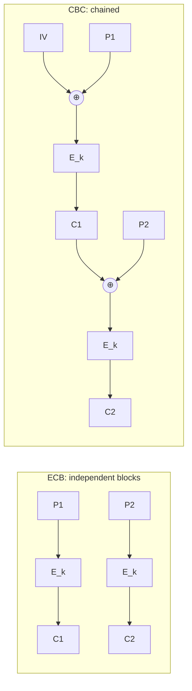

# CS-05 Cryptography Foundations and Symmetric Encryption

> [!info] Topic card
> **Unit:** U3 · **Time:** 5 h · **Lab:** [[LAB-CS-03 Toy Ciphers and Why They Fail]] · **Demo outputs** in §9 were produced by running the Python `cryptography` library (version 50.0.1) during the build.

> [!danger] Golden rule
> **Never invent your own cipher, and never implement standard algorithms yourself for production use.** Use a well-reviewed library with high-level, authenticated APIs (e.g. `cryptography`'s `AESGCM` or Fernet, or libsodium). The toy ciphers in this vault exist to teach you *why* they fail.

## 1. Learning objectives
1. **Use** the cryptographic vocabulary (plaintext, ciphertext, key, cipher, encryption/decryption, cryptanalysis) and **state** Kerckhoffs's principle.
2. **Explain** why classical ciphers fail (small key spaces, frequency analysis), and why the one-time pad is perfectly secret but impractical.
3. **Describe** modern symmetric ciphers (AES as a block cipher, stream ciphers such as ChaCha20) and key sizes.
4. **Compare** block-cipher modes (ECB, CBC, CTR, GCM), and **explain** why ECB leaks patterns and why nonce reuse is catastrophic.
5. **Explain** authenticated encryption (AEAD), the key-distribution problem, and when symmetric encryption is the right tool.

## 2. Why it matters
Encryption protects the **confidentiality** of data at rest (disk encryption, database fields, backups) and in transit (TLS uses symmetric ciphers for the bulk data). Misusing it (ECB mode, reused nonces, hard-coded keys, unauthenticated encryption) gives a **false sense of security**, which is worse than knowingly having none.

## 3. Prerequisites
[[CS-01 Security Foundations - CIA, Threats, Vulnerabilities and Risk]], [[DM-07 Functions]] (for each key, encryption must be a bijection, or decryption is impossible), [[DM-11 Counting Principles, Permutations and Combinations]] (key spaces), and XOR ([[DM-17 Boolean Algebra and Logic Circuits]]).

## 4. Intuition
Encryption is a **lockbox**. The algorithm (the box design) is public, and the **key** is secret. Symmetric means **the same key locks and unlocks**, like a house key shared between family members. The hard part is often not the lock but **sharing the key safely**.

## 5. Rigorous explanation

### 5.1 Definitions
A symmetric cipher is a pair of algorithms $E_k$ and $D_k$ with $D_k(E_k(m)) = m$ for every key $k$ and message $m$. For a fixed $k$, $E_k$ must be injective ([[DM-07 Functions]]).
**Kerckhoffs's principle (1883):** a cryptosystem should stay secure even if everything about it except the key is public. Secret algorithms ("security through obscurity") get reverse-engineered, and only the key can be changed cheaply.

### 5.2 Classical ciphers and their failures
| Cipher | Key space | Breaks by |
|---|---|---|
| Caesar (shift) | 25 | Trying all keys (brute force) |
| Monoalphabetic substitution | $26! \approx 4\times10^{26}$ | **Frequency analysis**: letter frequencies survive encryption |
| Vigenère | $26^{L}$ | Kasiski/IoC to find the key length L, then L Caesar ciphers ([[PY-09 Strings and String Processing]]) |
A huge key space is **necessary but not sufficient**. Substitution has more keys than AES-64 would, yet falls to statistics in seconds.

### 5.3 The one-time pad (OTP)
$c = m \oplus k$, where $k$ is truly random, as long as $m$, and **never reused**. **Perfect secrecy** (Shannon, 1949): the ciphertext reveals nothing about $m$ beyond its length, since every plaintext of that length is equally possible. It's impractical, because the key is as long as the data and must be shared securely in advance. **Reusing** a pad is fatal: $c_1 \oplus c_2 = m_1 \oplus m_2$, and the key cancels out.

### 5.4 Modern symmetric ciphers
- **Block cipher:** encrypts fixed-size blocks. **AES** (the Advanced Encryption Standard, FIPS 197, from the Rijndael design) uses 128-bit blocks and 128-, 192- or 256-bit keys, and it is the global standard. (DES, with its 56-bit key, is broken by brute force, and 3DES is deprecated.)
- **Stream cipher:** generates a keystream XORed with the data. **ChaCha20** is modern and fast in software, and is used in TLS.
- **Brute force against AES-128:** $2^{128} \approx 3.4\times10^{38}$ keys. Even at $10^{12}$ keys per second, that's about $10^{19}$ years. Practical attacks target **implementations, key management and modes**, not the AES algorithm itself.

### 5.5 Modes of operation
| Mode | How it works | Properties | Verdict |
|---|---|---|---|
| **ECB** | Each block encrypted independently | **Identical plaintext blocks → identical ciphertext blocks** (patterns leak) | **Never use for data** |
| **CBC** | Each block XORed with the previous ciphertext block before encryption, with a random **IV** | Hides patterns. Needs padding. Malleable without a MAC (padding-oracle attacks). | Legacy. Use only with encrypt-then-MAC. |
| **CTR** | Encrypts a counter to make a keystream | Parallel, no padding. **A nonce must never repeat** under the same key. | OK as a component |
| **GCM** | CTR + a Galois MAC | **AEAD**: confidentiality + integrity + authenticated associated data. A unique 96-bit nonce per message. | **Recommended** (alongside ChaCha20-Poly1305) |

### 5.6 Authenticated encryption (AEAD)
Encryption alone doesn't stop **tampering**: an attacker can flip ciphertext bits and change the plaintext in predictable ways (*malleability*). AEAD outputs `ciphertext + tag`. Decryption **verifies the tag** first and fails on any change. Associated data (AAD), such as a record ID, is authenticated but not encrypted, which binds the ciphertext to its context.

### 5.7 The key-distribution problem
With symmetric crypto, every pair of parties needs a shared secret key: $\binom{n}{2}$ keys for $n$ parties (4950 for 100 users). How do you agree a key over an insecure network? Public-key cryptography solves this ([[CS-07 Public-Key Cryptography, Signatures and Key Management]]), and real systems use **hybrid** encryption: a public key to agree a session key, then AES or ChaCha20 for the data.

## 6. Terminology
| Term | Meaning |
|---|---|
| Plaintext / ciphertext | Readable data / encrypted data |
| Key / key space | The secret parameter / the set of possible keys |
| Cryptanalysis | The study of breaking ciphers |
| Block / stream cipher | Encrypts fixed blocks / XORs a keystream |
| IV / nonce | Initialisation vector / number used once (must be unique, and for CBC unpredictable) |
| Mode of operation | How a block cipher handles messages longer than one block |
| AEAD | Authenticated Encryption with Associated Data |
| Malleability | Being able to change the ciphertext so the plaintext changes meaningfully |

## 7. Step-by-step: encrypting a record correctly with AES-GCM (Python `cryptography`)
```python
# pip install cryptography   (third-party; well-maintained)
import os
from cryptography.hazmat.primitives.ciphers.aead import AESGCM

key = AESGCM.generate_key(bit_length=256)    # 1. random key from the OS CSPRNG; store in a key vault, NOT in code
aead = AESGCM(key)
nonce = os.urandom(12)                        # 2. fresh 96-bit nonce for EVERY message
aad = b"student=S1"                           # 3. context bound to the ciphertext (not secret)
ct = aead.encrypt(nonce, b"mark=72", aad)     # 4. ciphertext || 16-byte tag
record = nonce + ct                           # 5. store the nonce with the ciphertext (the nonce isn't secret)
pt = aead.decrypt(record[:12], record[12:], aad)   # 6. raises InvalidTag if anything changed
```

## 8. Diagram: ECB vs CBC

*Text version: in ECB each plaintext block is encrypted alone, so equal blocks give equal ciphertext. In CBC each block is first XORed with the previous ciphertext block (the first one with a random IV), so equal plaintext blocks encrypt differently.*

## 9. Worked examples

### Example 1 (basic): brute-forcing Caesar
The ciphertext `Dwwdfn dw gdzq` has only 25 possible keys. Trying them all, shift −3 gives "Attack at dawn". A key space you can enumerate gives no security ([[LAB-CS-03 Toy Ciphers and Why They Fail]]).

### Example 2 (intermediate): ECB leaks patterns (real run)
AES-128 with a fixed demo key, encrypting `"YELLOW SUBMARINE" × 2 + "ATTACK AT DAWN!!"` (three 16-byte blocks):
```text
ECB blocks: 761ab98c7086c509261f322cb3ffa7d9
            761ab98c7086c509261f322cb3ffa7d9   ← identical to block 1
            8a21cef935d8587bea999da471a91c41
CBC: block 1 == block 2 ? False
```
An observer learns that "blocks 1 and 2 are the same" without any key. For images (the classic "ECB penguin"), the outline of the picture remains visible in the ciphertext.

### Example 3 (challenging): GCM detects tampering, and nonce reuse destroys confidentiality (real run)
- Flipping one bit of a GCM ciphertext → `decrypt` raises **`InvalidTag`**. Decrypting with the wrong AAD (`student=S2`) → **`InvalidTag`**. With the correct AAD → `b'mark=72'` ✔.
- Two messages encrypted with the **same key and nonce**: `c1 ⊕ c2 == p1 ⊕ p2` was **True**. The keystream cancels, exactly as in a reused one-time pad. With one known plaintext, the other is revealed, and GCM's authentication key can also be recovered, enabling forgeries. **A nonce must be unique per key**: use random 96-bit nonces (with a limit on messages per key) or a counter.

## 10. Application: what to encrypt, and where
| Data | Recommended protection |
|---|---|
| Laptop disks | Full-disk encryption (BitLocker, FileVault, LUKS) |
| Data in transit | TLS 1.2/1.3 ([[CS-09 Network Security and Secure Communication]]) |
| Sensitive DB fields (national ID numbers) | Application-level AEAD with keys in a KMS or vault, plus access control |
| Backups | Encrypted, with the keys stored **separately** from the backups |
| Passwords | **Not encryption**: a slow salted hash ([[CS-08 Password Storage and Authentication Security]]) |

## 11. Common mistakes
| Mistake | Consequence | Fix |
|---|---|---|
| ECB mode | Pattern leakage | AEAD (GCM, ChaCha20-Poly1305) |
| Reusing nonces or IVs | Total loss of confidentiality (CTR/GCM) | A unique nonce per message |
| Encryption without authentication | Tampering, padding oracles | AEAD, or encrypt-then-MAC |
| Hard-coded keys in source or Git | Anyone with the code decrypts everything | A KMS or vault, environment-injected secrets, rotation |
| Using `random` for keys | Predictable keys | `os.urandom` / `secrets` / the library's key generation |
| "Encrypting" passwords | Reversible if the key leaks | Hash them with a slow KDF |
| A home-made cipher | Broken by experts | Standard algorithms and libraries |

## 12. Comparison
| | Symmetric (AES) | Asymmetric (RSA/ECC) |
|---|---|---|
| Keys | One shared secret | Public/private pair |
| Speed | Very fast | Much slower |
| Use | Bulk data | Key exchange, signatures |
| Key distribution | Hard | Easier (public keys can be published) |
| Typical sizes | 128/256-bit | RSA 3072-bit, ECC 256-bit (comparable strength) |

## 13. Practice
**L1** 1. State Kerckhoffs's principle. 2. Why is the Caesar cipher insecure?

**L2** 3. How many keys does a 128-bit key space contain? Estimate the brute-force time at $10^{12}$ keys/s. 4. Which mode would you choose for encrypting database fields, and why?

**L3** 5. Explain, with XOR algebra, why reusing a one-time pad (or a CTR nonce) leaks $m_1 \oplus m_2$. 6. What does AAD protect in AES-GCM? Give an example of a "cut-and-paste" attack it prevents.

**L4** 7. A developer stores AES-CBC-encrypted session cookies without a MAC and returns "invalid padding" errors. Explain the risk, at a conceptual level (the padding-oracle idea), and the fix. 8. Calculate the number of symmetric keys needed for 500 users who all communicate pairwise, and explain how hybrid encryption avoids this.

**L5** 9. Design the key-management approach for encrypting national-ID numbers in the hostel database: key generation, storage (KMS/HSM vs env variables), rotation (re-encryption strategy), access, backup, and what happens when a server is compromised. Justify each choice.

## 14. Hints
> [!tip]- Hints
> 3: $2^{128}\approx 3.4\times10^{38}$, divided by $10^{12}$, then by the seconds in a year. 5: $(m_1\oplus k)\oplus(m_2\oplus k)$. 6: an attacker copying an encrypted mark from student S2's row into S1's row. 7: the error difference is an oracle, so authenticate before decrypting. 8: $\binom{500}{2}$.

## 15. Worked solutions
> [!success]- Solutions 1–2
> 1. A system should be secure even if everything except the key is public. 2. Only 25 keys, so brute force is trivial (and frequency analysis also works).

> [!success]- Solution 3
> $2^{128} \approx 3.4\times10^{38}$ keys. At $10^{12}$ keys/s that's $3.4\times10^{26}$ s $\approx 1.1\times10^{19}$ years (computed during the build), about $10^9$ times the age of the universe.

> [!success]- Solution 4
> **AES-GCM** (or ChaCha20-Poly1305): authenticated encryption gives confidentiality *and* integrity, and the record ID can be bound as AAD. Use a unique nonce per encryption, stored alongside the ciphertext.

> [!success]- Solution 5
> $c_1 \oplus c_2 = (m_1 \oplus k)\oplus(m_2 \oplus k) = m_1 \oplus m_2 \oplus (k\oplus k) = m_1\oplus m_2$, since $k\oplus k = 0$. The key disappears, and statistics or known plaintext then recover both messages. The build demo confirmed this for AES-GCM with a reused nonce.

> [!success]- Solution 6
> AAD is authenticated but not encrypted. Binding `student_id` as AAD means a ciphertext moved to another student's row fails verification (`InvalidTag`). Without it, an attacker with database write access could copy their friend's encrypted "mark=85" into their own row, and it would decrypt validly.

> [!success]- Solution 7
> CBC without authentication is malleable. If the server reveals whether the padding is valid (through different errors or timing), an attacker can modify ciphertext blocks and use the server as an **oracle**, decrypting cookies byte by byte without the key. **Fix:** use AEAD (or encrypt-then-MAC, verifying the MAC *before* decrypting), return uniform errors, and prefer well-designed session tokens from a framework.

> [!success]- Solution 8
> $\binom{500}{2} = 124\,750$ keys. **Hybrid encryption:** each user has one public/private key pair (500 pairs). For each conversation, a fresh random symmetric session key is generated and protected with the recipient's public key (or derived by key agreement such as ECDH), then AES encrypts the data.

> [!success]- Solution 9 (model answer)
> Generate a **data-encryption key (DEK)** with the library's CSPRNG. **Envelope encryption:** the DEK is itself encrypted by a **key-encryption key (KEK)** held in a KMS or HSM, so the application only ever holds the DEK in memory. Never put keys in the repository, and keep them out of plain environment variables where possible (use a secrets manager or KMS API). **Rotation:** rotate the KEK periodically (cheap, because only the DEKs are re-wrapped). Rotate DEKs on a schedule or after an incident, re-encrypting lazily (decrypt with the old key on read, re-encrypt with the new one) and tracking the key version with each record. **Access:** only the app service identity may call decrypt, with audit logs on KMS usage. **Backups:** the DB backups contain only ciphertext. Back up the KMS key material separately, with strict controls. **Compromise:** an attacker with a running server can decrypt while they hold access, so detect it (KMS anomaly alerts), revoke the service credentials, rotate the keys, and investigate. Encryption reduces the impact of **stolen disks or backups**, not of full application compromise. That's defence in depth, together with access control and monitoring.

## 16. Self-test (pass ≥ 4/5)
1. What does ECB leak? 2. What does AEAD add to encryption? 3. What happens if a GCM nonce is reused? 4. AES block size? 5. Why use hybrid encryption?
> [!success]- Answers
> 1. Equality of plaintext blocks (patterns). 2. Integrity and authenticity (tamper detection), and binding of associated data. 3. Confidentiality fails (XOR of the plaintexts), and forgery becomes possible. 4. 128 bits. 5. To combine the easy key distribution of public-key crypto with the speed of symmetric ciphers.

## 17. Flashcards
#flashcards/cyber-security
Kerckhoffs's principle?::A cryptosystem must remain secure if everything except the key is public.
Why is ECB insecure?::Identical plaintext blocks produce identical ciphertext blocks, leaking patterns.
What is AEAD?::Authenticated encryption: confidentiality plus integrity, with associated data authenticated (e.g. AES-GCM).
One-time pad requirement?::Truly random key, as long as the message, never reused.
Consequence of nonce reuse in CTR/GCM?::XOR of ciphertexts equals XOR of plaintexts; confidentiality and (for GCM) integrity fail.
AES key sizes?::128, 192 or 256 bits (block size 128 bits).
Number of pairwise symmetric keys for n users?::n(n−1)/2

## 18. Blank-page recall
Draw ECB vs CBC, write the modes table, and explain nonce reuse with XOR algebra.

## 19. Revision summary
- Kerckhoffs: the key is the only secret. Never use home-made crypto.
- Classical ciphers fail through small key spaces or statistics. The OTP is perfect but impractical, and must never be reused.
- AES (128-bit blocks) and ChaCha20 are the modern standards. Brute force is infeasible, and attacks target misuse.
- Never ECB. Prefer AEAD (GCM / ChaCha20-Poly1305) with unique nonces.
- Symmetric keys are hard to distribute, so hybrid crypto uses public keys for key exchange.

## 20. Links
Prev: [[CS-04 Authorization and Access Control]] · Next: [[CS-06 Hashes, MACs and Integrity]] · Lab: [[LAB-CS-03 Toy Ciphers and Why They Fail]] · Related: [[CS-07 Public-Key Cryptography, Signatures and Key Management]], [[PY-09 Strings and String Processing]] (Caesar/Vigenère code), [[DM-07 Functions]]

## 21. Sources
- NIST FIPS 197, *Advanced Encryption Standard (AES)*, 2001 (updated 2023): https://csrc.nist.gov/pubs/fips/197/final
- NIST SP 800-38A (modes) and SP 800-38D (GCM): https://csrc.nist.gov/publications/sp
- Shannon, C. E., "Communication theory of secrecy systems", *Bell System Technical Journal*, 28(4), 1949, pp. 656–715.
- Kerckhoffs, A., "La cryptographie militaire", *Journal des sciences militaires*, 9, 1883.
- Ferguson, N., Schneier, B. & Kohno, T., *Cryptography Engineering*, Wiley, 2010.
- `cryptography` library documentation (AEAD): https://cryptography.io/en/latest/hazmat/primitives/aead/ (version 50.0.1 used for the demos)

## 22. Mastery checklist
- [ ] I can explain why ECB leaks and why nonce reuse breaks CTR/GCM
- [ ] I can choose and justify AEAD for a scenario
- [ ] Key-management design (practice 9) · LAB-CS-03 done · reviews scheduled
