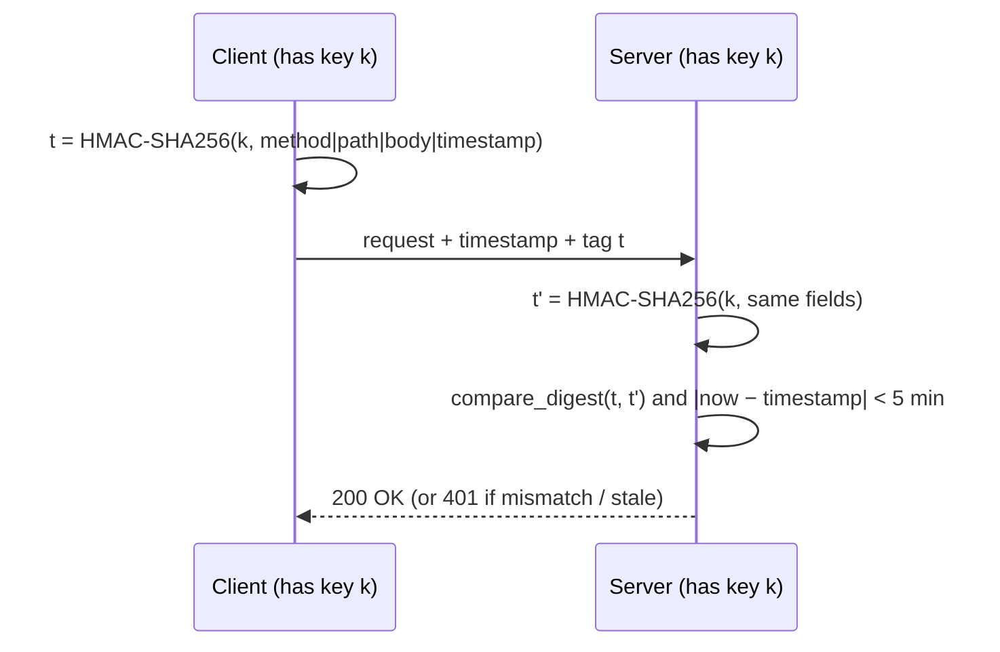

# CS-06 Hashes, MACs and Integrity

> [!info] Topic card
> **Unit:** U3 · **Time:** 4 h · **Lab:** [[LAB-CS-02 Hashing and Integrity Verification]] · All the digests below were computed with Python's `hashlib` during the build. SHA-256("abc") matches the FIPS 180 test vector.

## 1. Learning objectives
1. **State** the security properties of cryptographic hash functions: preimage resistance, second-preimage resistance and collision resistance. **Explain** the birthday bound.
2. **Distinguish** checksums (CRC), cryptographic hashes, MACs (HMAC) and digital signatures by what they protect against and who can verify them.
3. **Explain** why MD5 and SHA-1 are broken for collision resistance, and **choose** SHA-256/SHA-3.
4. **Use** HMAC correctly, and **explain** why `hash(key + message)` is unsafe (length extension).
5. **Design** integrity verification for downloads, logs and messages, including where the reference value must come from.

## 2. Why it matters
Hashes are the workhorses of security: integrity checks for downloads and backups, password storage (with slow KDFs, [[CS-08 Password Storage and Authentication Security]]), digital signatures (which sign the hash), Git commits, blockchains, and tamper-evident logs. MACs authenticate API requests and cookies. Choosing the wrong primitive creates subtle, exploitable bugs.

## 3. Prerequisites
[[CS-05 Cryptography Foundations and Symmetric Encryption]], [[DM-12 Pigeonhole Principle and Inclusion-Exclusion]] (collisions must exist), [[DM-18 Introductory Discrete Probability]] (the birthday bound), and [[DM-07 Functions]] (hashes are deliberately non-injective).

## 4. Intuition
A cryptographic hash is a **digital fingerprint**: any input of any size gives a short, fixed-size digest. Change one character and the fingerprint changes completely and unpredictably. You can't work backwards from the fingerprint to the input, and you can't find two inputs with the same fingerprint, even though such pairs must exist.

## 5. Rigorous explanation

### 5.1 Properties of a cryptographic hash $H: \{0,1\}^* \to \{0,1\}^n$
| Property | Hard to… | Attack cost (ideal n-bit hash) | Needed for |
|---|---|---|---|
| **Preimage resistance** | given $h$, find $m$ with $H(m) = h$ | $\approx 2^n$ | Password hashing, commitments |
| **Second-preimage resistance** | given $m_1$, find $m_2\ne m_1$ with $H(m_2)=H(m_1)$ | $\approx 2^n$ | Download integrity (fixed known file) |
| **Collision resistance** | find **any** $m_1\ne m_2$ with $H(m_1)=H(m_2)$ | $\approx 2^{n/2}$ (the **birthday bound**) | Signatures, certificates |
Also expected: **determinism**, **efficiency**, and the **avalanche effect** (one changed input bit flips about half the output bits).
**Collisions must exist** by pigeonhole (infinitely many inputs, $2^n$ outputs). Security means they're infeasible to *find*.

### 5.2 Algorithms
| Algorithm | Output | Status |
|---|---|---|
| MD5 | 128 bits | **Broken**: collisions found in seconds (published 2004–2005). Never use it for security. |
| SHA-1 | 160 bits | **Broken** for collisions (the public "SHAttered" collision, 2017). Deprecated. |
| SHA-256 / SHA-512 (SHA-2) | 256 / 512 bits | Recommended |
| SHA3-256 (Keccak) | 256 bits | Recommended (different internal design, sponge construction) |
| BLAKE2/BLAKE3 | variable | Fast, modern |
| CRC32 | 32 bits | **Not cryptographic**: it detects accidental errors only, and collisions are trivial to construct |

### 5.3 MACs and HMAC
A **MAC** takes a **secret key**: $t = \text{MAC}_k(m)$. Only holders of $k$ can create or verify valid tags, which gives **integrity + authenticity** (but not non-repudiation, since both parties share the key).
**HMAC** (RFC 2104): $\text{HMAC}_k(m) = H\big((k\oplus\text{opad}) \,\|\, H((k\oplus\text{ipad})\,\|\,m)\big)$.
**Why not $H(k\,\|\,m)$?** SHA-256 and similar *Merkle–Damgård* hashes allow **length extension**: knowing $H(k\|m)$ and the length of $k\|m$, an attacker can compute $H(k\|m\|\text{padding}\|m')$ **without knowing $k$**, forging a valid tag for an extended message. HMAC's nested structure prevents this. (SHA-3 isn't vulnerable to length extension, but HMAC is still the standard, safe choice.)
Verify tags with **constant-time comparison** (`hmac.compare_digest`).

### 5.4 Hash vs MAC vs signature
| Mechanism | Key | Detects accidental change | Detects malicious change | Proves who | Non-repudiation |
|---|---|---|---|---|---|
| CRC / checksum | none | ✔ | ✘ (an attacker recomputes it) | ✘ | ✘ |
| Cryptographic hash | none | ✔ | Only if the hash itself is obtained through a **trusted channel** | ✘ | ✘ |
| MAC (HMAC) | shared secret | ✔ | ✔ | "Someone with the key" | ✘ |
| Digital signature | private/public pair | ✔ | ✔ | The holder of the private key | ✔ ([[CS-07 Public-Key Cryptography, Signatures and Key Management]]) |

## 6. Terminology
| Term | Meaning |
|---|---|
| Digest | The output of a hash |
| Collision | Two different inputs with the same digest |
| Birthday bound | Collisions are expected after about $2^{n/2}$ attempts |
| Avalanche effect | Small input changes cause large, unpredictable output changes |
| MAC / HMAC | Keyed integrity tag / the hash-based MAC construction |
| Length extension | Extending $H(k\|m)$ to $H(k\|m\|\ldots)$ without the key |
| Merkle tree | A tree of hashes allowing efficient integrity proofs for large data sets |

## 7. Step-by-step: verifying a downloaded file
1. Download `tool.zip` **and** obtain the publisher's SHA-256 value **from a separate, trusted channel**: the official HTTPS site, or a *signed* checksum file.
2. Compute it locally: `sha256sum tool.zip` (Linux), `Get-FileHash tool.zip -Algorithm SHA256` (PowerShell), or Python `hashlib.file_digest` (3.11+).
3. Compare **every** character (or use a tool). A match means the file is the one the hash describes.
4. **Caveat:** if an attacker can change both the file *and* the hash on the same compromised mirror, the check proves nothing. That's why publishers **sign** their checksum files (PGP/Sigstore), and why the hash must come over a trusted path.

## 8. Diagram: HMAC-protected API request

*Text version: client and server share a key. The client computes an HMAC over the request fields plus a timestamp. The server recomputes it, compares in constant time, and rejects stale timestamps (to prevent replay). Webhook signatures from payment providers work like this.*

## 9. Worked examples

### Example 1 (basic): the avalanche effect (real outputs)
```text
SHA-256("Pay Amina 1000") = c1237ef6bc6c9d46bf594bb3c007de6a19c7c0a5b0812d291ea94d2dbd3fc7fa
SHA-256("Pay Amina 1001") = 1f0894459872a134a958941be91a8fc47fbd712336973d60f4eb14df50eb526e
bits differing: 122 of 256
```
One character changed, and about half the bits flipped. Nothing about the first digest helps predict the second.

### Example 2 (intermediate): hash vs HMAC for a cookie. Incorrect → corrected
```python
# INCORRECT: integrity "protection" anyone can recompute
cookie = "user=amina&role=student"
sig = hashlib.sha256(cookie.encode()).hexdigest()
# Attacker changes role=admin and recomputes sha256: the server accepts it.
```
```python
# CORRECTED: a keyed MAC, verified in constant time
import hashlib
import hmac

SECRET = b"load-from-secret-store"            # never hard-code real keys
def sign(value: str) -> str:
    return hmac.new(SECRET, value.encode(), hashlib.sha256).hexdigest()

def verify(value: str, tag: str) -> bool:
    return hmac.compare_digest(sign(value), tag)
```
Without the key, an attacker can't produce a valid tag for `role=admin`. Note that this gives integrity, **not** confidentiality: the cookie contents are still readable. Use a framework's signed (or encrypted) session, or keep the session data on the server.

### Example 3 (challenging): birthday-bound sizing
A file-deduplication system identifies files by a truncated 64-bit hash. The collision probability becomes about 50% after roughly $1.18\cdot2^{32} \approx 5\times10^9$ files ([[DM-18 Introductory Discrete Probability]]). For a cloud service with billions of files, accidental collisions are **plausible**, and an **adversary** can deliberately find collisions with about $2^{32}$ work, which is easy. **Use the full 256-bit SHA-256**, where the collision bound is $2^{128}$.

## 10. Application: tamper-evident logs
Append each log entry with $h_i = H(h_{i-1} \,\|\, \text{entry}_i)$ (a hash chain). Altering or deleting entry $j$ changes every later $h_i$. Store the latest $h$ somewhere the attacker can't reach (a remote log server, or periodically signed), and integrity violations become **detectable**. This supports non-repudiation and forensics ([[CS-15 Logging, Monitoring, Incident Response and Recovery]], [[CS-17 Digital Forensics Fundamentals]]). Git commits and blockchains use the same idea.

## 11. Common mistakes
| Mistake | Fix |
|---|---|
| MD5/SHA-1 for security | SHA-256 / SHA-3 |
| Treating a hash as encryption ("hashed so it's secret") | Hashes aren't reversible encryption, and low-entropy inputs can be guessed |
| `sha256(password)` for password storage | A salted slow KDF ([[CS-08 Password Storage and Authentication Security]]) |
| `sha256(key + msg)` as a MAC | HMAC |
| `==` to compare tags | `hmac.compare_digest` |
| Hash and file from the same untrusted place | A trusted channel or a signed checksum |
| Truncating hashes for convenience | Keep ≥ 256 bits where collisions matter |
| CRC for security | CRC detects accidents only |

## 12. Comparison: what each tool guarantees
See §5.4. One sentence each: a **hash** detects change if the reference digest is trustworthy. A **MAC** detects change by anyone without the shared key. A **signature** detects change *and* proves the origin to third parties.

## 13. Practice
**L1** 1. Name the three hash security properties. 2. Why must collisions exist?

**L2** 3. Compute SHA-256 of "abc" with Python and compare it with the FIPS 180 test vector `ba7816bf…15ad`. 4. Which is required, collision or second-preimage resistance, for (a) verifying a known ISO download (b) signing contracts that the other party drafted?

**L3** 5. Explain length extension in your own words, and why HMAC prevents it. 6. Design an HMAC-signed webhook. Which fields must be included in the tag, and why the timestamp?

**L4** 7. An attacker compromises a download mirror and replaces both `tool.zip` and `SHA256SUMS`. Which verification steps still protect the user? 8. Compute the expected work to find a collision for a 128-bit hash and for SHA-256, and explain why MD5's practical breaks are even worse than its 64-bit birthday bound suggests.

**L5** 9. Design a tamper-evident audit log for the results system: the record format, the hash chain, where the anchor hashes are stored, how an auditor verifies it, and what attacks remain (e.g. deleting the *latest* entries before they're anchored).

## 14. Hints
> [!tip]- Hints
> 4(b): the other party could prepare two colliding contracts. 6: method, path, body and timestamp, and reject old timestamps. 7: a signed `SHA256SUMS` with a public key obtained earlier from a trusted source. 8: $2^{64}$ vs $2^{128}$, and cryptanalytic shortcuts. 9: periodic anchoring (signing the head hash, or writing it to an external system).

## 15. Worked solutions
> [!success]- Solutions 1–2
> 1. Preimage, second-preimage and collision resistance. 2. By the pigeonhole principle: infinitely many possible inputs map into $2^n$ outputs.

> [!success]- Solution 3
> `hashlib.sha256(b"abc").hexdigest()` gives `ba7816bf8f01cfea414140de5dae2223b00361a396177a9cb410ff61f20015ad` (computed during the build). It matches the standard test vector.

> [!success]- Solution 4
> (a) **Second-preimage** resistance: the file is fixed, so the attacker must match *its* hash. (b) **Collision** resistance: the drafter could create two contracts (one benign, one malicious) with the same hash, get you to sign the benign one, and claim you signed the other.

> [!success]- Solution 5
> Merkle–Damgård hashes process input in blocks, and the digest *is* the internal state after the last block. Knowing $H(k\|m)$ lets an attacker continue hashing from that state with extra blocks, getting $H(k\|m\|pad\|m')$ without knowing $k$. HMAC hashes the inner result again under a second key-derived pad, so the outer hash's state isn't exposed, and extending the inner hash doesn't give a valid outer tag.

> [!success]- Solution 6
> Tag $= \text{HMAC-SHA256}(k, \text{method}\,\|\,\text{path}\,\|\,\text{timestamp}\,\|\,\text{body})$, sent in a header. Including the method and path stops a valid tag from being reused on a different endpoint. Including the body protects the content. Including the timestamp, with a rejection window (e.g. 5 minutes) plus an optional nonce cache, prevents **replay** of a captured valid request. Verify with `compare_digest`, and rotate the keys.

> [!success]- Solution 7
> If both the file and the checksum come from the compromised mirror, comparing them gives no protection. What still protects the user: (1) **signature verification** of `SHA256SUMS` (or the package) with the publisher's public key, obtained beforehand from a trusted source (an OS keyring, the publisher's HTTPS site); (2) package managers with built-in signature checks; (3) comparing the hash against the publisher's official HTTPS page rather than the mirror. Supply-chain security relies on **signatures**, not bare hashes.

> [!success]- Solution 8
> Birthday bound: 128-bit → about $2^{64}\approx1.8\times10^{19}$ evaluations (feasible for well-resourced attackers). SHA-256 → $2^{128}$ (infeasible). MD5's real breaks come from **cryptanalytic structure**: differential paths find collisions in seconds on a laptop, far below $2^{64}$. "Broken" means attacks much faster than generic brute force.

> [!success]- Solution 9 (outline)
> **Record:** `{seq, timestamp, actor, action, target, details_hash, prev_hash, entry_hash}`, where `entry_hash = SHA-256(prev_hash || canonical_json(entry_without_hash))`. **Anchoring:** every N entries or every few minutes, sign the current head hash with the system's private key and send it to a separate log service, or publish it to a write-once store. **Verification:** the auditor recomputes the chain from the genesis entry, checks the stored hashes, and checks that each anchor's signature matches the chain at that point. **Remaining attacks:** truncation of the entries after the last anchor (mitigated by frequent anchoring and real-time shipping to a remote server), a compromised signing key (use an HSM and key rotation), and malicious entries written *by the system itself* before hashing (the log proves integrity after writing, not the truth of what was written).

## 16. Self-test (pass ≥ 4/5)
1. Work to find a collision in an n-bit ideal hash? 2. Is HMAC a signature? 3. Why is SHA-1 deprecated? 4. What does CRC protect against? 5. Why use `compare_digest`?
> [!success]- Answers
> 1. About $2^{n/2}$. 2. No: it uses a shared key, so there's no non-repudiation. 3. Practical collisions have been demonstrated (2017). 4. Accidental corruption only. 5. To avoid timing side channels when comparing secrets or tags.

## 17. Flashcards
#flashcards/cyber-security
Three hash security properties?::Preimage, second-preimage and collision resistance.
Birthday bound for an n-bit hash?::Collisions found in about 2^(n/2) attempts.
Hash vs MAC?::A hash has no key (anyone can compute); a MAC requires a secret key (integrity + authenticity).
Why not use sha256(key||message) as a MAC?::Length-extension attacks; use HMAC.
MD5 and SHA-1 status?::Broken for collision resistance; do not use for security.
When does a downloaded file's hash prove integrity?::Only if the reference hash comes from a trusted channel or is signed.

## 18. Blank-page recall
Draw the hash / MAC / signature comparison table, and the HMAC webhook sequence.

## 19. Revision summary
- A hash is a fixed-size fingerprint with preimage, second-preimage and collision resistance (birthday bound $2^{n/2}$).
- Use SHA-256/SHA-3. MD5 and SHA-1 are broken, and CRC isn't cryptographic.
- MAC = keyed integrity. Use HMAC, not `H(k‖m)`, and compare in constant time.
- Signatures add verifiable origin and non-repudiation.
- A hash only proves integrity if the reference value is trusted. Sign checksums.

## 20. Links
Prev: [[CS-05 Cryptography Foundations and Symmetric Encryption]] · Next: [[CS-07 Public-Key Cryptography, Signatures and Key Management]] · Lab: [[LAB-CS-02 Hashing and Integrity Verification]] · Related: [[CS-08 Password Storage and Authentication Security]], [[DM-12 Pigeonhole Principle and Inclusion-Exclusion]], [[DM-18 Introductory Discrete Probability]]

## 21. Sources
- NIST FIPS 180-4, *Secure Hash Standard* (SHA-2) and FIPS 202 (SHA-3): https://csrc.nist.gov/publications/fips
- IETF RFC 2104, *HMAC: Keyed-Hashing for Message Authentication*, 1997: https://www.rfc-editor.org/rfc/rfc2104
- Wang, X. & Yu, H., "How to break MD5 and other hash functions", *EUROCRYPT 2005*, LNCS 3494, pp. 19–35.
- Stevens, M., Bursztein, E., Karpman, P., Albertini, A. & Markov, Y., "The first collision for full SHA-1", *CRYPTO 2017*, LNCS 10401, pp. 570–596 (https://shattered.io/).
- Python docs, `hashlib` and `hmac`: https://docs.python.org/3/library/hashlib.html

## 22. Mastery checklist
- [ ] I can pick hash vs MAC vs signature for any scenario
- [ ] I can explain length extension and the birthday bound
- [ ] LAB-CS-02 done · tamper-evident log designed · reviews scheduled
