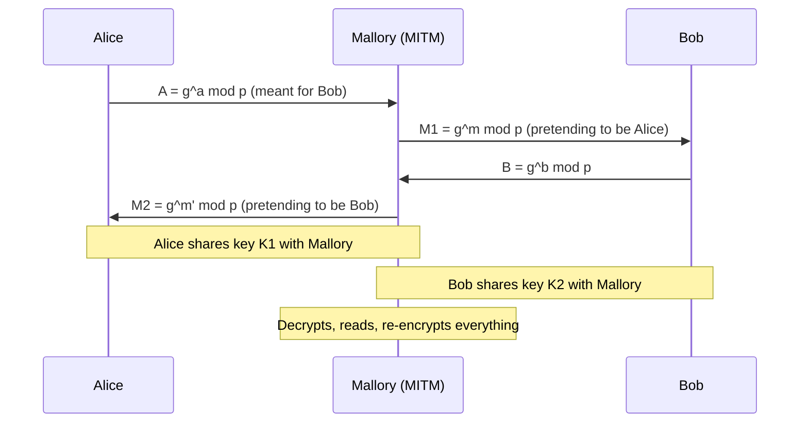
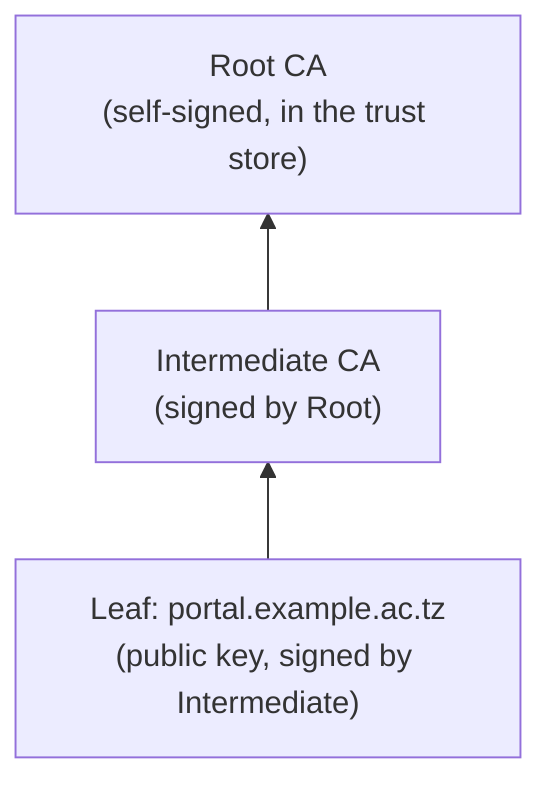

# CS-07 Public-Key Cryptography, Signatures and Key Management

> [!info] Topic card
> **Unit:** U3 · **Time:** 5–6 h · The toy RSA and Diffie–Hellman numbers and the Ed25519 demo in §9 were computed by running Python during the build.

> [!danger] Toy numbers are for learning only
> RSA with $n = 3233$ is broken by hand. Real RSA uses moduli of at least 2048 bits (3072 recommended for long-term security) **and padding** (OAEP for encryption, PSS for signatures). Use library APIs, and never "textbook RSA".

## 1. Learning objectives
1. **Explain** the public/private key idea, and **list** what asymmetric cryptography enables: key exchange, encryption to a recipient, digital signatures.
2. **Compute** toy RSA key generation, encryption, decryption and signing, and **explain** why real RSA needs large keys and padding.
3. **Perform** a toy Diffie–Hellman exchange, and **explain** the man-in-the-middle problem and how authentication solves it.
4. **Describe** digital signatures (sign the hash with a private key, verify with the public key) and their properties: integrity, authenticity, non-repudiation.
5. **Explain** X.509 certificates, certificate authorities, chains of trust and revocation, the key-management lifecycle, forward secrecy, and the post-quantum transition.

## 2. Why it matters
Every HTTPS connection, software update, code-signing check, SSH login and secure messaging app relies on public-key cryptography. It solves symmetric crypto's key-distribution problem ([[CS-05 Cryptography Foundations and Symmetric Encryption]] §5.7), and signatures give **non-repudiation**, which shared-key MACs can't.

## 3. Prerequisites
[[CS-05 Cryptography Foundations and Symmetric Encryption]], [[CS-06 Hashes, MACs and Integrity]], and modular arithmetic: congruence ([[DM-10 Relations, Equivalence Relations and Partial Orders]]) and primes ([[DM-05 Direct Proof, Contrapositive and Contradiction]]).

## 4. Intuition
- **Public-key encryption** is a **padlock** you hand out freely (the public key): anyone can snap it shut on a box, but only you have the key that opens it (the private key).
- A **digital signature** is a **wax seal only you can make**, but anyone can inspect it using your public "seal pattern".
- **Diffie–Hellman** is like **mixing paint**. Each party mixes a secret colour into a public colour and exchanges the results. Each then adds their own secret again, and both end up with the same final colour, which an eavesdropper can't un-mix.

## 5. Rigorous explanation

### 5.1 RSA (Rivest–Shamir–Adleman, 1977)
**Key generation:** choose large primes $p, q$. Compute $n = pq$ and $\varphi(n) = (p-1)(q-1)$. Choose $e$ with $\gcd(e,\varphi(n)) = 1$ (commonly 65537), and compute $d = e^{-1} \bmod \varphi(n)$. The public key is $(n, e)$, and the private key is $d$ (together with $p$ and $q$).
**Encrypt:** $c = m^e \bmod n$. **Decrypt:** $m = c^d \bmod n$. **Sign:** $s = H(m)^d \bmod n$. **Verify:** $s^e \bmod n \stackrel{?}{=} H(m)$.
**Why it works:** $ed \equiv 1 \pmod{\varphi(n)}$, so by Euler's theorem $m^{ed}\equiv m \pmod n$.
**Security:** recovering $d$ requires factoring $n$, which is believed infeasible for 2048+ bits on classical computers.
**Why padding:** textbook RSA is deterministic (the same plaintext always gives the same ciphertext, so guesses can be confirmed) and malleable ($(m_1m_2)^e = m_1^em_2^e$). OAEP and PSS add randomness and structure.

### 5.2 Diffie–Hellman (DH) key agreement (1976)
Public parameters: a prime $p$ and a generator $g$. Alice picks a secret $a$ and sends $A = g^a \bmod p$. Bob picks $b$ and sends $B = g^b\bmod p$. Both compute $K = g^{ab} \bmod p$: Alice as $B^a$, Bob as $A^b$. An eavesdropper sees $g, p, A, B$, and recovering $K$ requires (believed) solving the **discrete logarithm problem**. Modern systems use **elliptic-curve DH (ECDH, e.g. X25519)**.
**Unauthenticated DH is vulnerable to man-in-the-middle (MITM):** Mallory runs separate exchanges with Alice and Bob. **Fix:** authenticate the exchanged values with signatures and certificates (as TLS does).

### 5.3 Digital signatures
Sign: $\sigma = \text{Sign}_{sk}(H(m))$. Verify: $\text{Verify}_{pk}(m, \sigma)$. Common schemes: RSA-PSS, ECDSA, **Ed25519**.
| Property | Provided? |
|---|---|
| Integrity | ✔ any change invalidates the signature |
| Authenticity | ✔ only the private-key holder can sign |
| Non-repudiation | ✔ the signer can't plausibly deny it (if their key is protected) |
| Confidentiality | ✘ signatures don't hide the message |

### 5.4 Certificates and PKI
A public key alone doesn't tell you **whose** it is. An **X.509 certificate** binds an identity (e.g. `portal.example.ac.tz`) to a public key, **signed by a Certificate Authority (CA)**.
- **Chain of trust:** leaf certificate ← intermediate CA ← root CA (pre-installed in the OS/browser trust store).
- **Validation:** a valid signature at each link, within the validity dates, the name matching the host (SAN), the right key-usage constraints, and not revoked.
- **Revocation:** CRLs, OCSP/OCSP stapling, and short-lived certificates (e.g. 90-day ACME certificates from Let's Encrypt).
- **Self-signed certificates** are fine for internal testing if pinned or distributed manually, but they give no third-party assurance to the public.

### 5.5 Key management lifecycle
**Generate** (a CSPRNG, adequate size) → **store** (an HSM, KMS, or a protected key store, never in source control) → **distribute** (public keys via certificates, private keys never leave their store) → **use** (separate keys per purpose: signing vs encryption) → **rotate** (on a schedule or after an incident) → **revoke** (on compromise) → **archive/destroy** (securely).
**Forward secrecy:** with **ephemeral** (EC)DH per session, compromising a server's long-term key later doesn't decrypt recorded past sessions. TLS 1.3 requires it.

### 5.6 Key sizes and the quantum transition
| Purpose | Recommended now (approximate equivalents) |
|---|---|
| Symmetric | AES-128 (128-bit security); AES-256 for long-term/quantum margin |
| RSA | 3072-bit (≈128-bit security); 2048-bit is the common minimum |
| Elliptic curve | 256-bit curves (X25519, Ed25519, P-256) |
Large quantum computers (if built) would break RSA and ECC via Shor's algorithm. NIST published post-quantum standards in 2024: **FIPS 203 (ML-KEM)**, **FIPS 204 (ML-DSA)** and **FIPS 205 (SLH-DSA)**. Organisations are now planning migration ("harvest now, decrypt later" threatens today's encrypted secrets that must stay confidential for decades).

## 6. Terminology
| Term | Meaning |
|---|---|
| Public / private key | Shareable / secret halves of a key pair |
| Key agreement / exchange | Establishing a shared secret over an open channel |
| MITM | An attacker relaying and altering communications between two parties |
| Digital signature | Value proving origin and integrity, verifiable with the public key |
| Certificate / CA / PKI | Signed identity-key binding / its issuer / the whole trust infrastructure |
| Forward secrecy | Past sessions stay safe after a long-term key is compromised |
| HSM / KMS | Hardware security module / key management service |
| Hybrid encryption | Public-key for the key exchange, symmetric for the data |

## 7. Step-by-step: toy RSA (verified by running the code)
1. $p = 61$, $q = 53$, so $n = 3233$ and $\varphi = 60\cdot52 = 3120$.
2. $e = 17$ ($\gcd(17, 3120) = 1$).
3. $d = 17^{-1}\bmod 3120 = 2753$. Check: $17\cdot2753 = 46801 = 15\cdot3120 + 1$ ✔.
4. Encrypt $m = 65$: $c = 65^{17}\bmod 3233 = 2790$.
5. Decrypt: $2790^{2753} \bmod 3233 = 65$ ✔.
6. "Sign" $m = 65$ (textbook, no hash): $s = 65^{2753}\bmod 3233 = 588$. Verify: $588^{17}\bmod 3233 = 65$ ✔.
In Python: `pow(65, 17, 3233)`, `pow(17, -1, 3120)` (3.8+). Breaking it: factor 3233 by trial division (it takes milliseconds), which reveals $p$ and $q$ and hence $d$. That's why real moduli have hundreds of digits.

## 8. Diagrams

### 8.1 Diffie–Hellman and a MITM attack

*Text version: without authentication, Mallory completes one exchange with Alice and another with Bob, so each side unknowingly shares a key with Mallory. Signing the DH values with certified keys (as in the TLS handshake) defeats this, because Mallory can't forge Bob's signature.*

### 8.2 Certificate chain of trust


## 9. Worked examples

### Example 1 (basic): toy Diffie–Hellman (computed)
$p = 23$, $g = 5$, Alice $a = 6$, Bob $b = 15$. $A = 5^6 \bmod 23 = 8$ and $B = 5^{15}\bmod 23 = 19$. Alice computes $19^6 \bmod 23 = 2$, and Bob computes $8^{15}\bmod 23 = 2$. **The shared key is 2.** An eavesdropper sees 23, 5, 8 and 19, and in this tiny group can find $a$ by trying every exponent. With real 2048-bit groups or elliptic curves, that's infeasible.

### Example 2 (intermediate): which key is used for what?
| Goal | Use whose key? |
|---|---|
| Send Bob a secret | **Bob's public** key (only Bob's private key decrypts) |
| Prove that a message came from Alice | **Alice's private** key signs, and anyone verifies with Alice's **public** key |
| Bob checks Alice's signature | Alice's **public** key |
| A server proves its identity in TLS | The server's private key signs the handshake, and the certificate supplies the public key |
**Classic exam trap:** "encrypt with your private key to keep it secret" is wrong. That's a signature, and anyone can "decrypt" it with your public key.

### Example 3 (challenging): signing results with Ed25519 (real run)
```python
from cryptography.hazmat.primitives.asymmetric.ed25519 import Ed25519PrivateKey
from cryptography.exceptions import InvalidSignature

sk = Ed25519PrivateKey.generate()      # registrar's private key (keep in an HSM/KMS in reality)
pk = sk.public_key()                   # published, e.g. on the university website
sig = sk.sign(b"Result: S1 = 72")      # 64-byte signature
pk.verify(sig, b"Result: S1 = 72")     # OK: no exception
pk.verify(sig, b"Result: S1 = 92")     # raises InvalidSignature
```
Build output: signature length 64 bytes, "valid" for the original, and `InvalidSignature` for the altered message. An employer verifying a digital transcript needs only the registrar's public key and a trustworthy way to obtain it (a certificate, or the official website over HTTPS).

## 10. Application: what happens in a TLS 1.3 handshake (conceptual)
1. The client sends a ClientHello with its supported ciphers and an ECDHE key share.
2. The server replies with its own key share, its **certificate**, and a **signature** over the handshake transcript (proving it holds the private key for that certificate).
3. The client validates the certificate chain and hostname, and verifies the signature.
4. Both derive symmetric session keys from the ECDHE secret (forward secrecy), and the bulk data uses AES-GCM or ChaCha20-Poly1305.
Asymmetric crypto authenticates and agrees the keys, and symmetric crypto protects the data. That's hybrid encryption in action ([[CS-09 Network Security and Secure Communication]]).

## 11. Common mistakes
| Mistake | Fix |
|---|---|
| "Encrypt with the private key for secrecy" | Encrypt with the recipient's public key. Signing uses your private key. |
| Textbook RSA (no padding) | OAEP / PSS via a library |
| Unauthenticated DH | Authenticate it with signatures and certificates |
| Ignoring certificate validation errors (`verify=False`) | Never disable validation in production |
| Private keys in repos, emails or shared folders | HSM/KMS, strict access, rotation |
| One key for both signing and encryption | Separate keys per purpose |
| Assuming RSA-1024 is fine | ≥ 2048 (3072 recommended), or ECC |

## 12. Comparison
| | Symmetric | RSA | ECC (X25519/Ed25519) |
|---|---|---|---|
| Keys | 1 shared | public/private | public/private |
| Speed | fastest | slowest | fast |
| Key size for ~128-bit security | 128 | 3072 | 256 |
| Uses | bulk encryption, MACs | signatures, key transport (legacy) | key agreement, signatures |
| Quantum threat | Grover: halves the security (use 256-bit keys) | Shor: broken | Shor: broken |

## 13. Practice
**L1** 1. Which key encrypts a message for Bob? Which key signs a message from Alice? 2. What does a CA sign?

**L2** 3. Toy RSA with $p = 11$, $q = 13$, $e = 7$: compute $n$, $\varphi$ and $d$, then encrypt and decrypt $m = 9$. 4. Toy DH with $p = 23$, $g = 5$, $a = 4$, $b = 3$: find A, B and the shared key.

**L3** 5. Explain how Mallory performs a MITM on unauthenticated DH, and how TLS prevents it. 6. List every check a browser performs before trusting `https://portal.example.ac.tz`.

**L4** 7. A developer disables certificate verification in Python (`requests.get(url, verify=False)`) "because of an error". Explain the exact risk and the correct fixes (installing the internal CA, fixing the server chain). 8. Explain forward secrecy with a scenario: an attacker records traffic in 2026 and steals the server's private key in 2028.

**L5** 9. Design a scheme for issuing **verifiable digital certificates of completion** for the college: key generation and protection, what exactly is signed (the data format), how verifiers obtain and trust the public key, how revocation works (e.g. for fraud), the key-compromise plan, and post-quantum considerations.

## 14. Hints
> [!tip]- Hints
> 3: $n = 143$, $\varphi = 120$, $d = 7^{-1} \bmod 120$. 4: $5^4 \bmod 23$ and $5^3\bmod 23$. 6: chain, signatures, dates, hostname (SAN), revocation, key usage, protocol. 9: sign a canonical JSON with the certificate ID. Publish the public key via the HTTPS site and DNS, and keep a revocation list.

## 15. Worked solutions
> [!success]- Solutions 1–2
> 1. Bob's **public** key encrypts for Bob, and Alice's **private** key signs. 2. A certificate binding a subject identity (domain or organisation) to a public key, plus its validity data.

> [!success]- Solution 3
> $n = 143$ and $\varphi = 10\cdot12 = 120$. $d = 7^{-1}\bmod 120 = 103$, since $7\cdot103 = 721 = 6\cdot120 + 1$. Encrypt: $9^7 \bmod 143 = 48$. Decrypt: $48^{103}\bmod 143 = 9$ ✔ (checked with `pow` in the test suite).

> [!success]- Solution 4
> $A = 5^4 \bmod 23 = 625 \bmod 23 = 4$. $B = 5^3\bmod 23 = 125 \bmod 23 = 10$. Shared key: $B^a = 10^4 \bmod 23 = 18$, and $A^b = 4^3 \bmod 23 = 64 \bmod 23 = 18$ ✔.

> [!success]- Solution 5
> See §8.1. TLS prevents it by having the server **sign** the handshake (including its key share) with the private key of a certificate that a trusted CA issued for that hostname. Mallory can't produce a valid signature for the real domain without its private key, and a certificate for her own domain fails the hostname check.

> [!success]- Solution 6
> The chain builds up to a trusted root. Every signature in the chain verifies. The current date lies within each certificate's validity. The hostname matches the leaf's SAN. Key usage/extended key usage allow TLS server authentication. No certificate is revoked (OCSP stapling, CRLs, or browser-specific mechanisms). The handshake signature verifies with the leaf key. The protocol version and ciphers are acceptable (TLS 1.2+). Many browsers also require Certificate Transparency logging.

> [!success]- Solution 7
> `verify=False` accepts **any** certificate, so anyone on the network path (public Wi-Fi, a compromised router) can impersonate the server, read and modify the traffic, and steal credentials and tokens. The connection is still encrypted, but to the **attacker**. **Fixes:** if the server uses an internal CA, pass `verify="/path/to/internal-ca.pem"`, or install the CA into the trust store. If the server's chain is incomplete, fix it on the server (include the intermediate certificate). If the certificate has expired or has the wrong name, renew it. Never ship disabled verification.

> [!success]- Solution 8
> **Without forward secrecy** (e.g. old RSA key transport), the session keys were encrypted under the server's long-term RSA key, so in 2028 the attacker decrypts the 2026 recordings. **With ephemeral ECDHE**, each session's key came from throw-away DH secrets that were deleted after the session. The stolen 2028 key only lets the attacker *impersonate* the server from then on (until revocation). It doesn't let them decrypt the past.

> [!success]- Solution 9 (outline)
> **Keys:** Ed25519 (or ECDSA P-256) keys generated in an HSM or cloud KMS, never exportable. A separate root key kept offline signs a yearly issuing key (a small private PKI). **Data:** canonical JSON `{cert_id, student_name, programme, award, date, issuer, key_id}`, signed, with the signature and `key_id` embedded (a QR code for a URL plus a signature). **Trust:** publish the public keys at `https://college.example/.well-known/certificate-keys.json` and in printed form. Verifiers check the signature *and* the issuer key ID. **Revocation:** a signed revocation list (or an online status endpoint) listing revoked `cert_id`s. Verifiers check it. **Compromise plan:** revoke the issuing key, publish the incident and key status, re-issue the affected certificates under a new key, and investigate. **Post-quantum:** documents must remain verifiable for decades, so plan crypto-agility (a `key_id` with an algorithm field) and consider dual signatures (classical + ML-DSA, FIPS 204) once library support matures.

## 16. Self-test (pass ≥ 4/5)
1. RSA's security relies on? 2. DH's weakness without authentication? 3. What does a signature provide that a MAC doesn't? 4. What is forward secrecy? 5. Name one NIST post-quantum standard.
> [!success]- Answers
> 1. The hardness of factoring large n. 2. Man-in-the-middle. 3. Non-repudiation (public verifiability). 4. Past session keys stay secure if a long-term key is later compromised (ephemeral key agreement). 5. FIPS 203 ML-KEM (or 204 ML-DSA, or 205 SLH-DSA).

## 17. Flashcards
#flashcards/cyber-security
Encrypt a message for Bob with?::Bob's public key.
Sign a message as Alice with?::Alice's private key (verified with her public key).
RSA key relation?::e·d ≡ 1 (mod φ(n)), n = pq.
Diffie–Hellman shared key?::g^(ab) mod p; Alice computes B^a, Bob computes A^b.
Fix for DH man-in-the-middle?::Authenticate the exchange (signatures + certificates).
What does a certificate do?::Binds an identity to a public key, signed by a CA.
Forward secrecy?::Ephemeral key agreement so later long-term key compromise can't decrypt past sessions.

## 18. Blank-page recall
Redo the toy RSA from memory, draw the DH MITM diagram, and list the browser's certificate checks.

## 19. Revision summary
- Public key: anyone can encrypt to you or verify you. The private key decrypts and signs.
- RSA ($n = pq$, $ed\equiv1$) needs large keys and padding. (EC)DH agrees keys, and must be authenticated.
- Signatures give integrity, authenticity and non-repudiation.
- PKI: certificates, CA chains, validation, revocation. Never disable verification.
- Key lifecycle, HSM/KMS, forward secrecy, post-quantum planning.

## 20. Links
Prev: [[CS-06 Hashes, MACs and Integrity]] · Next: [[CS-08 Password Storage and Authentication Security]] · Applied: [[CS-09 Network Security and Secure Communication]] (TLS), [[CS-03 Authentication and Identity]] (FIDO2 uses signatures), [[DM-10 Relations, Equivalence Relations and Partial Orders]] (modular arithmetic)

## 21. Sources
- Rivest, R., Shamir, A. & Adleman, L., "A method for obtaining digital signatures and public-key cryptosystems", *Communications of the ACM*, 21(2), 1978, pp. 120–126.
- Diffie, W. & Hellman, M., "New directions in cryptography", *IEEE Transactions on Information Theory*, 22(6), 1976, pp. 644–654.
- IETF RFC 8446, *TLS 1.3*, 2018: https://www.rfc-editor.org/rfc/rfc8446 · RFC 5280 (X.509 PKI profile) · RFC 8032 (Ed25519)
- NIST SP 800-57 Part 1 Rev. 5, *Recommendation for Key Management*, 2020; NIST FIPS 203/204/205 (post-quantum, August 2024): https://csrc.nist.gov/projects/post-quantum-cryptography
- `cryptography` library, Ed25519: https://cryptography.io/en/latest/hazmat/primitives/asymmetric/ed25519/

## 22. Mastery checklist
- [ ] Toy RSA and DH computed correctly by hand
- [ ] I always name the correct key for each operation
- [ ] Certificate-scheme design (practice 9) · reviews scheduled
