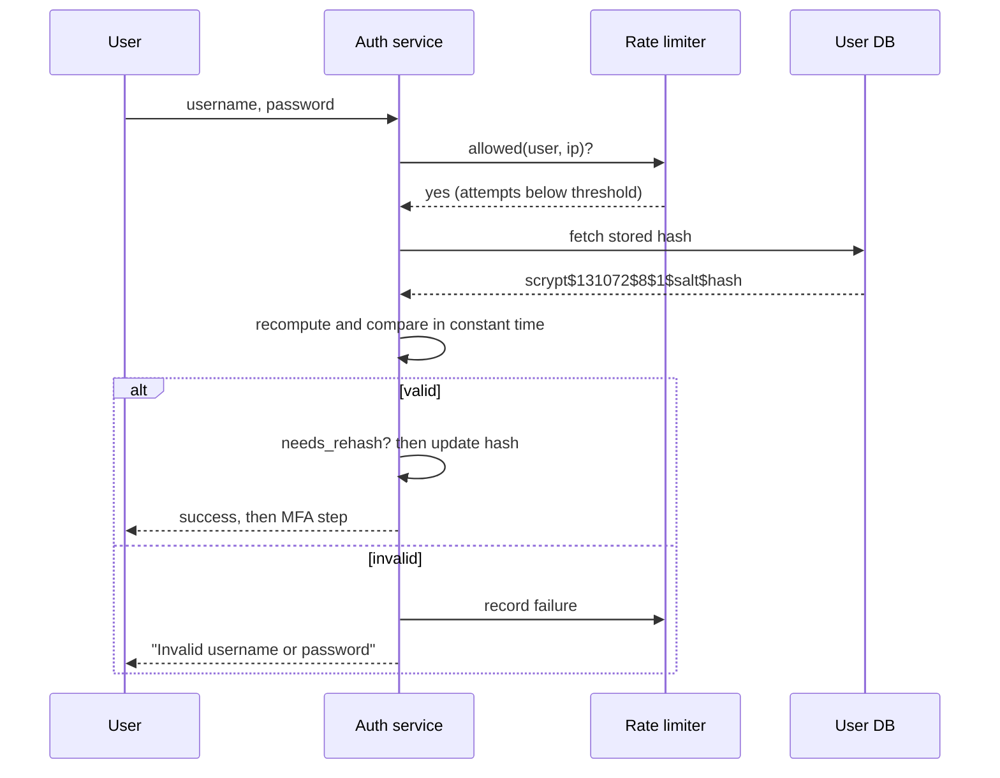

# CS-08 Password Storage and Authentication Security

> [!info] Topic card
> **Unit:** U3 · **Time:** 4 h · **Lab:** [[LAB-CS-01 Password Strength and Secure Password Storage]] · **Code:** `hash_password`, `verify_password`, `needs_rehash` and `password_problems` in `02 - Cyber Security/code/cs_examples.py`, covered by tests in `tests/test_cs_examples.py` (they pass on Python 3.13). Every number on this page was computed during the build.

## 1. Learning objectives
1. **Explain** why passwords must be stored with a *slow, salted, memory-hard* function rather than encrypted or hashed with SHA-256.
2. **Compute** keyspaces and entropy for password policies, and **estimate** offline cracking times under stated assumptions.
3. **Implement** salted password hashing with a self-describing format, constant-time verification, and upgrade-on-login (`needs_rehash`).
4. **Evaluate** password policies against current guidance (length, blocklists, no forced composition or periodic rotation).
5. **Design** defences against online attacks: rate limiting, credential stuffing protection, MFA and safe reset flows.

## 2. Why it matters
Databases leak. When they do, the way passwords were stored decides whether attackers get a few weak passwords after weeks of work, or every password within hours. Users reuse passwords, so a leak from *your* system also opens their email and bank accounts. Password storage is one of the few security decisions a single developer makes alone, and it is often hard to change later.

## 3. Prerequisites
[[CS-03 Authentication and Identity]] (factors, MFA) · [[CS-06 Hashes, MACs and Integrity]] (hash properties) · [[DM-11 Counting Principles, Permutations and Combinations]] (keyspaces $k^L$).

## 4. Intuition
A password hash should be a **lock that is deliberately slow to try**. The legitimate server tries one key per login, so taking 0.1 s is fine. An attacker with a stolen database tries billions of guesses, so 0.1 s per guess turns hours into centuries. A **salt** makes every user's lock unique, so the attacker can't try one guess against all users at once, and precomputed tables become useless.

## 5. Rigorous explanation

### 5.1 The threat model
- **Online attack:** guessing through the login form. The defences are rate limiting, lockout or backoff, MFA and monitoring. Storage format doesn't matter here.
- **Offline attack:** the attacker has the stored hashes (SQL injection, a stolen backup, an insider) and guesses at their own hardware's speed. Only the **storage scheme** and the **password's strength** help.

### 5.2 Why the obvious approaches fail
| Scheme | Problem |
|---|---|
| Plaintext | Every account exposed immediately |
| Reversible encryption | The key lives on the same server; steal both and you have plaintext |
| `sha256(password)` | Fast (GPUs make billions of guesses per second). Equal passwords give equal hashes. Precomputed and rainbow tables work |
| `sha256(salt + password)` | Fixes equal hashes and precomputation, but still fast |
| **Slow salted KDF** (Argon2id, scrypt, bcrypt, PBKDF2) | Each guess costs time (and memory); a unique salt per user |

### 5.3 Salts, peppers and work factors
- **Salt:** random (≥ 16 bytes), unique per password, stored *with* the hash. It isn't secret. It defeats precomputation and forces attackers to attack each user separately.
- **Work factor:** an iteration count or cost parameter, tuned so one hash takes noticeable time on your server. **Memory-hard** functions (Argon2id, scrypt) also need lots of RAM per guess, which blunts GPUs and ASICs.
- **Pepper (optional):** a secret key kept *outside* the database (e.g. in an HSM or secrets manager) and mixed in, often as HMAC. It helps only if the database leaks without the pepper.

### 5.4 Current parameter guidance
From the OWASP Password Storage Cheat Sheet (re-check before relying on it, because the values are revised as hardware improves):

| Algorithm | Suggested minimum |
|---|---|
| **Argon2id** (first choice) | m = 19 MiB, t = 2, p = 1 |
| **scrypt** | N = 2¹⁷, r = 8, p = 1 |
| **bcrypt** (legacy systems) | work factor ≥ 10; note its 72-byte input limit |
| **PBKDF2-HMAC-SHA256** (when FIPS compliance is required) | 600,000 iterations |

On the build container, one scrypt hash with N = 2¹⁷, r = 8, p = 1 took about **0.53 s**, and PBKDF2-HMAC-SHA256 with 600,000 iterations took about **0.19 s**. By contrast, plain Python made about **1.6 million** SHA-256 hashes per second on one CPU core. These are single measurements on one machine, shown to give a sense of scale.

### 5.5 Self-describing hashes and upgrades
Store the algorithm and its parameters together with the salt and hash, e.g. `scrypt$131072$8$1$<salt>$<hash>` (the same idea as the PHC string format `$argon2id$v=19$m=19456,t=2,p=1$…`). When you raise the cost, `needs_rehash` spots old hashes. On the user's next successful login you have the plaintext briefly, so you re-hash it with the new parameters. For legacy fast hashes, you can wrap them right away (`scrypt(sha1_hash)`) and migrate fully at login.

### 5.6 Entropy and policy
For $L$ symbols chosen **uniformly at random** from an alphabet of size $k$: keyspace $N = k^L$, entropy $H = L\log_2 k$ bits. *Human-chosen* passwords are far from uniform, so formulas overestimate their strength; attackers try dictionaries, leaks and mutation rules first.

NIST SP 800-63B (Revision 4, 2025; check for the current revision) moved policy away from complexity rules:
- Require length (at least 15 characters when the password is the only factor; at least 8 when it's part of MFA).
- Allow at least 64 characters, and all printable characters, including spaces.
- **Check against a blocklist** of common, breached and context-specific passwords.
- Don't impose composition rules, and don't force periodic changes (only change after evidence of compromise).
- Allow paste and password managers.

## 6. Terminology
| Term | Meaning |
|---|---|
| KDF | Key derivation function; a password-hashing KDF is deliberately slow |
| Salt | Random, non-secret, per-password value mixed in before hashing |
| Pepper | A secret value stored outside the database |
| Work factor / cost | Parameter controlling the time (and memory) per hash |
| Memory-hard | Needs large RAM per evaluation, which limits parallel hardware |
| Rainbow table | Precomputed chains mapping hashes back to passwords (defeated by salts) |
| Credential stuffing | Replaying username–password pairs leaked from *other* sites |
| Password spraying | Trying a few common passwords against many accounts, staying under lockout limits |

## 7. Step-by-step: registering and logging in
1. Registration: check `password_problems` (length and blocklist). If it's acceptable, `stored = hash_password(pw)`, and save `stored`.
2. Login: look up the user. If the user doesn't exist, still run a dummy hash so timing doesn't reveal whether accounts exist.
3. `verify_password(pw, stored)` recomputes with the *stored* parameters and compares with `hmac.compare_digest`.
4. If it's valid and `needs_rehash(stored)`, re-hash and update the record.
5. Return the same generic error for a wrong user or a wrong password, and count failures per account and per IP for throttling.

## 8. Diagram: login with rate limiting and rehash


## 9. Worked examples

### Example 1 (basic): keyspace and entropy
All values computed with Python:

| Policy | $N = k^L$ | Entropy |
|---|---|---|
| 4-digit PIN | $10^4 = 10{,}000$ | 13.3 bits |
| 8 lowercase letters | $26^8 \approx 2.09\times10^{11}$ | 37.6 bits |
| 8 from letters + digits (62) | $62^8 \approx 2.18\times10^{14}$ | 47.6 bits |
| 8 from 95 printable | $95^8 \approx 6.63\times10^{15}$ | 52.6 bits |
| 4 random words (7,776-word list) | $7776^4 \approx 3.66\times10^{15}$ | 51.7 bits |
| 6 random words | $7776^6 \approx 2.21\times10^{23}$ | 77.5 bits |
| 12 from 95 printable | $95^{12} \approx 5.40\times10^{23}$ | 78.8 bits |

Length helps more than a bigger alphabet: six random words beat eight random printable characters by about 25 bits, and they're easier to remember. These figures apply only to passwords chosen *at random*.

### Example 2 (intermediate): cracking-time estimate under stated assumptions
Assume the attacker manages $10^{10}$ guesses/s against a fast unsalted hash (a common ballpark for a GPU rig; real rates vary a lot by hardware and algorithm), and $10^4$ guesses/s against a properly tuned slow KDF. On average, the search covers half the keyspace.

| Keyspace | Fast hash | Slow KDF |
|---|---|---|
| $26^8$ | ≈ 10 s | ≈ 0.33 years |
| $62^8$ | ≈ 10,900 s (3 h) | ≈ 346 years |
| $95^8$ | ≈ 331,700 s (3.8 days) | ≈ 10,500 years |

The KDF makes each guess about a million times more expensive. This changes "crackable overnight" into "not worth attacking", *for random passwords*. Common passwords like `password123` fall within the first few thousand guesses in either case. That's why blocklists matter.

### Example 3 (challenging): hashing code — insecure version, then the fix
```python
# INSECURE: do not use. Shown for critique only.
import hashlib

def store(pw: str) -> str:
    return hashlib.md5(pw.encode()).hexdigest()

def check(pw: str, stored: str) -> bool:
    return store(pw) == stored
```
Faults: MD5 is fast and broken; there's no salt, so equal passwords give equal hashes (`482c811da5d5b4bc6d497ffa98491e38` for `password123`, which can be found by searching it online); `==` isn't constant-time; and there's no parameter field for upgrades.

Corrected version (from `cs_examples.py`; the real output is below):
```python
from cs_examples import hash_password, verify_password, needs_rehash

stored = hash_password("ndizi mbili chai moto asubuhi")
print(stored)
print(verify_password("ndizi mbili chai moto asubuhi", stored),
      verify_password("ndizi mbili chai moto asubuhI", stored),
      needs_rehash(stored))
```
```text
scrypt$131072$8$1$J2JtoU4lRObaAgJ3mWXScg==$IuUaexBjkt7qwcyoefHLBmngrN+k7Fx/1bB2sgX00Cs=
True False False
```
The salt is random, so your output will differ on every run. That's intended. In production, prefer a maintained library such as `argon2-cffi` (Argon2id) or `bcrypt`. The standard-library version here shows the mechanics.

## 10. Application: hostel maintenance system login
In the [[PRJ-PY-05 Hostel Maintenance System]], students log in with a registration number and password:
- **Storage:** Argon2id or scrypt in the `users.password_hash` column, using the self-describing format.
- **Policy:** at least 15 characters (or 8 plus MFA for wardens), and a blocklist that includes the institution's name, "hostel" and common passwords.
- **Online defences:** exponential backoff per account, a per-IP limit, alerts on spraying patterns (many accounts, one password), and MFA for staff roles.
- **Reset:** a single-use random token (≥ 128 bits) emailed to the address on file. Store only the token's hash, expire it within 30 minutes, and invalidate existing sessions after the reset.

## 11. Common mistakes
| Mistake | Fix |
|---|---|
| SHA-256 or MD5 for passwords | Argon2id, scrypt, bcrypt or PBKDF2 with current parameters |
| One global salt | A unique random salt per password |
| Encrypting passwords "so we can email them" | Never recover passwords; reset them instead |
| Composition rules and 90-day rotation | Length, blocklists and MFA; change only after compromise |
| "User not found" vs "wrong password" messages | One generic message, and similar timing |
| Lockout after 3 tries (lets attackers lock users out) | Progressive delays, CAPTCHA, per-IP limits |
| Truncating passwords silently (bcrypt 72-byte limit) | Document the limit, or pre-hash carefully with a library that supports it |
| Logging request bodies that contain passwords | Redact credentials in logs |

## 12. Comparison: password KDFs
| | PBKDF2 | bcrypt | scrypt | Argon2id |
|---|---|---|---|---|
| Year | 2000 (RFC 2898) | 1999 | 2009 (RFC 7914, 2016) | 2015 (PHC winner; RFC 9106, 2021) |
| Memory-hard | No | Slightly | Yes | Yes (tunable) |
| GPU resistance | Weak | Moderate | Good | Good |
| Standard library in Python | `hashlib.pbkdf2_hmac` | No (`bcrypt` package) | `hashlib.scrypt` | No (`argon2-cffi`) |
| When to choose | FIPS requirements | Existing systems | When Argon2 isn't available | New systems |

## 13. Practice
**L1** 1. Why is a salt not secret? 2. Which attack does rate limiting prevent, and which can it never prevent?

**L2** 3. Compute the keyspace and entropy of a 10-character password drawn uniformly from 36 symbols (lowercase + digits). 4. A system stores `sha256(salt‖pw)` with unique salts. What does the salt fix, and what remains weak?

**L3** 5. Write `login(username, password)` pseudocode that returns a generic error, avoids user enumeration via timing, and rehashes on success. 6. Explain how a pepper should be stored, and what happens to all passwords if it is lost.

**L4** 7. Plan the migration of 20,000 users from unsalted MD5 hashes to Argon2id *without* forcing everyone to reset. 8. Under the assumptions in Example 2, how much longer does a random 10-character password from 62 symbols survive than an 8-character one, against the slow KDF?

**L5** 9. Write a password and login policy for a university exam-results portal (students, lecturers, admins). Cover length, blocklists, MFA by role, throttling, reset, monitoring, and how you'll explain the "no forced rotation" choice to an auditor.

## 14. Hints
> [!tip]- Hints
> 3: $36^{10}$ and $10\log_2 36$. 4: the speed. 6: a secrets manager, separate from the database backups. 7: wrap the hashes now, `argon2(md5_hex)`, then replace them at login. 8: $62^{10}/62^{8} = 62^2$. 9: separate staff and student roles, and cite the current guidance.

## 15. Worked solutions
> [!success]- Solutions 1–2
> 1. Its job is to make each hash unique and to defeat precomputation, not to hide anything; the attacker can read it and that's fine. 2. Rate limiting stops **online** guessing through the login interface. It can't stop **offline** guessing once the hashes are stolen.

> [!success]- Solution 3
> $36^{10} = 3{,}656{,}158{,}440{,}062{,}976 \approx 3.66\times10^{15}$. Entropy $= 10\log_2 36 \approx 51.7$ bits (exactly the same keyspace as four random diceware words, because $36^{10} = 7776^4 = 6^{20}$).

> [!success]- Solution 4
> Unique salts mean equal passwords get different hashes, rainbow tables are useless, and each user must be attacked separately. What remains weak is that SHA-256 is **fast**: billions of guesses per second per GPU, so weak and medium passwords still fall quickly. A slow KDF is needed.

> [!success]- Solution 5
> ```text
> function login(username, password):
>     if not limiter.allowed(username, client_ip): return error("Too many attempts. Try later")
>     user = db.find(username)
>     stored = user.password_hash if user else DUMMY_HASH   # same work for unknown users
>     ok = verify_password(password, stored) and user is not None
>     if not ok:
>         limiter.record_failure(username, client_ip)
>         return error("Invalid username or password")
>     if needs_rehash(stored): db.update(user.id, hash_password(password))
>     limiter.reset(username)
>     return start_mfa_or_session(user)
> ```

> [!success]- Solution 6
> Store the pepper in a secrets manager or HSM, *not* in the database or its backups. Apply it as `HMAC(pepper, password)` before the KDF, or by encrypting the stored hash. If it's lost, **every** password becomes unverifiable and all users must reset. So it needs a secure backup and a rotation plan (keep a pepper version ID next to each hash).

> [!success]- Solution 7
> (1) Immediately, in one batch: `new = argon2id(md5_hex)` for every user, stored as `argon2-over-md5$…`. The weak MD5 hashes are gone from storage right away. (2) At login: compute `md5(pw)`, verify it against the wrapped hash, then replace it with a plain `argon2id(pw)` record. (3) After a set period, force a reset for accounts that never logged in. (4) Assume the old hashes may already have leaked: check for credential stuffing and encourage MFA.

> [!success]- Solution 8
> The ratio is $62^{2} = 3{,}844$ times longer. 8 characters: about 346 years (Example 2). 10 characters: about $346 \times 3844 \approx 1.33$ million years, on average, under the stated assumptions. Each extra character multiplies the work by the alphabet size.

> [!success]- Solution 9 (outline)
> **Storage:** Argon2id at the OWASP minimum or above, tuned to about 0.25 s on the server. **Students:** at least 15 characters, or at least 8 with optional TOTP; a blocklist (breached corpus plus the university name, course codes, "semester"). **Lecturers and admins:** MFA is mandatory (TOTP or a security key), because grade changes and bulk exports are high-impact. **Throttling:** progressive delays per account and limits per IP, and alert on spraying. **Reset:** a token-hash flow; notify the user; end their sessions. **Monitoring:** log failed and successful logins, MFA changes and resets (never passwords). **Rotation:** cite NIST SP 800-63B: forced periodic change leads to predictable patterns (`Spring2025!` → `Summer2025!`). Instead, force changes only on evidence of compromise, and compensate with a blocklist and MFA.

## 16. Self-test (pass ≥ 4/5)
1. Which property of a salt matters most? 2. Name two memory-hard KDFs. 3. Why use a self-describing hash string? 4. What's credential stuffing? 5. Does NIST recommend forced 90-day password changes?
> [!success]- Answers
> 1. Uniqueness (random, per password). 2. Argon2id and scrypt. 3. To verify with the original parameters and detect when rehashing is needed. 4. Replaying credentials leaked from other services. 5. No: only after evidence of compromise.

## 17. Flashcards
#flashcards/cyber-security
Why not SHA-256 for passwords?::It's fast; offline attackers try billions of guesses per second. Use a slow, salted KDF.
What does a salt defeat?::Precomputed and rainbow tables, and identical hashes for identical passwords.
First-choice password hashing algorithm (OWASP)?::Argon2id.
Pepper?::A secret value stored outside the database and mixed in before or after hashing.
Entropy of L uniform symbols from alphabet k?::L·log2(k) bits.
Online vs offline password attack defences?::Online: rate limiting, MFA. Offline: a slow salted KDF and strong passwords.
NIST policy stance on composition rules?::Don't impose them; require length, check a blocklist, allow long passphrases.

## 18. Blank-page recall
Rebuild the "why the obvious approaches fail" table and the login sequence diagram from memory.

## 19. Revision summary
- Passwords: use **Argon2id or scrypt** (or bcrypt, or PBKDF2 for FIPS), with a unique salt and current parameters, stored in a self-describing format.
- Verify in constant time. Rehash on login when parameters are raised.
- Online attacks: rate limits, MFA, monitoring. Offline attacks: slow hashing plus strong passwords.
- Policy: length and blocklists, no composition rules or forced rotation, allow password managers.
- Entropy formulas apply only to random passwords. Human choices are weaker.

## 20. Links
Prev: [[CS-07 Public-Key Cryptography, Signatures and Key Management]] · Next: [[CS-09 Network Security and Secure Communication]] · Lab: [[LAB-CS-01 Password Strength and Secure Password Storage]] · Related: [[CS-03 Authentication and Identity]], [[PY-24 Secure Programming and Input Validation]], [[DM-11 Counting Principles, Permutations and Combinations]]

## 21. Sources
- NIST SP 800-63B, *Digital Identity Guidelines: Authentication and Authenticator Management* (Revision 4): https://pages.nist.gov/800-63-4/
- OWASP Password Storage Cheat Sheet: https://cheatsheetseries.owasp.org/cheatsheets/Password_Storage_Cheat_Sheet.html
- IETF RFC 7914, *The scrypt Password-Based Key Derivation Function*, 2016; RFC 9106, *Argon2 Memory-Hard Function for Password Hashing and Proof-of-Work Applications*, 2021; RFC 8018, *PKCS #5 v2.1* (PBKDF2), 2017.
- Python docs, `hashlib.scrypt` and `hashlib.pbkdf2_hmac`: https://docs.python.org/3/library/hashlib.html
- *(Links were not checked during the build, because there was no network access. Verify them before citing.)*

## 22. Mastery checklist
- [ ] I can explain why each naive storage scheme fails
- [ ] I can compute keyspace and entropy, and estimate attack time under stated assumptions
- [ ] I can implement hash, verify and rehash, and write a modern password policy
- [ ] LAB-CS-01 done · reviews scheduled
