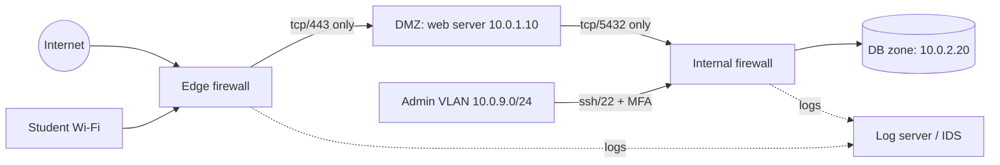

# CS-09 Network Security and Secure Communication

> [!info] Topic card
> **Unit:** U4 · **Time:** 5 h · **Code:** `match_rule` and `shadowed_rules` (a first-match packet-filter model) in `code/cs_examples.py`, with parametrised tests. Subnet figures were computed with Python's `ipaddress` module. The `openssl` and `ss` commands in §7 are shown for your own machine; their output was **not** captured during the build, because the build environment had no outbound network.

> [!warning] Scope
> Only scan, capture or probe networks you own or are explicitly authorised to assess. Packet capture on shared networks (a campus Wi-Fi, a café) can be illegal even if you do nothing with the data.

## 1. Learning objectives
1. **Map** common network attacks (sniffing, spoofing, MITM, DoS, DNS poisoning) to TCP/IP layers and to the CIA property each one harms.
2. **Design** a segmented network with a DMZ and a default-deny rule set, and **reason** about first-match rule ordering.
3. **Explain** the TLS 1.3 handshake: how it gives confidentiality, integrity and server authentication, and what certificate validation actually checks.
4. **Compare** firewalls (stateless, stateful, application-layer), IDS/IPS and VPNs by what they can and can't see.
5. **Evaluate** Wi-Fi, DNS and remote-access configurations against current good practice.

## 2. Why it matters
Most attacks reach their target over a network, and most breaches spread *inside* a network after a first foothold (lateral movement). Good network design cannot fix vulnerable applications, but it limits who can reach them, contains damage, and creates the visibility that incident response depends on.

## 3. Prerequisites
[[CS-07 Public-Key Cryptography, Signatures and Key Management]] (certificates, key exchange) · [[DM-15 Graphs, Representations, Paths and Connectivity]] (networks as graphs) · basic IP addressing.

## 4. Intuition
Think of a building. **Segmentation** is walls and locked internal doors. **Firewalls** are guards checking who may pass each door. **IDS** is CCTV, which watches and raises alarms, and **IPS** is a guard who can also stop people. **TLS** is a sealed, signed envelope, so couriers (routers, Wi-Fi) can carry it but can't read or alter it unnoticed. **Zero trust** means "don't assume someone is friendly just because they're already inside the building."

## 5. Rigorous explanation

### 5.1 Attacks by layer
| Layer (TCP/IP) | Example attacks | Harms | Main defences |
|---|---|---|---|
| Link | ARP spoofing, MAC flooding, rogue access point | C, I | Port security, Dynamic ARP Inspection, 802.1X, WPA3 |
| Internet (IP) | IP spoofing, ICMP floods, route hijacking | I, A | Ingress/egress filtering, rate limits, RPKI (for ISPs) |
| Transport | SYN flood, port scanning, session hijacking | A, C | SYN cookies, stateful firewalls, TLS |
| Application | DNS poisoning, HTTP attacks, credential theft | C, I, A | DNSSEC/validated resolvers, TLS, WAF, secure code |

### 5.2 Segmentation and the DMZ
Split the network into zones by trust and function, e.g. **Internet → DMZ (public web server) → internal app zone → database zone**, plus separate admin, staff, student and guest Wi-Fi VLANs. Traffic between zones passes a filtering point, and rules follow **least privilege**: allow only the flows the system needs. Fewer reachable hosts means a smaller attack surface and less lateral movement.

### 5.3 Firewall rule semantics
Most packet filters evaluate rules **in order** and apply the **first match**. Two consequences:
- A broad rule placed early **shadows** later, more specific rules (they can never fire).
- The final rule should be **default deny** (an explicit "deny any any" or a deny policy).

Types:
- **Stateless:** each packet is judged on its own headers.
- **Stateful:** tracks connections, so return traffic is allowed automatically.
- **Application-layer/NGFW/WAF:** understands protocols, e.g. HTTP. Needs TLS inspection to see inside encrypted traffic, which has privacy and trust costs.

### 5.4 IDS/IPS
- **Signature-based:** matches known patterns. Precise, but blind to new attacks.
- **Anomaly-based:** flags deviations from a baseline. Can catch novel attacks, but produces more false positives.

An IDS (detect only) can be passive; an IPS (inline) can drop traffic, but a false positive then blocks legitimate users. Base rates matter: if 1 packet in a million is malicious, even a 0.1% false-positive rate means most alerts are false (see [[DM-18 Introductory Discrete Probability]]).

### 5.5 TLS 1.3 (simplified)
1. **ClientHello:** supported cipher suites, a key share (ephemeral ECDHE public value), and SNI (the server name).
2. **ServerHello:** the chosen suite and the server's key share. Both sides now derive handshake keys from the shared ECDHE secret. Everything after this is encrypted.
3. The server sends its **Certificate**, a **CertificateVerify** (a signature over the handshake transcript with the certificate's private key), and **Finished** (a MAC over the transcript).
4. The client **validates** the certificate:
   - the chain leads to a trusted root;
   - it hasn't expired;
   - the name matches the host;
   - it hasn't been revoked (where checked).
   It then checks the signature and sends its own Finished.
5. Application data flows under AEAD (AES-GCM or ChaCha20-Poly1305).

Properties: **confidentiality** and **integrity** (AEAD), **server authentication** (certificate + signature), and **forward secrecy** (ephemeral keys: a later key theft doesn't decrypt past sessions). TLS does *not* protect data at the endpoints, hide which IP addresses are talking, or prove that a validly certified site is honest.

### 5.6 Other building blocks
- **VPN** (IPsec, WireGuard, TLS-based): an encrypted tunnel between networks or for remote users. The VPN gateway becomes a high-value target, so patch it and protect it with MFA.
- **DNS:** plain DNS is unauthenticated, which allows cache poisoning. **DNSSEC** signs records (integrity); **DoH/DoT** encrypt queries (privacy). These solve different problems.
- **Wi-Fi:** WPA3-Personal (SAE) resists offline dictionary attacks on the handshake. WPA2-Enterprise/WPA3-Enterprise with 802.1X gives per-user credentials. Never use WEP or open networks for anything sensitive.
- **Zero trust:** authenticate and authorise every request based on identity and device health, not on network location.
- **DoS/DDoS:** the defences are capacity, upstream filtering (ISP/CDN scrubbing), rate limiting and SYN cookies. This lesson covers defence only.

## 6. Terminology
| Term | Meaning |
|---|---|
| DMZ | A network zone for Internet-facing services, isolated from internal zones |
| VLAN | A logical network segment on shared switches |
| Stateful inspection | Filtering that tracks connection state |
| Egress filtering | Restricting *outbound* traffic (limits exfiltration and malware callbacks) |
| MITM | Man-in-the-middle: an attacker relays and possibly alters traffic |
| Forward secrecy | Compromise of long-term keys doesn't reveal past session keys |
| SNI | Server Name Indication: the hostname sent in the ClientHello |
| Lateral movement | An attacker moving from a first compromised host to others |

## 7. Step-by-step: checking your own machine and a TLS endpoint
Run these on a machine you control. Output varies, so interpret it rather than comparing exact text.
```bash
# Which services are listening on this machine? (Linux)
ss -tulpn
# Interpretation: a 0.0.0.0:5432 (PostgreSQL) listener means "reachable from any interface"; bind it to 127.0.0.1 if it's only used locally.

# Inspect the TLS certificate and protocol of a site you're allowed to test
openssl s_client -connect example.com:443 -servername example.com -tls1_3 </dev/null
# Look for: "Verify return code: 0 (ok)", Protocol TLSv1.3, the certificate subject/SAN and its validity dates.
```
On Windows, `netstat -ano` and `Get-NetTCPConnection -State Listen` (PowerShell) give the equivalent listener list.

## 8. Diagram: segmented hostel-system network

*Text version: the Internet and student Wi-Fi reach only the web server's port 443 in the DMZ. Only the web server reaches the database, on port 5432. Only the admin VLAN can SSH inside. Both firewalls send logs to a log/IDS server.*

## 9. Worked examples

### Example 1 (basic): subnetting a hostel network
Computed with `ipaddress`: `192.168.10.0/24` has 256 addresses (netmask 255.255.255.0), usable hosts .1–.254, broadcast .255. Splitting it into four `/26` blocks gives:

| Subnet | Range | Broadcast | Use |
|---|---|---|---|
| 192.168.10.0/26 | .0–.63 | .63 | Staff |
| 192.168.10.64/26 | .64–.127 | .127 | Servers |
| 192.168.10.128/26 | .128–.191 | .191 | Admin |
| 192.168.10.192/26 | .192–.255 | .255 | Guests |

Each `/26` has $2^{6} = 64$ addresses and 62 usable hosts.

### Example 2 (intermediate): evaluating a rule list
The rules in the diagram, as `HOSTEL_RULES` in the test file:

| # | Action | Source | Destination | Proto/port |
|---|---|---|---|---|
| 0 | allow | any | 10.0.1.10/32 | tcp/443 |
| 1 | allow | 10.0.1.10/32 | 10.0.2.20/32 | tcp/5432 |
| 2 | allow | 10.0.9.0/24 | 10.0.0.0/16 | tcp/22 |
| 3 | deny | any | any | any |

Tested results (`match_rule`):
- An Internet host (41.59.1.2) to the web server on 443 → **allow (0)**.
- The same host to the database on 5432 → **deny (3)**.
- The web server to the database → **allow (1)**.
- The admin VLAN (10.0.9.5) SSH to the database host → **allow (2)**.
- 10.0.3.7 SSH → **deny (3)**.
- UDP to 443 → **deny (3)**.

### Example 3 (challenging): spot the shadowed rules
```text
0 allow 10.0.0.0/16  any  tcp  any
1 deny  10.0.5.0/24  any  tcp  23     <- intended: block telnet from the lab subnet
2 deny  any          any  any  any
3 allow any          any  tcp  443    <- intended: allow HTTPS
```
`shadowed_rules` returns `[1, 3]`. Rule 1 never fires, because rule 0 already allows *all* TCP from 10.0.0.0/16, which includes 10.0.5.0/24 port 23. Rule 3 never fires, because the deny-all comes first. **The fix:** order rules from most specific to least specific, and keep deny-all last: 1, 3, 0, 2. Then check again: the corrected order has no shadowed rules. This analysis catches a common real-world misconfiguration.

## 10. Application: remote access for hostel administrators
Rather than exposing SSH or a database to the Internet:
1. Admins connect to a **VPN** (WireGuard or IPsec) protected by MFA.
2. From the VPN subnet, they reach a hardened **bastion host** (jump server) that logs every session.
3. Only the bastion's address may SSH to servers (key-based authentication, no passwords, no root login).

Egress rules let the database server reach *only* the patch repository. Every firewall decision is logged centrally for [[CS-15 Logging, Monitoring, Incident Response and Recovery]].

## 11. Common mistakes
| Mistake | Fix |
|---|---|
| A flat network ("everything can reach everything") | Segment by zone; least-privilege flows |
| An allow-any rule placed above specific denies | Most specific first; run shadow analysis |
| Database or RDP/SSH exposed to the Internet | VPN + bastion; bind to internal interfaces |
| Ignoring outbound traffic | Egress filtering and DNS monitoring |
| "It's HTTPS, so it's safe" | TLS protects data in transit only; the site and endpoints still need security |
| Disabling certificate verification to "fix" errors (`verify=False`) | Fix the trust store or certificate; never disable validation |
| Treating an IDS as set-and-forget | Tune it, triage alerts, account for base rates |

## 12. Comparison: network controls
| Control | Sees | Can block | Blind to |
|---|---|---|---|
| Stateless ACL | Headers per packet | Yes | Connection context, payload |
| Stateful firewall | Headers + connection state | Yes | Payload (encrypted or not) |
| NGFW/WAF | Application protocol | Yes | Encrypted traffic, unless it inspects TLS |
| IDS | Traffic copies | No (it alerts) | Encrypted payloads; novel attacks (signature-based) |
| IPS | Inline traffic | Yes | The same as IDS, and false positives cause outages |
| VPN | n/a (it builds tunnels) | Restricts who can connect | Malicious *authorised* users |

## 13. Practice
**L1** 1. Which CIA property does ARP spoofing primarily threaten? 2. What does forward secrecy mean?

**L2** 3. How many usable hosts does `10.20.0.0/22` have, and what's its broadcast address? 4. Classify each: SYN flood, DNS cache poisoning, rogue access point (layer, CIA property).

**L3** 5. Write a default-deny rule list for: public HTTPS to a web server, the web server to an API server on 8443, the API server to the database on 5432, and admin SSH from 10.0.9.0/24 only. 6. Explain what a browser checks before showing the padlock, and one attack that each check prevents.

**L4** 7. A colleague proposes TLS inspection on the campus proxy "to catch malware". Analyse the security benefits, privacy and legal concerns, and the new risks (a trusted root on every device, a single point of compromise). 8. An IDS has a 99% detection rate and a 1% false-positive rate, and 1 in 10,000 connections is malicious. What fraction of alerts are real?

**L5** 9. Design the network for a small clinic: reception PCs, doctors' laptops, a records server, guest Wi-Fi and a cloud backup. Provide the zones, a subnet plan, firewall flows, Wi-Fi security, remote access, logging, and a justification for each choice.

## 14. Hints
> [!tip]- Hints
> 3: $2^{32-22}$ addresses, minus 2. 5: one allow per flow, then deny-all. 6: the chain, validity, name, revocation, and the handshake signature. 8: Bayes, or count per million connections. 9: start from the assets and who needs to reach them.

## 15. Worked solutions
> [!success]- Solutions 1–2
> 1. Mainly **confidentiality** and **integrity** (a MITM can read and change traffic); availability too, if it drops frames. 2. Session keys come from ephemeral key exchanges, so stealing the server's long-term private key later doesn't decrypt recorded past sessions.

> [!success]- Solution 3
> $2^{10} = 1024$ addresses (netmask 255.255.252.0, computed). Usable hosts: **1022** (10.20.0.1–10.20.3.254). Broadcast: **10.20.3.255**.

> [!success]- Solution 4
> | Attack | Layer | CIA |
> |---|---|---|
> | SYN flood | Transport | Availability |
> | DNS cache poisoning | Application | Integrity (then confidentiality, when users are redirected to fake sites) |
> | Rogue AP | Link | Confidentiality, integrity |

> [!success]- Solution 5
> ```text
> 0 allow any            web:443   tcp
> 1 allow web/32         api:8443  tcp
> 2 allow api/32         db:5432   tcp
> 3 allow 10.0.9.0/24    servers:22 tcp
> 4 deny  any            any       any   (log)
> ```
> Every flow has one rule, none is shadowed, and deny-all is last and logged. With a stateful firewall, the return traffic is allowed automatically.

> [!success]- Solution 6
> 1. **The chain to a trusted root** stops a self-signed impostor. 2. **The validity period** stops reuse of an old, possibly compromised certificate. 3. **The hostname matches the SAN** stops a valid certificate for `evil.com` being used for `bank.com`. 4. **Revocation (OCSP/CRL, where enforced)** stops a reported stolen certificate. 5. **The CertificateVerify signature over the transcript** proves possession of the private key, which stops someone replaying a copied public certificate.

> [!success]- Solution 7
> **Benefits:** it can scan encrypted downloads for malware and enforce data-loss prevention. **Concerns:** it breaks end-to-end confidentiality and exposes users' banking, health and private messages to the proxy operator. It needs a clear policy, notice and a legal basis (privacy law and staff and student agreements). **New risks:** a custom root CA installed on all devices (if its key is stolen, the attacker can impersonate any site); the proxy becomes a high-value single point of failure; certificate pinning breaks in some apps. **The balance:** exempt sensitive categories (banking, health), protect the CA key in an HSM, and consider endpoint protection as an alternative.

> [!success]- Solution 8
> Per 1,000,000 connections: 100 malicious, so 99 true alerts. 999,900 benign, so 9,999 false alerts. Real fraction $= 99/(99+9999) \approx$ **0.98%**. Fewer than 1 in 100 alerts are real, which is why tuning and triage matter more than the headline detection rate.

> [!success]- Solution 9 (outline)
> **Zones/VLANs:**
> - Reception 10.1.10.0/24
> - Clinical laptops 10.1.20.0/24 (802.1X)
> - Servers 10.1.30.0/24
> - Management 10.1.99.0/24
> - Guest Wi-Fi 172.16.0.0/24, Internet-only and isolated from clients
>
> **Flows:** reception and clinical → records server HTTPS only; servers → cloud backup HTTPS (egress allow-list); management → servers SSH/HTTPS; everything else denied and logged.
>
> **Wi-Fi:** WPA3-Enterprise for staff, and WPA3-Personal (or an open network with enhanced protections) for guests, with client isolation.
>
> **Remote:** a VPN with MFA for doctors; no direct exposure of the records server.
>
> **Logging:** firewall, VPN and server authentication logs to a central store, kept for a defined period.
>
> **Justification:** patient records are the critical asset (confidentiality, and the integrity of clinical data). Guests are untrusted. Backups must stay reachable even if the LAN is compromised (immutable cloud storage).

## 16. Self-test (pass ≥ 4/5)
1. First-match semantics: what does an early broad allow do to later denies? 2. DNSSEC vs DoH? 3. What does an IPS add over an IDS? 4. Why egress filtering? 5. Does TLS hide the destination IP address?
> [!success]- Answers
> 1. It shadows them: they never fire. 2. DNSSEC gives integrity (signed records); DoH gives privacy (encrypted queries). 3. Inline blocking. 4. It limits exfiltration and command-and-control traffic. 5. No: IP headers remain visible.

## 17. Flashcards
#flashcards/cyber-security
DMZ?::An isolated zone for Internet-facing services between the Internet and internal networks.
First-match firewall pitfall?::Broad early rules shadow later specific rules; order rules from most specific to least, with deny-all last.
Stateful vs stateless firewall?::Stateful tracks connections and allows return traffic; stateless judges each packet alone.
TLS 1.3 provides?::Confidentiality, integrity, server authentication and forward secrecy.
IDS vs IPS?::An IDS detects and alerts; an IPS sits inline and can block.
Zero trust principle?::Never trust based on network location; authenticate and authorise every request.
Why base rates matter for IDS?::With rare attacks, even low false-positive rates make most alerts false.

## 18. Blank-page recall
Redraw the segmented network diagram, and the TLS 1.3 handshake in five steps.

## 19. Revision summary
- Attacks map to layers; defences are layered too: segmentation, firewalls, IDS/IPS, TLS, VPN.
- Firewalls are first-match: specific before general, default deny last, check for shadowing.
- TLS 1.3: ECDHE key share, certificate + CertificateVerify + Finished, then AEAD data. It protects data in transit only.
- Segment, restrict egress, avoid exposing management services, and log centrally.
- IDS alerts need base-rate thinking and tuning.

## 20. Links
Prev: [[CS-08 Password Storage and Authentication Security]] · Next: [[CS-10 Operating System Security and Hardening]] · Related: [[CS-07 Public-Key Cryptography, Signatures and Key Management]], [[CS-15 Logging, Monitoring, Incident Response and Recovery]], [[CS-19 Cloud Security and Privacy]], [[X-02 Graph Theory in Algorithms, Networks and Scheduling]]

## 21. Sources
- IETF RFC 8446, *The Transport Layer Security (TLS) Protocol Version 1.3*, 2018: https://www.rfc-editor.org/rfc/rfc8446
- NIST SP 800-41 Rev. 1, *Guidelines on Firewalls and Firewall Policy*, 2009.
- NIST SP 800-207, *Zero Trust Architecture*, 2020.
- NIST SP 800-94, *Guide to Intrusion Detection and Prevention Systems (IDPS)*, 2007.
- Python docs, `ipaddress`: https://docs.python.org/3/library/ipaddress.html
- *(Links not checked during the build, because there was no network access.)*

## 22. Mastery checklist
- [ ] I can subnet a /24 and a /22 by hand
- [ ] I can write a default-deny rule list and find shadowed rules
- [ ] I can explain the TLS 1.3 handshake and certificate validation
- [ ] I designed a segmented network with justified flows · reviews scheduled
