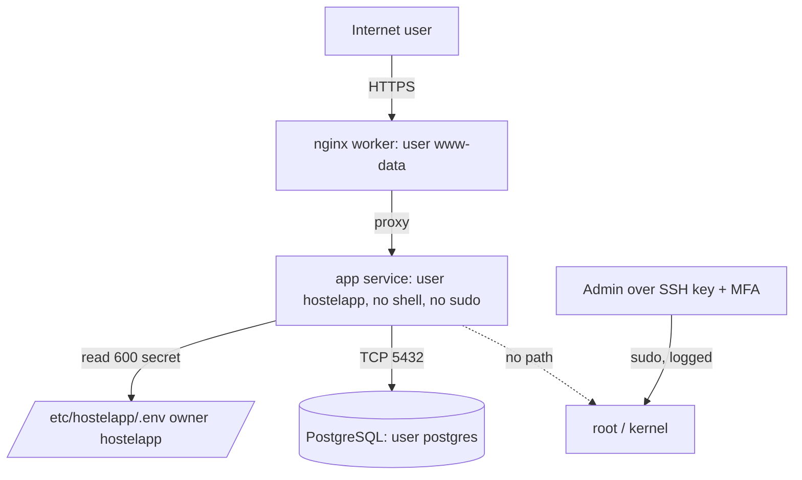

# CS-10 Operating System Security and Hardening

> [!info] Topic card
> **Unit:** U4 · **Time:** 4 h · **Lab:** [[LAB-CS-04 File Permission Audit]] · **Code:** `symbolic`, `permission_findings` and `audit_tree` in `code/cs_examples.py`, with tests (one uses a temporary directory and real `chmod`). The `ls -la` and `umask` output in Example 1 was captured on the Linux build container. The other commands are for **your own** machine or VM.

## 1. Learning objectives
1. **Explain** the OS security mechanisms: user/kernel mode, process isolation, accounts and privileges, discretionary and mandatory access control.
2. **Read and set** Unix permissions (symbolic and octal, setuid/setgid/sticky, umask) and **audit** a directory for risky modes.
3. **Apply** a hardening baseline: minimise services, patch, least privilege, secure configuration, logging, and full-disk encryption.
4. **Compare** the Linux and Windows privilege models (root/sudo vs Administrator/UAC; ACLs).
5. **Plan** patch and configuration management, using benchmarks (e.g. CIS) as a starting point rather than a checklist to follow blindly.

## 2. Why it matters
Every application sits on an OS. A perfectly coded web app is still compromised if its server runs an unpatched SSH daemon, if its `.env` file is readable by every user, or if it runs as root, so that one bug gives full control. Most hardening is cheap; the expensive part is doing it consistently and keeping it that way.

## 3. Prerequisites
[[CS-04 Authorization and Access Control]] (DAC, MAC, RBAC, least privilege) · [[CS-09 Network Security and Secure Communication]] (listening services, firewalls) · basic command-line use.

## 4. Intuition
Hardening means **reducing what can go wrong**. Remove what you don't need (fewer doors), lock what remains (permissions, firewall), give each program only the keys it needs (least privilege), keep the locks up to date (patching), and install alarms (logging). An attacker who gets in through one weakness should land in a small, locked room, not the control room.

## 5. Rigorous explanation

### 5.1 Core OS protection mechanisms
- **CPU modes:** the kernel runs privileged; user programs run unprivileged and request services via system calls.
- **Process isolation:** separate virtual address spaces. Modern defences make memory-corruption exploits harder: ASLR (address randomisation), DEP/NX (non-executable data pages) and stack canaries.
- **Identities:** every process runs as a user (UID/SID), and access checks use that identity plus its groups.
- **Access control:** **DAC** (owners set permissions), **MAC** (system-wide policy: SELinux, AppArmor, Windows integrity levels) and capabilities, which split up root's powers (e.g. `CAP_NET_BIND_SERVICE`).

### 5.2 Unix permissions
Each file has an owner, a group, and three triplets `rwx` for **u**ser, **g**roup and **o**thers. Octal: r = 4, w = 2, x = 1.
- `644` = `rw-r--r--` (normal file)
- `600` = `rw-------` (secret)
- `755` = `rwxr-xr-x` (program or directory)
- `750` = `rwxr-x---` (group-shared directory)

On directories: r = list, w = create/delete entries, x = enter or traverse.

Special bits (a fourth leading digit):
- **setuid (4):** the program runs as the file's owner (e.g. `passwd`). A setuid-root bug means root compromise.
- **setgid (2):** the program runs with the file's group; on a directory, new files inherit the group.
- **sticky (1)**, on directories: only a file's owner may delete it (`/tmp` is `1777`, i.e. `rwxrwxrwt`).

**umask** removes bits from new files' default modes: files start from 666 and directories from 777. With umask `022`, new files are `644` and directories `755`. With `027`, directories are `750`. With `077`, files are `600`. (These values were computed during the build.)

### 5.3 Windows model (in brief)
Accounts and groups, with security identifiers (SIDs). Files have **ACLs** made of allow/deny entries (ACEs), which are more expressive than Unix triplets. **UAC** runs administrators with a standard token until they elevate. Group Policy pushes baselines across a domain. Defender, BitLocker and Windows Update provide anti-malware, disk encryption and patching.

### 5.4 Hardening baseline
1. **Inventory and minimise:**
   - remove unused packages, services and accounts;
   - close listening ports you don't need (`ss -tulpn`).
2. **Patch:** use a documented cadence, prioritising risk (internet-facing services and known-exploited vulnerabilities first), and test on staging.
3. **Accounts:**
   - no shared accounts; disable direct root login;
   - use sudo with logging; MFA for administrators;
   - keys rather than passwords for SSH.
4. **Least privilege for services:** each service runs as its own unprivileged user, with only the directories it needs writeable. Use containers or systemd sandboxing where available.
5. **Secure configuration:**
   - firewall default deny;
   - secure SSH (`PermitRootLogin no`, `PasswordAuthentication no`);
   - disable legacy protocols.
6. **File permissions:** secrets `600` and owned by the service user; no world-writable files outside sticky directories; review setuid binaries.
7. **Encryption:** full-disk encryption on laptops and servers that hold personal data (LUKS, BitLocker, FileVault).
8. **Logging and time:**
   - forward authentication, sudo and service logs centrally;
   - keep clocks synchronised (NTP), because incident timelines depend on it.
9. **Backups:** regular, offline or immutable, and restore-tested.
10. **Verify:** compare against a benchmark (CIS Benchmarks, vendor guides), automate the checks, and re-audit after changes (configuration drift).

## 6. Terminology
| Term | Meaning |
|---|---|
| Attack surface | Everything an attacker can interact with: services, ports, accounts, files |
| Privilege escalation | Gaining higher rights than granted (vertical) or another user's rights (horizontal) |
| setuid | Executable runs with the owner's privileges |
| umask | Bits removed from the default permissions of new files |
| MAC (OS sense) | Mandatory access control policy (SELinux, AppArmor) |
| Baseline | A documented secure configuration standard |
| Configuration drift | Systems slowly diverging from their baseline |
| Patch management | The process of identifying, testing, deploying and verifying updates |

## 7. Step-by-step: reading and fixing permissions
Real output from the build container (Linux, umask `0022`). It shows a `.env` file left readable by everyone and a `777` shared directory:
```text
-rw-r--r-- 1 root root   12 Oct 19 15:48 .env
-rw-r--r-- 1 root root    0 Oct 19 15:48 notes.txt
drwxrwxrwx 2 root root 4096 Oct 19 15:48 shared
```
Fix, then the real output after `chmod 600 .env` and `chmod 750 shared`:
```text
-rw------- 1 root root   12 Oct 19 15:48 .env
-rw-r--r-- 1 root root    0 Oct 19 15:48 notes.txt
drwxr-x--- 2 root root 4096 Oct 19 15:48 shared
```
Useful audit commands for your own system:
```bash
find /srv/app -perm -0002 -type f           # world-writable files
find / -xdev -perm -4000 -type f 2>/dev/null # setuid binaries (compare with a known-good list)
sudo -l                                      # what the current user may run as root
```
(The file was created only for the demonstration and contains no real secret.)

## 8. Diagram: privilege boundaries

*Text version: each service runs as its own unprivileged user. The app can read only its own secret file and reach the database. Only administrators, through key-based SSH and logged sudo, reach root. The app account has no route to root.*

## 9. Worked examples

### Example 1 (basic): octal ↔ symbolic
Tested with `symbolic()`:
- 644 → `rw-r--r--`
- 600 → `rw-------`
- 755 → `rwxr-xr-x`
- 640 → `rw-r-----`
- 4755 → `rwsr-xr-x` (setuid shown as `s`)
- 1777 → `rwxrwxrwt` (sticky shown as `t`)
- 777 → `rwxrwxrwx`

### Example 2 (intermediate): audit a project folder (tested)
```python
from cs_examples import audit_tree
for line in audit_tree("/srv/hostelapp"):   # a directory you own
    print(line)
```
On the test fixture (`app.py` 644, `.env` 644, `upload/` 777), the test asserts exactly:
```text
.env: secret readable or writable by group/others (expected 600 or stricter)
upload: world-writable
```
After `chmod 600 .env` and `chmod 750 upload`, the audit returns no findings.

### Example 3 (challenging): from misconfiguration to escalation, and the fix
A cron job runs `/opt/backup/backup.sh` as root every night, and the script is `rwxrwxrwx`. Any local user can edit it, and the next run executes their commands as root. That's privilege escalation with no exploit code. The root cause: a root-executed file is writeable by non-root users. **Fix:**
- `chown root:root` and `chmod 700` the script and its directory, and check every parent directory, since a writeable parent lets an attacker replace the file.
- Better still, run backups as a dedicated low-privilege user with only read access to the data.
- Add a periodic check: "files executed by root must not be writeable by others."

## 10. Application: hardening the hostel system server
1. Minimal OS install, with automatic security updates enabled and a monthly patch review.
2. Users: `hostelapp` (service, `nologin` shell), named admin accounts, sudo with logging, SSH keys plus MFA via the VPN/bastion ([[CS-09 Network Security and Secure Communication]]).
3. Listeners: only nginx on 443 and SSH on the admin interface. PostgreSQL bound to localhost or the database zone.
4. Files: the app code is owned by root and readable by `hostelapp` (the app can't modify its own code); `.env` is `600 hostelapp`; uploads go to a directory that the web server serves as static, non-executable files.
5. A systemd unit with `NoNewPrivileges=yes`, `ProtectSystem=strict` and `ReadWritePaths=/var/lib/hostelapp`.
6. Disk encryption, logs forwarded centrally, and a nightly `audit_tree` job whose findings are alerted.

## 11. Common mistakes
| Mistake | Fix |
|---|---|
| `chmod 777` to "fix" a permission error | Find which user needs which access, then grant the minimum |
| Running the app as root | A dedicated service user; drop privileges after binding to the port |
| Secrets in world-readable files or in the repository | `600`, owned by the service user, or a secrets manager |
| Patching "when there's time" | Scheduled, risk-based patching with tracking |
| Leaving default accounts and passwords | Remove or disable them, and change defaults on day one |
| Applying a benchmark blindly and breaking the service | Test on staging, record justified exceptions |
| Hardening once, never re-checking | Automated compliance checks to catch drift |

## 12. Comparison: Linux vs Windows controls
| Concern | Linux | Windows |
|---|---|---|
| Superuser | root (UID 0), sudo | Administrator / SYSTEM, UAC elevation |
| File access | Owner/group/others bits, POSIX ACLs | NTFS ACLs (ACEs) |
| Mandatory control | SELinux, AppArmor | Integrity levels, AppLocker/WDAC |
| Central policy | Configuration management (Ansible etc.) | Group Policy, Intune |
| Disk encryption | LUKS | BitLocker |
| Logs | journald, syslog, auditd | Event Log (Security, System) |

## 13. Practice
**L1** 1. Convert 750 and 4711 to symbolic form. 2. What does the x bit mean on a directory?

**L2** 3. With umask 027, what are the default modes of new files and directories? 4. Why is a world-writable directory without the sticky bit dangerous on a multi-user system?

**L3** 5. Write a hardening checklist (at least 10 items) for a Linux server that hosts a student-records web app. 6. Explain why the app's own code should not be writeable by the app's user.

**L4** 7. A setuid-root binary written in-house reads a filename from the user and prints the file. What's the vulnerability? Give two safer designs. 8. Design a patch-management process for 40 lab PCs and 3 servers, with priorities, testing, a rollback plan and evidence for an audit.

**L5** 9. Using `audit_tree` as a starting point, specify an extended audit tool: which extra checks (setuid against an allow-list, ownership of root-executed files, unowned files), its output format for a SIEM, how false positives are handled, and how you'll test it safely.

## 14. Hints
> [!tip]- Hints
> 1: split the digits; 4 is setuid, and x for user plus setuid shows as `s`. 3: 666 & ~027, 777 & ~027. 4: anyone can delete or rename others' files. 7: reading arbitrary files as root. 9: allow-lists, plus tests in a temporary directory.

## 15. Worked solutions
> [!success]- Solutions 1–2
> 1. 750 = `rwxr-x---`; 4711 = `rws--x--x` (checked with `stat.filemode`). 2. Permission to enter or traverse the directory (to access entries by name). Without r, you can't list it, but you can still open known names.

> [!success]- Solution 3
> Files: 666 & ~027 = **640** (`rw-r-----`); directories: 777 & ~027 = **750** (`rwxr-x---`). Computed: `oct(0o777 & ~0o027)` = `0o750`.

> [!success]- Solution 4
> Any user can delete or rename other users' files in it, or swap in a malicious file where a program expects a trusted one. The sticky bit (as on `/tmp`) restricts deletion to the file's owner.

> [!success]- Solution 5 (sample)
> 1. Minimal install; remove unused packages and services. 2. Automatic security updates plus a monthly review. 3. Firewall default deny; only 443 public. 4. SSH: keys only, no root login, access via VPN/bastion. 5. Named admin accounts, sudo logged, MFA. 6. The app runs as a dedicated `nologin` user. 7. Secrets `600`, or in a secrets manager. 8. Database bound to localhost or its zone; strong database credentials, least-privilege database user. 9. Full-disk encryption. 10. Central logging plus NTP. 11. Backups: encrypted, offsite/immutable, restore-tested. 12. A CIS benchmark scan, with documented exceptions. 13. Periodic permission audits and setuid review.

> [!success]- Solution 6
> If an attacker exploits the app (e.g. through a file-upload bug), a writeable code directory lets them plant a persistent backdoor that runs on every request. If the code is read-only to the app, a compromise is limited to that one process's memory and data, and redeploying from a clean source removes it. This is defence in depth and least privilege.

> [!success]- Solution 7
> The vulnerability: it reads **any** file with root privileges, e.g. `/etc/shadow` (an arbitrary file read, which leads to privilege escalation). Path tricks (`../`, symlinks) defeat naive checks. Safer designs: (1) **no setuid**: put the files in a group, add authorised users to it, and run the tool unprivileged; (2) a small privileged helper that accepts only an **ID** from a fixed allow-list and opens files with `O_NOFOLLOW` from a fixed directory, while the main program stays unprivileged; (3) `sudo` with a narrowly specified rule for an exact command and argument.

> [!success]- Solution 8 (outline)
> **Inventory:** list all hosts and software versions. **Sources:** vendor advisories and the CISA KEV catalogue. **Priority:** P1, known-exploited or internet-facing: within 48 h on servers; P2, critical/high: within 14 days; P3, others: monthly. **Testing:** a pilot group (2 lab PCs and a staging server) for 24–48 h. **Deployment:** central tooling (WSUS/Intune, or unattended-upgrades plus Ansible). **Rollback:** VM snapshots for servers and a documented uninstall for PCs. **Evidence:** a patch ticket for each cycle with dates, a compliance report (% patched) and exceptions signed off by the system owner.

> [!success]- Solution 9 (outline)
> **Checks:**
> - world-writable without the sticky bit;
> - secrets wider than 600;
> - setuid/setgid binaries not on an allow-list (path + hash);
> - files executed by root (from cron, systemd units) whose file or any parent directory is writeable by non-root users;
> - unowned UIDs/GIDs.
>
> **Output:** JSON lines `{host, path, check_id, severity, mode, owner, timestamp}`.
>
> **False positives:** an exceptions file with a reason, an approver and an expiry date.
>
> **Testing:** pytest with `tmp_path` fixtures and real `chmod`, as in this lesson's test. Never test on production first; run it read-only, and don't follow symlinks.

## 16. Self-test (pass ≥ 4/5)
1. Octal for `rw-r-----`? 2. What does the sticky bit do on a directory? 3. Why not run services as root? 4. Name two memory-exploit mitigations. 5. What's configuration drift?
> [!success]- Answers
> 1. 640. 2. Only the owner may delete or rename their files. 3. Any compromise becomes full system compromise. 4. ASLR, DEP/NX (also stack canaries). 5. Systems gradually diverging from the secure baseline.

## 17. Flashcards
#flashcards/cyber-security
Octal values of r, w, x?::4, 2, 1.
Mode for a secret file?::600 (rw-------), owned by the service user.
umask 022 gives which default file and directory modes?::644 and 755.
setuid risk?::The program runs as its owner (often root); any bug can mean privilege escalation.
Sticky bit?::On a directory, only a file's owner can delete or rename it (e.g. /tmp 1777).
First hardening step?::Inventory, then remove unneeded services, packages and accounts.
DAC vs MAC on an OS?::DAC: owners set permissions. MAC: system-wide policy (SELinux/AppArmor) that users can't override.

## 18. Blank-page recall
Write the 10-step hardening baseline and the permission bit table from memory.

## 19. Revision summary
- OS security: kernel/user separation, process isolation, identities, DAC/MAC.
- Unix permissions: u/g/o × rwx (4/2/1), plus setuid, setgid and sticky; umask removes bits.
- Hardening: minimise, patch, least privilege, secure configuration, correct permissions, encryption, logging, backups, verification.
- Root-executed files writeable by others mean escalation without an exploit.
- Benchmarks are a baseline: test, document exceptions, and re-audit for drift.

## 20. Links
Prev: [[CS-09 Network Security and Secure Communication]] · Next: [[CS-11 Web Application Security]] · Lab: [[LAB-CS-04 File Permission Audit]] · Related: [[CS-04 Authorization and Access Control]], [[CS-14 Malware and Defensive Detection]], [[PY-14 Files, CSV and JSON]]

## 21. Sources
- CIS Benchmarks (operating-system configuration guides): https://www.cisecurity.org/cis-benchmarks
- NIST SP 800-123, *Guide to General Server Security*, 2008.
- NIST SP 800-40 Rev. 4, *Guide to Enterprise Patch Management Planning*, 2022.
- CISA Known Exploited Vulnerabilities Catalog: https://www.cisa.gov/known-exploited-vulnerabilities-catalog
- Python docs, `stat` and `os.walk`: https://docs.python.org/3/library/stat.html
- *(Links not checked during the build, because there was no network access.)*

## 22. Mastery checklist
- [ ] I can convert permissions between octal and symbolic, including the special bits
- [ ] I can compute umask results
- [ ] I can write and justify a hardening checklist
- [ ] LAB-CS-04 done · reviews scheduled
