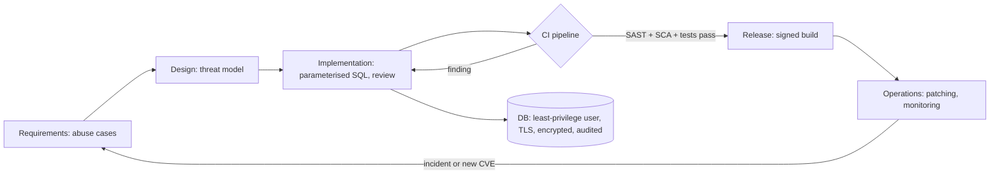

# CS-12 Secure Software Development and Database Security

> [!info] Topic card
> **Unit:** U5 · **Time:** 5 h · **Lab:** [[LAB-CS-06 Input Validation and SQL Injection Prevention]] · **Code:** `demo_db`, `find_user_UNSAFE`, `find_user` and `list_users` in `code/cs_examples.py`. The injection is demonstrated **only** against a local in-memory SQLite database, and the tests show the unsafe version is injectable and the safe one is not. All outputs below are real.

## 1. Learning objectives
1. **Integrate** security activities into each SDLC phase (requirements, design, implementation, testing, deployment, maintenance).
2. **Explain** how SQL injection works at the level of query construction, and **prevent** it with parameterised queries and allow-listed identifiers.
3. **Apply** database security controls: least-privilege accounts, encryption at rest and in transit, backups, auditing, and data minimisation.
4. **Use** supporting practices: secure code review, SAST/DAST/SCA, secrets management, and dependency pinning.
5. **Evaluate** a development process against a framework such as the NIST SSDF or OWASP SAMM.

## 2. Why it matters
A defect fixed during design costs a conversation. The same defect found in production costs an incident. Injection flaws have been known for more than 25 years and still appear, because one developer concatenated one string under deadline pressure. A secure SDLC makes the safe way the default way, so security doesn't depend on every developer remembering every rule.

## 3. Prerequisites
[[CS-11 Web Application Security]] · [[PY-22 SQL and Database Integration]] (sqlite3, cursors) · [[SD-02 Software Process Models]] (lifecycle phases).

## 4. Intuition
SQL injection happens when **data is mixed into code**. If you build a query by pasting user text into SQL, the database can't tell which part you wrote and which part the user wrote. A parameterised query is like a form with labelled boxes: the SQL is the printed form, and the user's text can only ever fill a box, never rewrite the form.

## 5. Rigorous explanation

### 5.1 Security in each SDLC phase
| Phase | Security activities | Output |
|---|---|---|
| Requirements | Security and privacy requirements, abuse cases, compliance needs | Security requirements list ([[CS-02 Threat Modeling and Security Requirements]]) |
| Design | Threat modelling, secure design patterns, data classification | Threat model, data-flow diagram |
| Implementation | Secure coding standard, safe libraries, peer review, secrets kept out of code | Reviewed code |
| Verification | SAST, dependency scanning (SCA), DAST, security unit tests, penetration test for major releases | Findings, fixed and re-tested |
| Release/deploy | Hardened configuration, signed builds, least-privilege deployment credentials | Release checklist sign-off |
| Operations/maintenance | Patching, monitoring, vulnerability intake, incident response | Patch records, alerts, lessons learned |

**DevSecOps** automates these checks in the CI/CD pipeline, so that each commit gets linting, SAST, dependency checks and tests.

### 5.2 How SQL injection works
The vulnerable code builds `"... WHERE username = '" + input + "'"`. With input `' OR '1'='1`, the SQL text becomes:
```text
SELECT id, username, role FROM users WHERE username = '' OR '1'='1'
```
(This line is real output from the string formatting.) The `WHERE` clause is now always true. Depending on the query and the database, injection can bypass logins, read other tables (`UNION SELECT`), modify data, or (with some drivers and stacked queries) run further statements.

**Why parameterisation works:** with `execute("... WHERE username = ?", (value,))`, the SQL text is parsed and planned **without** the value, which is then bound as data. It can't change the query's structure.

**What parameters can't do:** identifiers (table and column names, `ASC`/`DESC`) can't be bound. Map them through an **allow-list** (`SORTABLE` in the code). Also escape `%` and `_` in `LIKE` patterns when you want them treated literally.

**ORMs** (SQLAlchemy, Django) parameterise by default. Their raw-SQL escape hatches (`text()`, `.raw()`, `extra()`) bring the risk back.

### 5.3 Database security controls
- **Least privilege:** the app connects as a user with only `SELECT`, `INSERT` and `UPDATE` on its own tables. No DDL, no superuser, and a separate migration account.
- **Network:** the database isn't reachable from the Internet, and connections use TLS ([[CS-09 Network Security and Secure Communication]]).
- **Encryption at rest:** disk or tablespace encryption, plus application-level encryption for the most sensitive fields, with keys outside the database.
- **Authentication:** strong unique credentials from a secrets manager, rotated; no defaults.
- **Auditing:** log privileged actions, schema changes and access to sensitive tables.
- **Backups:** encrypted, offsite or immutable, and **restore-tested**. Backups contain the same personal data, so they need the same protection.
- **Data minimisation and retention:** don't collect what you don't need; delete it on schedule. Data you don't hold can't leak.
- **Integrity:** constraints (`NOT NULL`, `CHECK`, foreign keys) and transactions guard against corrupt states.

### 5.4 Supporting practices
- **Secrets management:** no credentials in code or repositories. Use environment variables or a vault, and run a pre-commit secret scanner. If a secret is ever committed, **rotate it**; deleting the commit isn't enough.
- **SCA:** inventory dependencies, pin versions, and monitor advisories (`pip-audit`, Dependabot).
- **SAST/DAST:** static analysis (e.g. Bandit for Python) finds patterns like string-built SQL; dynamic scanners test the running app (in a test environment).
- **Code review checklist:** input validation, output encoding, authorisation on every endpoint, error handling, logging without secrets, and safe use of crypto.
- **Frameworks:** NIST SP 800-218 *Secure Software Development Framework* (SSDF) and OWASP SAMM describe practices and maturity levels.

## 6. Terminology
| Term | Meaning |
|---|---|
| Secure SDLC | A development lifecycle with security activities in every phase |
| Parameterised query / prepared statement | SQL with placeholders; values are bound separately |
| Second-order injection | Malicious input stored safely, then later concatenated into SQL |
| SAST / DAST / SCA | Static code analysis / dynamic testing of the running app / software composition (dependency) analysis |
| Least privilege (database) | The app account has only the permissions it needs |
| Data minimisation | Collect and keep only the necessary personal data |
| Shift left | Doing security activities earlier in the lifecycle |
| SBOM | Software bill of materials: a list of components and versions |

## 7. Step-by-step: fixing a vulnerable query
1. **Find** every place where SQL is built with `+`, f-strings, `%` or `.format`. Search with `grep -n "execute(f" -r .`, or run Bandit (check B608).
2. **Replace** values with placeholders (`?` for sqlite3, `%s` for psycopg) and pass a tuple.
3. **Allow-list** dynamic identifiers.
4. **Add a test** that the injection payload returns nothing and that legitimate edge cases (`O'Brien`) work.
5. **Reduce privileges** of the database account, so that if some other flaw remains, the damage is limited.
6. **Review** that the error messages shown to users don't include SQL text.

## 8. Diagram: where controls sit


## 9. Worked examples

### Example 1 (basic): the injection, demonstrated locally (real output)
```python
from cs_examples import demo_db, find_user_UNSAFE, find_user

conn = demo_db()                                   # in-memory training database
print(find_user_UNSAFE(conn, "' OR '1'='1"))
print(find_user(conn, "' OR '1'='1"))
```
```text
[(1, 'amina', 'student'), (2, 'juma', 'technician'), (3, 'mrs_k', 'warden'), (4, "o'brien", 'student')]
[]
```
The unsafe version leaks every user. The parameterised version looks for a user literally named `' OR '1'='1` and finds none.

### Example 2 (intermediate): concatenation also breaks legitimate users
```text
find_user_UNSAFE(conn, "o'brien")  ->  OperationalError near "brien": syntax error
find_user(conn, "o'brien")         ->  [(4, "o'brien", 'student')]
```
(Real output.) Security and correctness agree here: the version that's safe is also the one that handles apostrophes. "Escaping quotes by hand" is fragile (encodings, backslashes, database-specific rules). Use the driver's parameters.

### Example 3 (challenging): dynamic sorting and search
Users may sort by a column and search names. Placeholders can't hold column names, so `list_users`:
1. maps `sort` through `SORTABLE`, rejecting `"id; DROP TABLE users"` with `ValueError`;
2. builds `ASC`/`DESC` from a boolean, not from user text;
3. escapes `\`, `%` and `_` in the search term and uses `LIKE ? ESCAPE '\'`.

Test results: sorting by username gives `amina, juma, mrs_k, o'brien`. Searching for `_` returns only `mrs_k` (a literal underscore, not "any character"). Searching for `%` returns nothing.

## 10. Application: hostel system database plan
- **Accounts:**
  - `hostel_app`: `SELECT`/`INSERT`/`UPDATE` on `requests`, `users` and `comments`; no `DELETE` (soft delete via a status column);
  - `hostel_migrate`: DDL, used only by the deployment pipeline;
  - `hostel_report`: read-only, for the warden dashboard.
- **Data classification:** names, room numbers and phone numbers are personal data; the password hashes are secret.
- **Retention:** resolved requests are anonymised after 2 years, subject to policy confirmation.
- **Pipeline:**
  - Bandit plus `pip-audit` on each commit;
  - tests including the injection tests above;
  - secrets in environment variables loaded from the server's protected `.env` (600), never committed.

## 11. Common mistakes
| Mistake | Fix |
|---|---|
| f-strings or `+` to build SQL | Placeholders and parameters |
| "Sanitising" by stripping quotes | Parameterisation; validation is an extra layer |
| Interpolating column names from input | An allow-list map |
| The app connects as the database superuser | A dedicated least-privilege account |
| Committing `.env` or credentials | `.gitignore`, secret scanning; rotate anything that leaked |
| SQL errors shown to users | Generic errors; log the details server-side |
| Untested backups | Scheduled restore drills |
| "Security testing at the end" | Shift left: threat model in design, checks in CI |

## 12. Comparison: injection defences
| Technique | Stops injection? | Notes |
|---|---|---|
| Parameterised queries | Yes, for values | The primary defence |
| ORM query builders | Yes, unless raw SQL is used | Review the raw-SQL escape hatches |
| Stored procedures | Only if they don't build dynamic SQL inside | |
| Allow-listing identifiers | Yes, for identifiers | Required for ORDER BY and column choices |
| Input validation | Partially | Reduces attack surface; not sufficient alone |
| Manual escaping | Fragile | Avoid |
| WAF | Partially | Can be bypassed; a temporary shield only |
| Least-privilege database user | Limits the damage | Defence in depth |

## 13. Practice
**L1** 1. Why can't a bound parameter change the query's structure? 2. What's second-order SQL injection?

**L2** 3. Rewrite the query safely: `cur.execute(f"SELECT * FROM results WHERE reg_no = '{reg}' AND year = {year}")`. 4. List three SDLC phases and one security activity for each.

**L3** 5. Write the `GRANT` statements (PostgreSQL syntax) for `hostel_app` and `hostel_report` as described in §10. 6. Explain why a WAF isn't an acceptable permanent fix for SQL injection.

**L4** 7. A developer committed a production database password to a public repository and then deleted the commit an hour later. List the incident-response steps, in order. 8. Design a CI pipeline with security gates for a Python web app. Which tools run, which findings block a merge, and how exceptions are recorded.

**L5** 9. Assess a project's development process (your FYP or a group project) against five practices of your choice from NIST SSDF (e.g. PO.1, PS.1, PW.4, PW.7, RV.1). For each: current state, gap, an improvement action, and evidence that the action was taken.

## 14. Hints
> [!tip]- Hints
> 1: parsing happens before binding. 3: two placeholders and a tuple. 5: `GRANT SELECT, INSERT, UPDATE ON … TO …`. 7: assume it was copied: rotate first. 9: read the SSDF practice names before writing, and cite the version.

## 15. Worked solutions
> [!success]- Solutions 1–2
> 1. The database parses and plans the SQL text with a placeholder first. The value is supplied later as data and is never parsed as SQL. 2. A payload stored safely (e.g. a username `x' OR '1'='1`) is later read from the database and **concatenated** into another query by code that trusts "internal" data. The defence is the same: parameterise every query, whatever the data's source.

> [!success]- Solution 3
> ```python
> cur.execute("SELECT reg_no, course, grade FROM results WHERE reg_no = ? AND year = ?", (reg, int(year)))
> ```
> Also: select only the needed columns (not `*`), validate `reg` with a format check, and **authorise**: the requester must own `reg` or be staff.

> [!success]- Solution 4
> Requirements: abuse cases and security requirements. Design: a threat model (STRIDE) and data classification. Verification: SAST, SCA and security tests. (Also acceptable: implementation code review; deployment hardening and signed builds; operations patching and monitoring.)

> [!success]- Solution 5
> ```sql
> CREATE ROLE hostel_app LOGIN PASSWORD :'app_pw';           -- value supplied from a secrets manager
> GRANT CONNECT ON DATABASE hostel TO hostel_app;
> GRANT USAGE ON SCHEMA public TO hostel_app;
> GRANT SELECT, INSERT, UPDATE ON requests, users, comments TO hostel_app;
> GRANT USAGE ON ALL SEQUENCES IN SCHEMA public TO hostel_app;
> CREATE ROLE hostel_report LOGIN PASSWORD :'report_pw';
> GRANT CONNECT ON DATABASE hostel TO hostel_report;
> GRANT USAGE ON SCHEMA public TO hostel_report;
> GRANT SELECT ON requests TO hostel_report;
> ```
> (`:'app_pw'` is psql variable syntax, so no password appears in the script. This wasn't executed during the build, because no PostgreSQL server was available. Test it in your own environment.)

> [!success]- Solution 6
> A WAF matches patterns in requests and can be bypassed by encoding, comments, alternative syntax or new payloads. It doesn't protect against second-order injection or requests from internal sources. And it leaves the vulnerable code in place, so a WAF misconfiguration re-exposes it. It's acceptable as a **temporary** virtual patch while the code fix is deployed.

> [!success]- Solution 7
> 1. **Rotate the password immediately.** Assume it was copied: public repositories are scanned within minutes.
> 2. Check the database logs for logins since the commit time, and look for unusual queries or data access.
> 3. Restrict network access to the database, if it was reachable.
> 4. Remove the secret from the git history (e.g. `git filter-repo`) and from forks or caches where possible. This is cleanup, not a fix.
> 5. Assess whether personal data was accessed. If so, follow breach-notification duties under the applicable law and policy.
> 6. Root cause: why was the secret in code? Add secret scanning (pre-commit and server-side), and move secrets to a vault.
> 7. Lessons learned, recorded in an incident report.

> [!success]- Solution 8 (outline)
> **Stages:**
> 1. Lint/format.
> 2. Unit and security tests (pytest, including injection, authorisation and CSRF tests).
> 3. SAST (Bandit): high-severity findings block.
> 4. SCA (`pip-audit`): any known-exploited or critical vulnerability with a fix available blocks.
> 5. Secret scan: any finding blocks.
> 6. Build and sign the artefact.
> 7. Deploy to staging, run DAST (a baseline scan against staging only), review the results.
> 8. Manual approval for production.
>
> **Exceptions:** an issue/ticket ID, a justification, an approver and an expiry date, held in a tracked file such as `security-exceptions.yml` and reviewed monthly.

> [!success]- Solution 9 (format)
> | SSDF practice | Current state | Gap | Action | Evidence |. For example: "PS.1 Protect all forms of code from unauthorised access and tampering | The repository is public, with no branch protection | Anyone with write access can push to main | Enable branch protection and require review | A screenshot of the settings and a PR showing a review". Check the practice IDs and names against the current SSDF publication.

## 16. Self-test (pass ≥ 4/5)
1. Primary defence against SQL injection? 2. How do you safely let users choose a sort column? 3. What does SCA check? 4. Name two least-privilege rules for the app's database account. 5. A secret was committed: what's the first step?
> [!success]- Answers
> 1. Parameterised queries. 2. An allow-list map from user choices to column names. 3. Third-party dependencies for known vulnerabilities (and licences). 4. No DDL/superuser; only the needed tables and operations (e.g. no DELETE). 5. Rotate (revoke) it.

## 17. Flashcards
#flashcards/cyber-security
Why does SQL injection happen?::User data is concatenated into SQL text, so the database parses it as code.
Placeholder style for sqlite3?::`?` with a tuple of values: execute(sql, (value,)).
Can column names be parameterised?::No. Use an allow-list mapping.
Second-order injection?::Stored data later concatenated into a query; parameterise every query.
SAST vs DAST?::SAST analyses source code; DAST tests the running application.
Leaked secret response?::Rotate first, then investigate access, then clean history and fix the process.
Secure SDLC phrase "shift left"?::Do security activities earlier (requirements and design), where fixes are cheapest.

## 18. Blank-page recall
Redraw the SDLC security table, and write the safe and unsafe `find_user` functions from memory.

## 19. Revision summary
- Security belongs in every SDLC phase; automate the checks in CI (DevSecOps).
- SQL injection = data parsed as code. Fix it with parameters, allow-listed identifiers, and escaped LIKE patterns.
- Database: least-privilege accounts, TLS, encryption at rest, auditing, tested backups, data minimisation.
- No secrets in code. A leaked secret must be rotated.
- Use the NIST SSDF or OWASP SAMM to assess and improve the process.

## 20. Links
Prev: [[CS-11 Web Application Security]] · Next: [[CS-13 Social Engineering and Security Awareness]] · Lab: [[LAB-CS-06 Input Validation and SQL Injection Prevention]] · Related: [[PY-22 SQL and Database Integration]], [[SD-14 Software Testing, Verification and Validation]], [[SD-17 Secure and Reliable Software Design]], [[X-03 Security Requirements in Software Architecture]]

## 21. Sources
- NIST SP 800-218, *Secure Software Development Framework (SSDF) Version 1.1*, 2022.
- OWASP SQL Injection Prevention Cheat Sheet and Query Parameterization Cheat Sheet: https://cheatsheetseries.owasp.org/
- OWASP SAMM (Software Assurance Maturity Model): https://owaspsamm.org/
- Python docs, `sqlite3` placeholders: https://docs.python.org/3/library/sqlite3.html#sqlite3-placeholders
- Bandit (Python SAST) documentation: https://bandit.readthedocs.io/
- *(Links not checked during the build, because there was no network access.)*

## 22. Mastery checklist
- [ ] I can explain and demonstrate SQL injection locally, and fix it
- [ ] I can handle dynamic identifiers and LIKE patterns safely
- [ ] I can map security activities to SDLC phases and design CI security gates
- [ ] LAB-CS-06 done · reviews scheduled
