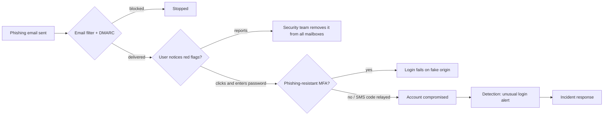

# CS-13 Social Engineering and Security Awareness

> [!info] Topic card
> **Unit:** U6 · **Time:** 3 h · **Code:** `edit_distance` and `url_red_flags` (link-checking heuristics) in `code/cs_examples.py`, with 7 tested URL cases. All organisations and domains in the examples are **fictional**, on the reserved `.example`/`.test` names. The punycode example is real: `xn--bnkmfano-16g.example` decodes to `bаnkmfano.example` with a Cyrillic "а", as checked with Python's `idna` codec.

> [!warning] Ethics
> Phishing simulations on real people need written authorisation from the organisation, a clear purpose, data protection, and a supportive (not shaming) follow-up. Never send test phishing to friends, classmates or staff on your own initiative.

## 1. Learning objectives
1. **Explain** the psychological principles that social engineering exploits: authority, urgency, scarcity, social proof, liking, reciprocity and fear.
2. **Recognise** the main attack types: phishing, spear phishing, business email compromise (BEC), smishing, vishing, pretexting, baiting, tailgating, and mobile-money fraud.
3. **Analyse** a message or URL for red flags, and **explain** the limits of heuristics.
4. **Design** layered defences: technical (email authentication, MFA, filtering), procedural (call-back verification) and human (awareness, easy reporting).
5. **Evaluate** an awareness programme by meaningful metrics (reporting rate, time to report), not just click rates.

## 2. Why it matters
Attackers often find it cheaper to trick a person than to break a system. One convincing message can lead to stolen credentials, a fraudulent payment or a malware infection. In East Africa, mobile-money and SIM-swap scams are common examples of social engineering at scale. People are not "the weakest link" to be blamed: they are a defensive layer that needs good design, training and support.

## 3. Prerequisites
[[CS-01 Security Foundations - CIA, Threats, Vulnerabilities and Risk]] (threats, controls) · [[CS-03 Authentication and Identity]] (MFA).

## 4. Intuition
Social engineering **hijacks fast thinking**. A message that creates urgency ("your account closes in 1 hour"), invokes authority ("from the Vice-Chancellor") or promises reward ("you won a laptop") pushes you to act before you think. Every defence aims to **slow down the decision** (pause and verify through a separate channel) or to **remove the payoff** (MFA, so a stolen password isn't enough; a payment process that requires a second approver).

## 5. Rigorous explanation

### 5.1 Principles exploited
| Principle | Attacker's use | Example |
|---|---|---|
| Authority | Impersonates a boss, IT, a bank or the police | "IT Department: verify your mailbox" |
| Urgency/scarcity | A deadline that blocks reflection | "Results will be withheld unless you confirm in 2 hours" |
| Fear | A threat of loss or punishment | "Your account is involved in fraud" |
| Reward/greed | Prizes, refunds, jobs | "You won a scholarship: pay the processing fee" |
| Social proof | "Everyone in your class has registered" | Fake group links |
| Liking/rapport | A friendly, long-running conversation | Romance or job-offer scams |
| Reciprocity | A small favour first | "I helped you; can you approve this?" |

### 5.2 Attack types
- **Phishing:** bulk emails leading to fake login pages or malware attachments.
- **Spear phishing:** targeted, using researched details (name, course, supervisor). **Whaling** targets executives.
- **BEC:** a compromised or spoofed executive or supplier account requests payment, or a change of bank details.
- **Smishing / vishing:** SMS or voice. Typical examples: fake mobile-money reversals ("I sent you money by mistake, please send it back"), or callers posing as the telecom company to obtain a one-time PIN.
- **SIM swap:** the attacker convinces the carrier to move your number to their SIM, then receives your SMS codes.
- **Pretexting:** an invented scenario ("I'm the new auditor").
- **Baiting:** infected USB drives left in public places.
- **Tailgating/piggybacking:** following someone through a secured door.
- **Consent phishing / MFA fatigue:** a malicious app requests OAuth permissions, or the attacker floods the victim with push requests until they approve one.

### 5.3 Technical defences
- **Email authentication:**
  - **SPF:** which servers may send for a domain;
  - **DKIM:** a signature over the message;
  - **DMARC:** a policy telling receivers what to do when SPF or DKIM fails, plus reporting.
  These reduce exact-domain spoofing, but **not** lookalike domains.
- **Filtering:** spam/malware filters, link rewriting and detonation (sandboxing), external-sender banners.
- **MFA**, preferably phishing-resistant (FIDO2/passkeys bind to the real domain, so a fake site can't use the response). Number matching reduces push fatigue.
- **Browser and password manager:** a password manager doesn't autofill on a lookalike domain. That's a useful warning signal.
- **Least privilege and payment controls:** limit the damage a single fooled person can cause.

### 5.4 Procedural and human defences
- **Out-of-band verification:** confirm payment or bank-detail changes by calling a number already on record, never a number given in the message.
- **Dual approval** for payments above a threshold.
- **An easy reporting path:** a "Report phishing" button, and a reply thanking every reporter.
- **Awareness training:** short, regular, relevant (local scams), with practice and no blame. Measure **reporting rate** and **time to first report**, as well as click rate.
- **A just culture:** people who clicked should report it immediately, without fear. Early reporting is what limits damage.

### 5.5 Limits of heuristics
URL and message red flags help, but attackers adapt: valid HTTPS certificates are free, compromised legitimate accounts send real-looking mail, and lookalike detection has false positives and misses. `url_red_flags` returns **warnings**. An empty list doesn't mean the link is safe.

## 6. Terminology
| Term | Meaning |
|---|---|
| Pretext | A fabricated scenario used to justify a request |
| BEC | Business email compromise: fraud using real or spoofed business email |
| Homograph attack | A domain with lookalike Unicode characters (shown as punycode `xn--…`) |
| Typosquatting | Registering misspellings of real domains |
| SPF / DKIM / DMARC | Email sender authorisation / signature / policy and reporting |
| Phishing-resistant MFA | MFA bound to the legitimate origin (FIDO2/WebAuthn), so it can't be relayed through a fake site |
| Out-of-band verification | Confirming a request through a different, trusted channel |

## 7. Step-by-step: triaging a suspicious message
1. **Pause.** Is there urgency, fear or an unusual request (credentials, payment, a gift card, a one-time PIN)?
2. **Sender:** check the actual address and domain, not just the display name. Is it a reply to a thread you never started?
3. **Links:** hover to see the real URL, or run it through `url_red_flags`. Check the registrable domain: in `chuo.example.verify-account.test`, the real domain is `verify-account.test`.
4. **Attachments:** be wary of unexpected Office files with macros, archives, `.html`, `.iso` and `.lnk` files.
5. **Verify** out of band, through a known contact.
6. **Report** to IT/security, even if you already clicked. Say what you did and when.
7. If credentials were entered: change the password from a trusted device, revoke sessions, check MFA settings and mailbox forwarding rules.

## 8. Diagram: layered defence against credential phishing

*Text version: each layer can stop the attack (filter, user, MFA, detection). The goal is that no single failure leads to compromise.*

## 9. Worked examples

### Example 1 (basic): analysing a smishing message
> "M-PESA: Umepokea Tsh 150,000 kutoka kwa JOHN. Samahani nimekosea, tafadhali rudisha kwa namba 07XX XXX XXX." *(constructed example: "You received 150,000 from JOHN. Sorry, I made a mistake, please send it back to number …")*

Red flags:
- It comes from a personal number, not the operator's official sender ID.
- Your real balance hasn't changed: check it in the official app or USSD menu, **not** from the SMS text.
- There's urgency, plus an appeal to kindness.

**Action:** don't send money. A genuine mistaken transfer is reversed through the operator, not by you.

### Example 2 (intermediate): URL heuristics (tested)
With trusted domains `chuo.example` and `bankmfano.example`:

| URL | `url_red_flags` result |
|---|---|
| `https://aris.chuo.example/login` | none (a subdomain of a trusted domain) |
| `http://chuo.example/` | not https |
| `https://chu0.example/login` | lookalike of 'chuo.example' (edit distance 1) |
| `https://chuo.example.verify-account.test/` | contains the trusted name, but is a different domain |
| `https://chuo.example@203.0.113.9/` | userinfo '@' hides the real host; raw IP address |
| `https://xn--bnkmfano-16g.example/` | punycode (possible homograph) |

The last one is displayed by some clients as `bаnkmfano.example`, which looks like the trusted bank, but the "а" is Cyrillic.

### Example 3 (challenging): a BEC scenario, with the controls that would have stopped it
The finance officer of a small company receives an email, apparently from a regular supplier, in an existing thread: "Our bank has changed. Please pay invoice #2231 (TZS 18,400,000) to the new account below." The supplier's mailbox had been compromised, so SPF/DKIM/DMARC all **pass**.

What would stop it:
- **Procedure:** any change of bank details must be confirmed by phone, using the number in the supplier master file, and approved by a second person.
- **Technical:** alerts on newly created inbox rules, and on logins to the supplier's mailbox from unusual locations (on the *supplier's* side).
- **Awareness:** staff know that "bank details changed" is the classic BEC pretext.

Email authentication doesn't help when the real account is compromised. Only process controls do.

## 10. Application: awareness plan for the hostel system launch
1. A 10-minute induction for students covering how to recognise the real login URL, never sharing OTPs, and how to report.
2. For wardens and technicians: phishing-resistant MFA, and training on fake "system maintenance" emails.
3. An announcement template that states, "We will never ask for your password by email or SMS."
4. A report button, plus a dedicated email address. Measure reports per month and median time to report.
5. After 3 months, a simulation **authorised by management**, with immediate supportive feedback. Results are aggregated, with no individual shaming.

## 11. Common mistakes
| Mistake | Fix |
|---|---|
| Trusting the display name | Inspect the real address and domain |
| "HTTPS padlock = legitimate site" | HTTPS proves encryption to *some* domain, not that it's honest |
| Calling the number in the suspicious message | Use a known, independently obtained contact |
| Shaming people who click | A just culture; reward reporting |
| Measuring only click rates | Track reporting rate and time to report |
| SMS OTP considered "strong" | Vulnerable to SIM swap and relay; prefer FIDO2/passkeys |
| One annual training session | Short, frequent, relevant reinforcement |

## 12. Comparison: phishing channels
| Channel | Typical lure | Key defence |
|---|---|---|
| Email | Fake login, invoice, parcel | Filtering, DMARC, MFA, reporting |
| SMS (smishing) | Mobile-money reversal, delivery fee | Verify in the official app; carrier spam reporting |
| Voice (vishing) | "Bank/telecom security team", OTP request | Never share OTPs; call back on an official number |
| Social media/WhatsApp | Fake scholarships, job offers, hacked friend accounts | Verify through another channel; enable 2-step verification |
| In person | Tailgating, fake technicians | Badge checks, visitor procedures |

## 13. Practice
**L1** 1. Name four persuasion principles used in social engineering. 2. What does DMARC add to SPF and DKIM?

**L2** 3. Find the registrable domain in: (a) `https://login.chuo.example.secure-portal.test/` (b) `https://chuo.example/` (c) `https://chuo-example.test/`. 4. Why doesn't a password manager autofill on a lookalike site, and why is that useful?

**L3** 5. Write a 150-word awareness message for students about results-portal phishing. 6. Explain why FIDO2/passkeys resist phishing but SMS codes do not.

**L4** 7. Design a payment-change verification procedure for a 20-person company, and show how it defeats Example 3. 8. Critique `url_red_flags`: give a phishing URL it misses, and a legitimate URL it wrongly flags.

**L5** 9. Plan an authorised phishing-simulation programme for a faculty: governance (who approves), ethics and data protection, scenarios, metrics, feedback, and how you'll avoid damaging trust between staff and IT.

## 14. Hints
> [!tip]- Hints
> 3: read right-to-left from the public suffix. 6: origin binding. 8: a compromised legitimate subdomain, or a domain with a similar meaning but an edit distance above 2; a legitimate partner domain that contains the trusted name. 9: consent, debriefing, aggregate reporting.

## 15. Worked solutions
> [!success]- Solutions 1–2
> 1. Any four of: authority, urgency, scarcity, fear, reward, social proof, liking, reciprocity. 2. A published **policy** (none, quarantine or reject) for messages that fail alignment, plus aggregate and forensic **reporting** to the domain owner. It also requires the authenticated domain to *align* with the visible From domain.

> [!success]- Solution 3
> (a) `secure-portal.test`: everything to its left is a subdomain chosen by the attacker. (b) `chuo.example`. (c) `chuo-example.test`: a different domain that only looks related.

> [!success]- Solution 4
> Password managers match saved credentials to the exact domain (origin). On `chu0.example`, there's nothing saved, so nothing is filled in. If your manager unexpectedly offers nothing on what looks like your usual site, treat it as a warning.

> [!success]- Solution 5 (sample)
> "**Results-portal safety:** The university will never ask for your password or verification code by email, SMS or WhatsApp. Always log in by typing the official portal address yourself or using your bookmark, not by clicking links in messages. Be suspicious of messages that say your results will be withheld unless you act immediately. That urgency is a trick. If you receive one, don't click. Forward it to the ICT help desk using the 'Report phishing' button. If you already entered your password, change it from the official site straight away and tell ICT. Reporting quickly protects you and your classmates, and you won't be blamed for it."

> [!success]- Solution 6
> With FIDO2/WebAuthn, the authenticator signs a challenge that includes the **origin** (the domain) the browser is actually on. A credential registered for `chuo.example` won't respond on `chu0.example`, and if relayed, the signature names the wrong origin, so the real server rejects it. SMS codes are just numbers that a user can type into any site: a phishing page captures the code and relays it to the real site in real time. SIM swaps also redirect the codes.

> [!success]- Solution 7
> **Procedure:**
> 1. Any request to change a supplier's bank details is logged as a ticket.
> 2. Finance calls the supplier on the phone number in the **master file** (never one from the email) and confirms with a known contact.
> 3. A second person approves the change in the accounting system.
> 4. The first payment to new details has a 48-hour hold, and the supplier receives a notification at the old contact details.
>
> **Against Example 3:** the call to the known number reveals the supplier never changed banks, and the fraud fails, even though the email was authenticated.

> [!success]- Solution 8
> **Misses:**
> - `https://chuo-results.test/` (no trusted substring, and edit distance > 2);
> - a link on a compromised legitimate site;
> - a shortened URL (`https://short.test/abc`) that redirects;
> - lookalikes using Unicode the user sees but that the check doesn't model.
>
> **False positive:** `https://chuo.example.partner-lms.test/` might be a legitimate partner integration.
>
> **Improvements:** compare registrable domains using a public-suffix list, follow redirects in a sandbox, use reputation feeds, and accept that heuristics are one layer only.

> [!success]- Solution 9 (outline)
> - **Governance:** written approval from the dean and the ICT director; HR and the data-protection officer consulted; a scope document.
> - **Ethics:** no scenarios exploiting personal distress (e.g. bereavement, salary cuts); results stored in aggregate only; individuals never named to management.
> - **Scenarios:** 4 per year, matching real local threats (results, fees, a fake ICT notice).
> - **Metrics:** report rate, time to first report, click rate, credential-submission rate, all compared over time.
> - **Feedback:** an immediate landing page explaining the red flags; thank-yous for reporters.
> - **Trust:** announce that the programme exists (not the dates); offer opt-in deeper training; publish anonymised trends; and pair it with technical improvements, so staff see the organisation investing in protections and not just testing them.

## 16. Self-test (pass ≥ 4/5)
1. What's spear phishing? 2. Does DMARC stop lookalike domains? 3. What's the first thing to do after entering your password on a phishing page? 4. Why is SIM swap dangerous? 5. Which metric best shows a healthy reporting culture?
> [!success]- Answers
> 1. Targeted phishing using researched personal details. 2. No: it protects only the exact domain. 3. Change the password from a trusted device, and report it immediately (also revoke sessions and check mailbox forwarding rules). 4. The attacker receives your SMS codes and calls. 5. Reporting rate and time to report.

## 17. Flashcards
#flashcards/cyber-security
Spear phishing vs phishing?::Spear phishing is targeted with personal details; phishing is bulk.
BEC defence that works even when email passes DMARC?::Out-of-band verification of payment or bank-detail changes, plus dual approval.
SPF, DKIM, DMARC?::Authorised senders; message signature; policy, alignment and reporting.
Homograph domain sign?::Punycode (xn--…) containing lookalike Unicode characters.
Why is FIDO2 phishing-resistant?::The signature is bound to the real origin, so it can't be relayed through a fake site.
Best awareness metric?::Reporting rate and time to report (not click rate alone).

## 18. Blank-page recall
List the 7 persuasion principles with one example each, and the 7-step triage procedure.

## 19. Revision summary
- Social engineering exploits authority, urgency, fear, reward, social proof, liking and reciprocity.
- The types: phishing, spear phishing, BEC, smishing, vishing, SIM swap, pretexting, baiting, tailgating, MFA fatigue.
- Defences in layers: email authentication and filtering, phishing-resistant MFA, process controls (out-of-band verification, dual approval), and awareness with easy reporting.
- Heuristics give warnings, not guarantees.
- Simulations need authorisation, ethics and a just culture.

## 20. Links
Prev: [[CS-12 Secure Software Development and Database Security]] · Next: [[CS-14 Malware and Defensive Detection]] · Related: [[CS-03 Authentication and Identity]], [[CS-15 Logging, Monitoring, Incident Response and Recovery]], [[CS-16 Risk Analysis, Policy, Governance and Compliance]], [[DM-14 Recurrence Relations]] (dynamic programming behind `edit_distance`)

## 21. Sources
- Cialdini, R. B., *Influence: The Psychology of Persuasion* (the persuasion principles; several editions, e.g. new and expanded edition, Harper Business, 2021).
- IETF RFC 7208 (SPF), 2014; RFC 6376 (DKIM), 2011; RFC 7489 (DMARC), 2015.
- NIST SP 800-50, *Building an Information Technology Security Awareness and Training Program* (check for the current revision).
- FIDO Alliance, passkeys/WebAuthn overview: https://fidoalliance.org/passkeys/
- *(Links not checked during the build, because there was no network access.)*

## 22. Mastery checklist
- [ ] I can identify the principles and attack type in any sample message
- [ ] I can find the registrable domain of a URL and explain heuristic limits
- [ ] I can design process controls against BEC and an ethical awareness programme
- [ ] Reviews scheduled
