# CS-14 Malware and Defensive Detection

> [!info] Topic card
> **Unit:** U6 · **Time:** 4 h · **Code:** `shannon_entropy`, `sha256_file`, `ioc_hash_matches` and `rule_matches` in `code/cs_examples.py`, with tests. The entropy values below were computed during the build. **No malware is used or provided anywhere in this vault**: the examples use harmless byte strings that only *look like* indicators.

> [!danger] Boundaries
> Don't download, write, modify or run real malware for this module. Malware analysis needs isolated lab infrastructure, legal clearance and expert supervision. For testing anti-malware products, the industry uses the harmless **EICAR test file** (see eicar.org), never live samples.

## 1. Learning objectives
1. **Classify** malware by propagation (virus, worm, trojan) and by payload (ransomware, spyware, RAT, botnet, cryptominer, wiper, rootkit).
2. **Describe** a typical infection chain (delivery → execution → persistence → command and control → actions on objectives), and map defences to each stage.
3. **Compare** detection approaches: signatures/hashes, heuristics, behavioural monitoring and EDR, with their strengths and blind spots.
4. **Use** defensive helpers: file hashing against IOC lists, simple pattern rules, and entropy as a weak signal of packing or encryption.
5. **Design** ransomware resilience: prevention, detection, and above all recoverable backups.

## 2. Why it matters
Ransomware can stop hospitals, universities and businesses for weeks, and modern gangs also steal data and threaten to publish it ("double extortion"). Most infections start with ordinary weaknesses: phishing, unpatched internet-facing systems, stolen credentials, or exposed remote desktop. Understanding malware *defensively* lets you break the chain at several points, and recover when prevention fails.

## 3. Prerequisites
[[CS-10 Operating System Security and Hardening]] (privileges, patching) · [[CS-06 Hashes, MACs and Integrity]] (SHA-256) · [[CS-13 Social Engineering and Security Awareness]] (delivery by phishing).

## 4. Intuition
Malware is **software that acts against the owner's interests**. To do harm, it must arrive, run, survive reboots, talk to its operator, and then do its job. Each of those steps leaves traces and can be blocked. Defenders don't need to stop every step, only one, as long as they **notice** and **recover**.

## 5. Rigorous explanation

### 5.1 Classification
| By propagation | Behaviour |
|---|---|
| Virus | Attaches to host files and spreads when they run |
| Worm | Self-propagates over networks, without user action |
| Trojan | Disguised as legitimate software; the user runs it |

| By payload | Effect |
|---|---|
| Ransomware | Encrypts data and demands payment; often steals data too |
| Spyware / infostealer | Steals credentials, cookies, keystrokes |
| RAT (remote access trojan) | Gives the attacker interactive control |
| Bot | Joins a botnet for DDoS, spam or proxying |
| Cryptominer | Uses victims' CPU/GPU to mine cryptocurrency |
| Wiper | Destroys data (sometimes disguised as ransomware) |
| Rootkit | Hides itself and other malware, sometimes at kernel or firmware level |
| Fileless | Lives in memory or uses built-in tools (PowerShell, WMI): "living off the land" |

### 5.2 The infection chain and defences
| Stage | Examples | Defences |
|---|---|---|
| Delivery | Phishing attachment, malicious download, exploited VPN or RDP, infected USB | Email filtering, patching, MFA, disabling autorun |
| Execution | A macro runs, a user opens an `.lnk`, an exploit runs | Block macros from the Internet, application allow-listing, least privilege |
| Persistence | Run keys, scheduled tasks, services, cron jobs | EDR monitoring of autoruns; integrity baselines |
| Command and control (C2) | HTTPS beaconing, DNS tunnelling | Egress filtering, DNS monitoring, proxy logs |
| Actions | Encrypting, exfiltrating, lateral movement | Segmentation, EDR isolation, backups, DLP |

This is a simplified form of the "kill chain" idea. MITRE ATT&CK catalogues real adversary techniques in much more detail and is widely used to map detections.

### 5.3 Detection approaches
- **Signatures and hashes:** exact matches of known-bad files (SHA-256) or byte patterns. Fast, with few false positives, but defeated by any change to the file (repacking, polymorphism).
- **Pattern rules (e.g. YARA):** combinations of strings and conditions. More flexible, but they need careful writing to avoid false positives.
- **Heuristics:** suspicious *features*, such as high entropy (packed or encrypted sections), odd imports, or unsigned binaries in temporary folders. These are weak signals; combine them.
- **Behavioural/EDR:** watches what processes *do*. For example, Word spawning PowerShell, mass file renames with new extensions, or attempts to delete shadow copies. EDR can catch fileless and novel malware, and can isolate a host.
- **Network detection:** beacon regularity, connections to newly registered domains, unusual DNS volume.
- **Sandboxing:** runs suspicious files in an instrumented VM and observes them. Malware may detect the sandbox and stay dormant.

### 5.4 Entropy as a signal
Shannon entropy $H = -\sum_b p_b \log_2 p_b$ over byte frequencies ranges from 0 to 8 bits per byte. Values computed during the build:

| Data | Entropy (bits/byte) |
|---|---|
| `b"aaaa"` | 0.0 |
| `b"abab"` | 1.0 |
| `"The quick brown fox jumps over the lazy dog"` | 4.432 |
| `cs_examples.py` source text | 4.919 |
| The same file compressed with zlib (level 9) | 7.961 |
| 64 KiB from `os.urandom` | 7.997 |

High entropy means "compressed or encrypted". That's normal for ZIP files, images and HTTPS traffic, so on its own it's **not** evidence of malware. It's useful in combination (an *executable* with a near-8 section, or a user's documents suddenly turning high-entropy, which suggests ransomware).

### 5.5 Ransomware resilience
1. **Prevent:**
   - patch internet-facing systems;
   - MFA on remote access and email;
   - block Internet-origin macros;
   - least privilege (no daily admin accounts).
2. **Limit:** segmentation; restrict admin tools; protect backup credentials separately.
3. **Detect:** EDR behaviour rules (mass encryption, shadow-copy deletion), alerting on new admin accounts.
4. **Recover:**
   - **3-2-1 backups** (3 copies, 2 media types, 1 offsite), with at least one **offline or immutable** copy;
   - **restore tests**;
   - documented rebuild procedures.
5. **Respond:** isolate hosts, preserve evidence, follow the incident plan ([[CS-15 Logging, Monitoring, Incident Response and Recovery]]), and involve management, legal advisers and authorities. Paying a ransom doesn't guarantee recovery and may be legally restricted; that decision belongs to management with legal advice.

## 6. Terminology
| Term | Meaning |
|---|---|
| IOC | Indicator of compromise: a file hash, domain, IP or registry key associated with an attack |
| TTP | Tactics, techniques and procedures (attacker behaviour), more durable than IOCs |
| C2 | Command-and-control channel between malware and its operator |
| Persistence | Mechanisms that survive reboot or logoff |
| Packing / obfuscation | Compressing or encrypting code to evade signatures |
| EDR | Endpoint detection and response: behavioural telemetry with response actions |
| Living off the land | Abusing built-in OS tools to avoid dropping new files |
| Double extortion | Encrypting data *and* threatening to leak stolen copies |

## 7. Step-by-step: hash-based IOC sweep of your own files
1. Get an IOC list (SHA-256 hashes) from a trusted source, e.g. a national CERT advisory or your vendor.
2. Run `ioc_hash_matches(root, bad_hashes)` over a directory **you own**. It hashes in chunks, so large files are fine, and it skips symlinks.
3. For each hit: don't open the file. Note its path, time stamps and owner, isolate the host if it's confirmed, and escalate to the incident process.
4. Record the sweep: date, IOC source and version, scope, results.
5. Remember the limits: a clean result only means "none of *these exact files*". Malware changes hashes easily, so complement the sweep with behavioural detection.

## 8. Diagram: ransomware chain with breakpoints

```mermaid
flowchart LR
    P[Phishing or exposed RDP] -->|MFA, patching, filtering| E[Execution]
    E -->|macro blocking, allow-listing| PE[Persistence + privilege escalation]
    PE -->|least privilege, EDR| LM[Lateral movement]
    LM -->|segmentation, admin tiering| EX[Exfiltration]
    EX -->|egress filtering, DLP| ENC[Mass encryption]
    ENC -->|EDR isolation| REC[Recovery from immutable backups]
```

*Text version: each arrow names the controls that can break the chain at that point. The final safety net is restoring from offline or immutable backups.*

## 9. Worked examples

### Example 1 (basic): classify the malware
1. "A USB stick labelled 'Exam answers' runs a program that copies itself to every new USB inserted" is a **virus or worm hybrid spread by removable media** (baiting delivery). It's best described as a worm, because it propagates without the user running each copy.
2. "A free 'PDF converter' that also uploads browser passwords" is a **trojan** with an **infostealer** payload.
3. "Machines become slow; CPUs run at 100% at night, with connections to a mining pool" is a **cryptominer**.

### Example 2 (intermediate): YARA-like rule writing (tested)
```python
rules = {
    "suspicious_macro": {"strings": [b"AutoOpen", b"Shell(", b"powershell -enc"], "min": 2},
    "ransom_note": {"strings": [b"your files have been encrypted", b"bitcoin"]},
}
```
- `Sub AutoOpen() Shell("calc")` matches **suspicious_macro** (2 of 3 strings).
- `Sub AutoOpen() MsgBox` matches nothing (only 1 string). Many legitimate macros use AutoOpen, so requiring two indicators cuts false positives.
- A text containing both ransom-note phrases matches **ransom_note**.

The trade-off: `min=1` would flag many legitimate documents, while requiring all three would miss variants. Rules should be tested against a corpus of known-good files as well as known-bad ones.

### Example 3 (challenging): triaging a ransomware alert
EDR alert: "`winword.exe` spawned `powershell.exe -enc …`, which spawned `vssadmin delete shadows /all`." Then 4,000 files in `\\fileserver\finance` were renamed to `.locked` in 3 minutes.

**Reasoning:**
- A parent–child chain from an Office application to PowerShell is typical of macro malware.
- Deleting shadow copies destroys local recovery points, a classic ransomware step.
- The mass renaming and new extension show encryption in progress.

**Actions:**
1. **Contain:** isolate the workstation with EDR; disable the user's account and sessions; disconnect or restrict the file share's SMB access.
2. **Scope:** which other hosts did this user or host reach? Check for the same process chain elsewhere.
3. **Preserve:** take a memory image if possible, and keep the logs.
4. **Eradicate and recover:** rebuild the workstation from a clean image, restore the share from the last good immutable backup, and verify file integrity.
5. **Post-incident:** why were Internet macros allowed? Enforce blocking.

## 10. Application: hostel system and campus endpoints
- **Servers:** application allow-listing (only the expected interpreters and services run); EDR or at least auditd plus central logging; nightly IOC sweeps of upload directories using national CERT feeds.
- **Uploads** (photos of broken equipment):
  - accept only images, verified by content type and magic bytes;
  - re-encode them, strip metadata, and store them outside the web root;
  - never execute uploads;
  - optionally scan them with an anti-malware engine.
- **Backups:** database dumps encrypted, copied to immutable cloud storage with 30-day retention, and a quarterly restore drill.

## 11. Common mistakes
| Mistake | Fix |
|---|---|
| "We have antivirus, so we're protected" | Layered controls; EDR plus backups plus patching |
| Backups online, using the same admin credentials | Offline/immutable copies, separate credentials |
| Never testing restores | Scheduled restore drills with measured recovery time |
| Treating high entropy as proof of malware | One weak signal; combine it with context |
| Relying only on hash IOCs | Add behavioural (TTP) detections |
| Running suspicious files "to see what happens" | Never on production; analysis belongs to trained staff in isolated labs |
| Wiping an infected machine immediately | Preserve evidence first, where the incident plan says to |

## 12. Comparison: detection methods
| Method | Catches new variants? | False positives | Cost |
|---|---|---|---|
| Hash IOC | No | Very low | Low |
| Pattern rule (YARA-like) | Some | Depends on the rule | Low–medium |
| Heuristic (entropy, imports) | Some | Medium–high | Low |
| Behavioural / EDR | Yes (many) | Medium (needs tuning) | Medium–high |
| Sandbox | Some (evasion is possible) | Low | Medium |
| Network (beaconing, DNS) | Yes (C2 patterns) | Medium | Medium |

## 13. Practice
**L1** 1. What's the difference between a virus and a worm? 2. Name three persistence locations on Windows or Linux.

**L2** 3. Why do attackers prefer "living off the land"? 4. Calculate the entropy of the bytes `b"aabb"` and `b"abcd"`.

**L3** 5. Write two pattern rules for a phishing attachment campaign (HTML-file credential harvester) and explain your false-positive controls. 6. Explain 3-2-1 backups, and why "immutable" matters for ransomware.

**L4** 7. Using the infection-chain table, design layered controls for a university office of 30 PCs. Name at least one control per stage. 8. A CERT advisory gives 12 SHA-256 IOCs. Your sweep finds nothing. What can and can't you conclude, and what would you do next?

**L5** 9. Write a ransomware readiness checklist and tabletop-exercise scenario for the hostel system: roles, decision points (isolate? restore? notify?), communication, recovery time objectives, and how you'll measure readiness.

## 14. Hints
> [!tip]- Hints
> 4: two symbols at 1/2 each; four symbols at 1/4 each. 5: combine HTML form tags, a credential-field name, and an external `action=` URL. 8: absence of evidence for *those* files only. 9: link it to [[PM-11 Risk Management]] and to RTO/RPO.

## 15. Worked solutions
> [!success]- Solutions 1–2
> 1. A virus needs a host file and user action to spread; a worm spreads itself across networks. 2. Windows: Run/RunOnce registry keys, scheduled tasks, services, the Startup folder. Linux: cron jobs, systemd units, shell rc files (`~/.bashrc`), SSH `authorized_keys`.

> [!success]- Solution 3
> Built-in tools (PowerShell, WMI, `certutil`, `bash`, `curl`) are trusted, signed and present everywhere, so there's no new file for antivirus to catch. Their use blends in with administration, so detection must rely on behaviour and context (who ran what, from which parent, with what arguments).

> [!success]- Solution 4
> `aabb`: $p = 1/2, 1/2$, so $H = 1$ bit/byte. `abcd`: four symbols at $1/4$, so $H = 2$ bits/byte. (Check with `shannon_entropy`.)

> [!success]- Solution 5 (sample)
> ```python
> rules = {
>     "html_cred_harvester": {"strings": [b"<form", b'type="password"', b"action=\"https://"], "min": 3},
>     "html_smuggling": {"strings": [b"atob(", b"Blob(", b"msSaveOrOpenBlob", b"download="], "min": 3},
> }
> ```
> **False-positive controls:** require several indicators together; scan only email attachments (not every intranet page); test against a corpus of legitimate HTML; log matches for analyst review before any auto-blocking; and review the rules after each campaign.

> [!success]- Solution 6
> 3-2-1 means 3 copies of the data, on 2 different media types, with 1 offsite. Ransomware operators deliberately look for and encrypt or delete reachable backups, using stolen admin credentials. An **immutable** (write-once, retention-locked) or **offline** copy can't be changed even with those credentials, so recovery remains possible.

> [!success]- Solution 7 (sample)
> **Delivery:** mail filtering, macro blocking, patching, MFA. **Execution:** standard (non-admin) user accounts, application allow-listing for executables in user-writeable folders. **Persistence:** EDR on all 30 PCs, with autorun monitoring. **C2:** a DNS filtering service, egress through a proxy with logging. **Lateral movement:** host firewalls blocking SMB between workstations, separate admin accounts (LAPS for local admin passwords on Windows). **Actions:** file-share permissions on a need-to-know basis, immutable cloud backups, and EDR rules for mass renaming.

> [!success]- Solution 8
> **Can conclude:** none of the 12 exact files exist in the scanned scope at the time of the sweep. **Can't conclude:** that you weren't compromised. The malware may be modified (different hash), deleted, memory-only, or outside the scanned scope. **Next:** search the logs for the advisory's **network IOCs** (domains and IPs) and **TTPs** (process chains); widen the scope; check the time window since the campaign started; record the sweep as evidence.

> [!success]- Solution 9 (outline)
> **Checklist:** backup immutability verified; last restore test date and time taken; EDR coverage %; MFA on all admin and remote access; an offline copy of the incident contact list; legal and notification contacts known.
>
> **Tabletop:** "09:10 Monday: wardens report that the dashboard shows encrypted file names." Decision points:
> - isolate the server (who has authority?);
> - choose the restore point (RPO: the last good backup; how much data is lost?);
> - notify students (what, when, by whom?);
> - decide whether personal data was exfiltrated (notification duties).
>
> **RTO target:** 24 h for read-only service, 72 h for full service. **Measures:** time to detect, isolate and restore, plus gaps found and actions with owners.

## 16. Self-test (pass ≥ 4/5)
1. What's an IOC? 2. Why are TTP-based detections more durable than hash IOCs? 3. Which backup property defeats ransomware that steals admin credentials? 4. Is high entropy proof of malware? 5. What's the safe way to test that antivirus works?
> [!success]- Answers
> 1. An observable artefact linked to an attack (a hash, IP, domain, registry key). 2. Attackers can change files and infrastructure cheaply, but changing behaviour is harder. 3. Immutability or offline storage. 4. No: compressed and encrypted legitimate data also has high entropy. 5. The harmless EICAR test file.

## 17. Flashcards
#flashcards/cyber-security
Virus vs worm vs trojan?::Needs a host file / self-propagates / disguised as legitimate software.
Ransomware double extortion?::Encrypting data and threatening to publish stolen copies.
Signature detection weakness?::Any change to the file (repacking, polymorphism) evades it.
EDR adds?::Behavioural monitoring of process activity plus response (e.g. host isolation).
3-2-1 backup rule?::3 copies, 2 media types, 1 offsite (plus at least one offline or immutable copy).
Entropy near 8 bits/byte means?::Compressed or encrypted data, a weak signal that needs context.
MITRE ATT&CK?::A knowledge base of real adversary tactics and techniques, used to map detections.

## 18. Blank-page recall
Draw the infection-chain table with a defence for each stage, and list the detection methods with one blind spot each.

## 19. Revision summary
- Classify malware by propagation (virus, worm, trojan) and payload (ransomware, stealer, RAT, bot, miner, wiper, rootkit, fileless).
- Chain: delivery → execution → persistence → C2 → actions. Break it at several stages.
- Detection: hashes (exact), rules (patterns), heuristics (weak signals like entropy), behaviour/EDR (most robust), network.
- Ransomware: prevention, limiting and detection matter, but **tested, immutable backups** decide recovery.
- Never handle real malware outside authorised, isolated labs.

## 20. Links
Prev: [[CS-13 Social Engineering and Security Awareness]] · Next: [[CS-15 Logging, Monitoring, Incident Response and Recovery]] · Related: [[CS-10 Operating System Security and Hardening]], [[CS-17 Digital Forensics Fundamentals]], [[DM-18 Introductory Discrete Probability]] (entropy and probability), [[PM-11 Risk Management]]

## 21. Sources
- NIST SP 800-83 Rev. 1, *Guide to Malware Incident Prevention and Handling for Desktops and Laptops*, 2013.
- MITRE ATT&CK knowledge base: https://attack.mitre.org/
- CISA #StopRansomware Guide: https://www.cisa.gov/stopransomware
- EICAR anti-malware test file: https://www.eicar.org/
- Shannon, C. E., "A Mathematical Theory of Communication", *Bell System Technical Journal*, 27, 1948, pp. 379–423, 623–656.
- *(Links not checked during the build, because there was no network access.)*

## 22. Mastery checklist
- [ ] I can classify malware and map defences to each chain stage
- [ ] I can explain the strengths and limits of each detection method
- [ ] I can write and justify simple pattern rules and an IOC sweep
- [ ] I can design ransomware resilience with tested backups · reviews scheduled
