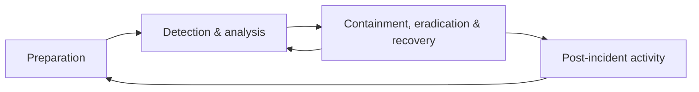

# CS-15 Logging, Monitoring, Incident Response and Recovery

> [!info] Topic card
> **Unit:** U7 · **Time:** 5 h · **Lab:** [[LAB-CS-08 Log Analysis and Incident Response]] · **Code:** `parse_auth_log`, `failure_bursts` and `success_after_failures` in `code/cs_examples.py`, run against `code/data/auth_sample.log`. That log is a **constructed** 20-line file: the IP addresses are from the documentation ranges (192.0.2.0/24, 198.51.100.0/24, 203.0.113.0/24) and the users are fictional. All results below come from the tests.

## 1. Learning objectives
1. **Specify** what to log (events, fields, sources), how to protect logs, and what *never* to log.
2. **Detect** suspicious patterns in authentication logs (brute force, password spraying, success after failures, privilege use) with sliding-window analysis.
3. **Explain** the incident-response lifecycle (preparation; detection and analysis; containment, eradication and recovery; post-incident activity) and apply it to a scenario.
4. **Define** RTO, RPO, business-continuity and disaster-recovery plans, and **relate** them to backup design.
5. **Write** an incident timeline and a lessons-learned report.

## 2. Why it matters
Attackers often stay inside networks for days or weeks before anyone notices. Without good logs you can't tell **what happened, when, to which data, by whom**, so you can't contain the attack properly, notify the right people, or prove what *didn't* happen. Incident response is a team skill. Organisations that practise it recover faster, and with less damage, than those that improvise.

## 3. Prerequisites
[[CS-14 Malware and Defensive Detection]] · [[CS-09 Network Security and Secure Communication]] · [[PY-09 Strings and String Processing]] (regular expressions for log parsing) · [[DM-18 Introductory Discrete Probability]] (alert base rates).

## 4. Intuition
Logs are the **flight recorder**. Monitoring is the **cockpit warning light**. Incident response is the **trained crew** following a checklist. You need all three. A recorder nobody reads doesn't help in time, and a warning light without a trained crew causes panic.

## 5. Rigorous explanation

### 5.1 What to log
| Category | Examples |
|---|---|
| Authentication | Login success/failure, MFA events, password resets, lockouts |
| Authorisation | Access denied, privilege changes, role assignments |
| Sensitive actions | Mark or result changes, bulk exports, configuration changes, deletions |
| System | Service start/stop, errors, updates, sudo/admin commands |
| Network | Firewall allow/deny, VPN connections, DNS queries, proxy logs |
| Security tools | EDR alerts, anti-malware detections, IDS alerts |

**Fields:** a timestamp (UTC, synchronised by NTP), the host, the actor (user/service), the source IP, the action, the target object, the result, and a request/correlation ID.

**Never log:** passwords, full card numbers, session tokens, secret keys, or unnecessary personal data. Mask or hash them where an identifier is needed.

### 5.2 Protecting and using logs
- **Centralise:** ship logs off the host quickly (syslog/agent → SIEM or a log server), because attackers delete local logs.
- **Integrity:** use append-only or write-once storage, or hash chains ([[CS-06 Hashes, MACs and Integrity]] Solution 9). Restrict and audit access.
- **Retention:** set by policy and law (e.g. 90 days hot, 1 year archived). Personal data in logs is still personal data.
- **SIEM:** collects and normalises logs, correlates events across sources, alerts and supports search. **SOAR** automates response steps.
- **Detection engineering:** write detections for known techniques, test them, tune for false positives, and track coverage (e.g. against MITRE ATT&CK).

### 5.3 Detection patterns for authentication
- **Brute force:** many failures from **one source** against one or a few accounts within a short window.
- **Password spraying:** a few attempts from one or many sources across **many accounts** (stays under per-account lockout).
- **Success after failures:** a successful login right after a run of failures from the same source. This is high priority: the guessing may have worked.
- **Impossible travel / new location**, **logins at unusual hours**, and **new privileged activity** (sudo, admin group changes) soon after login.
- Window size matters: slow attacks (e.g. one attempt every 20 minutes) evade short windows. Use several windows (minutes and hours).

### 5.4 Incident-response lifecycle (NIST SP 800-61)
1. **Preparation:**
   - an IR plan with roles (incident lead, technical, communications, legal, management);
   - contact lists, tools, logging, backups;
   - training and exercises.
2. **Detection and analysis:**
   - triage alerts and decide whether it's an incident;
   - scope (affected systems, data, accounts);
   - severity classification;
   - start the **timeline**.
3. **Containment, eradication and recovery:**
   - short-term containment (isolate a host, disable accounts, block IPs), then longer-term containment;
   - remove the cause (malware, backdoors, compromised credentials, the vulnerability);
   - restore from clean sources, monitor closely, return to normal operation.
4. **Post-incident activity:** a blameless lessons-learned review, improvements with owners and deadlines, metrics, and evidence retention.

NIST published Revision 3 of SP 800-61 in 2025, which aligns incident response with the Cybersecurity Framework 2.0 functions. Check the current version, but the four phases above remain a good working model.

Throughout: **preserve evidence** ([[CS-17 Digital Forensics Fundamentals]]), **communicate** (internal updates, regulators, affected people where the law requires it), and **document** every action with a time and the person responsible.

### 5.5 Continuity and recovery
- **RTO** (recovery time objective): the maximum acceptable downtime.
- **RPO** (recovery point objective): the maximum acceptable data loss, measured in time. Backups must run at least this often.
- **BCP** (business continuity plan) keeps critical functions running, perhaps manually. **DRP** (disaster recovery plan) restores the IT systems.
- Test them: tabletop exercises, restore drills, failover tests. An untested plan is a hypothesis.

## 6. Terminology
| Term | Meaning |
|---|---|
| Event / alert / incident | Something observed / a notification that might matter / a confirmed violation or imminent threat |
| SIEM | Security information and event management: central collection, correlation and alerting |
| MTTD / MTTR | Mean time to detect / to respond or recover |
| Triage | Prioritising alerts by severity and confidence |
| Containment | Limiting the spread and impact of an incident |
| RTO / RPO | Maximum tolerable downtime / data loss |
| Tabletop exercise | A discussion-based walkthrough of a scenario |
| Blameless review | A post-incident review focused on system and process causes, not individual blame |

## 7. Step-by-step: analysing an authentication log
1. **Collect:** export the time range from the central log store; record the source and the hash of the export (evidence).
2. **Parse:** `events = parse_auth_log(open(path))`. Count lines that didn't parse; a large number means your parser is missing formats.
3. **Summarise:** count by kind, by IP, by user; list invalid usernames tried.
4. **Detect:** `failure_bursts(events)` with a short window, then again with a long window; `success_after_failures(events)`.
5. **Pivot:** for each suspicious success, what did that account do next (sudo, file access, new keys)?
6. **Decide:** is this an incident? If yes, open a ticket, assign a lead, start the timeline, and contain.
7. **Report:** findings, evidence and recommended actions.

## 8. Diagram: incident-response lifecycle

*Text version: preparation enables detection. Analysis and containment loop until the incident is understood and contained. Recovery leads to a lessons-learned review, which improves preparation.*

## 9. Worked examples

### Example 1 (basic): summarising the sample log (tested)
`parse_auth_log` finds **20 events**: 16 failed logins, 3 accepted logins and 1 sudo command. Invalid usernames tried: `admin, guest, oracle, pi, test, ubuntu, user`. These are typical of automated scanning of default accounts.

### Example 2 (intermediate): bursts with two windows
- **2-minute window, threshold 5:** `{'203.0.113.50': 7, '192.0.2.99': 5}`. Both are fast guessers.
- **1-hour window, threshold 3:** additionally finds `198.51.100.23` with 3 failures against `mrs_k`, at 11:02, 11:20 and 11:40. That's a slow attempt the short window misses (or a user who forgot their password; context decides).

Lesson: tune the windows to the attacks you expect, and run more than one.

### Example 3 (challenging): success after failures → an incident timeline
`success_after_failures` returns `[('juma', '203.0.113.50', 2026-03-02T08:14:36Z)]`.

The timeline built from the log:

| Time (UTC) | Event | Significance |
|---|---|---|
| 08:14:22–08:14:24 | 203.0.113.50 tries invalid users `test`, `oracle` | Automated guessing begins |
| 08:14:25–08:14:27 | 2 failures for `root` | Targets a privileged account |
| 08:14:29–08:14:33 | 3 failures for `juma` | Focuses on a real account |
| **08:14:36** | **Accepted password for `juma`** from 203.0.113.50 | Probable compromise |
| **08:15:02** | `juma` runs `sudo cat /etc/shadow` | Credential theft from the password-hash file; the account has sudo |

**Assessment:** a likely incident. The account `juma` was compromised by password guessing, and its sudo rights allowed reading the system's password hashes.

**Immediate actions:**
1. Disable `juma` and terminate their sessions.
2. Block 203.0.113.50 (a weak control, since IPs change).
3. Isolate web01 for investigation.
4. Rotate every credential stored on or hashed in `/etc/shadow`.
5. Check for persistence (new SSH keys, cron jobs, users).

**Root causes:**
- SSH password authentication was enabled and internet-facing;
- a weak password;
- no MFA;
- broad sudo rights;
- no alert fired at 08:14:36.

**Fixes:**
- keys-only SSH via a VPN/bastion ([[CS-10 Operating System Security and Hardening]]);
- a real-time "success after failures" alert;
- least-privilege sudo.

## 10. Application: an incident-response plan outline for the hostel system
- **Roles:** incident lead (the ICT security officer), technical responder (the sysadmin), communications (the warden's office), decision-maker (the dean of students), legal/data-protection adviser.
- **Severity levels:** S1 (personal data exposed, or service down for more than 4 h), S2 (a confirmed compromise without data exposure), S3 (a suspicious event under investigation).
- **Playbooks:** a compromised account; malware on the server; a data leak; a DDoS.
- **Communications templates:** to students, to management, and to the regulator (where required by data-protection law).
- **Targets:** RTO 24 h (read-only), RPO 24 h (nightly backups); review after a pilot.
- **Exercises:** a tabletop every semester, and a restore drill every quarter.

## 11. Common mistakes
| Mistake | Fix |
|---|---|
| Logs only on the local host | Centralise in near real time |
| Local time zones, unsynchronised clocks | UTC + NTP everywhere |
| Logging passwords or tokens | Redaction at the logging layer; review samples |
| Alerting on everything | Prioritise high-signal detections; tune them; track false-positive rates |
| Wiping and rebuilding before scoping | Preserve evidence and understand the scope first |
| No pre-agreed decision-makers | Roles and authority defined in the IR plan |
| No post-incident review | A blameless review with tracked actions |

## 12. Comparison: brute force vs spraying vs credential stuffing
| | Brute force | Password spraying | Credential stuffing |
|---|---|---|---|
| Pattern | Many passwords, one account | One or a few passwords, many accounts | Known username+password pairs from leaks |
| Log signal | Burst of failures per account or IP | Failures across many accounts, few per account | Low failure rate, many distinct accounts, often many IPs |
| Defence | Throttling, lockout/backoff, MFA | Blocklists for common passwords, MFA, detection across accounts | MFA, breached-password checks, bot detection |

## 13. Practice
**L1** 1. Name five fields every security log entry should have. 2. What's the difference between RTO and RPO?

**L2** 3. Write the four NIST IR phases and one activity for each. 4. Why must logs be shipped off the host quickly?

**L3** 5. Modify `failure_bursts` (in pseudocode or Python) to detect password **spraying**: many distinct users failing from one IP within 10 minutes. 6. Write three log-redaction rules for the hostel web app.

**L4** 7. Using the sample log, write a short incident report: summary, timeline, impact, actions taken, root cause, and recommendations. 8. A business says, "RPO = 1 hour, RTO = 4 hours", for its sales database. Design a backup and recovery approach that meets these targets, and say how you'll prove it.

**L5** 9. Design the logging and detection architecture for the exam-results portal: sources, fields, transport, storage and retention, integrity, five detections with thresholds and response actions, and how you'll measure detection quality (false-positive rate, MTTD).

## 14. Hints
> [!tip]- Hints
> 2: time down vs data lost. 5: group by IP, count distinct users in the window. 6: password fields, tokens, phone numbers. 8: database replication or log shipping for RPO; a scripted restore for RTO; drills. 9: grade changes are the critical action.

## 15. Worked solutions
> [!success]- Solutions 1–2
> 1. Timestamp (UTC), host/source, actor (user/service), action/event type, result, plus the source IP, target object and correlation ID. 2. RTO is how long you can be **down**; RPO is how much **data** (in time) you can lose. An RPO of 24 h means nightly backups are enough; an RPO of 5 minutes needs continuous replication or log shipping.

> [!success]- Solution 3
> Preparation: an IR plan and exercises. Detection and analysis: triage alerts and scope the incident. Containment, eradication and recovery: isolate hosts, remove malware, restore from backups. Post-incident: a lessons-learned review and improvement actions.

> [!success]- Solution 4
> An attacker with administrative access can delete or alter local logs to hide their activity. Logs already forwarded to a separate, access-controlled system keep the evidence. Central logs also allow correlation across hosts.

> [!success]- Solution 5
> ```python
> def spraying(events, min_users=5, window=timedelta(minutes=10)):
>     by_ip = {}
>     for e in events:
>         if e["kind"] == "login_failed":
>             by_ip.setdefault(e["ip"], []).append((e["ts"], e["user"]))
>     out = {}
>     for ip, items in by_ip.items():
>         items.sort()
>         start = 0
>         for end in range(len(items)):
>             while items[end][0] - items[start][0] > window:
>                 start += 1
>             users = {u for _, u in items[start:end + 1]}
>             if len(users) >= min_users:
>                 out[ip] = max(out.get(ip, 0), len(users))
>     return out
> ```
> On the sample log, both 203.0.113.50 (users test, oracle, root, juma) and 192.0.2.99 (5 different invalid users) try several accounts. With `min_users=5`, only 192.0.2.99 is flagged. Try it on the sample yourself as part of [[LAB-CS-08 Log Analysis and Incident Response]].

> [!success]- Solution 6
> 1. Drop the fields named `password`, `new_password`, `otp` and `csrf_token` from logged request bodies. 2. Replace `Authorization` headers and session cookies with `[REDACTED]`. 3. Mask phone numbers to the last 3 digits (`07XX XXX 123`), and log user IDs instead of names where possible.

> [!success]- Solution 7 (outline)
> **Summary:** on 2026-03-02, an external IP guessed the password of the account `juma` on web01 via SSH and used sudo to read `/etc/shadow`. **Timeline:** as in Example 3. **Impact:** a compromised account with root-level read of password hashes; possible further access, which needs investigation. **Actions:** account disabled, sessions killed, host isolated, credentials rotated, persistence check performed. **Root cause:** internet-facing SSH with passwords, a weak password, no MFA, broad sudo, no real-time alert. **Recommendations:** keys-only SSH behind a VPN, MFA, least-privilege sudo, a "success after failures" alert with paging, and quarterly log reviews. Owners and dates for each.

> [!success]- Solution 8
> **RPO 1 h:** continuous WAL/transaction-log shipping (or replication) to a separate location, plus nightly full backups. Worst-case loss is well under 1 hour. **RTO 4 h:** a scripted restore (infrastructure-as-code to rebuild the server, an automated database restore and replay), with a standby replica for faster failover. **Proof:** a quarterly drill that times the full restore into an isolated environment and checks data up to the last shipped log; record the measured RTO and RPO; fix any gaps. Keep one copy immutable, for ransomware.

> [!success]- Solution 9 (outline)
> **Sources:** web app (auth events, grade changes with old/new values, exports), database audit log, OS (sshd, sudo), firewall, WAF. **Transport:** an agent over TLS to a SIEM. **Storage:** hot for 90 days, archived for 1 year (as policy confirms), immutable, with access limited to the security team. **Detections:**
> 1. Success after ≥ 3 failures: page on-call.
> 2. A grade change outside the marking window, or by a non-assigned lecturer: alert the exams office.
> 3. A bulk export > 200 records: alert and require a justification.
> 4. A new admin role assignment: alert.
> 5. Spraying (≥ 10 users from one IP in 10 minutes): auto-block the IP for 1 hour and alert.
>
> **Quality:** record each alert's outcome (true or false positive), the false-positive rate per detection, MTTD from purple-team tests, and review monthly.

## 16. Self-test (pass ≥ 4/5)
1. Name the four IR phases. 2. Why UTC? 3. Which pattern indicates successful guessing? 4. What should never appear in logs? 5. What does an RPO of 15 minutes require of the backups?
> [!success]- Answers
> 1. Preparation; detection and analysis; containment, eradication and recovery; post-incident activity. 2. To correlate events across systems and time zones without ambiguity. 3. A successful login after a series of failures from the same source. 4. Passwords, tokens, keys, unnecessary personal data. 5. Backups or replication at least every 15 minutes (continuous log shipping).

## 17. Flashcards
#flashcards/cyber-security
NIST IR phases?::Preparation; Detection & Analysis; Containment, Eradication & Recovery; Post-Incident Activity.
RTO vs RPO?::Maximum downtime vs maximum data loss (in time).
Password spraying signature?::Few attempts per account across many accounts, often from one source.
Highest-priority auth log pattern?::A successful login right after many failures from the same source.
Why centralise logs?::Attackers delete local logs; central logs allow correlation and keep the evidence.
Blameless post-incident review?::Focus on system and process causes, with tracked improvement actions.

## 18. Blank-page recall
Rebuild Example 3's timeline and actions from the raw log lines alone.

## 19. Revision summary
- Log authentication, authorisation, sensitive actions, system and network events, with consistent fields in UTC. Never log secrets.
- Centralise, protect integrity, set retention, correlate in a SIEM.
- Detect bursts (with multiple windows), spraying, success after failures and privileged follow-up.
- IR: prepare → detect and analyse → contain, eradicate, recover → learn. Preserve evidence and document everything.
- RTO/RPO drive backup design. Test plans with drills.

## 20. Links
Prev: [[CS-14 Malware and Defensive Detection]] · Next: [[CS-16 Risk Analysis, Policy, Governance and Compliance]] · Lab: [[LAB-CS-08 Log Analysis and Incident Response]] · Related: [[CS-17 Digital Forensics Fundamentals]], [[PY-09 Strings and String Processing]], [[PY-20 Testing, Debugging and Test-Driven Development]]

## 21. Sources
- NIST SP 800-61, *Computer Security Incident Handling Guide*: Rev. 2 (2012), which describes the four-phase lifecycle used here, and Rev. 3 (2025), *Incident Response Recommendations and Considerations for Cybersecurity Risk Management*.
- NIST SP 800-92, *Guide to Computer Security Log Management*, 2006.
- OWASP Logging Cheat Sheet: https://cheatsheetseries.owasp.org/cheatsheets/Logging_Cheat_Sheet.html
- NIST SP 800-34 Rev. 1, *Contingency Planning Guide for Federal Information Systems*, 2010.
- *(Links not checked during the build, because there was no network access.)*

## 22. Mastery checklist
- [ ] I can specify log content, protection and retention
- [ ] I can detect brute force, spraying and success-after-failure in a log
- [ ] I can run through the IR lifecycle for a scenario and write a timeline/report
- [ ] I can design to RTO/RPO targets · LAB-CS-08 done · reviews scheduled
