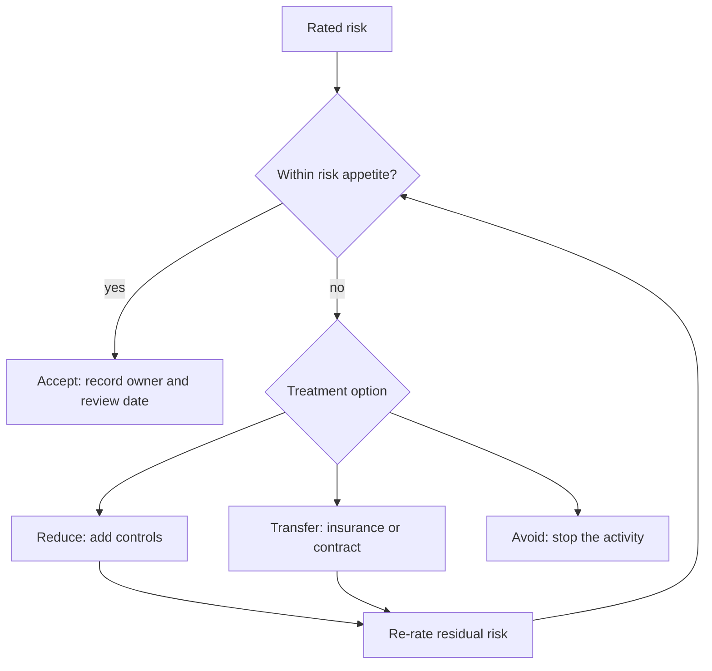

# CS-16 Risk Analysis, Policy, Governance and Compliance

> [!info] Topic card
> **Unit:** U7 · **Time:** 5 h · **Code:** `ale`, `control_value` and `risk_rating` in `code/cs_examples.py`. Every figure in the worked examples is asserted in the tests. The money values are **illustrative** amounts in Tanzanian shillings (TZS), not real loss data.

> [!warning] Law changes
> The laws named here (e.g. Tanzania's Cybercrimes Act, 2015, and Personal Data Protection Act, 2022) are given for orientation only. Check the current text, regulations and guidance from the regulator before relying on them, and seek qualified legal advice for real decisions. This lesson isn't legal advice.

## 1. Learning objectives
1. **Conduct** a risk assessment: identify assets, threats and vulnerabilities, estimate likelihood and impact, rate the risk, and choose a treatment.
2. **Calculate** quantitative risk (SLE, ARO, ALE), and **evaluate** controls by cost–benefit, while explaining the uncertainty in the inputs.
3. **Distinguish** policy, standard, procedure and guideline, and **draft** a short policy statement.
4. **Explain** governance roles (board, CISO, risk owner, data owner, custodian) and frameworks (ISO/IEC 27001/27002, NIST CSF 2.0, ISO 31000).
5. **Identify** the compliance obligations typical for an information system that handles personal data, and **map** them to controls.

## 2. Why it matters
Security budgets are limited, and you can't fix everything. Risk analysis decides **what to protect first and how much to spend**, in language that managers understand. Governance makes sure someone is accountable. Compliance makes sure the organisation meets its legal and contractual duties. The technical lessons (CS-03 to CS-15) answer *how* to control a risk; this lesson answers *which* risks and *why*.

## 3. Prerequisites
[[CS-01 Security Foundations - CIA, Threats, Vulnerabilities and Risk]] (risk = likelihood × impact) · [[CS-02 Threat Modeling and Security Requirements]] (threat identification) · [[PM-11 Risk Management]] (the same vocabulary in project management).

## 4. Intuition
Risk management is **disciplined worrying**. List what you value, imagine what could go wrong, estimate how likely and how bad each outcome is, and then decide, for each one, to **reduce** it, **transfer** it (insurance, a contract), **avoid** it (don't do the risky thing), or **accept** it (consciously, with a signature). The key word is *consciously*: a risk nobody chose to accept is simply an unmanaged risk.

## 5. Rigorous explanation

### 5.1 The risk process (aligned with ISO 31000 and ISO/IEC 27005)
1. **Context:** scope, objectives, risk appetite, criteria for likelihood and impact.
2. **Identification:** assets (data, systems, people, reputation), threats, vulnerabilities, existing controls.
3. **Analysis:** likelihood and impact, either qualitative (1–5 scales) or quantitative (money).
4. **Evaluation:** compare with the risk criteria and appetite, and prioritise.
5. **Treatment:** reduce (mitigate), transfer (share), avoid, or accept. Record residual risk.
6. **Monitoring and review:** a risk register reviewed regularly, plus key risk indicators.
7. **Communication and consultation** throughout.

### 5.2 Qualitative rating
Score $= L \times I$ on 1–5 scales. The bands used here (one common convention; organisations define their own) are: Low 1–4, Medium 5–9, High 10–16, Critical 20–25. Only these products occur on a 5×5 grid: 1, 2, 3, 4, 5, 6, 8, 9, 10, 12, 15, 16, 20, 25. So the bands cover every possible score. Scales need **definitions**, e.g. impact 5 = "personal data of more than 1,000 people exposed, or more than 1 week of outage".

### 5.3 Quantitative rating
- **AV** (asset value) in money, **EF** (exposure factor) is the fraction lost per incident (0–1).
- **SLE** $= AV \times EF$ (single loss expectancy).
- **ARO** = expected incidents per year (annualised rate of occurrence).
- **ALE** $= SLE \times ARO$ (annualised loss expectancy).
- A control's annual value $= ALE_{before} - ALE_{after} - \text{annual cost}$.

**Caution:** the inputs are estimates, often rough. Present ranges and sensitivity ("if the ARO is 0.2–1.0, the ALE is …"), and don't treat the output as precise. More advanced methods (e.g. FAIR, Monte Carlo simulation) model the uncertainty explicitly.

### 5.4 Policy hierarchy
| Document | Nature | Example |
|---|---|---|
| **Policy** | High-level, mandatory statement of intent, approved by management | "All access to personal data shall be authorised, authenticated and logged." |
| **Standard** | Mandatory specific requirements | "Passwords: at least 15 characters; MFA for staff; Argon2id storage." |
| **Procedure** | Mandatory step-by-step instructions | "How to grant a new technician access." |
| **Guideline** | Recommended practice (optional) | "Tips for choosing a passphrase." |

Good policies are short, clear, owned, approved, communicated, enforceable, and reviewed (e.g. annually).

### 5.5 Governance roles
- **Board / top management:** sets the risk appetite and is ultimately accountable.
- **CISO / security officer:** runs the security programme and reports on risk.
- **Risk owner:** a manager accountable for a specific risk and its treatment.
- **Data owner:** decides classification and access rules for a data set (e.g. the registrar owns exam results).
- **Data custodian:** operates the systems that hold the data (e.g. ICT).
- **Users:** follow policy, and report incidents.
- **Internal audit:** independent assurance that controls work.

### 5.6 Frameworks
- **ISO/IEC 27001:2022:** requirements for an information security management system (ISMS): context, leadership, risk assessment and treatment, a Statement of Applicability, internal audit, continual improvement. It's certifiable.
- **ISO/IEC 27002:2022:** guidance on 93 controls in four themes (organisational, people, physical, technological).
- **NIST Cybersecurity Framework 2.0 (2024):** six functions (**Govern, Identify, Protect, Detect, Respond, Recover**) with categories and outcomes. Widely used for profiles and maturity.
- **ISO 31000:2018:** general risk-management principles.
- **CIS Controls:** a prioritised, practical list of safeguards.

### 5.7 Compliance
Typical obligations for an information system handling personal data:
- **Data-protection law:** in Tanzania, the Personal Data Protection Act, 2022, and its regulations, overseen by the Personal Data Protection Commission. Elsewhere, e.g. the EU GDPR. Typical duties:
  - a lawful basis and purpose limitation;
  - data minimisation and accuracy;
  - security safeguards;
  - data-subject rights;
  - breach notification;
  - registration and cross-border transfer rules.
  The details differ by law and change over time: **verify them.**
- **Cybercrime law:** e.g. Tanzania's Cybercrimes Act, 2015, which defines offences such as unauthorised access. This is relevant to security testing: always get written authorisation.
- **Sector rules and contracts:** e.g. PCI DSS for card payments, central-bank guidelines for financial services, university ICT policies.

Compliance is a **minimum**: you can be compliant and still insecure. Map each obligation to controls and evidence.

## 6. Terminology
| Term | Meaning |
|---|---|
| Risk appetite | The amount and type of risk an organisation is willing to pursue or retain |
| Inherent / residual risk | Risk before / after controls |
| Risk register | A list of risks with owner, rating, treatment and status |
| SLE / ARO / ALE | Loss per incident / incidents per year / expected annual loss |
| Statement of Applicability (SoA) | An ISO 27001 document listing the selected controls and justifications |
| Due care / due diligence | Doing what a reasonable organisation would do / investigating to know what is needed |
| Control types | Preventive, detective, corrective; administrative, technical, physical |

## 7. Step-by-step: a risk register entry
1. **Asset:** the hostel request database (personal data: names, rooms, phone numbers).
2. **Threat + vulnerability:** an external attacker exploits an unpatched web framework.
3. **Existing controls:** HTTPS, nightly backups.
4. **Likelihood:** 3 (possible: the framework has frequent advisories). **Impact:** 4 (personal data of all residents; notification duties).
5. **Rating:** `risk_rating(3, 4)` gives (12, "High").
6. **Treatment:** reduce it, with patching within 7 days of critical advisories, a WAF as a temporary shield, and dependency scanning in CI. **Owner:** the ICT services manager. **Due date.**
7. **Residual:** L 2 × I 4 = (8, "Medium"). This is within appetite once the dean signs to accept it.
8. **Review** every quarter, or after an incident or major change.

## 8. Diagram: risk treatment decision

## 9. Worked examples

### Example 1 (basic): the qualitative matrix (tested)
- `risk_rating(2, 2)` = (4, Low)
- `(1, 5)` = (5, Medium): rare but severe, so it still deserves attention
- `(3, 3)` = (9, Medium)
- `(2, 5)` = (10, High)
- `(4, 4)` = (16, High)
- `(4, 5)` = (20, Critical)
- `(5, 5)` = (25, Critical)

Note that 1 × 5 and 5 × 1 both score 5, though they're very different risks. Look at the components, not just the product.

### Example 2 (intermediate): ALE and control justification (tested)
A data breach of the hostel system. Asset value (including response, notification, downtime and reputation): AV = TZS 40,000,000. Exposure factor EF = 0.25. ARO = 0.5 (once every two years).
- SLE = 40,000,000 × 0.25 = **TZS 10,000,000**
- ALE = 10,000,000 × 0.5 = **TZS 5,000,000 per year**

Control package A (MFA, patching discipline and monitoring) costs TZS 1,500,000 a year and is expected to reduce the ARO to 0.1. The new ALE is TZS 1,000,000. Net value = 5,000,000 − 1,000,000 − 1,500,000 = **+TZS 2,500,000 a year**, so it's justified.

Control package B achieves the same reduction for TZS 6,000,000 a year: net value **−TZS 2,000,000**, so it isn't justified on these numbers alone. (It might still be chosen for legal or reputational reasons the model doesn't capture.)

### Example 3 (challenging): sensitivity and limits
The ARO of 0.5 is a guess. Repeat the calculation for ARO ∈ {0.2, 0.5, 1.0} before controls, keeping the after-control ARO at 0.1:

| ARO before | ALE before | Value of package A |
|---|---|---|
| 0.2 | 2,000,000 | 2,000,000 − 1,000,000 − 1,500,000 = −500,000 |
| 0.5 | 5,000,000 | +2,500,000 |
| 1.0 | 10,000,000 | +7,500,000 |

The decision flips at ARO = 0.25, where ALE before = 2,500,000 and the value is 0. **Interpretation:** if management believes a breach is at least as likely as once every four years, package A pays for itself. Presenting the break-even point is more honest, and more useful, than one precise-looking number. Also, ALE treats a frequent small loss and a rare catastrophic one as equal if their products match. For catastrophic risks, decision-makers usually care about the worst case too (see [[DM-18 Introductory Discrete Probability]] on expected value).

## 10. Application: an information security policy set for the hostel system
- **Policy (1 page):** purpose, scope, roles (the dean of students as risk owner, the registrar's office as data owner for student records, ICT as custodian), principles (least privilege, logging, breach reporting within 24 h internally), review cycle.
- **Standards:** passwords and MFA ([[CS-08 Password Storage and Authentication Security]]); server hardening ([[CS-10 Operating System Security and Hardening]]); logging and retention ([[CS-15 Logging, Monitoring, Incident Response and Recovery]]).
- **Procedures:** user onboarding and offboarding; patching; incident response; backups and restore.
- **Compliance map:** each data-protection duty → control → evidence. For example, "security safeguards" → MFA, encryption, access reviews → MFA enrolment report, quarterly access-review sign-off.

## 11. Common mistakes
| Mistake | Fix |
|---|---|
| A risk register nobody owns or reviews | Named owners, review dates, and governance reporting |
| Treating quantitative outputs as precise | Ranges, sensitivity analysis, break-even points |
| Accepting risks implicitly | A documented acceptance signed by the accountable manager |
| A 40-page policy nobody reads | A short policy plus specific standards and procedures |
| "Compliant = secure" | Compliance is a floor; manage risk beyond it |
| Copying another organisation's policy unchanged | Tailor it to your context and actual practices |
| Only technical controls | Balance administrative, technical and physical controls |

## 12. Comparison: qualitative vs quantitative analysis
| | Qualitative | Quantitative |
|---|---|---|
| Inputs | 1–5 scales with definitions | Money values and frequencies |
| Speed | Fast; workshop-friendly | Slower; needs data |
| Output | A ranked list | Annual loss and cost–benefit |
| Weakness | Subjective; products can mislead | False precision if the inputs are guesses |
| Best for | Prioritising many risks | Justifying major investments |

## 13. Practice
**L1** 1. Name the four treatment options. 2. Define residual risk.

**L2** 3. Compute the SLE and ALE: AV = TZS 12,000,000, EF = 0.4, ARO = 0.25. 4. Classify as policy, standard, procedure or guideline: (a) "Use TLS 1.2 or higher." (b) "Information shall be classified by its owner." (c) "Step 1: open the admin console…" (d) "Consider using a password manager."

**L3** 5. Create three risk-register entries for the exam-results portal, with ratings, treatments, owners and residual ratings. 6. Explain the roles of data owner and data custodian for student exam results.

**L4** 7. For Example 2, find the after-control ARO at which package B breaks even (net value 0), given ARO before = 0.5. 8. Map five obligations of a data-protection law (choose the one relevant to you, and cite the version) to controls and evidence for the hostel system.

**L5** 9. Write a two-page information security policy for a small business (10 staff, a point-of-sale system, customer phone numbers) that a non-technical owner would approve. Include scope, roles, principles, acceptable use, incident reporting, review, and a one-paragraph justification of how it reflects their risks.

## 14. Hints
> [!tip]- Hints
> 3: multiply. 4: mandatory and specific → standard; intent → policy; steps → procedure; optional → guideline. 7: 5,000,000 − SLE × x − 6,000,000 = 0. 8: the lawful basis, security, breach notification, rights, retention. 9: keep it short; link to standards.

## 15. Worked solutions
> [!success]- Solutions 1–2
> 1. Reduce (mitigate), transfer (share), avoid, accept. 2. The risk that remains after the treatment's controls are in place. It must itself be within appetite, or accepted explicitly.

> [!success]- Solution 3
> SLE = 12,000,000 × 0.4 = TZS 4,800,000. ALE = 4,800,000 × 0.25 = **TZS 1,200,000 a year**. (Check: `ale(12_000_000, 0.4, 0.25)` gives `(4800000.0, 1200000.0)`.)

> [!success]- Solution 4
> (a) Standard. (b) Policy. (c) Procedure. (d) Guideline.

> [!success]- Solution 5 (sample)
> | # | Risk | L | I | Rating | Treatment | Owner | Residual |
> |---|---|---|---|---|---|---|---|
> | R1 | A lecturer account is phished and grades are altered | 3 | 5 | 15 High | MFA for staff; a grade-change audit log with alerts; a change window | Exams officer | L1 × I5 = 5 Medium |
> | R2 | IDOR exposes other students' results | 3 | 4 | 12 High | Object-level authorisation tests in CI; code review | Development lead | L1 × I4 = 4 Low |
> | R3 | Outage on results day because of load | 4 | 3 | 12 High | Load testing; caching; a static fallback page | ICT manager | L2 × I3 = 6 Medium |

> [!success]- Solution 6
> The **data owner** (e.g. the registrar or examinations office) decides who may view or change results, the classification (confidential), retention, and approves access requests. The **custodian** (ICT) runs the systems and implements the owner's decisions: access controls, backups, patching, logging. The owner is accountable for *what* protection is required; the custodian is responsible for *operating* it.

> [!success]- Solution 7
> Value(B) = 5,000,000 − 10,000,000·x − 6,000,000 = 0 ⇒ −1,000,000 = 10,000,000·x ⇒ x = −0.1. A negative ARO is impossible, so **package B can never break even** at this ALE: even reducing breaches to zero (ALE after = 0) saves only 5,000,000 a year, less than its 6,000,000 cost. To justify it, you'd need non-monetary reasons, or a higher asset value or ARO.

> [!success]- Solution 8 (format)
> | Obligation (cite the section of your law) | Control | Evidence |
> |---|---|---|
> | Lawful basis and purpose | A privacy notice at registration; data used only for maintenance | The notice text; a data-flow map |
> | Security safeguards | MFA, encryption, access control, logging | Configuration screenshots; access-review sign-offs |
> | Breach notification | An IR procedure with a regulator-notification step | The procedure; exercise records |
> | Data-subject rights | A procedure for access and correction requests | A request log |
> | Retention limits | Anonymisation after 2 years | The scheduled job; deletion logs |

> [!success]- Solution 9 (outline)
> 1. **Purpose and scope:** protect customer and business information on all shop devices and accounts.
> 2. **Roles:** the owner is accountable; one staff member is the IT contact; the POS vendor is responsible under its contract.
> 3. **Principles:** a unique login per person; MFA on email and the POS admin; least access; updates switched on.
> 4. **Acceptable use:** no sharing of passwords; no personal USB drives on the POS.
> 5. **Customer data:** collect phone numbers only with consent, keep them only as long as needed, never send them over WhatsApp groups.
> 6. **Backups:** daily, with one copy offline.
> 7. **Incident reporting:** tell the owner immediately; there's a contact list.
> 8. **Review:** yearly, or after any incident.
>
> **Justification:** the main risks are fraud, theft of customer data and POS downtime, and each principle targets one of them.

## 16. Self-test (pass ≥ 4/5)
1. ALE formula? 2. Who accepts a residual risk? 3. Name the six NIST CSF 2.0 functions. 4. Policy vs standard? 5. Why present a break-even ARO?
> [!success]- Answers
> 1. ALE = SLE × ARO = AV × EF × ARO. 2. The accountable risk owner or manager, within the organisation's appetite. 3. Govern, Identify, Protect, Detect, Respond, Recover. 4. A policy states intent; a standard gives specific mandatory requirements. 5. The inputs are uncertain; the break-even point shows when the decision changes.

## 17. Flashcards
#flashcards/cyber-security
SLE?::Single loss expectancy = asset value × exposure factor.
ALE?::Annualised loss expectancy = SLE × ARO.
Four risk treatments?::Reduce, transfer, avoid, accept.
ISO/IEC 27001 vs 27002?::27001: certifiable ISMS requirements. 27002: control guidance.
NIST CSF 2.0 functions?::Govern, Identify, Protect, Detect, Respond, Recover.
Data owner vs custodian?::The owner decides protection and access; the custodian operates the systems that implement it.
Is compliance the same as security?::No. Compliance is a minimum; risk management goes beyond it.

## 18. Blank-page recall
Draw the risk-treatment flowchart and the policy hierarchy table, then redo Example 2's numbers.

## 19. Revision summary
- Risk process: context → identify → analyse → evaluate → treat → monitor, with communication throughout.
- Qualitative: L × I with defined scales. Quantitative: SLE = AV × EF, ALE = SLE × ARO; a control is worth ALE before − ALE after − cost.
- Show uncertainty: sensitivity and break-even points.
- Policies state intent; standards, procedures and guidelines implement it. Roles make someone accountable.
- Frameworks: ISO 27001/27002, NIST CSF 2.0, ISO 31000. Compliance (data protection, cybercrime law) is the minimum. Verify current law.

## 20. Links
Prev: [[CS-15 Logging, Monitoring, Incident Response and Recovery]] · Next: [[CS-17 Digital Forensics Fundamentals]] · Related: [[PM-11 Risk Management]], [[X-05 Security Risk in Project Management]], [[FYP-10 Research Ethics, Privacy, Academic Integrity and Citation]], [[CS-19 Cloud Security and Privacy]]

## 21. Sources
- ISO/IEC 27001:2022, *Information security, cybersecurity and privacy protection: Information security management systems: Requirements*; ISO/IEC 27002:2022 (controls); ISO/IEC 27005:2022 (risk management); ISO 31000:2018, *Risk management: Guidelines*.
- NIST, *The NIST Cybersecurity Framework (CSF) 2.0*, NIST CSWP 29, 2024.
- NIST SP 800-30 Rev. 1, *Guide for Conducting Risk Assessments*, 2012.
- United Republic of Tanzania, *The Cybercrimes Act, 2015* and *The Personal Data Protection Act, 2022*. Obtain the current official texts (e.g. from the Parliament of Tanzania or the government legal portal) before citing sections.
- *(Not checked online during the build, because there was no network access.)*

## 22. Mastery checklist
- [ ] I can run a risk assessment and write register entries
- [ ] I can calculate SLE/ALE, control value and break-even, and explain the uncertainty
- [ ] I can draft a policy and distinguish the document types
- [ ] I can name governance roles and frameworks, and map compliance duties to controls · reviews scheduled
