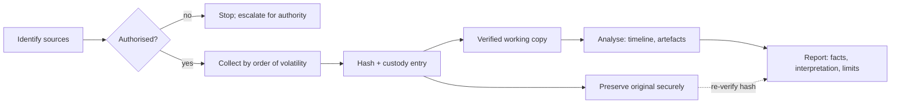

# CS-17 Digital Forensics Fundamentals

> [!info] Topic card
> **Unit:** U7 · **Time:** 4 h · **Code:** `custody_append`, `custody_problems` (a hash-chained chain-of-custody log) and `acquire_copy` (copy, hash and set read-only) in `code/cs_examples.py`, with tests that detect an altered entry, a deleted entry and a changed evidence hash. The outputs below are real. People and evidence items are fictional.

> [!warning] Scope
> This lesson teaches principles. Real investigations that may end in court or disciplinary action need trained examiners, validated tools, legal authority (a warrant, a policy, or consent) and the procedures required in your jurisdiction. As a student, practise only on data you create yourself.

## 1. Learning objectives
1. **State** the principles of digital evidence: relevance, authenticity, integrity, reliability, and a documented chain of custody.
2. **Apply** the order of volatility when deciding what to collect first.
3. **Explain** acquisition methods (live vs dead, logical vs physical/bit-stream imaging, write blockers) and why every action is hashed and documented.
4. **Build** a timeline from multiple sources, and **reason** about time zones, clock skew and timestamp meanings.
5. **Write** a clear, reproducible forensic findings report that separates facts from interpretation.

## 2. Why it matters
After an incident, people ask: what happened, who did it, what data was taken, and can we prove it? If evidence was handled carelessly (opened on the suspect machine, copied without hashes, with no record of who held it), the answers may be wrong, and they won't stand up to a disciplinary panel, an insurer or a court. Forensic discipline is how organisations turn logs and disks into trustworthy conclusions.

## 3. Prerequisites
[[CS-15 Logging, Monitoring, Incident Response and Recovery]] (timelines, IR) · [[CS-06 Hashes, MACs and Integrity]] (SHA-256, hash chains) · [[CS-10 Operating System Security and Hardening]] (file systems, permissions).

## 4. Intuition
Treat digital evidence like evidence at a crime scene: **don't contaminate it, record everything, and be able to show that what you analysed is exactly what you collected**. A hash is the evidence bag's tamper seal. The chain-of-custody form is the list of everyone who held the bag. Working only on verified copies is like testing a sample, never the original.

## 5. Rigorous explanation

### 5.1 Principles
- **Integrity:** the evidence isn't changed. If an action must change it (e.g. a live memory capture), it's minimised, justified and documented.
- **Authenticity:** you can show the evidence is what you claim (its source, time and method).
- **Chain of custody:** a continuous record of who collected, held, transferred and examined each item, when and why.
- **Reproducibility:** another competent examiner, given the same evidence and method, should reach the same findings.
- **Proportionality and legality:** collect what the investigation needs and is authorised to collect, respecting privacy.

These principles are reflected in guidance such as ISO/IEC 27037 (identification, collection, acquisition and preservation of digital evidence) and NIST SP 800-86.

### 5.2 Order of volatility (collect the most volatile first)
1. CPU registers, cache.
2. RAM: running processes, network connections, encryption keys, malware held only in memory.
3. Network state: ARP cache, routing tables, active connections.
4. Temporary file systems, swap.
5. Disk.
6. Remote logs and monitoring data.
7. Archives and backups.

(RFC 3227, *Guidelines for Evidence Collection and Archiving*, 2002.) **Pulling the plug** destroys items 1–4. **Leaving the system running** lets an attacker or malware keep changing it. The decision depends on the case. Whatever you decide, document it.

### 5.3 Acquisition
- **Dead (offline) acquisition:** a powered-off disk, connected through a **write blocker**, and imaged bit-for-bit (all sectors, including deleted space). Hash the source and the image; they must match.
- **Live acquisition:** memory and volatile data captured from a running system with trusted tools (ideally run from external media). This changes the system slightly, so record exactly what was run.
- **Logical acquisition:** selected files or exports (e.g. a log export from the SIEM, a mailbox export). This is common in organisational investigations.
- **Cloud and remote:** provider logs and snapshots, obtained through the provider's mechanisms and with the right legal basis.
- Work on **verified copies**; store the original securely.

### 5.4 Analysis
- **Timeline analysis:** merge events from file-system timestamps, logs, browser history, and the registry or system journals into one ordered timeline. Normalise everything to UTC and note the clock offsets.
- **Timestamps:** file systems record several times. On Linux: modification (mtime), metadata change (ctime) and access (atime, often disabled or relaxed). NTFS records creation and other times as well. Copying a file can change some of them, and attackers can forge them ("timestomping"), so corroborate them with independent sources.
- **Artefacts:**
  - deleted files (recoverable until overwritten; less likely on SSDs with TRIM);
  - log files, shell history, recently used lists;
  - persistence locations;
  - email headers.
- **Keyword and hash searches:** known-bad hashes; known-good hashes to *exclude* standard OS files.

### 5.5 Reporting
A report should state:
- the scope and authorisation;
- the evidence list with hashes;
- the tools and versions used;
- the method;
- the findings, as **facts** with references to the evidence;
- the **interpretation** and its confidence;
- the limitations;
- the examiner's details.

Avoid unsupported conclusions about *who* was at the keyboard. A user account acting is not the same as a person acting.

## 6. Terminology
| Term | Meaning |
|---|---|
| Forensic image | A bit-for-bit copy of storage, including unallocated space |
| Write blocker | Hardware or software that prevents writes to the source media |
| Chain of custody | A documented history of an evidence item's handling |
| Order of volatility | Collection priority from most to least volatile data |
| Timeline | An ordered, merged list of events from several sources |
| Anti-forensics | Attempts to hide or destroy evidence (wiping, timestomping, log deletion) |
| Known-good / known-bad hash sets | Hashes used to exclude standard files or to find malicious ones |
| Attribution | Linking actions to a specific person or group (hard; needs corroboration) |

## 7. Step-by-step: collecting a log export as evidence
1. **Authorisation:** confirm it with the incident lead (e.g. under the ICT policy) and record the case ID.
2. **Acquire:** export the relevant log range from the central log server (not from the compromised host, if possible). Note the query, the time range and the system time offset.
3. **Hash immediately:** run `sha256_file(export)`. Record it in the custody log: `custody_append(log, "acquired", "EV-001 auth.log export", h, "Neema (ICT)", "2026-03-02T10:05Z")`.
4. **Copy for analysis:** `acquire_copy(src, dst)` hashes the source and the copy and sets the copy read-only (`444`). The two hashes must match.
5. **Store the original** in restricted, access-logged storage.
6. **Every transfer or examination:** add a custody entry with the same item and hash.
7. **Before reporting:** re-hash the evidence and run `custody_problems(log)`, which must return an empty list.

## 8. Diagram: evidence lifecycle


## 9. Worked examples

### Example 1 (basic): order of volatility decision
A server is suspected of running memory-only malware, and it's still on. The correct sequence:
1. Photograph and document the screen and connections.
2. Capture RAM with a trusted tool from external media.
3. Record the network connections and running processes.
4. Then decide on shutdown and disk imaging, following the plan.

Pulling the power first would lose the only copy of the malware and of its network connections.

### Example 2 (intermediate): a hash-chained custody log (real output)
The first entry created in the test:
```text
{'seq': 0, 'when': '2026-03-02T10:05Z', 'person': 'Neema (ICT)', 'action': 'acquired',
 'item': 'EV-001 auth.log export',
 'sha256': '8f6a41a908b944dfa1cc42d70c2b1715448f74531066acf7c0da4a01c3dd7452',
 'prev': '0000000000000000000000000000000000000000000000000000000000000000',
 'entry_hash': 'a42f915bac88a8abaff00e06817720e34e7cdd75ddd1d0a131460b58526bbee0'}
```
Each later entry's `prev` is the earlier entry's `entry_hash`. What the tests show `custody_problems` detecting:
- Changing who received the item in entry 1: `entry 1: entry altered after recording`.
- Deleting entry 1: `entry 1: sequence number 2`, `entry 1: broken link to previous entry`.
- Recording a different evidence hash later: `entry 3: evidence hash changed for EV-001 auth.log export`.

**Limitation:** someone who controls the whole log can rebuild the entire chain. For real assurance, sign the entries, or send the head hash to an independent party regularly (see [[CS-06 Hashes, MACs and Integrity]] Solution 9). The paper or electronic signatures of the people handling the evidence remain essential.

### Example 3 (challenging): timeline reasoning with skewed clocks
Sources:
- the web server's auth log (UTC, NTP-synchronised): `08:14:36Z Accepted password for juma`;
- a workstation's file-system mtime for `payroll.xlsx`: `11:20:05` local time (EAT, UTC+3), but the workstation's clock was found to be **4 minutes fast**;
- the file server's SMB audit: `08:16:10Z juma read payroll.xlsx`.

**Normalise:** the workstation time 11:20:05 EAT is 08:20:05 UTC; correcting the 4-minute drift gives **08:16:05 UTC**.

**Merged timeline (UTC):**

| Time | Event | Source |
|---|---|---|
| 08:14:36 | `juma` logs in to web01 | Auth log |
| 08:16:05 | `payroll.xlsx` modified on the workstation (corrected) | FS mtime |
| 08:16:10 | `juma` reads `payroll.xlsx` on the file server | SMB audit |

**Interpretation:** the corrected times put the workstation modification 5 seconds *before* the server-side read, which is puzzling if the file was copied *from* the server. Possible explanations: the drift estimate is off by a few seconds; mtime reflects the server's original modification time preserved on copy (many copy tools keep mtime); or a different file. **Conclusion:** report the facts, give the competing interpretations, and say what would resolve them (the file's hash on both machines, a creation-time artefact, the copy tool's behaviour). Don't overstate it.

## 10. Application: an evidence procedure for the hostel system
1. The IR plan names who may authorise collection (the dean of students, with ICT security).
2. Central logs are kept for 1 year (subject to policy), with integrity protection, so they're available as evidence.
3. An evidence kit: an external drive with trusted tools, write blockers, custody forms (or a `custody_append` log), and a camera.
4. Exports are hashed on creation; copies are read-only; originals go to a locked, access-logged store.
5. Reports use a template with facts, interpretation and limitations, and are peer-reviewed before release.
6. Privacy: only the data relevant to the incident is collected, and access to evidence is limited to the investigation team.

## 11. Common mistakes
| Mistake | Fix |
|---|---|
| Browsing the suspect machine "to have a look" | Don't. It changes timestamps and may trigger anti-forensics |
| Pulling the plug without thinking about volatile data | Apply the order of volatility; follow the plan |
| No hashes, or hashing only at the end | Hash at acquisition and verify before each use |
| Gaps in the custody record | A record for every transfer and examination |
| Mixing time zones | Normalise to UTC; note offsets and drift |
| "User X did it" from account activity alone | Distinguish account actions from people; corroborate |
| Collecting everything "just in case" | Proportional, authorised collection |

## 12. Comparison: acquisition types
| Type | Captures | Pros | Cons |
|---|---|---|---|
| Live memory | Processes, keys, connections, fileless malware | The only way to capture volatile data | Alters the system slightly; needs skill |
| Dead disk image | All sectors, including deleted space | Complete; repeatable; hash-verifiable | Loses volatile data; needs downtime |
| Logical/file | Selected files or exports | Fast, targeted, privacy-friendly | Misses deleted data and context |
| Cloud/provider | API logs, snapshots | Often the only source in cloud systems | Depends on the provider; retention limits |

## 13. Practice
**L1** 1. Put in order of volatility: disk, RAM, backups, ARP cache. 2. What does a write blocker do?

**L2** 3. Why must the image hash match the source hash? 4. Convert 23:45 EAT (UTC+3) on 2 March to UTC, with the date.

**L3** 5. Write the custody entries for an evidence USB drive that is seized, transferred to the security office, imaged, and returned to storage. 6. List five artefacts you'd examine to decide whether a user copied files to USB storage.

**L4** 7. Critique this conclusion: "The log shows `amina` logged in at 02:00 and deleted records, so Amina deleted the records." What else would you need? 8. Explain how SSD TRIM and full-disk encryption affect deleted-file recovery and acquisition planning.

**L5** 9. Draft a forensic findings report (1–2 pages) for the incident in [[CS-15 Logging, Monitoring, Incident Response and Recovery]] Example 3, with an evidence list and hashes, the method, a timeline, findings, interpretation, limitations and recommendations.

## 14. Hints
> [!tip]- Hints
> 1: memory-like state first. 4: subtract 3 hours. 6: device connection logs, file access times, link files, shell or Explorer history. 7: account compromise, shared credentials, corroborating evidence. 8: TRIM erases blocks; encrypted volumes need keys or a live capture.

## 15. Worked solutions
> [!success]- Solutions 1–2
> 1. RAM → ARP cache → disk → backups. (The ARP cache is network state; both it and RAM come before disk. Many orderings put RAM first, as RFC 3227 does.) 2. It lets the examiner read the source media while physically or logically preventing any writes, so the evidence isn't altered by connecting it.

> [!success]- Solution 3
> A matching hash shows that the image is a bit-for-bit identical copy. All analysis is done on the image, so this links every finding to the original evidence. A mismatch means read errors or alteration, which must be investigated and documented.

> [!success]- Solution 4
> 23:45 EAT − 3 h = **20:45 UTC on 2 March** (same date). If it had been 01:30 EAT on 3 March, the UTC time would be 22:30 on **2 March**: watch for date changes.

> [!success]- Solution 5
> | seq | When (UTC) | Person | Action | Item | SHA-256 |
> |---|---|---|---|---|---|
> | 0 | 09:00 | Officer A | Seized from desk 4, bagged and sealed (#S-118) | EV-002 USB drive | (n/a until imaged; record the seal number) |
> | 1 | 09:40 | Officer A → Security office B | Transferred, seal intact | EV-002 | n/a |
> | 2 | 10:15 | Examiner B | Imaged via write blocker | EV-002 → EV-002-IMG | `<image hash>` = `<source hash>` |
> | 3 | 11:00 | Examiner B | Original resealed (#S-119), returned to locked store | EV-002 | `<source hash>` |
> | 4 | later | Examiner B | Examination of EV-002-IMG copy | EV-002-IMG | Re-verified hash |

> [!success]- Solution 6
> 1. OS device connection records: Windows registry USB keys and setupapi logs, or Linux journal/udev messages, with the device serial number. 2. File-system access and modification times of the copied files. 3. Shortcut (.lnk) files or recent-documents lists pointing to removable drive letters. 4. Shell or command history. 5. The removable drive itself, if recovered: the files present, their timestamps, matching hashes. Also EDR/DLP logs, if deployed.

> [!success]- Solution 7
> The log shows that the **account** `amina` authenticated and performed deletions. It doesn't prove the *person* did. Consider: compromised credentials (phishing, password reuse), a shared or borrowed password, a session hijack, malware acting under the account, or wrong log interpretation (time zone, a service account). Needed: the source IP and device of the login, and whether they match Amina's usual devices; MFA records; physical access or CCTV, if relevant; corroboration from other logs; and an interview. Report it as "the account `amina` performed…", with confidence levels.

> [!success]- Solution 8
> **TRIM:** when files are deleted on an SSD, the OS tells the drive which blocks are free, and the drive may erase them soon afterwards. Deleted data is therefore often unrecoverable, and the chance falls quickly over time. **Full-disk encryption:** a powered-off image is just ciphertext without the key. If the system is running and unlocked, a live acquisition (logical copy or memory capture, which may contain the keys) may be the only way to get readable data. Recovery keys held by the organisation (escrowed BitLocker keys) are the lawful alternative. Plan these decisions in advance.

> [!success]- Solution 9 (outline)
> **Header:** case ID, examiner, dates, authorisation reference. **Evidence:** EV-001 auth.log export (its SHA-256), EV-002 web01 memory image (hash), EV-003 web01 disk image (hash). **Tools:** names and versions, plus the Python helpers with their commit ID. **Method:** export, hash, read-only copies, timeline merge in UTC. **Timeline:** as in CS-15 Example 3, with source references. **Findings (facts):** a successful password login to `juma` from 203.0.113.50 at 08:14:36Z after 7 failures from that IP; `sudo cat /etc/shadow` at 08:15:02Z. **Interpretation:** a high-confidence password-guessing compromise of the account; no evidence yet about the person's identity. **Limitations:** no memory capture before isolation; logs only from web01. **Recommendations:** as in CS-15.

## 16. Self-test (pass ≥ 4/5)
1. Why hash evidence at acquisition? 2. What's the first collection priority? 3. Why normalise to UTC? 4. What does a chain-of-custody record contain? 5. Can a hash chain alone prove a custody log is genuine?
> [!success]- Answers
> 1. To prove later that the evidence hasn't changed. 2. The most volatile data (registers, cache, RAM). 3. To order events from different time zones and systems correctly. 4. Who, what, when, where and why for every collection, transfer and examination, plus the evidence hashes. 5. No: someone who controls the whole log can rebuild it. Signatures or external anchoring are needed.

## 17. Flashcards
#flashcards/cyber-security
Order of volatility (first three)?::Registers/cache, RAM, network state.
Purpose of a write blocker?::Read source media without altering it.
Chain of custody?::A documented, unbroken record of everyone who handled the evidence, when and why.
Image verification?::The image hash must equal the source hash.
Live vs dead acquisition?::Live captures volatile data but alters the system; dead imaging is complete for disks but loses volatile data.
Attribution caution?::Account activity is not proof of who was at the keyboard.
TRIM's effect on forensics?::Deleted blocks on SSDs may be erased quickly, so recovery is unlikely.

## 18. Blank-page recall
Write the 7-step evidence procedure and the order of volatility, then redo Example 3's time normalisation.

## 19. Revision summary
- Evidence must be relevant, authentic, intact, and documented through the chain of custody.
- Collect by order of volatility. Choose live or dead acquisition deliberately, and document it.
- Hash at acquisition, work on verified read-only copies, re-verify before reporting.
- Timelines: normalise to UTC, correct for drift, corroborate timestamps.
- Reports separate facts, interpretation and limitations. Account ≠ person.

## 20. Links
Prev: [[CS-16 Risk Analysis, Policy, Governance and Compliance]] · Next: [[CS-18 Security Testing and Vulnerability Management]] · Related: [[CS-15 Logging, Monitoring, Incident Response and Recovery]], [[CS-14 Malware and Defensive Detection]], [[FYP-10 Research Ethics, Privacy, Academic Integrity and Citation]]

## 21. Sources
- IETF RFC 3227, *Guidelines for Evidence Collection and Archiving*, 2002: https://www.rfc-editor.org/rfc/rfc3227
- NIST SP 800-86, *Guide to Integrating Forensic Techniques into Incident Response*, 2006.
- ISO/IEC 27037:2012, *Guidelines for identification, collection, acquisition and preservation of digital evidence*.
- *(Not checked online during the build, because there was no network access.)*

## 22. Mastery checklist
- [ ] I can apply the order of volatility and justify my acquisition choices
- [ ] I can maintain and verify a chain of custody with hashes
- [ ] I can build a UTC timeline that corrects for drift
- [ ] I can write a report that separates facts from interpretation · reviews scheduled
