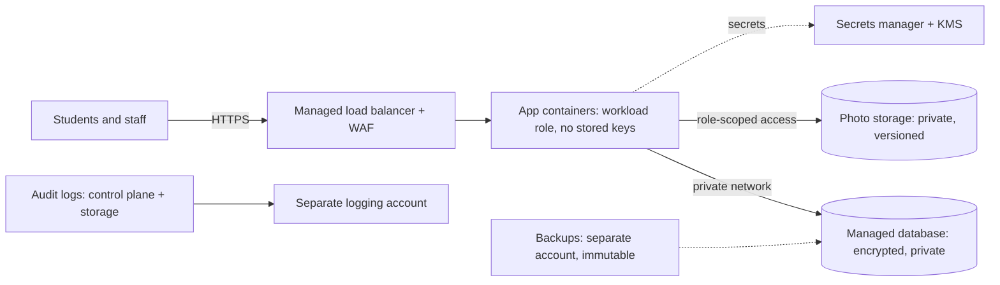

# CS-19 Cloud Security and Privacy

> [!info] Topic card
> **Unit:** U8 · **Time:** 4 h · **Code:** `pseudonymise`, `k_anonymity` and `storage_policy_findings` in `code/cs_examples.py`, with tests. The storage check is a **provider-neutral teaching model**, not any vendor's real API. The registration numbers and residents in the examples are fictional.

> [!warning] Law changes
> Privacy duties depend on the applicable law (e.g. Tanzania's Personal Data Protection Act, 2022, or the EU GDPR) and its current regulations. Check the official texts, because this lesson describes common principles, not legal advice.

## 1. Learning objectives
1. **Explain** the cloud service models (IaaS, PaaS, SaaS) and the **shared responsibility model** for each.
2. **Identify** the most common cloud security failures (misconfiguration, weak identity controls, exposed keys, missing logging) and their controls.
3. **Apply** identity and access management principles in the cloud: least-privilege roles, MFA, no long-lived keys in code.
4. **Distinguish** anonymisation, pseudonymisation and encryption, and **measure** re-identification risk with k-anonymity.
5. **Apply** privacy-by-design principles (minimisation, purpose limitation, retention, transparency, data-subject rights, data-protection impact assessments) to an information system.

## 2. Why it matters
Most new systems are built on cloud platforms, and many reported cloud breaches are caused by the customer's own configuration: public storage buckets, over-privileged accounts, leaked access keys. At the same time, systems hold more personal data than ever, and people and regulators expect it to be handled lawfully and respectfully. Cloud security and privacy are where technical controls meet legal and ethical duties.

## 3. Prerequisites
[[CS-04 Authorization and Access Control]] (least privilege) · [[CS-09 Network Security and Secure Communication]] (segmentation) · [[CS-16 Risk Analysis, Policy, Governance and Compliance]] (compliance, data owners) · [[CS-06 Hashes, MACs and Integrity]] (HMAC).

## 4. Intuition
Renting cloud infrastructure is like renting a flat in a well-guarded building. The landlord secures the building, the walls and the main doors. **You** lock your own door, decide who gets keys, and don't leave your valuables on the balcony. Most cloud breaches are "unlocked flat door", not "building collapsed". Privacy is about whether you should hold the valuables at all, and for how long.

## 5. Rigorous explanation

### 5.1 Service models and shared responsibility
| Layer | IaaS (VMs) | PaaS (managed app/database) | SaaS (email, office suite) |
|---|---|---|---|
| Data, classification, accounts and access | Customer | Customer | Customer |
| Application code and configuration | Customer | Customer | Provider (customer configures settings) |
| Runtime, middleware, OS patching | Customer | Provider | Provider |
| Virtualisation, hardware, physical data centre | Provider | Provider | Provider |

The customer is **always** responsible for their data, their identities and access, and their configuration choices. Read each provider's own shared-responsibility documentation, because the boundaries vary by service.

### 5.2 Common failures and controls
| Failure | Control |
|---|---|
| Storage made publicly readable | Block public access by default; policy checks in CI; regular configuration audits |
| Over-privileged roles ("admin for everything") | Least-privilege roles per workload; review unused permissions |
| Long-lived access keys in code or repositories | Workload identities/short-lived credentials; secret scanning; rotation |
| No MFA on console accounts, especially the root/owner account | MFA everywhere; lock away the root account; use break-glass procedures |
| Logging disabled | Enable audit logs (control-plane API calls) and storage access logs; centralise them |
| Unencrypted data, or keys managed carelessly | Encryption at rest and in transit; a managed KMS; key-access policies |
| Exposed management ports | Security groups default deny; private networks; bastion/VPN ([[CS-09 Network Security and Secure Communication]]) |
| No backups or versioning | Versioning, immutable backups, a separate account for backups |

**Infrastructure as code** (Terraform, CloudFormation and so on) lets you review, version and **automatically check** configuration before deployment. The `storage_policy_findings` function is a tiny model of such a policy check.

### 5.3 Cloud identity and access
- **Identity is the new perimeter:** whoever holds valid credentials can reach the control plane from anywhere.
- Use **roles** for workloads (a service gets temporary credentials from the platform), not stored user keys.
- **Separate environments** (development, testing, production) into different accounts or projects, to limit the damage a mistake can do.
- **Guardrails:** organisation-level policies that forbid dangerous actions (e.g. making storage public, disabling logging).
- **Monitor** for unusual API activity: new access keys, logging disabled, resources created in unused regions.

### 5.4 Privacy concepts
- **Personal data:** information relating to an identified or identifiable person. **Sensitive categories** (e.g. health, religion, biometrics) usually get extra protection under law.
- **Privacy principles** (common to most laws and to ISO/IEC 29100):
  - lawfulness, fairness and transparency;
  - purpose limitation;
  - data minimisation;
  - accuracy;
  - storage limitation (retention);
  - integrity and confidentiality (security);
  - accountability.
- **Data-subject rights** typically include access, correction, deletion (in some cases), and objection.
- **Privacy by design and by default:** build these principles into the system from the start, with the most privacy-protective settings as the default.
- **DPIA** (data-protection impact assessment): a structured assessment of high-risk processing *before* it starts. It covers purpose, necessity, risks to individuals, and mitigations.
- **Cross-border transfers:** many laws restrict sending personal data to other countries. This matters when choosing a cloud region.

### 5.5 Anonymisation, pseudonymisation, encryption
| Technique | Reversible? | Still personal data? | Example |
|---|---|---|---|
| Encryption | Yes, with the key | Yes | AES-GCM-encrypted phone numbers |
| Pseudonymisation | Yes, for whoever holds the key or lookup table | Yes (in most laws) | `pseudonymise(reg_no, key)` HMAC tokens |
| Anonymisation | No (if done properly) | No | Aggregated counts with small groups suppressed |

**Re-identification risk:** removing names isn't enough. Combinations of **quasi-identifiers** (age band, block, gender, course) can single people out. A data set is **k-anonymous** if every combination of quasi-identifier values is shared by at least k rows. k-anonymity is a useful check, but not a guarantee: if everyone in a group has the same sensitive value, the group still leaks it (the motivation for refinements such as l-diversity, and for differential privacy).

## 6. Terminology
| Term | Meaning |
|---|---|
| Shared responsibility model | The division of security duties between cloud provider and customer |
| Control plane | The management API and console used to create and configure resources |
| IAM | Identity and access management |
| KMS | Key management service |
| Infrastructure as code (IaC) | Defining infrastructure in version-controlled files |
| Quasi-identifier | An attribute that isn't identifying alone but can be in combination |
| k-anonymity | Every quasi-identifier combination appears in at least k records |
| DPIA | A data-protection impact assessment of high-risk processing |

## 7. Step-by-step: reviewing a cloud storage configuration
1. **Inventory:** list every bucket or container, with its owner and data classification.
2. **Public access:** none, unless the content is deliberately public (e.g. a website's images), and documented.
3. **Encryption** at rest is on; access over HTTPS only.
4. **Versioning** on, with lifecycle rules to delete old versions after the retention period.
5. **Access logging** on, sent to a separate logging account.
6. **Region:** personal data stored only in approved regions, per the law and the institution's policy.
7. **Automate:** run a check like `storage_policy_findings` in CI and on a schedule. Treat findings as defects with owners.

## 8. Diagram: hostel system on a cloud platform


## 9. Worked examples

### Example 1 (basic): who is responsible?
1. The hostel app runs on IaaS virtual machines, and the OS has a critical unpatched vulnerability. The **customer** is responsible: under IaaS, the customer patches the OS.
2. A managed database (PaaS) engine needs a security update. The **provider** applies it, though the customer may choose the maintenance window.
3. A SaaS email account is phished because MFA was off. The **customer** is responsible: account security is always the customer's.

### Example 2 (intermediate): a storage review (tested)
Configuration: `public_read: True`, personal data stored in region `us-east` while the approved region list is `["af-south"]`, and nothing else set. `storage_policy_findings` reports:
```text
objects readable by anyone on the Internet
encryption at rest disabled
versioning disabled (no recovery from overwrite or ransomware)
access logging disabled
personal data stored outside approved regions
```
With public access off, readers limited to `hostel-app-role`, encryption, versioning and logging on, and the region `af-south`, it reports nothing. (Region names here are generic examples.)

### Example 3 (challenging): is this export safe to share?
The warden wants to share a maintenance data set with a research student. Names have been removed, and registration numbers have been replaced with `pseudonymise(reg_no, key)`. The quasi-identifiers are age band, block and gender. The 5 rows in the test give **k = 1**: exactly one resident is 25–29, female, in block B, so anyone who knows her can see her request (plumbing).

**Options:**
- Generalise: drop gender, or merge the blocks. With age only, the first four rows form a group of 4, but the 25–29 row is still alone (k = 1).
- Suppress small groups: remove the 25–29/B/F row. The remaining 4 rows have k = 2 by (age, block, gender), as the test shows.
- Better still: share only aggregated counts per block and issue type, with counts below a threshold (e.g. 5) suppressed.

The tokens are pseudonymous, not anonymous. The warden holds the key, so the data set is still personal data: use a data-sharing agreement and share the minimum needed.

## 10. Application: privacy by design for the hostel system
- **Minimise:** collect the name, registration number, room, phone number (optional) and the issue. Not date of birth or home address.
- **Purpose:** use the data for maintenance only. Reports to management are aggregated.
- **Retention:** anonymise closed requests after 2 years (subject to policy), and delete photos after 6 months.
- **Transparency:** a short privacy notice on the request form.
- **Rights:** a process for students to see and correct their data.
- **Security:** the controls from CS-08 to CS-15, plus the cloud configuration in §8.
- **DPIA:** a short one before launch, because the system tracks where students live.

## 11. Common mistakes
| Mistake | Fix |
|---|---|
| "The cloud provider handles security" | Know your side of the shared responsibility model |
| Access keys committed to Git | Workload roles; secret scanning; rotate leaked keys immediately |
| One account for development and production | Separate accounts or projects, with guardrails |
| Calling pseudonymised data "anonymous" | Whoever holds the key can re-identify; it's still personal data |
| Removing names and assuming the data is safe | Check quasi-identifiers (k-anonymity) and aggregate |
| Keeping data "forever, just in case" | A retention schedule with automated deletion |
| Choosing a region without checking the law | Approve regions for personal data in advance |

## 12. Comparison: on-premises vs cloud security
| Concern | On-premises | Cloud |
|---|---|---|
| Physical security | The organisation | The provider |
| Patching hardware and hypervisors | The organisation | The provider |
| Configuration risk | Changes are slow and manual | Changes are fast and API-driven, so misconfiguration spreads quickly; IaC and guardrails are needed |
| Identity | Often network-based trust | Identity is the perimeter |
| Logging | Must be built | Available, but must be switched on and kept |
| Data location | Known | A choice that needs legal review |

## 13. Practice
**L1** 1. Name the three service models. 2. Who is responsible for data classification under SaaS?

**L2** 3. For each, say whether the result is still personal data: (a) phone numbers encrypted with AES; (b) registration numbers replaced by HMAC tokens; (c) the count of requests per block per month. 4. Why are long-lived access keys risky?

**L3** 5. Compute k for these rows, using the quasi-identifiers (course, year): (BIT, 3), (BIT, 3), (BIT, 2), (CS, 3), (CS, 3), (CS, 3). Suggest a fix. 6. List six items for a cloud account security baseline.

**L4** 7. Write a one-page DPIA outline for the hostel system: description, necessity, risks to students, mitigations, and residual risk. 8. A developer finds a storage bucket that has been public for three months and contains repair photos showing students' rooms. What do you do, in order?

**L5** 9. Design a cloud deployment for the exam-results portal, covering the accounts structure, identities and roles, network, data protection, logging, backups, region choice and privacy measures. Justify each in one sentence.

## 14. Hints
> [!tip]- Hints
> 3: reversibility. 5: count each combination. 8: contain, assess, notify, fix the root cause. 9: separate accounts, least-privilege roles, private database, a logging account, an approved region.

## 15. Worked solutions
> [!success]- Solutions 1–2
> 1. IaaS, PaaS, SaaS. 2. The customer: data classification and access are always the customer's.

> [!success]- Solution 3
> (a) Yes: reversible with the key. (b) Yes: pseudonymised; the key holder can re-identify. (c) Generally no, if the groups are large enough. Small counts (e.g. "1 request in block D this month") can still identify someone, so suppress small numbers.

> [!success]- Solution 4
> They're valid until someone revokes them, so if leaked (in code, logs or a laptop), an attacker can use them indefinitely from anywhere. They're also often over-privileged and forgotten. Short-lived credentials issued to workload roles expire automatically and aren't stored in code.

> [!success]- Solution 5
> The groups are (BIT, 3): 2 rows, (BIT, 2): 1 row, (CS, 3): 3 rows, so **k = 1**, because (BIT, 2) is unique. Fix: generalise the year (e.g. "year 2–3"), which gives groups BIT: 3 and CS: 3, so k = 3. Or suppress the unique row, which gives k = 2. (Check with `k_anonymity`.)

> [!success]- Solution 6
> 1. MFA on all human accounts; the root account locked away. 2. Least-privilege roles, reviewed quarterly. 3. No long-lived keys in code; workload roles. 4. Audit logging on, sent to a separate account. 5. Block public storage access by default. 6. Encryption at rest with managed keys. Also acceptable: separate environments, guardrail policies, budget and usage alerts, backups in a separate account.

> [!success]- Solution 7 (outline)
> **Description:** students report maintenance issues; the data includes names, rooms, phone numbers and photos. **Necessity:** rooms are needed to dispatch technicians; phone numbers are optional. **Risks:**
> - location data reveals where students sleep (a safety risk if leaked);
> - photos can show personal belongings;
> - technicians might misuse contact details.
>
> **Mitigations:**
> - role-based access (technicians see only their assigned jobs);
> - photos deleted after 6 months and checked for faces/documents at upload;
> - phone numbers hidden after a request closes;
> - encryption, logging, MFA.
>
> **Residual risk:** low to medium, accepted by the dean of students, with a review after 6 months.

> [!success]- Solution 8
> 1. **Contain:** make the bucket private immediately; keep the configuration change record.
> 2. **Preserve:** keep the access logs (if they were enabled) as evidence ([[CS-17 Digital Forensics Fundamentals]]).
> 3. **Assess:** what was exposed, for how long, and whether there's evidence it was accessed.
> 4. **Notify:** escalate to the incident lead and the data-protection officer; follow the legal and policy duties to notify the regulator and the affected students where required.
> 5. **Root cause:** how did it become public? Fix it: a guardrail blocking public access, and checks in CI.
> 6. **Review:** lessons learned, plus an audit of other buckets.

> [!success]- Solution 9 (outline)
> - **Accounts:** separate production, staging, logging and backup accounts, so mistakes and compromises stay contained.
> - **Identities:** SSO with MFA for staff; workload roles for the app; break-glass admin access logged.
> - **Network:** a public load balancer with a WAF; the app and database on private subnets.
> - **Data:** a managed database, encrypted with KMS; TLS throughout; results fields integrity-protected by audit logs.
> - **Logging:** control-plane and application audit logs to the logging account, with alerts on grade changes and logging changes.
> - **Backups:** daily snapshots copied to the backup account with immutability.
> - **Region:** a region approved for student data under the applicable law.
> - **Privacy:** minimal fields, a privacy notice, retention rules, aggregate reporting only.

## 16. Self-test (pass ≥ 4/5)
1. Under IaaS, who patches the guest OS? 2. Is pseudonymised data anonymous? 3. What does k = 1 mean? 4. Name two cloud misconfigurations that commonly cause breaches. 5. What's a DPIA for?
> [!success]- Answers
> 1. The customer. 2. No: it can be re-identified with the key. 3. At least one record is unique on its quasi-identifiers. 4. Public storage; over-privileged roles or leaked keys (also: logging off, exposed ports, no MFA). 5. Assessing and reducing privacy risks of high-risk processing before it starts.

## 17. Flashcards
#flashcards/cyber-security
Shared responsibility model?::The provider secures the cloud's infrastructure; the customer secures their data, identities and configuration.
Customer's responsibility in every model?::Data, accounts and access.
Pseudonymisation vs anonymisation?::Pseudonymised data can be re-identified with a key (still personal data); anonymised data cannot.
k-anonymity?::Every quasi-identifier combination is shared by at least k records.
Privacy by design?::Building privacy principles into the system from the start, with protective defaults.
Cloud identity best practice for workloads?::Short-lived role credentials, not long-lived keys in code.

## 18. Blank-page recall
Draw the shared-responsibility table and the anonymisation comparison table from memory.

## 19. Revision summary
- Shared responsibility: the customer always owns data, identities and configuration.
- Most cloud breaches come from misconfiguration: block public access, use least-privilege roles and short-lived credentials, log, encrypt, version, and check configuration automatically.
- Privacy principles: lawfulness, purpose limitation, minimisation, accuracy, retention limits, security, accountability; rights; DPIAs.
- Pseudonymised ≠ anonymous. Check quasi-identifiers with k-anonymity, and prefer aggregates.
- Choose data regions with the law in mind.

## 20. Links
Prev: [[CS-18 Security Testing and Vulnerability Management]] · Back to: [[CS 00 Dashboard]] · Related: [[CS-16 Risk Analysis, Policy, Governance and Compliance]], [[FYP-10 Research Ethics, Privacy, Academic Integrity and Citation]], [[X-CASE-01 Secure Exam Results Portal]]

## 21. Sources
- NIST SP 800-145, *The NIST Definition of Cloud Computing*, 2011.
- Cloud Security Alliance, *Security Guidance for Critical Areas of Focus in Cloud Computing* (check the current version).
- ISO/IEC 29100:2011, *Privacy framework*; ISO/IEC 27701:2019 (privacy information management).
- Sweeney, L., "k-anonymity: a model for protecting privacy", *International Journal of Uncertainty, Fuzziness and Knowledge-Based Systems*, 10(5), 2002, pp. 557–570.
- United Republic of Tanzania, *The Personal Data Protection Act, 2022*. Obtain the current official text before citing sections.
- *(Not checked online during the build, because there was no network access.)*

## 22. Mastery checklist
- [ ] I can assign responsibilities under IaaS, PaaS and SaaS
- [ ] I can review a cloud storage configuration and an IAM setup
- [ ] I can compute k-anonymity and choose between pseudonymisation, anonymisation and encryption
- [ ] I can outline a DPIA · reviews scheduled
