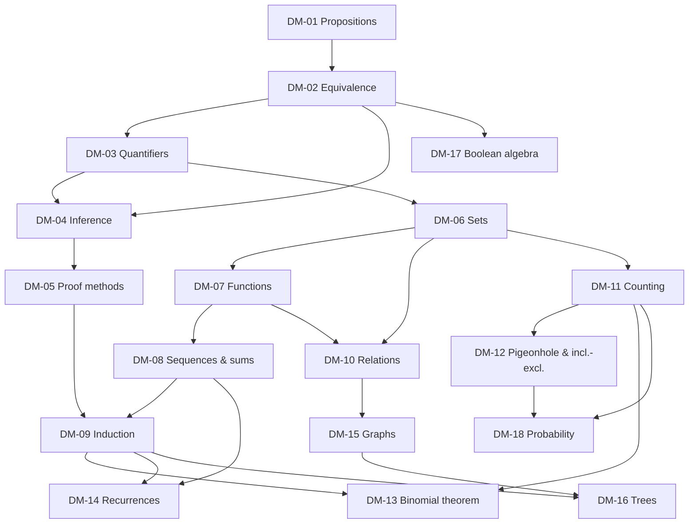

# Discrete Mathematics: Curriculum Map

Back to [[DM 00 Dashboard]]

## 1. Units
| Unit | Topics | Assessment |
|---|---|---|
| U1 Logic | DM-01 propositions · DM-02 equivalence · DM-03 quantifiers · DM-04 inference | Mock Section A |
| U2 Proof | DM-05 direct/contrapositive/contradiction · DM-09 induction | Mock Section B (proofs) |
| U3 Discrete structures | DM-06 sets · DM-07 functions · DM-08 sequences and sums · DM-10 relations | Mock Section A/B |
| U4 Counting and recurrences | DM-11 permutations/combinations · DM-12 pigeonhole and inclusion–exclusion · DM-13 binomial · DM-14 recurrences · DM-18 probability (supplementary) | Mock Section C |
| U5 Graphs | DM-15 graphs · DM-16 trees | Mock Section C |
| U6 Boolean algebra | DM-17 | Mock Section A |

## 2. Prerequisite graph

*Text version: logic (01 → 02 → 03/04) is the base. Proof methods (05) need inference. Sets (06) lead to functions (07), sequences (08) and relations (10). Induction (09) needs proof methods and summations. Counting (11) builds on sets, and leads to pigeonhole (12), the binomial theorem (13, which also uses induction) and probability (18). Recurrences (14) need sequences and induction. Graphs (15) build on relations, and trees (16) on graphs and induction. Boolean algebra (17) builds on logical equivalence.*

## 3. Review alerts
| Before… | Review | Because |
|---|---|---|
| DM-05 | DM-04 modus ponens/tollens | Proofs are chains of valid inferences |
| DM-09 | DM-08 Σ notation | Most induction exercises are about sums |
| DM-13 | DM-11 $\binom{n}{k}$ | Binomial coefficients are combinations |
| DM-14 | DM-09 | Recurrence solutions are verified by induction |
| DM-16 | DM-15 paths and cycles | A tree is a connected acyclic graph |
| DM-17 | DM-02 laws | The Boolean laws are the logic laws in other notation |

## 4. Cross-module uses
[[PY-04 Conditions and Branching]] (DM-01/02), [[PY-11 Dictionaries, Sets and Comprehensions]] (DM-06), [[PY-07 Recursion]] (DM-09/14), [[PY-12 Searching, Sorting and Complexity]] (DM-08/14), [[PY-21 Data Structures and Algorithm Design]] (DM-15/16), [[CS-08 Password Storage and Authentication Security]] (DM-11), [[PM-06 Critical Path Method and Float]] (DM-15), [[X-01 Logic and Sets in Python and Requirements]], [[X-02 Graph Theory in Algorithms, Networks and Scheduling]].
