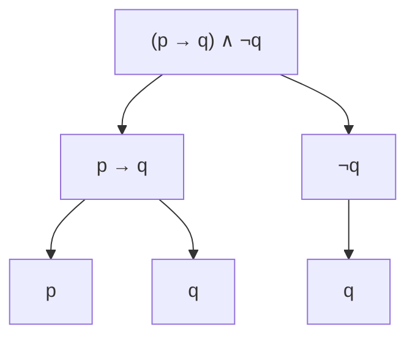

# DM-01 Propositions, Connectives and Truth Tables

> [!info] Topic card
> **Unit:** U1 Logic · **Time:** 3 h · **Verify with:** `code/dm_tools.py` (`print_truth_table`, `is_tautology`), see [[DM Python Toolkit]]

## 1. Learning objectives
1. **Decide** whether a sentence is a proposition.
2. **Translate** English statements into symbolic form using ¬, ∧, ∨, ⊕, →, ↔, and back again.
3. **Construct** truth tables for compound propositions with up to 3–4 variables.
4. **Classify** propositions as tautologies, contradictions or contingencies.
5. **Form and distinguish** the converse, inverse and contrapositive of a conditional.

## 2. Why it matters
Every `if` statement, database query filter, access-control rule and digital circuit is a logical formula. Precise logic lets you write requirements without ambiguity ([[SD-03 Requirements Engineering]]), simplify conditions ([[PY-04 Conditions and Branching]]) and later write proofs ([[DM-05 Direct Proof, Contrapositive and Contradiction]]).

## 3. Prerequisites
None. Careful reading is enough.

## 4. Intuition
A **proposition** is a sentence that is either true or false, with no "maybe" and nothing depending on who's asking. **Connectives** build bigger statements from smaller ones, like LEGO bricks. A **truth table** is a complete checklist of every possible world: list every combination of truth values and see what the compound statement does in each.

The conditional "if p then q" is the one that surprises people. Think of it as a **promise**: "If you pass the exam (p), I'll buy you lunch (q)." The promise is only **broken** when you pass and I don't buy lunch. If you fail, I haven't broken my promise, whatever I do. So p → q is false only when p is true and q is false.

## 5. Rigorous explanation

### 5.1 Propositions
A **proposition** is a declarative sentence that is either true (T) or false (F), but not both.
| Sentence | Proposition? | Why |
|---|---|---|
| "Dodoma is the capital of Tanzania." | Yes (T) | Declarative, has a definite truth value |
| "7 is even." | Yes (F) | False, but still a proposition |
| "Close the door." | No | A command |
| "Is it raining?" | No | A question |
| "x + 2 = 5" | No (yet) | The truth value depends on x. It's a **predicate** ([[DM-03 Predicates and Quantifiers]]) |
| "This sentence is false." | No | A paradox: it can't consistently be either value |

We use propositional variables p, q, r, … for arbitrary propositions.

### 5.2 Connectives, symbol by symbol
| Symbol | Name | Read as | True exactly when |
|---|---|---|---|
| $\lnot p$ | negation | "not p" | p is false |
| $p \land q$ | conjunction | "p and q" | both are true |
| $p \lor q$ | (inclusive) disjunction | "p or q" | at least one is true |
| $p \oplus q$ | exclusive or | "p xor q" | exactly one is true |
| $p \to q$ | conditional (implication) | "if p then q", "p implies q", "q if p", "p only if q", "p is sufficient for q", "q is necessary for p" | NOT (p true and q false) |
| $p \leftrightarrow q$ | biconditional | "p if and only if q" (iff) | p and q have the same value |

In $p \to q$, p is the **hypothesis** (antecedent) and q the **conclusion** (consequent).

### 5.3 The defining truth tables
| p | q | ¬p | p∧q | p∨q | p⊕q | p→q | p↔q |
|---|---|---|---|---|---|---|---|
| T | T | F | T | T | F | **T** | T |
| T | F | F | F | T | T | **F** | F |
| F | T | T | F | T | T | **T** | F |
| F | F | T | F | F | F | **T** | T |

The rows where p is false and p → q is true are called **vacuously true**: the promise wasn't tested.

### 5.4 Precedence
From highest to lowest: ¬, ∧, ∨ (and ⊕), →, ↔. So $\lnot p \land q \to r$ means $((\lnot p) \land q) \to r$. Use parentheses when there's any doubt, which is good exam practice. → is conventionally right-associative: $p \to q \to r$ means $p \to (q \to r)$.

### 5.5 Related conditionals
For $p \to q$:
| Name | Form | Equivalent to the original? |
|---|---|---|
| Converse | $q \to p$ | **No** |
| Inverse | $\lnot p \to \lnot q$ | **No** (but it is equivalent to the converse) |
| Contrapositive | $\lnot q \to \lnot p$ | **Yes, always** |

### 5.6 Classification
- **Tautology:** true in every row (e.g. $p \lor \lnot p$).
- **Contradiction:** false in every row (e.g. $p \land \lnot p$).
- **Contingency:** neither.
A table with $n$ variables has $2^n$ rows: each variable doubles the number of combinations (the product rule, [[DM-11 Counting Principles, Permutations and Combinations]]).

## 6. Terminology
| Term | Meaning |
|---|---|
| Proposition | Declarative sentence that is true or false |
| Atomic / compound | Can't be split further / built with connectives |
| Truth value | T or F |
| Truth table | All combinations of the variables' values with the compound's value |
| Tautology / contradiction / contingency | Always T / always F / sometimes T and sometimes F |
| Hypothesis / conclusion | The p / q of p → q |
| Vacuous truth | p → q is true because p is false |

## 7. Step-by-step: building a truth table for $(p \to q) \land (q \to r) \to (p \to r)$
1. Count the variables: p, q, r gives $2^3 = 8$ rows.
2. List the rows in a standard order: p is T for the first 4 rows and F for the last 4, q alternates in pairs, and r alternates every row.
3. Add one column per sub-expression, from the inside out: $p \to q$, $q \to r$, their conjunction, $p \to r$, then the whole.
4. Fill each column using only the defining tables.

| p | q | r | p→q | q→r | (p→q)∧(q→r) | p→r | whole |
|---|---|---|---|---|---|---|---|
| T | T | T | T | T | T | T | T |
| T | T | F | T | F | F | F | T |
| T | F | T | F | T | F | T | T |
| T | F | F | F | T | F | F | T |
| F | T | T | T | T | T | T | T |
| F | T | F | T | F | F | T | T |
| F | F | T | T | T | T | T | T |
| F | F | F | T | T | T | T | T |
Every row is T, so the formula is a **tautology**. It's the logical form of the "chain of reasoning" rule, *hypothetical syllogism* ([[DM-04 Rules of Inference]]).

## 8. Diagram: how a compound proposition is evaluated

*Text version: the main connective (∧) is at the root. Its operands are p → q and ¬q, and the leaves are the variables. You evaluate from the leaves upward, exactly like an expression tree in a compiler ([[PY-01 How Python Executes Programs and Environment Setup]]).*

## 9. Worked examples

### Example 1 (basic): translation
Let p = "the student paid fees", q = "the student is registered", r = "the student can sit the exam".
| English | Symbolic |
|---|---|
| The student paid fees and is registered. | $p \land q$ |
| The student can sit the exam only if they are registered. | $r \to q$ |
| Paying fees is necessary for registration. | $q \to p$ |
| The student can sit the exam if and only if they paid and are registered. | $r \leftrightarrow (p \land q)$ |
| The student did not pay fees, but is registered. | $\lnot p \land q$ ("but" means "and") |
**Key trap:** "r only if q" is $r \to q$, **not** $q \to r$. "Only if" introduces the *necessary* condition, which goes on the right of the arrow.

### Example 2 (intermediate): truth table and classification of $(p \to q) \leftrightarrow (\lnot q \to \lnot p)$
| p | q | p→q | ¬q | ¬p | ¬q→¬p | ↔ |
|---|---|---|---|---|---|---|
| T | T | T | F | F | T | T |
| T | F | F | T | F | F | T |
| F | T | T | F | T | T | T |
| F | F | T | T | T | T | T |
A **tautology**, so a conditional and its contrapositive always agree. That's why proof by contrapositive works ([[DM-05 Direct Proof, Contrapositive and Contradiction]]).

### Example 3 (challenging): a puzzle solved by truth table
On an island, **knights** always tell the truth and **knaves** always lie. A says: "B is a knave." B says: "A and I are the same type." Who is what?
Let a = "A is a knight", b = "B is a knight". A's statement is true iff A is a knight: $a \leftrightarrow \lnot b$. B's statement: $b \leftrightarrow (a \leftrightarrow b)$.
| a | b | a↔¬b | a↔b | b↔(a↔b) | both hold? |
|---|---|---|---|---|---|
| T | T | F | T | T | no |
| T | F | T | F | T | **yes** |
| F | T | T | F | F | no |
| F | F | F | T | F | no |
**A is a knight, and B is a knave.** Check: A (truthful) says B is a knave ✔. B (a liar) says "we're the same type", which is false, and indeed they aren't ✔.

## 10. Application: access-control rule as logic
Policy: "A user may edit a mark if they are the course lecturer, or they are an administrator, and in every case the marks must not be locked." With L = lecturer, A = admin and K = locked: $\text{edit} \leftrightarrow (L \lor A) \land \lnot K$. In Python: `can_edit = (is_lecturer or is_admin) and not locked`. Writing it as `is_lecturer or is_admin and not locked` (missing parentheses) means $L \lor (A \land \lnot K)$, which lets lecturers edit locked marks. That's a security bug caused by precedence ([[CS-04 Authorization and Access Control]]).

## 11. Common mistakes
| Mistake | Why it happens | Correct thinking |
|---|---|---|
| Thinking p → q is false when p is false | Everyday "if" suggests causation | p → q is only false in the T, F row |
| Translating "p only if q" as q → p | Word order | "only if" points to the necessary condition: p → q |
| Treating the converse as equivalent | "If it rains the ground is wet" feels reversible | A wet ground (sprinklers!) doesn't imply rain |
| Treating "or" as exclusive | English "tea or coffee?" | Logic's ∨ is inclusive unless ⊕ is stated |
| Missing rows | Ad-hoc listing | Always $2^n$ rows in the standard order |
| Ignoring precedence | Reading left to right | ¬ before ∧ before ∨ before → before ↔ |

## 12. Comparison with related concepts
| Concept | Example | Difference |
|---|---|---|
| Implication p → q | "If logged in then has a token" | One-way. Can be vacuously true. |
| Biconditional p ↔ q | "Access iff authorised" | Two-way: both directions |
| Causation | "Rain causes wet ground" | Not a logical notion. → doesn't claim causation. |
| Python `and`/`or` | `a or b` | Returns an operand, and short-circuits ([[PY-04 Conditions and Branching]]) |

## 13. Practice
**L1 Recall**
1. Which are propositions? (a) "2 + 2 = 5" (b) "Please submit by Friday" (c) "x > 3" (d) "Every even number greater than 2 is a sum of two primes".
2. Write the truth table of $p \oplus q$ from memory.

**L2 Routine**
3. With p = "it is raining" and q = "the match is cancelled", translate: (a) "The match is cancelled whenever it rains." (b) "It is raining but the match is not cancelled." (c) "The match is cancelled only if it is raining."
4. Construct the truth table of $\lnot(p \lor q) \to \lnot p$.

**L3 Multi-step**
5. Classify each of these as a tautology, contradiction or contingency: (a) $(p \land q) \to p$ (b) $p \land \lnot(p \lor q)$ (c) $(p \to q) \to p$.
6. Write the converse, inverse and contrapositive of: "If a password has fewer than 12 characters, then it is rejected."

**L4 Transfer**
7. A login system grants access ($G$) if the password is correct ($P$) and either the device is trusted ($D$) or a one-time code is correct ($O$). Write $G$ as a formula, build its 8-row truth table, and say in how many of the 8 situations access is granted.
8. Knights and knaves: A says "At least one of us is a knave." Determine A's and B's types, and justify with a table.

**L5 Synthesis**
9. A university rule says: "A student graduates if they pass all core modules, and either complete the project or (pass an extra elective and the board approves)." (a) Formalise it. (b) Identify an ambiguity in the English, and give both readings as formulas. (c) Find a truth assignment where the two readings disagree, and explain why the ambiguity matters for the software implementing the rule.

## 14. Hints
> [!tip]- Hints
> 1(d): it has a definite truth value even if nobody knows it yet (Goldbach's conjecture). 3(c): "only if" makes the condition the conclusion of the arrow. 5(c): try p = F. 8: if A were a knave, the statement "at least one of us is a knave" would be true. 9: where does the "either" end?

## 15. Worked solutions
> [!success]- Solution 1–2
> 1. (a) Yes (false). (b) No (a command). (c) No (a predicate: its truth depends on x). (d) **Yes.** It's either true or false. Whether it's true is unknown (Goldbach's conjecture is unproved), but that doesn't stop it being a proposition.
> 2. T,T→F; T,F→T; F,T→T; F,F→F.

> [!success]- Solution 3
> (a) $p \to q$ ("whenever it rains" = "if it rains"). (b) $p \land \lnot q$. (c) $q \to p$.

> [!success]- Solution 4
> | p | q | p∨q | ¬(p∨q) | ¬p | ¬(p∨q)→¬p |
> |---|---|---|---|---|---|
> | T | T | T | F | F | T |
> | T | F | T | F | F | T |
> | F | T | T | F | T | T |
> | F | F | F | T | T | T |
> A tautology. Whenever the hypothesis "neither p nor q" holds, "not p" certainly holds.

> [!success]- Solution 5
> (a) **Tautology**: if p∧q is true then p is true, and when p∧q is false the conditional is vacuously true. (b) **Contradiction**: $\lnot(p\lor q)$ requires p false, contradicting the first conjunct. Check all 4 rows: always F. (c) **Contingency**: p=T,q=T gives (T→T)→T = T, while p=F,q=T gives (F→T)→F = T→F = F.

> [!success]- Solution 6
> Let p = "the password has fewer than 12 characters" and q = "it is rejected". Original: p → q.
> **Converse** (q → p): "If a password is rejected, then it has fewer than 12 characters." That's false in general: passwords may be rejected for other reasons, e.g. appearing on a breached list.
> **Inverse** (¬p → ¬q): "If a password has at least 12 characters, then it is not rejected." (Same flaw.)
> **Contrapositive** (¬q → ¬p): "If a password is not rejected, then it has at least 12 characters." That's equivalent to the original.

> [!success]- Solution 7
> $G \leftrightarrow P \land (D \lor O)$. Granted in rows with P = T and (D or O) true: (T,T,T), (T,T,F), (T,F,T), giving **3 of 8**. Note how one pair of parentheses changes everything. Without them, $P \land D \lor O$ means $(P \land D) \lor O$, which grants access with a correct one-time code even when the password is wrong.

> [!success]- Solution 8
> Let a, b mean "is a knight". A's claim is $\lnot a \lor \lnot b$, and it must satisfy $a \leftrightarrow (\lnot a \lor \lnot b)$.
> | a | b | ¬a∨¬b | a↔(…) |
> |---|---|---|---|
> | T | T | F | F |
> | T | F | T | **T** |
> | F | T | T | F |
> | F | F | T | F |
> **A is a knight, B is a knave.** (A knave can't say it, because it would be true.)

> [!success]- Solution 9
> Variables: C = passes all core modules, J = completes the project, E = passes an extra elective, B = board approves, G = graduates.
> (a) The most natural reading: $G \leftrightarrow C \land (J \lor (E \land B))$.
> (b) Ambiguity: does "and the board approves" attach only to the elective route or to the whole condition? Reading 1: $C \land (J \lor (E \land B))$. Reading 2: $C \land (J \lor E) \land B$ (the board approves every graduation).
> (c) Take C=T, J=T, E=F, B=F. Reading 1 gives T (graduates via the project), Reading 2 gives F (no board approval). A student would be told they graduated by one implementation and refused by another. **Requirements must remove such ambiguity before coding**, ideally by writing the formula and a truth table into the specification and getting the registrar to confirm it ([[SD-03 Requirements Engineering]], [[X-01 Logic and Sets in Python and Requirements]]).

## 16. Self-test (closed book, pass ≥ 4/5)
1. When is p → q false? 2. Is the inverse equivalent to the original conditional? 3. How many rows does a table with 4 variables have? 4. Translate "q is necessary for p". 5. Classify $p \to p$.
> [!success]- Answers
> 1. Only when p is T and q is F. 2. No (the contrapositive is). 3. 16. 4. p → q. 5. Tautology.

## 17. Flashcards
#flashcards/discrete-math
When is p → q false?::Only when p is true and q is false.
"p only if q" in symbols?::p → q
Contrapositive of p → q?::¬q → ¬p (logically equivalent to p → q)
Converse of p → q?::q → p (NOT equivalent in general)
Tautology vs contingency?::Tautology is true in every row; contingency is true in some rows and false in others.
Precedence of connectives?::¬, then ∧, then ∨/⊕, then →, then ↔.
Rows in a truth table with n variables?::2ⁿ

## 18. Blank-page recall
Write the 8-column defining truth table (§5.3), the six English readings of p → q, and the converse/inverse/contrapositive table.

## 19. Revision summary
- A proposition is definitely T or F. Commands, questions and open sentences aren't.
- Connectives: ¬ ∧ ∨ ⊕ → ↔. Know their tables and their precedence.
- p → q is false only in the T, F row. "Only if" marks the necessary condition.
- Contrapositive ≡ original. The converse and inverse are not.
- $2^n$ rows. Tautology / contradiction / contingency.

## 20. Links
Next: [[DM-02 Logical Equivalence and Laws of Logic]] · Applied in: [[PY-04 Conditions and Branching]], [[CS-04 Authorization and Access Control]], [[DM-17 Boolean Algebra and Logic Circuits]] · Integration: [[X-01 Logic and Sets in Python and Requirements]]

## 21. Sources
- Rosen, K. H., *Discrete Mathematics and Its Applications*, 8th ed., McGraw-Hill, 2019, §1.1–1.2.
- Levin, O., *Discrete Mathematics: An Open Introduction*, 3rd ed., §0.2 and §3.1: https://discrete.openmathbooks.org/
- Smullyan, R., *What Is the Name of This Book?*, Prentice-Hall, 1978 (knights and knaves puzzles).

## 22. Mastery checklist
- [ ] I can build an 8-row truth table without errors in under 5 minutes
- [ ] I translated "only if", "necessary" and "sufficient" correctly every time
- [ ] Practice 9 done with both readings · checked tables with `dm_tools` · reviews scheduled
