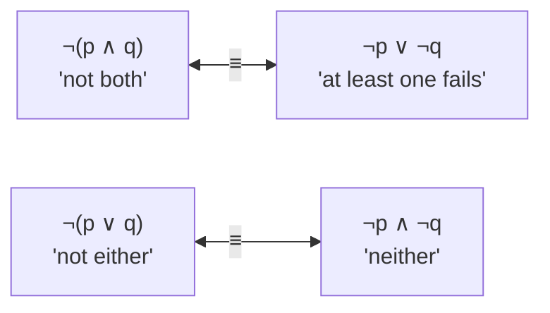

# DM-02 Logical Equivalence and Laws of Logic

> [!info] Topic card
> **Unit:** U1 · **Time:** 3–4 h · **Verify with:** `equivalent(e1, e2, vars)` in [[DM Python Toolkit]]

## 1. Learning objectives
1. **Define** logical equivalence ($\equiv$), and **prove** equivalences both by truth table and by a chain of named laws.
2. **Apply** the standard laws (identity, domination, idempotent, double negation, commutative, associative, distributive, De Morgan, absorption, negation, and the conditional and biconditional laws).
3. **Negate** compound English statements correctly using De Morgan's laws.
4. **Convert** formulas to disjunctive normal form (DNF) and conjunctive normal form (CNF).
5. **Explain** functional completeness (e.g. {NAND} alone suffices).

## 2. Why it matters
Equivalences let you **rewrite** a condition into a simpler or clearer one that is *guaranteed* to behave identically, for code, database queries or circuits ([[DM-17 Boolean Algebra and Logic Circuits]]). Negating correctly is essential for writing the "else" case of a requirement and for proofs by contradiction.

## 3. Prerequisites
[[DM-01 Propositions, Connectives and Truth Tables]]: truth tables, connectives, the conditional.

## 4. Intuition
Two formulas are equivalent if **no situation can tell them apart**: in every row of the truth table they give the same answer. The laws are tested "algebra rules" that let you move from one form to another without drawing a table every time, just as $a(b+c) = ab + ac$ saves you checking numbers.

## 5. Rigorous explanation

### 5.1 Definition
Formulas $A$ and $B$ are **logically equivalent**, written $A \equiv B$, if $A \leftrightarrow B$ is a tautology. Equivalently, $A$ and $B$ have identical truth-table columns. ($\equiv$ is a statement *about* formulas. $\leftrightarrow$ is a connective *inside* a formula.)

### 5.2 The laws (T = tautology, F = contradiction)
| Law | ∧ form | ∨ form |
|---|---|---|
| Identity | $p \land T \equiv p$ | $p \lor F \equiv p$ |
| Domination | $p \land F \equiv F$ | $p \lor T \equiv T$ |
| Idempotent | $p \land p \equiv p$ | $p \lor p \equiv p$ |
| Double negation | $\lnot\lnot p \equiv p$ | |
| Commutative | $p \land q \equiv q \land p$ | $p \lor q \equiv q \lor p$ |
| Associative | $(p \land q) \land r \equiv p \land (q \land r)$ | $(p \lor q) \lor r \equiv p \lor (q \lor r)$ |
| Distributive | $p \land (q \lor r) \equiv (p \land q) \lor (p \land r)$ | $p \lor (q \land r) \equiv (p \lor q) \land (p \lor r)$ |
| **De Morgan** | $\lnot(p \land q) \equiv \lnot p \lor \lnot q$ | $\lnot(p \lor q) \equiv \lnot p \land \lnot q$ |
| Absorption | $p \land (p \lor q) \equiv p$ | $p \lor (p \land q) \equiv p$ |
| Negation | $p \land \lnot p \equiv F$ | $p \lor \lnot p \equiv T$ |

**Conditional and biconditional laws**
| Equivalence | Name |
|---|---|
| $p \to q \equiv \lnot p \lor q$ | Implication as disjunction |
| $p \to q \equiv \lnot q \to \lnot p$ | Contrapositive |
| $\lnot(p \to q) \equiv p \land \lnot q$ | Negated conditional |
| $p \leftrightarrow q \equiv (p \to q) \land (q \to p)$ | Biconditional |
| $p \leftrightarrow q \equiv (p \land q) \lor (\lnot p \land \lnot q)$ | |
| $(p \to q) \land (p \to r) \equiv p \to (q \land r)$ | |
| $(p \to r) \land (q \to r) \equiv (p \lor q) \to r$ | Proof by cases, in formula form |

### 5.3 Proof by chain of laws
Write each line as an equivalence with the law that justifies it. You may substitute an equivalent sub-formula anywhere (**substitution principle**).

### 5.4 Normal forms
- A **literal** is a variable or its negation ($p$, $\lnot q$).
- **DNF:** an OR of ANDs of literals, e.g. $(p \land \lnot q) \lor (\lnot p \land r)$.
- **CNF:** an AND of ORs of literals, e.g. $(p \lor q) \land (\lnot p \lor r)$.
- **From a truth table to DNF:** for each **T** row, write the conjunction that is true only in that row (a *minterm*), then OR them together. Every formula has a DNF and a CNF. CNF is the input format of SAT solvers used in verification and scheduling.

### 5.5 Functional completeness
A set of connectives is **functionally complete** if every truth table can be expressed with it. {¬, ∧, ∨} is complete (by the DNF construction), and so are {¬, ∧} and {¬, ∨} (by De Morgan). Remarkably, **{NAND}** alone is complete, where $p \uparrow q \equiv \lnot(p \land q)$: $\lnot p \equiv p \uparrow p$ and $p \land q \equiv (p \uparrow q) \uparrow (p \uparrow q)$. This is why chips can be built from NAND gates alone.

## 6. Terminology
| Term | Meaning |
|---|---|
| $A \equiv B$ | A ↔ B is a tautology |
| Law | A known equivalence used as a rewrite rule |
| Substitution principle | Replacing a sub-formula by an equivalent one preserves equivalence |
| Literal, minterm, maxterm | Variable or its negation; AND of all variables (each once) true in one row; OR false in one row |
| DNF / CNF | OR-of-ANDs / AND-of-ORs |
| Functionally complete | Can express every truth function |

## 7. Step-by-step: simplify $\lnot(p \lor (\lnot p \land q))$
| Step | Formula | Law |
|---|---|---|
| 0 | $\lnot(p \lor (\lnot p \land q))$ | given |
| 1 | $\lnot p \land \lnot(\lnot p \land q)$ | De Morgan (∨) |
| 2 | $\lnot p \land (\lnot\lnot p \lor \lnot q)$ | De Morgan (∧) |
| 3 | $\lnot p \land (p \lor \lnot q)$ | Double negation |
| 4 | $(\lnot p \land p) \lor (\lnot p \land \lnot q)$ | Distributive |
| 5 | $F \lor (\lnot p \land \lnot q)$ | Negation (and commutative) |
| 6 | $\lnot p \land \lnot q$ | Identity |
So $\lnot(p \lor (\lnot p \land q)) \equiv \lnot p \land \lnot q$, i.e. "neither p nor q".

## 8. Diagram: De Morgan as sets

*Text version: "not both" is the same as "at least one is false". "Not either" is the same as "both are false". In set language, the complement of an intersection is the union of the complements, and vice versa ([[DM-06 Sets, Set Operations, Power Sets and Cartesian Products]]).*

## 9. Worked examples

### Example 1 (basic): verify a De Morgan law by truth table
| p | q | p∧q | ¬(p∧q) | ¬p | ¬q | ¬p∨¬q |
|---|---|---|---|---|---|---|
| T | T | T | F | F | F | F |
| T | F | F | T | F | T | T |
| F | T | F | T | T | F | T |
| F | F | F | T | T | T | T |
The columns ¬(p∧q) and ¬p∨¬q are identical, so they are equivalent ∎.

### Example 2 (intermediate): show that $(p \land q) \to (p \lor q)$ is a tautology using laws
| Step | Formula | Law |
|---|---|---|
| 0 | $(p \land q) \to (p \lor q)$ | given |
| 1 | $\lnot(p \land q) \lor (p \lor q)$ | Implication as disjunction |
| 2 | $(\lnot p \lor \lnot q) \lor (p \lor q)$ | De Morgan |
| 3 | $(\lnot p \lor p) \lor (\lnot q \lor q)$ | Associative and commutative |
| 4 | $T \lor T$ | Negation |
| 5 | $T$ | Domination ∎ |

### Example 3 (challenging): negating English correctly
*"Every student who submitted late and had no medical note lost marks."* For one student, let L = late, M = has a medical note, X = lost marks. The rule is $(L \land \lnot M) \to X$.
Negation (what a **violation** of the rule looks like):
$\lnot((L \land \lnot M) \to X) \equiv (L \land \lnot M) \land \lnot X$ (negated conditional).
In English: "a student submitted late, had no medical note, **and** did not lose marks". A common wrong answer is "the student submitted on time or had a note". That describes *a student the rule doesn't apply to*, not a violation.

### Example 4 (challenging): DNF and CNF from a truth table
$f(p, q, r)$ is true exactly when **at least two** of p, q, r are true (the majority function).
T rows: TTT, TTF, TFT, FTT.
DNF (one minterm per T row): $(p\land q\land r)\lor(p\land q\land\lnot r)\lor(p\land\lnot q\land r)\lor(\lnot p\land q\land r)$.
Simplified (absorption/distribution): $(p \land q) \lor (p \land r) \lor (q \land r)$. Check: each T row satisfies some pair, and each F row (at most one T) satisfies no pair ✔.
CNF (one clause per F row, false exactly in that row): the F rows are TFF, FTF, FFT, FFF, giving
$(\lnot p\lor q\lor r)\land(p\lor\lnot q\lor r)\land(p\lor q\lor\lnot r)\land(p\lor q\lor r)$, which simplifies to $(p\lor q)\land(p\lor r)\land(q\lor r)$.

## 10. Application: simplifying code
```python
# before
if not (user.is_admin or (not user.is_admin and user.is_owner)):
    deny()
# ≡ ¬(a ∨ (¬a ∧ o)) ≡ ¬a ∧ ¬o   (§7 with p = a, q = o)
# after
if not user.is_admin and not user.is_owner:
    deny()
```
The equivalence **guarantees** that the refactor is behaviour-preserving ([[PY-19 Type Hints, Documentation, Clean Code and Refactoring]]). No test case can tell the two versions apart. (Short-circuit side effects aside: if the operands are pure attribute reads, as here, nothing changes.)

## 11. Common mistakes
| Mistake | Why | Fix |
|---|---|---|
| $\lnot(p \land q) \equiv \lnot p \land \lnot q$ | Distributing ¬ like a minus sign | De Morgan **flips** ∧↔∨ |
| $\lnot(p \to q) \equiv \lnot p \to \lnot q$ | Same habit | $\lnot(p \to q) \equiv p \land \lnot q$ |
| Treating $p \to q \equiv q \to p$ | Converse confusion | Only the contrapositive is equivalent |
| Skipping law names in a proof | Rushing | Every line needs a justification (marks!) |
| Mixing ≡ and ↔ | Notation confusion | ≡ relates formulas, ↔ is a connective |
| "Negation of 'all' is 'none'" | English intuition | That's for quantifiers ([[DM-03 Predicates and Quantifiers]]): ¬∀ is ∃¬ |

## 12. Comparison: two ways to prove an equivalence
| Method | Pros | Cons |
|---|---|---|
| Truth table | Mechanical, always works | $2^n$ rows: impractical for many variables |
| Chain of laws | Scales, explains *why*, matches algebra | Needs insight to choose the steps |
| Tool check (`dm_tools.equivalent`) | Instant verification | Not a written proof, so not acceptable in exams |

## 13. Practice
**L1** 1. State both De Morgan laws and both absorption laws. 2. Write $p \to q$ using only ¬ and ∨.

**L2** 3. Prove $\lnot(p \to q) \equiv p \land \lnot q$ by a chain of laws. 4. Simplify $(p \land q) \lor (p \land \lnot q)$.

**L3** 5. Prove $(p \to r) \land (q \to r) \equiv (p \lor q) \to r$ using laws. 6. Negate, and express in clear English: "If the server is down or the network is slow, then users complain."

**L4** 7. Show that $p \to (q \to r) \equiv (p \land q) \to r$ (exportation). Explain what it means for nested `if` statements in code. 8. Write the DNF of the function that is true exactly when p ⊕ q ⊕ r is true (an odd number of trues).

**L5** 9. (a) Express ¬p, p ∧ q and p ∨ q using only NAND. (b) Prove that {∧, ∨} (without ¬) is **not** functionally complete. (Hint: what happens when all inputs are T?)

## 14. Hints
> [!tip]- Hints
> 3: start with $\lnot(\lnot p \lor q)$. 4: distributive, then negation and identity. 5: rewrite both conditionals as disjunctions, then distribute. 7: rewrite the inner conditional first. 9(b): any formula built from ∧, ∨ and variables evaluates to T when every variable is T. Can such formulas express ¬p?

## 15. Worked solutions
> [!success]- Solutions 1–2
> 1. $\lnot(p\land q)\equiv\lnot p\lor\lnot q$, $\lnot(p\lor q)\equiv\lnot p\land\lnot q$, $p\land(p\lor q)\equiv p$, $p\lor(p\land q)\equiv p$. 2. $\lnot p\lor q$.

> [!success]- Solution 3
> $\lnot(p\to q) \equiv \lnot(\lnot p\lor q)$ (implication) $\equiv \lnot\lnot p\land\lnot q$ (De Morgan) $\equiv p\land\lnot q$ (double negation) ∎

> [!success]- Solution 4
> $(p\land q)\lor(p\land\lnot q) \equiv p\land(q\lor\lnot q)$ (distributive, factoring out p) $\equiv p\land T$ (negation) $\equiv p$ (identity).

> [!success]- Solution 5
> | Step | Formula | Law |
> |---|---|---|
> | 0 | $(p\to r)\land(q\to r)$ | given |
> | 1 | $(\lnot p\lor r)\land(\lnot q\lor r)$ | implication ×2 |
> | 2 | $(\lnot p\land\lnot q)\lor r$ | distributive (∨ over ∧, read right to left) |
> | 3 | $\lnot(p\lor q)\lor r$ | De Morgan |
> | 4 | $(p\lor q)\to r$ | implication ∎ |

> [!success]- Solution 6
> With D = down, S = slow, C = complain: rule $(D\lor S)\to C$. Negation: $(D\lor S)\land\lnot C$. In English: "The server is down or the network is slow, **and** users are not complaining."

> [!success]- Solution 7
> $p\to(q\to r)\equiv\lnot p\lor(\lnot q\lor r)\equiv(\lnot p\lor\lnot q)\lor r\equiv\lnot(p\land q)\lor r\equiv(p\land q)\to r$ ∎ (implication, associative, De Morgan, implication).
> **Code meaning:** `if p: if q: r()` behaves exactly like `if p and q: r()`, so collapsing nested ifs is safe. (This assumes there are no `else` branches. With them, the two forms differ.)

> [!success]- Solution 8
> True rows (an odd number of T): TTT, TFF, FTF, FFT.
> DNF: $(p\land q\land r)\lor(p\land\lnot q\land\lnot r)\lor(\lnot p\land q\land\lnot r)\lor(\lnot p\land\lnot q\land r)$. No simplification is possible here: parity needs all $2^{n-1}$ minterms, which is why XOR circuits are expensive in sum-of-products form.

> [!success]- Solution 9
> (a) $\lnot p \equiv p\uparrow p$. $p\land q\equiv(p\uparrow q)\uparrow(p\uparrow q)$. $p\lor q\equiv(p\uparrow p)\uparrow(q\uparrow q)$ (because $\lnot p \uparrow \lnot q = \lnot(\lnot p\land\lnot q) = p\lor q$, by De Morgan).
> (b) **Claim:** every formula built only from variables, ∧ and ∨ is T when all its variables are T. **Proof by structural induction:** a single variable is T. If $A$ and $B$ are T under that assignment, so are $A\land B$ and $A\lor B$. ∎ But ¬p is F when p is T, so ¬p can't be expressed, and {∧, ∨} is not complete. This "invariant-preservation" proof style returns in [[DM-09 Mathematical Induction]].

## 16. Self-test (pass ≥ 4/5)
1. $\lnot(p\lor q)\equiv$? 2. $p\lor(p\land q)\equiv$? 3. $\lnot(p\to q)\equiv$? 4. What's the difference between ≡ and ↔? 5. Which single connective is functionally complete?
> [!success]- Answers
> 1. $\lnot p\land\lnot q$. 2. $p$ (absorption). 3. $p\land\lnot q$. 4. ≡ asserts that two formulas always agree. ↔ is a connective that forms a new formula. 5. NAND (NOR also works).

## 17. Flashcards
#flashcards/discrete-math
De Morgan laws?::¬(p∧q) ≡ ¬p∨¬q and ¬(p∨q) ≡ ¬p∧¬q
p → q as a disjunction?::¬p ∨ q
Negation of p → q?::p ∧ ¬q
Absorption laws?::p∧(p∨q) ≡ p and p∨(p∧q) ≡ p
How to build DNF from a truth table?::OR together one minterm (AND of literals) for each row where the function is true.
Why is NAND functionally complete?::¬p = p↑p and p∧q = (p↑q)↑(p↑q), and {¬,∧} is complete.

## 18. Blank-page recall
Reproduce the law tables in §5.2 from memory, then the 6-step simplification in §7.

## 19. Revision summary
- $A\equiv B$ iff $A\leftrightarrow B$ is a tautology.
- Laws are justified rewrites. De Morgan flips ∧/∨ under ¬.
- $p\to q\equiv\lnot p\lor q$, and $\lnot(p\to q)\equiv p\land\lnot q$.
- DNF from the T rows, CNF from the F rows. NAND alone is complete.
- Equivalence-based refactoring of conditions is provably safe.

## 20. Links
Prev: [[DM-01 Propositions, Connectives and Truth Tables]] · Next: [[DM-03 Predicates and Quantifiers]] · Applied: [[PY-04 Conditions and Branching]], [[DM-17 Boolean Algebra and Logic Circuits]], [[X-01 Logic and Sets in Python and Requirements]]

## 21. Sources
- Rosen (2019), §1.3 "Propositional Equivalences" (tables of laws).
- Levin, *Discrete Mathematics: An Open Introduction*, §3.1: https://discrete.openmathbooks.org/
- Sheffer, H. M., "A set of five independent postulates for Boolean algebras…", *Transactions of the AMS*, 14(4), 1913, pp. 481–488 (the NAND "stroke").

## 22. Mastery checklist
- [ ] I can prove an equivalence with a fully justified chain of laws
- [ ] I negate English conditionals correctly (practice 6, Example 3)
- [ ] DNF/CNF from a truth table · checked with `dm_tools.equivalent` · reviews scheduled
