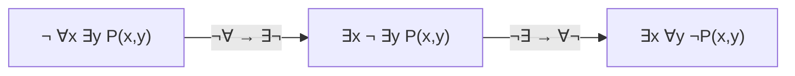

# DM-03 Predicates and Quantifiers

> [!info] Topic card
> **Unit:** U1 · **Time:** 4 h · **Python analogue:** `all(P(x) for x in D)` and `any(P(x) for x in D)`

## 1. Learning objectives
1. **Define** predicates, domains (universes of discourse), and the quantifiers ∀, ∃ and ∃!.
2. **Determine** the truth value of quantified statements over finite and infinite domains, using **counterexamples** and **witnesses**.
3. **Negate** quantified statements correctly (De Morgan for quantifiers), and **push** negations inward.
4. **Translate** English sentences, including nested quantifiers, into predicate logic and back, paying attention to **quantifier order**.
5. **Connect** quantifiers to programming (`all`/`any`), databases (SQL `EXISTS`) and specifications.

## 2. Why it matters
Propositional logic can't say "**every** student has a mark" or "**some** request is overdue". Requirements, database queries, loop invariants and security policies are all quantified statements. Mistranslating quantifier order ("everyone has a password" vs "there's one password everyone shares") changes the meaning completely.

## 3. Prerequisites
[[DM-02 Logical Equivalence and Laws of Logic]] (De Morgan, negated conditionals), and some set notation, which is taught fully in [[DM-06 Sets, Set Operations, Power Sets and Cartesian Products]].

## 4. Intuition
A **predicate** is a sentence with a blank: "___ is even". Fill in the blank and you get a proposition. A **quantifier** says *how many* fillings make it true: **all** of them (∀) or **at least one** (∃). To **refute** "all", you need only **one counterexample**. To **prove** "there exists", you need only **one witness**.

## 5. Rigorous explanation

### 5.1 Predicates and domains
A **predicate** $P(x)$ is a statement whose truth value depends on the variable $x$ drawn from a **domain** $D$. $P(3)$ is a proposition. Predicates may have several variables: $L(x, y)$ = "x is enrolled in course y".

### 5.2 Quantifiers, symbol by symbol
| Notation | Read as | True iff |
|---|---|---|
| $\forall x\, P(x)$ | "for all x, P(x)" | P(x) is true for **every** x in D |
| $\exists x\, P(x)$ | "there exists x such that P(x)" | P(x) is true for **at least one** x in D |
| $\exists! x\, P(x)$ | "there exists a unique x…" | exactly one x makes it true |
| $\forall x \in S\, P(x)$ | "for all x in S…" | shorthand for $\forall x\,(x \in S \to P(x))$ |
| $\exists x \in S\, P(x)$ | "some x in S…" | shorthand for $\exists x\,(x \in S \land P(x))$ |

Note the **different connectives** in the restricted forms: ∀ goes with →, and ∃ goes with ∧. Mixing them up is the most common translation error.

Over a finite domain $D = \{a_1, \dots, a_n\}$: $\forall x P(x) \equiv P(a_1) \land \dots \land P(a_n)$, and $\exists x P(x) \equiv P(a_1) \lor \dots \lor P(a_n)$. Over an **empty** domain, ∀ is (vacuously) true and ∃ is false, just like Python's `all([]) == True` and `any([]) == False`.

### 5.3 Negation (De Morgan for quantifiers)
$$\lnot \forall x\, P(x) \equiv \exists x\, \lnot P(x) \qquad \lnot \exists x\, P(x) \equiv \forall x\, \lnot P(x)$$
"Not everyone passed" ≡ "someone didn't pass". "Nobody cheated" ≡ "everyone did not cheat". To negate a nested formula, flip each quantifier and push the ¬ inward, then apply the propositional laws:
$\lnot \forall x\, \exists y\, (P(x,y) \to Q(x,y)) \equiv \exists x\, \forall y\, (P(x,y) \land \lnot Q(x,y))$.

### 5.4 Nested quantifiers and order
- Quantifiers of the **same** type commute: $\forall x \forall y \equiv \forall y \forall x$, and similarly for ∃.
- **Mixed** quantifiers do **not** commute:
  - $\forall x\, \exists y\, (y > x)$ over ℤ: "for every number there is a bigger one". **True** (take y = x + 1).
  - $\exists y\, \forall x\, (y > x)$: "there is a number bigger than every number". **False**.
- The order describes **dependency**: in $\forall x \exists y$, $y$ may depend on $x$ (think of $y$ as a function of $x$).

### 5.5 Bound and free variables; scope
A variable is **bound** if a quantifier in scope controls it, and **free** otherwise. A formula with a free variable isn't a proposition. In $\forall x\,(P(x) \land Q(y))$, $x$ is bound and $y$ is free.

## 6. Terminology
| Term | Meaning |
|---|---|
| Predicate | Statement with variables. Becomes a proposition when the variables are fixed. |
| Domain (universe) | The set the variables range over |
| Universal / existential quantifier | ∀ "for all" / ∃ "there exists" |
| Witness | A value showing an ∃ statement is true |
| Counterexample | A value showing a ∀ statement is false |
| Bound / free variable | Under a quantifier / not |
| Scope | The part of the formula a quantifier governs |

## 7. Step-by-step translation method
1. **Fix the domain** (everything, students, integers…).
2. **Name the predicates** with clear meanings.
3. **Find the quantifier words:** "all/every/each/any" → ∀, "some/there is/at least one" → ∃, "no/none" → ∀¬ (or ¬∃).
4. **Use the restricted-quantifier pattern:** "all A are B" → $\forall x (A(x) \to B(x))$. "Some A are B" → $\exists x (A(x) \land B(x))$.
5. **Order nested quantifiers** as the English dependency demands.
6. **Read it back in English** to check.

## 8. Diagram: quantifier negation flow

*Text version: each time the negation passes a quantifier, the quantifier flips (∀ ↔ ∃). When it reaches the predicate, apply the propositional negation rules.*

## 9. Worked examples

### Example 1 (basic): truth values over a finite domain
Domain $D = \{1, 2, 3, 4\}$. $E(x)$: "x is even". $L(x)$: "x < 5".
- $\forall x\, L(x)$: true (every element is < 5).
- $\forall x\, E(x)$: false. **Counterexample:** x = 1.
- $\exists x\, E(x)$: true. **Witness:** x = 2.
- $\exists! x\,(E(x) \land x > 2)$: true (only x = 4).
Python check: `all(x < 5 for x in D)` → `True`, and `any(x % 2 == 0 for x in D)` → `True`.

### Example 2 (intermediate): translations with restricted quantifiers
Domain: all people. S(x): x is a student, C(x): x completed the project, M(x, y): x mentors y.
| English | Logic | Common wrong version |
|---|---|---|
| Every student completed the project. | $\forall x\,(S(x) \to C(x))$ | $\forall x\,(S(x) \land C(x))$ claims *everyone* is a student |
| Some student completed the project. | $\exists x\,(S(x) \land C(x))$ | $\exists x\,(S(x) \to C(x))$ is true if anyone at all is a non-student |
| No student completed it. | $\forall x\,(S(x) \to \lnot C(x))$ | |
| Every student has a mentor. | $\forall x\,(S(x) \to \exists y\, M(y, x))$ | $\exists y\, \forall x\,(S(x) \to M(y,x))$ says one person mentors everyone |

### Example 3 (challenging): negating a definition
"Function $f$ is **bounded** on ℝ": $\exists M\, \forall x\, (|f(x)| \le M)$.
Negation ("f is unbounded"):
$\lnot \exists M\, \forall x\, (|f(x)| \le M) \equiv \forall M\, \exists x\, (|f(x)| > M)$.
In words: "for every proposed bound M, some x exceeds it". To prove $f(x) = x$ is unbounded: given any M, choose the witness $x = |M| + 1$. Then $|f(x)| = |M| + 1 > M$ ✔. The proof follows the shape of the formula: "for every M (arbitrary), exhibit an x (a witness depending on M)".

## 10. Application: specifications and queries
- **Requirement** "Every overdue request is assigned to a technician": $\forall r\,(\text{Overdue}(r) \to \exists t\, \text{Assigned}(r,t))$.
- A **violation query** follows from the negation: $\exists r\,(\text{Overdue}(r) \land \forall t\, \lnot\text{Assigned}(r,t))$, i.e. "an overdue request with no technician". In SQL: `SELECT * FROM requests r WHERE r.overdue AND NOT EXISTS (SELECT 1 FROM assignments a WHERE a.request_id = r.id)`. **Negating the specification gives the test for its violations.** That's a powerful technique for both testing and monitoring ([[X-01 Logic and Sets in Python and Requirements]]).

## 11. Common mistakes
| Mistake | Example | Fix |
|---|---|---|
| ∀ with ∧ | "All students passed": ∀x(S(x)∧P(x)) | ∀ pairs with → |
| ∃ with → | "Some student passed": ∃x(S(x)→P(x)) | ∃ pairs with ∧ |
| Negating ∀ to "∀¬" | "Not all passed" read as "none passed" | ¬∀ ≡ ∃¬ |
| Swapping mixed quantifiers | ∀∃ vs ∃∀ | Order expresses dependency |
| Proving ∀ with examples | "Works for 1, 2, 3, so true for all" | Needs a general argument (or exhaustive checking of a *finite* domain) |
| Forgetting the domain | "∀x (x² ≥ x)" | False over the reals (x = 0.5), true over the integers |

## 12. Comparison
| Statement type | To prove true | To prove false |
|---|---|---|
| $\forall x\, P(x)$ | General argument for an arbitrary x | One counterexample |
| $\exists x\, P(x)$ | One witness | General argument that every x fails |
| $\forall x \exists y$ | For an arbitrary x, construct a y | Find an x for which every y fails |
| $\exists x \forall y$ | Find one x that works for all y | Show every x has a y that fails |

## 13. Practice
**L1** 1. Over D = {−1, 0, 1, 2}, decide: (a) ∀x (x² ≥ x) (b) ∃x (x² = 2x) (c) ∀x (x > 0 → x² > 0). 2. Write the negation of ∃x ∀y P(x, y).

**L2** 3. Translate (domain: people; P(x): x is a programmer, L(x, y): x likes y): (a) Every programmer likes some language… *(use L(x, y) with y ranging over languages)*. (b) There is a language that every programmer likes. (c) No programmer likes every language. 4. Negate and simplify: ∀x (P(x) → ∃y Q(x, y)).

**L3** 5. Over the integers, decide each with justification: (a) ∀x ∃y (x + y = 0) (b) ∃y ∀x (x + y = 0) (c) ∀x ∃y (xy = 1). 6. Write in English, then negate: "∀ε > 0 ∃N ∀n > N, |aₙ − L| < ε" (the definition of a limit; just negate it formally).

**L4** 7. Specification for a booking system: "No two bookings for the same room overlap." Formalise it with B(b) = b is a booking, room(b), start(b), end(b). Then derive the formal negation and turn it into a test query in words. 8. Is $\forall x\,(P(x) \lor Q(x)) \equiv \forall x\, P(x) \lor \forall x\, Q(x)$? Prove it or give a counterexample domain.

**L5** 9. Python's `all` over an empty list returns `True`. A validation routine says `if all(mark >= 0 for mark in marks): accept()`. Explain, with the logic of vacuous truth, why an *empty* upload is accepted, whether that's a bug, and how to state the requirement precisely enough to decide.

## 14. Hints
> [!tip]- Hints
> 1(a): test x = −1, 0, 1, 2. 5(c): y would have to be 1/x. 7: quantify over pairs of distinct bookings. 8: try D = {1, 2}, with P true only at 1 and Q true only at 2. 9: "every mark is non-negative" is true when there are no marks.

## 15. Worked solutions
> [!success]- Solution 1–2
> 1. (a) True: (−1)² = 1 ≥ −1, 0 ≥ 0, 1 ≥ 1, 4 ≥ 2. (b) True: the witness x = 0 (0 = 0), and also x = 2 (4 = 4). (c) True: for x = 1 and x = 2 the hypothesis holds and so does the conclusion. For x ≤ 0 it's vacuously true.
> 2. $\forall x\, \exists y\, \lnot P(x, y)$.

> [!success]- Solution 3
> Let Lang(y) mean "y is a language".
> (a) $\forall x\,(P(x) \to \exists y\,(\text{Lang}(y) \land L(x,y)))$.
> (b) $\exists y\,(\text{Lang}(y) \land \forall x\,(P(x) \to L(x,y)))$.
> (c) $\lnot\exists x\,(P(x) \land \forall y\,(\text{Lang}(y) \to L(x,y)))$, equivalently $\forall x\,(P(x) \to \exists y\,(\text{Lang}(y) \land \lnot L(x,y)))$.

> [!success]- Solution 4
> $\lnot\forall x\,(P(x)\to\exists y\,Q(x,y)) \equiv \exists x\,\lnot(P(x)\to\exists y\,Q(x,y)) \equiv \exists x\,(P(x)\land\lnot\exists y\,Q(x,y)) \equiv \exists x\,(P(x)\land\forall y\,\lnot Q(x,y))$.

> [!success]- Solution 5
> (a) **True.** For an arbitrary x, choose y = −x. (b) **False.** If some y worked for all x, then x = 0 gives y = 0, but x = 1 gives 1 + 0 ≠ 0. (c) **False.** The counterexample x = 2: no integer y has 2y = 1. (It's also false for x = 0.)

> [!success]- Solution 6
> English: "for every positive tolerance ε there is a point N after which every term is within ε of L".
> Negation: $\exists \varepsilon > 0\; \forall N\; \exists n > N:\; |a_n - L| \ge \varepsilon$. "There's some tolerance such that, however far you go, some later term is at least ε away from L."

> [!success]- Solution 7
> Overlap of $b_1, b_2$: $\text{start}(b_1) < \text{end}(b_2) \land \text{start}(b_2) < \text{end}(b_1)$ (half-open intervals).
> Spec: $\forall b_1 \forall b_2\,[(B(b_1)\land B(b_2)\land b_1\ne b_2\land \text{room}(b_1)=\text{room}(b_2)) \to \lnot\text{Overlap}(b_1,b_2)]$.
> Negation: $\exists b_1 \exists b_2\,[B(b_1)\land B(b_2)\land b_1\ne b_2\land \text{room}(b_1)=\text{room}(b_2)\land\text{Overlap}(b_1,b_2)]$.
> Test query: "find two different bookings for the same room whose time intervals overlap". If the query returns any rows, the system violates the requirement. This is used in the running case study [[SD-CASE LabBook Running Case Study]].

> [!success]- Solution 8
> **Not equivalent.** Take D = {1, 2}, with P true only at 1 and Q true only at 2. Then ∀x (P(x) ∨ Q(x)) is true (each element satisfies one of them), but ∀x P(x) is false and ∀x Q(x) is false, so the right side is false. (The other direction does hold: $\forall x P \lor \forall x Q \to \forall x (P \lor Q)$. Universal **does** distribute over ∧, but not over ∨.)

> [!success]- Solution 9
> `all(...)` implements ∀ over the list. Over an empty list, "every mark is ≥ 0" is vacuously true, so the empty upload is accepted. Whether that's a bug depends on the requirement: "every submitted mark must be non-negative" is satisfied by an empty file, while "the upload must contain at least one mark and every mark is non-negative" is $\exists m\,(m\in U)\land\forall m\in U\,(m\ge0)$. That's `bool(marks) and all(m >= 0 for m in marks)`. The precise formula forces the stakeholder to decide, and that decision belongs in the specification.

## 16. Self-test (pass ≥ 4/5)
1. ¬∀x P(x) ≡ ? 2. Which connective goes with a restricted ∀? 3. What proves ∃x P(x)? 4. Is ∀x∃y equivalent to ∃y∀x? 5. What is `any([])`?
> [!success]- Answers
> 1. ∃x ¬P(x). 2. →. 3. A single witness. 4. No: in general ∃y∀x implies ∀x∃y, but not the converse. 5. `False`.

## 17. Flashcards
#flashcards/discrete-math
Negation of ∀x P(x)?::∃x ¬P(x)
Negation of ∃x P(x)?::∀x ¬P(x)
"All A are B" in logic?::∀x (A(x) → B(x))
"Some A are B" in logic?::∃x (A(x) ∧ B(x))
Does ∀x∃y P mean the same as ∃y∀x P?::No. In ∀x∃y, y may depend on x; ∃y∀x needs one y for all x.
How do you disprove a universal statement?::Give one counterexample.
all([]) and any([]) in Python?::True (vacuous ∀) and False (empty ∃).

## 18. Blank-page recall
Write the quantifier truth conditions, both negation laws, the restricted-quantifier patterns, and the "prove true / prove false" table (§12).

## 19. Revision summary
- Predicates + domain + quantifiers give propositions.
- ∀ is a big AND, ∃ is a big OR. Empty domain: ∀ true, ∃ false.
- ¬∀ ≡ ∃¬ and ¬∃ ≡ ∀¬. Push negations inward.
- ∀ pairs with →, ∃ pairs with ∧. Mixed quantifier order matters.
- Negating a specification gives a violation query.

## 20. Links
Prev: [[DM-02 Logical Equivalence and Laws of Logic]] · Next: [[DM-04 Rules of Inference]] · Applied: [[PY-11 Dictionaries, Sets and Comprehensions]], [[PY-22 SQL and Database Integration]] (EXISTS), [[SD-03 Requirements Engineering]], [[X-01 Logic and Sets in Python and Requirements]]

## 21. Sources
- Rosen (2019), §1.4–1.5 (predicates, quantifiers, nested quantifiers).
- Levin, *Discrete Mathematics: An Open Introduction*, §0.2 (quantifiers): https://discrete.openmathbooks.org/
- Python docs, `all` / `any`: https://docs.python.org/3/library/functions.html#all

## 22. Mastery checklist
- [ ] I translate "all/some/no" with the correct connective every time
- [ ] I can negate a three-quantifier statement correctly
- [ ] Practice 7 done (spec → violation query) · reviews scheduled
