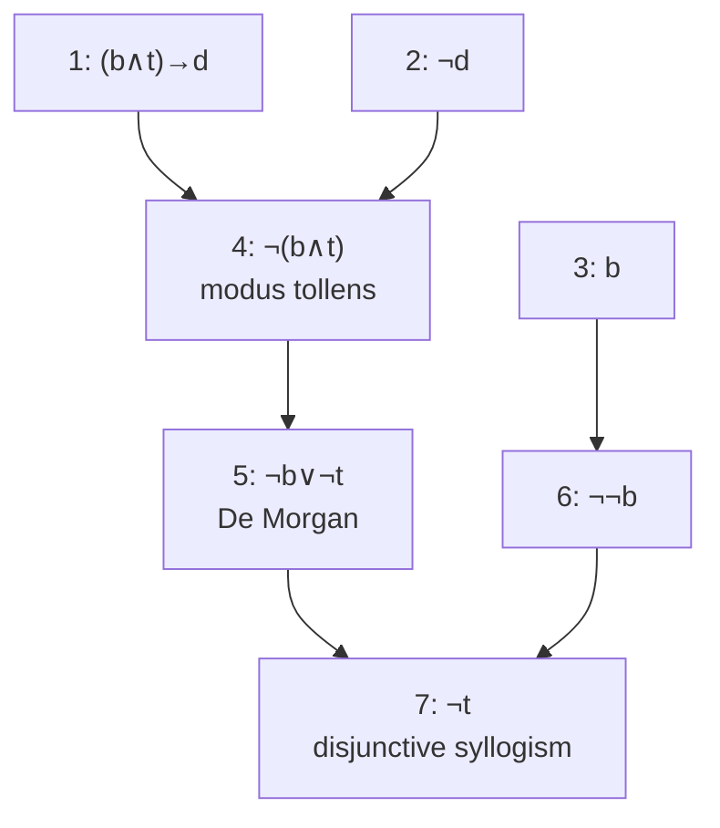

# DM-04 Rules of Inference

> [!info] Topic card
> **Unit:** U1 · **Time:** 3–4 h · **Verify with:** `valid_argument(premises, conclusion, vars)` in [[DM Python Toolkit]]

## 1. Learning objectives
1. **Define** an argument, validity and soundness, and **test** validity with a truth table.
2. **Apply** the standard rules of inference: modus ponens, modus tollens, hypothetical syllogism, disjunctive syllogism, addition, simplification, conjunction and resolution, plus the quantifier rules.
3. **Construct** formal step-by-step derivations with a justification for each line.
4. **Identify** common fallacies (affirming the consequent, denying the antecedent, begging the question) in mathematical and everyday reasoning.
5. **Use** valid reasoning patterns in debugging and security analysis.

## 2. Why it matters
A proof is a chain of valid inferences. If one link uses a fallacy, the whole proof collapses, however convincing it sounds. The same patterns appear when you debug ("the test fails, and if the cache were stale the test would fail, therefore the cache is stale": a **fallacy**!) and in security arguments.

## 3. Prerequisites
[[DM-02 Logical Equivalence and Laws of Logic]] (tautologies), [[DM-03 Predicates and Quantifiers]] (for the quantifier rules).

## 4. Intuition
An argument is **valid** when its form guarantees that **if** the premises are true, the conclusion **can't** be false, whatever the propositions actually mean. Validity is about **form**, not about whether the premises are true. "All cats can fly; Tom is a cat; so Tom can fly" is *valid* (good form) but *unsound* (a false premise).

## 5. Rigorous explanation

### 5.1 Definitions
- An **argument** is a list of premises $P_1, \dots, P_n$ and a conclusion $C$.
- It is **valid** iff $(P_1 \land \dots \land P_n) \to C$ is a tautology. Equivalently, **no row** of the truth table makes every premise true and the conclusion false.
- It is **sound** iff it is valid **and** all its premises are actually true.

### 5.2 Rules of inference (propositional)
| Rule | Premises | Conclusion | Underlying tautology |
|---|---|---|---|
| Modus ponens | $p,\; p \to q$ | $q$ | $(p \land (p\to q)) \to q$ |
| Modus tollens | $\lnot q,\; p \to q$ | $\lnot p$ | $(\lnot q \land (p\to q)) \to \lnot p$ |
| Hypothetical syllogism | $p\to q,\; q\to r$ | $p \to r$ | (DM-01 §7) |
| Disjunctive syllogism | $p \lor q,\; \lnot p$ | $q$ | |
| Addition | $p$ | $p \lor q$ | |
| Simplification | $p \land q$ | $p$ | |
| Conjunction | $p,\; q$ | $p \land q$ | |
| Resolution | $p \lor q,\; \lnot p \lor r$ | $q \lor r$ | basis of automated provers |

### 5.3 Rules for quantifiers
| Rule | From | Infer | Condition |
|---|---|---|---|
| Universal instantiation (UI) | $\forall x\, P(x)$ | $P(c)$ | any $c$ in the domain |
| Universal generalisation (UG) | $P(c)$ for an **arbitrary** $c$ | $\forall x\, P(x)$ | $c$ must be arbitrary (no special assumptions about it) |
| Existential instantiation (EI) | $\exists x\, P(x)$ | $P(c)$ for some **new** name $c$ | $c$ must not be used elsewhere |
| Existential generalisation (EG) | $P(c)$ | $\exists x\, P(x)$ | |

Combined: **universal modus ponens.** From $\forall x\,(P(x) \to Q(x))$ and $P(a)$, infer $Q(a)$ ("All registered students may vote. Amina is registered. So Amina may vote.").

### 5.4 Fallacies (invalid forms)
| Fallacy | Form | Counterexample row |
|---|---|---|
| **Affirming the consequent** | $p \to q,\; q \;\therefore\; p$ | p = F, q = T |
| **Denying the antecedent** | $p \to q,\; \lnot p \;\therefore\; \lnot q$ | p = F, q = T |
| Begging the question (circular) | the conclusion is used as a premise | — |
| Hasty generalisation | $P(a), P(b), P(c) \;\therefore\; \forall x P(x)$ | — |

## 6. Terminology
| Term | Meaning |
|---|---|
| Premise / conclusion | Assumed statements / statement derived |
| Valid | The conclusion can't be false when all the premises are true |
| Sound | Valid, with true premises |
| Rule of inference | A valid argument form used as a step |
| Derivation | Numbered sequence of statements, each a premise or obtained by a rule |
| Fallacy | An invalid argument form that looks plausible |

## 7. Step-by-step: a formal derivation
Premises: (1) "If the build passes and the tests pass, we deploy." (2) "We did not deploy." (3) "The build passed." Conclusion: "The tests did not pass."
Symbols: b = build passes, t = tests pass, d = deploy. Premises: $(b \land t)\to d$, $\lnot d$, $b$. Goal: $\lnot t$.
| # | Statement | Justification |
|---|---|---|
| 1 | $(b \land t) \to d$ | premise |
| 2 | $\lnot d$ | premise |
| 3 | $b$ | premise |
| 4 | $\lnot(b \land t)$ | modus tollens 1, 2 |
| 5 | $\lnot b \lor \lnot t$ | De Morgan 4 |
| 6 | $\lnot\lnot b$ | double negation 3 |
| 7 | $\lnot t$ | disjunctive syllogism 5, 6 ∎ |

## 8. Diagram: structure of the derivation

## 9. Worked examples

### Example 1 (basic): validity by truth table
Argument: $p \to q$, $\lnot q$, therefore $\lnot p$ (modus tollens).
| p | q | p→q | ¬q | ¬p |
|---|---|---|---|---|
| T | T | T | F | F |
| T | F | F | T | F |
| F | T | T | F | T |
| F | F | **T** | **T** | **T** |
Only the last row makes both premises true, and there the conclusion is true. So the argument is **valid** ✔.

### Example 2 (intermediate): spotting a fallacy in debugging
"If the database is down, the page shows error 500. The page shows error 500. Therefore the database is down." Form: $p \to q,\; q \;\therefore\; p$, which is **affirming the consequent**. The counterexample row is p = F, q = T: the database is up, but a coding bug also causes error 500. **Debugging lesson:** a symptom consistent with a hypothesis doesn't confirm it. Look for evidence that *distinguishes* the hypotheses (e.g. check the database directly). That's the scientific method in [[PY-20 Testing, Debugging and Test-Driven Development]].

### Example 3 (challenging): a quantified argument
Premises: (1) Every student who passes Discrete Math and Python is eligible for the project. (2) Every eligible student is assigned a supervisor. (3) Baraka passed Discrete Math. (4) Baraka passed Python. Conclusion: Baraka is assigned a supervisor.
Predicates: D(x), Y(x), E(x), S(x).
| # | Statement | Justification |
|---|---|---|
| 1 | $\forall x\,((D(x)\land Y(x))\to E(x))$ | premise |
| 2 | $\forall x\,(E(x)\to S(x))$ | premise |
| 3 | $D(b)$ | premise |
| 4 | $Y(b)$ | premise |
| 5 | $(D(b)\land Y(b))\to E(b)$ | UI on 1 |
| 6 | $E(b)\to S(b)$ | UI on 2 |
| 7 | $D(b)\land Y(b)$ | conjunction 3, 4 |
| 8 | $E(b)$ | modus ponens 5, 7 |
| 9 | $S(b)$ | modus ponens 6, 8 ∎ |

### Example 4 (resolution): automated reasoning
Clauses: $p \lor q$, $\lnot p \lor r$, $\lnot q \lor r$, $\lnot r$. Is this set contradictory?
Resolve $p\lor q$ with $\lnot p\lor r$ to get $q\lor r$. Resolve with $\lnot q\lor r$ to get $r \lor r \equiv r$. Resolve with $\lnot r$ to get the **empty clause** (a contradiction). So the clauses can't all be true. Equivalently, the first three clauses **entail** $r$. SAT solvers and Prolog use exactly this procedure.

## 10. Application: security reasoning
A threat-model claim: "If an attacker has the password and there is no MFA, the account is compromised. MFA is enabled. Therefore the account is safe." The form is $(p \land \lnot m) \to c$, $m$, $\therefore \lnot c$, which is **invalid**: other paths to compromise exist (session theft, phishing the MFA code). Valid security arguments must cover every path to the asset, which is why threat modelling enumerates them systematically ([[CS-02 Threat Modeling and Security Requirements]]).

## 11. Common mistakes
| Mistake | Fix |
|---|---|
| Affirming the consequent / denying the antecedent | Check against the rule table. Find the counterexample row. |
| Confusing valid with true | Validity is about form. Soundness also needs true premises. |
| UG from a specific example ("x = 2 works, so ∀x") | UG only applies to an *arbitrary* element |
| Reusing a name in EI | Each EI introduces a fresh constant |
| Unjustified steps in derivations | Every line cites a premise or rule with line numbers |

## 12. Comparison
| Reasoning type | Guarantees the conclusion? | Example |
|---|---|---|
| Deductive (valid) | Yes, if the premises are true | Modus ponens |
| Inductive (empirical) | No, only probable | "Every test run passed, so the code is correct" |
| Abductive (best explanation) | No, plausible | Debugging hypotheses |
(*Mathematical* induction, in [[DM-09 Mathematical Induction]], is deductive despite the name.)

## 13. Practice
**L1** 1. Name the rule: from $p \lor q$ and $\lnot q$, infer $p$. 2. Define a sound argument.

**L2** 3. Determine whether each is valid (truth table or rules): (a) $p \to q$, $\lnot p$ ∴ $\lnot q$ (b) $p \lor q$, $p \to r$, $q \to r$ ∴ $r$.

**L3** 4. Give a formal derivation: premises $p \to q$, $r \to s$, $p \lor r$, $\lnot q$. Conclusion: $s$. 5. Translate and derive: "If it is a weekday and not a holiday, the lab opens. The lab did not open. It is a weekday. Therefore it is a holiday."

**L4** 6. Identify the error in this "proof": "Let n be an even number, say n = 4. Then n² = 16 is even. Hence the square of every even number is even." Then write a correct argument. 7. Use resolution to show that the premises $\{\lnot p \lor q,\; \lnot q \lor r,\; p\}$ entail $r$.

**L5** 8. An incident report concludes: "The breach happened through the VPN, because every breach in the last year came through the VPN and logs show VPN activity at the time." Analyse the reasoning type, identify any fallacies, and propose evidence that would turn this into a **deductively** supported conclusion ([[CS-17 Digital Forensics Fundamentals]]).

## 14. Hints
> [!tip]- Hints
> 3(b): proof by cases (DM-02: $(p\to r)\land(q\to r)\equiv(p\lor q)\to r$). 4: use modus tollens on $p\to q$ first. 6: universal generalisation needs an *arbitrary* element. 7: add $\lnot r$ and derive the empty clause.

## 15. Worked solutions
> [!success]- Solutions 1–2
> 1. Disjunctive syllogism. 2. Valid, and all its premises are true.

> [!success]- Solution 3
> (a) **Invalid** (denying the antecedent): the row p = F, q = T makes both premises true and the conclusion ¬q false. (b) **Valid**: by the proof-by-cases equivalence, $(p\to r)\land(q\to r)\equiv(p\lor q)\to r$. With $p\lor q$, modus ponens gives r. (Or check the 8-row table, which has no counterexample row.)

> [!success]- Solution 4
> | # | Statement | Justification |
> |---|---|---|
> | 1 | $p\to q$ | premise |
> | 2 | $\lnot q$ | premise |
> | 3 | $\lnot p$ | modus tollens 1, 2 |
> | 4 | $p\lor r$ | premise |
> | 5 | $r$ | disjunctive syllogism 4, 3 |
> | 6 | $r\to s$ | premise |
> | 7 | $s$ | modus ponens 6, 5 ∎ |

> [!success]- Solution 5
> w = weekday, h = holiday, o = lab opens. Premises: $(w\land\lnot h)\to o$, $\lnot o$, $w$.
> Modus tollens gives $\lnot(w\land\lnot h)$. De Morgan gives $\lnot w\lor h$. Double negation on $w$ and disjunctive syllogism give $h$ ∎. **Valid.**

> [!success]- Solution 6
> The error: **universal generalisation from a specific example**. n = 4 isn't arbitrary.
> Correct argument: let n be an **arbitrary** even integer. Then n = 2k for some integer k. So $n^2 = 4k^2 = 2(2k^2)$, and $2k^2$ is an integer, so $n^2$ is even. Since n was arbitrary, the square of every even integer is even (UG) ∎. (This is a direct proof, see [[DM-05 Direct Proof, Contrapositive and Contradiction]].)

> [!success]- Solution 7
> Add the negated goal, ¬r. Resolve $p$ with $\lnot p\lor q$ to get $q$. Resolve $q$ with $\lnot q\lor r$ to get $r$. Resolve $r$ with $\lnot r$ to get the empty clause, a contradiction. So the premises together with ¬r are unsatisfiable, i.e. the premises **entail** r ∎.

> [!success]- Solution 8
> **Reasoning type:** inductive generalisation (from past breaches) plus abduction (VPN activity "explains" the breach). **Fallacies:** hasty generalisation ("every past breach came via the VPN" doesn't imply this one did), and affirming the consequent ("if the breach came via the VPN, there would be VPN activity; there is VPN activity; so…", but legitimate users also generate VPN activity). **Evidence for a deductive conclusion:** a chain of custody linking the specific attacker session (source IP, authenticated account, timestamps) to the VPN logs **and** to the actions on the compromised host (file access logs, process creation), with no unexplained gaps, plus the elimination of other entry points. Only then does "the attacker's session originated from the VPN" follow from the evidence.

## 16. Self-test (pass ≥ 4/5)
1. Is "p → q, q ∴ p" valid? 2. Which rule gives ¬p from p → q and ¬q? 3. When may you apply universal generalisation? 4. Valid vs sound? 5. What does resolution produce from $p\lor q$ and $\lnot p\lor r$?
> [!success]- Answers
> 1. No (affirming the consequent). 2. Modus tollens. 3. When the element is arbitrary (no special assumptions). 4. Valid is about form only. Sound means valid **and** with true premises. 5. $q\lor r$.

## 17. Flashcards
#flashcards/discrete-math
Modus ponens?::From p and p→q infer q.
Modus tollens?::From ¬q and p→q infer ¬p.
Affirming the consequent?::Invalid: p→q, q ∴ p.
Denying the antecedent?::Invalid: p→q, ¬p ∴ ¬q.
Definition of a valid argument?::No truth assignment makes all premises true and the conclusion false.
Resolution rule?::From p∨q and ¬p∨r infer q∨r.
Universal generalisation condition?::Only from P(c) for an arbitrary c.

## 18. Blank-page recall
Write the 8 propositional rules, the 4 quantifier rules, and the 2 classic fallacies with their counterexample rows.

## 19. Revision summary
- Valid = no counterexample row. Sound = valid + true premises.
- Know MP, MT, HS, DS, addition, simplification, conjunction, resolution, UI/UG/EI/EG.
- Number every derivation line and cite its justification.
- Watch for affirming the consequent and denying the antecedent, in proofs *and* in debugging.

## 20. Links
Prev: [[DM-03 Predicates and Quantifiers]] · Next: [[DM-05 Direct Proof, Contrapositive and Contradiction]] · Applied: [[PY-20 Testing, Debugging and Test-Driven Development]], [[CS-02 Threat Modeling and Security Requirements]], [[CS-17 Digital Forensics Fundamentals]]

## 21. Sources
- Rosen (2019), §1.6 "Rules of Inference".
- Levin, *Discrete Mathematics: An Open Introduction*, §3.2 (deductions).
- Robinson, J. A., "A machine-oriented logic based on the resolution principle", *Journal of the ACM*, 12(1), 1965, pp. 23–41.

## 22. Mastery checklist
- [ ] I can write a numbered, justified derivation of 6+ lines
- [ ] I can spot both classic fallacies in natural-language arguments
- [ ] Practice 8 analysed in writing · reviews scheduled
