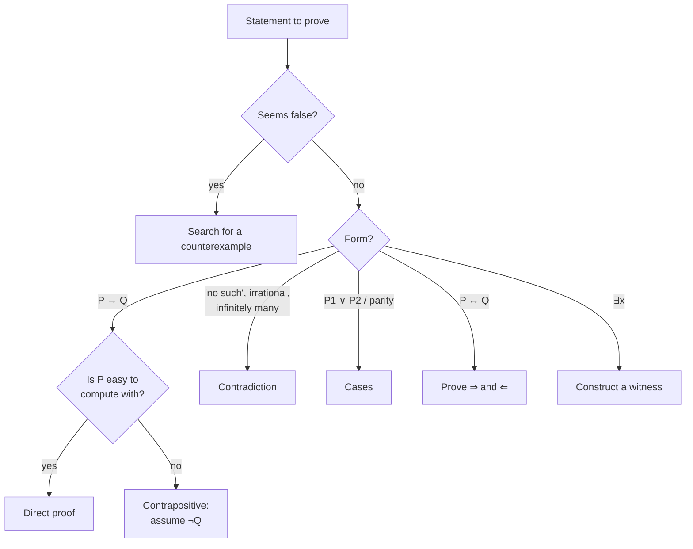

# DM-05 Direct Proof, Contrapositive and Contradiction

> [!info] Topic card
> **Unit:** U2 Proof · **Time:** 5 h · Contains the **proof-writing rubric** used to self-mark every proof in this module.

## 1. Learning objectives
1. **Use** precise definitions (even, odd, divides, rational, prime) as the starting point of a proof.
2. **Write** direct proofs, proofs by contrapositive, proofs by contradiction, proofs by cases, and existence/uniqueness proofs.
3. **Choose** the most suitable technique for a given statement, and **justify** the choice.
4. **Disprove** universal claims with counterexamples.
5. **Self-assess** proofs against a rubric: clarity of the assumptions, justified steps, correct conclusion.

## 2. Why it matters
Proof is how mathematics, and correctness-critical computing (algorithm correctness, cryptographic security arguments, verified software), establishes certainty. Writing proofs trains the habit of **justifying every step**, which is exactly what code review and debugging demand.

## 3. Prerequisites
[[DM-04 Rules of Inference]] (modus ponens/tollens, UG), [[DM-01 Propositions, Connectives and Truth Tables]] (the contrapositive is equivalent), and basic algebra.

## 4. Intuition
- **Direct:** start from what you're given and walk forward to the goal. "Assume P. … Therefore Q."
- **Contrapositive:** sometimes walking backwards is easier. Prove "not Q ⇒ not P", which is logically the same claim.
- **Contradiction:** assume the opposite of what you want, and show that the world breaks (something both true and false). Then the opposite must be impossible.

## 5. Rigorous explanation

### 5.1 Definitions you will use (memorise them; proofs start here)
| Term | Definition (for integers) |
|---|---|
| $n$ is **even** | $\exists k \in \mathbb{Z},\; n = 2k$ |
| $n$ is **odd** | $\exists k \in \mathbb{Z},\; n = 2k + 1$ |
| $a$ **divides** $b$ ($a \mid b$), $a \ne 0$ | $\exists k \in \mathbb{Z},\; b = ak$ |
| $r$ is **rational** | $\exists p, q \in \mathbb{Z},\; q \ne 0,\; r = p/q$ |
| $p > 1$ is **prime** | its only positive divisors are 1 and $p$ |
Facts used without proof at this level: every integer is even or odd and not both; the integers are closed under +, −, ×; every fraction can be written in lowest terms; every integer $n > 1$ has a prime divisor.

### 5.2 The techniques as templates
**Direct proof of $P \to Q$**
> Assume $P$. *[Unpack the definitions.]* … *[Algebra or logic, each step justified.]* … Hence $Q$. ∎

**Contrapositive** (valid because $P\to Q \equiv \lnot Q\to\lnot P$)
> We prove the contrapositive: assume $\lnot Q$. … Hence $\lnot P$. Therefore $P \to Q$. ∎

**Contradiction** (to prove $S$)
> Suppose, for contradiction, that $\lnot S$. … Then $R$ and $\lnot R$, a contradiction. Hence $S$. ∎

**Cases** (to prove $P \to Q$ when $P \equiv P_1 \lor P_2$)
> Case 1: $P_1$ … $Q$. Case 2: $P_2$ … $Q$. The cases are exhaustive, so $Q$. ∎

**Biconditional** $P \leftrightarrow Q$: prove both $P \to Q$ **and** $Q \to P$ (the "⇒" and "⇐" directions).

**Existence:** *constructive* (exhibit a witness) or *non-constructive* (show that one must exist). **Uniqueness:** show existence, then show that if $x$ and $y$ both work, then $x = y$.

**Disproof** of $\forall x\, P(x)$: one counterexample.

### 5.3 Choosing a technique
| The statement looks like… | Try first |
|---|---|
| P → Q, where P gives you something to compute with | Direct |
| P → Q, where ¬Q is more concrete than P (e.g. Q = "n is odd") | Contrapositive |
| "There is no…", "is irrational", "infinitely many" | Contradiction |
| P involves "or", or a parity/remainder split | Cases |
| ∀ claim that seems false | Look for a counterexample |

## 6. Terminology
| Term | Meaning |
|---|---|
| Theorem / lemma / corollary | Main result / helper result / immediate consequence |
| Hypothesis / conclusion | What's assumed / what's shown |
| Without loss of generality (WLOG) | The cases are symmetric, so prove one |
| ∎ (QED) | End of proof |
| Constructive proof | Exhibits the object |
| Vacuous / trivial proof | P is false / Q is true regardless of P |

## 7. Step-by-step: a direct proof, annotated
**Theorem.** The sum of two odd integers is even.
| Line | Proof text | Why it is justified |
|---|---|---|
| 1 | Let $m$ and $n$ be arbitrary odd integers. | Setting up UG ([[DM-04 Rules of Inference]]) |
| 2 | Then $m = 2a + 1$ and $n = 2b + 1$ for some integers $a, b$. | Definition of odd (EI with fresh names) |
| 3 | So $m + n = 2a + 2b + 2 = 2(a + b + 1)$. | Algebra |
| 4 | $a + b + 1$ is an integer. | Closure of ℤ under + |
| 5 | Hence $m + n$ is even. | Definition of even |
| 6 | Since $m, n$ were arbitrary, the claim holds for all odd integers. ∎ | UG |

## 8. Diagram: choosing a proof method

## 9. Worked examples

### Example 1 (basic): direct proof with divisibility
**Theorem.** If $a \mid b$ and $b \mid c$, then $a \mid c$.
*Proof.* Assume $a \mid b$ and $b \mid c$. Then $b = ak$ and $c = bl$ for some integers $k, l$. Substituting gives $c = (ak)l = a(kl)$, and $kl \in \mathbb{Z}$. Hence $a \mid c$. ∎
*(Transitivity of divisibility, which reappears as a partial-order property in [[DM-10 Relations, Equivalence Relations and Partial Orders]].)*

### Example 2 (intermediate): contrapositive
**Theorem.** For an integer $n$, if $n^2$ is even, then $n$ is even.
*Why not direct?* From "$n^2 = 2k$" there's no easy way to reach $n$ (taking square roots leaves the integers).
*Proof (contrapositive).* Suppose $n$ is **not** even, i.e. odd: $n = 2k + 1$. Then $n^2 = 4k^2 + 4k + 1 = 2(2k^2 + 2k) + 1$, which is odd, i.e. **not** even. So "n odd ⇒ n² odd", which is the contrapositive of the theorem. ∎

### Example 3 (classic): contradiction, √2 is irrational
**Theorem.** $\sqrt{2}$ is irrational.
*Proof.* Suppose, for contradiction, that $\sqrt{2} = p/q$ with integers $p, q$, $q \ne 0$, and the fraction **in lowest terms** (no common factor > 1).
1. Squaring: $2 = p^2/q^2$, so $p^2 = 2q^2$. Hence $p^2$ is even.
2. By Example 2, $p$ is even: $p = 2r$.
3. Then $4r^2 = 2q^2$, so $q^2 = 2r^2$, and $q^2$ is even. By Example 2 again, $q$ is even.
4. Now 2 divides both $p$ and $q$, contradicting "lowest terms".
Therefore $\sqrt{2}$ is irrational. ∎
*Notice the reuse of Example 2 as a **lemma**. Building on proven results is how mathematics (and good software) is structured.*

### Example 4 (classic): contradiction, infinitely many primes (Euclid)
*Proof.* Suppose there are only finitely many primes, $p_1, p_2, \dots, p_n$. Let $N = p_1 p_2 \cdots p_n + 1$. Since $N > 1$, it has a prime divisor $p$, which must be one of the $p_i$. But dividing $N$ by any $p_i$ leaves remainder 1, so $p_i \nmid N$. Contradiction. Hence there are infinitely many primes. ∎
**Common misconception:** "$N$ is always prime." It isn't: $2\cdot3\cdot5\cdot7\cdot11\cdot13 + 1 = 30031 = 59 \times 509$. The proof only needs $N$ to have a prime factor *not on the list*.

### Example 5 (cases): $n^2 + n$ is even for every integer $n$
*Proof.* Case 1, $n$ even, $n = 2k$: $n^2 + n = 4k^2 + 2k = 2(2k^2 + k)$, which is even. Case 2, $n$ odd, $n = 2k+1$: $n^2 + n = (2k+1)(2k+2) = 2(2k+1)(k+1)$, which is even. Every integer is even or odd, so the claim holds. ∎
*(A slicker direct proof: $n^2 + n = n(n+1)$ is a product of consecutive integers, one of which is even.)*

### Example 6 (disproof): "For all $n \ge 1$, $n^2 + n + 41$ is prime."
Checking n = 1, …, 39 gives primes, which is tempting. But $n = 40$: $1600 + 40 + 41 = 1681 = 41^2$. **Counterexample**, so the claim is false. Lots of confirming cases ≠ proof ([[DM-04 Rules of Inference]], hasty generalisation).

## 10. Application: correctness argument for code
Claim: `is_even(n)` defined as `n % 2 == 0` agrees with the mathematical definition for all integers. Python guarantees $n = 2\cdot(n // 2) + (n \% 2)$ with $n \% 2 \in \{0, 1\}$ ([[PY-02 Variables, Types, Expressions and Operators]]).
(⇒) If `n % 2 == 0`, then $n = 2(n//2)$ with $n//2 \in \mathbb{Z}$, so $n$ is even.
(⇐) If $n = 2k$, then the remainder of division by 2 is unique and $0 \le 0 < 2$ works, so `n % 2 == 0`. ∎
That's a biconditional proof about real code. Tests check examples, while proofs check **all** inputs.

## 11. Common mistakes in proofs
| Mistake | Example | Fix |
|---|---|---|
| Proving with an example | "Let n = 3…" for a ∀ claim | Use an **arbitrary** n |
| Reusing the same letter | "m = 2k + 1, n = 2k + 1" (this forces m = n!) | Fresh letters per object |
| Assuming the conclusion | Starting from "n² is odd" to prove it | Start from the hypotheses |
| Proving the converse | Showing Q → P instead of P → Q | Check which direction you need |
| Contradiction without a contradiction | Never reaching R ∧ ¬R | State the contradiction explicitly |
| Unjustified algebra or "clearly" | Skipping steps | Each step is a definition, an earlier result or algebra |

## 12. Proof-writing rubric (self-marking, 10 points per proof)
| Criterion | 2 points | 1 point | 0 points |
|---|---|---|---|
| Statement and technique declared | "We prove the contrapositive: assume…" | Technique implicit | Unclear what's being proved |
| Definitions used correctly | Precise, with quantified variables (fresh letters) | Minor slips | Definitions missing or wrong |
| Every step justified | Algebra, a lemma or a rule cited | Some gaps | Leaps of faith |
| Logic correct (direction, cases exhaustive) | Fully correct | Minor | Converse, or a missing case |
| Conclusion stated, linked to the goal | Explicit, with ∎ | Implied | Missing |

## 13. Practice
**L1** 1. State the definitions of odd, divides and rational. 2. Which technique would you try first for: "if 3n + 2 is odd, then n is odd"? Why?

**L2** 3. Prove: the product of two odd integers is odd. 4. Prove: if $a \mid b$ and $a \mid c$, then $a \mid (b + c)$.

**L3** 5. Prove by contrapositive: if $3n + 2$ is odd, then $n$ is odd. 6. Prove by cases: $n^3 - n$ is divisible by 2 for every integer $n$.

**L4** 7. Prove that $\sqrt{3}$ is irrational. (You may use the lemma: if $3 \mid n^2$ then $3 \mid n$. Prove it by cases on $n \bmod 3$.) 8. Prove or disprove: (a) the sum of a rational and an irrational number is irrational; (b) the product of two irrational numbers is irrational.

**L5** 9. Prove that there is no largest even integer, and explain which technique you chose and why. Then self-mark your proof with the rubric in §12.
10. Prove that for every integer $n$, $n$ is odd **if and only if** $n^2$ is odd. Write both directions in full.

## 14. Hints
> [!tip]- Hints
> 5: assume n is even, n = 2k. 6: $n^3 - n = (n-1)n(n+1)$, or use cases on parity. 7: n mod 3 ∈ {0, 1, 2}, so check which cases make $n^2$ divisible by 3. 8(b): consider $\sqrt{2}\cdot\sqrt{2}$. 9: assume a largest even integer E, and consider E + 2.

## 15. Worked solutions
> [!success]- Solutions 1–2
> 1. See §5.1. 2. **Contrapositive**: ¬Q is "n is even", which gives you $n = 2k$ to compute with. The hypothesis "3n + 2 is odd" is harder to unpack into information about $n$.

> [!success]- Solution 3
> Let $m = 2a + 1$ and $n = 2b + 1$ be arbitrary odd integers. Then $mn = 4ab + 2a + 2b + 1 = 2(2ab + a + b) + 1$. Since $2ab + a + b \in \mathbb{Z}$, $mn$ is odd. ∎

> [!success]- Solution 4
> Assume $b = ak$ and $c = al$, with $k, l \in \mathbb{Z}$. Then $b + c = a(k + l)$, and $k + l \in \mathbb{Z}$, so $a \mid (b + c)$. ∎

> [!success]- Solution 5
> *Contrapositive:* assume n is even, $n = 2k$. Then $3n + 2 = 6k + 2 = 2(3k + 1)$, which is even, i.e. not odd. Hence if 3n + 2 is odd, n is odd. ∎

> [!success]- Solution 6
> If n is even, $n = 2k$: $n^3 - n = 8k^3 - 2k = 2(4k^3 - k)$. If n is odd, $n = 2k+1$: $n^3 - n = n(n-1)(n+1) = (2k+1)(2k)(2k+2) = 2\cdot[k(2k+1)(2k+2)]$. Both cases give an even number. ∎

> [!success]- Solution 7
> **Lemma** (if $3 \mid n^2$ then $3 \mid n$), proved by contrapositive with cases. If $3 \nmid n$, then $n = 3k+1$ or $n = 3k+2$. Case 1: $n^2 = 9k^2+6k+1 = 3(3k^2+2k)+1$. Case 2: $n^2 = 9k^2+12k+4 = 3(3k^2+4k+1)+1$. Either way $n^2$ leaves remainder 1, so $3 \nmid n^2$. ∎
> **Theorem.** Suppose $\sqrt3 = p/q$ in lowest terms. Then $p^2 = 3q^2$, so $3 \mid p^2$, and by the lemma $3 \mid p$: $p = 3r$. Then $9r^2 = 3q^2$, so $q^2 = 3r^2$, and $3 \mid q$. Both are divisible by 3, contradicting lowest terms. ∎

> [!success]- Solution 8
> (a) **True.** Suppose $r$ is rational, $x$ irrational, and $r + x = s$ is rational. Then $x = s - r$ is a difference of rationals $\frac{a}{b} - \frac{c}{d} = \frac{ad - bc}{bd}$, which is rational. Contradiction. ∎
> (b) **False.** Counterexample: $\sqrt2 \cdot \sqrt2 = 2$, which is rational (and √2 is irrational by Example 3).

> [!success]- Solution 9
> *Technique:* contradiction, since "there is no largest" is a negative existence claim. *Proof:* suppose E is the largest even integer. Then $E + 2$ is an integer, and $E + 2 = 2k + 2 = 2(k+1)$ is even (where $E = 2k$). But $E + 2 > E$, contradicting the maximality of E. Hence there's no largest even integer. ∎ *(Rubric: technique declared, definition used, steps justified, contradiction explicit, conclusion stated: 10/10.)*

> [!success]- Solution 10
> (⇒) If n is odd, then n² is odd: Solution 3 with m = n. (⇐) If n² is odd, then n is odd. Contrapositive: if n is even, $n = 2k$, then $n^2 = 2(2k^2)$ is even. Both directions hold, so n is odd ⇔ n² is odd. ∎

## 16. Self-test (pass ≥ 4/5)
1. Why is proof by contrapositive valid? 2. What must happen in a proof by contradiction? 3. How do you disprove a ∀ statement? 4. Is $2\cdot3\cdot5\cdot7\cdot11\cdot13+1$ prime? 5. What's wrong with writing "m = 2k + 1 and n = 2k + 1"?
> [!success]- Answers
> 1. $P\to Q \equiv \lnot Q \to \lnot P$. 2. You must derive a statement and its negation (or contradict a known fact). 3. One counterexample. 4. No: 30031 = 59 × 509. 5. It forces m = n, so the proof loses generality. Use different letters.

## 17. Flashcards
#flashcards/discrete-math
Definition of even?::n = 2k for some integer k.
Definition of a | b?::b = ak for some integer k (a ≠ 0).
Contrapositive proof template?::Assume ¬Q, derive ¬P; conclude P → Q.
Contradiction proof template?::Assume ¬S, derive some R and ¬R; conclude S.
Key step in √2 irrational proof?::Lowest terms p/q; p² = 2q² forces both p and q even: contradiction.
Euclid's prime proof uses which number?::N = (product of all listed primes) + 1.
How to prove P ↔ Q?::Prove P → Q and Q → P.

## 18. Blank-page recall
Write the five templates (§5.2), then prove √2 irrational from memory and mark your proof with the rubric.

## 19. Revision summary
- Proofs start from **definitions** with fresh variables, and every step is justified.
- Direct: P ⇒ … ⇒ Q. Contrapositive: ¬Q ⇒ ¬P. Contradiction: ¬S ⇒ ⊥.
- Use cases for parity and remainders. ↔ needs both directions. ∃ needs a witness.
- One counterexample kills a ∀ claim, and many examples prove nothing.
- Self-mark with the rubric.

## 20. Links
Prev: [[DM-04 Rules of Inference]] · Next: [[DM-06 Sets, Set Operations, Power Sets and Cartesian Products]] · Then: [[DM-09 Mathematical Induction]] · Applied: [[PY-12 Searching, Sorting and Complexity]] (proof that $n^2 \ne O(n)$), [[CS-07 Public-Key Cryptography, Signatures and Key Management]] (number theory behind RSA)

## 21. Sources
- Rosen (2019), §1.7–1.8 "Introduction to Proofs" and "Proof Methods and Strategy".
- Velleman, D. J., *How to Prove It: A Structured Approach*, 3rd ed., Cambridge University Press, 2019.
- Euclid, *Elements*, Book IX, Proposition 20 (infinitude of primes).
- Levin, *Discrete Mathematics: An Open Introduction*, §3.2 (proofs): https://discrete.openmathbooks.org/

## 22. Mastery checklist
- [ ] I proved practice 3–7 with each proof scoring ≥ 8/10 on the rubric
- [ ] I reproduced √2 and Euclid from memory
- [ ] I chose techniques deliberately (practice 2, 9) · reviews scheduled
