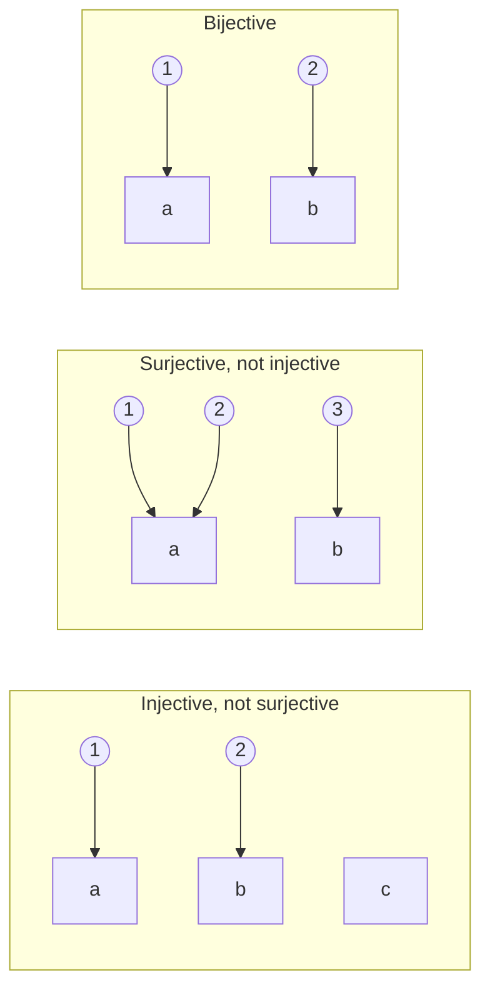

# DM-07 Functions

> [!info] Topic card
> **Unit:** U3 · **Time:** 4 h · **Verify with:** `is_injective`, `is_surjective`, `count_functions` in [[DM Python Toolkit]]

## 1. Learning objectives
1. **Define** a function $f: A \to B$ (domain, codomain, image/range), and **decide** whether a given rule or relation is a function.
2. **Prove** that a function is injective (one-to-one), surjective (onto) or bijective, and **disprove** these with counterexamples.
3. **Compose** functions and **find** inverses of bijections, **explaining** why only bijections have inverses.
4. **Use** floor, ceiling and mod functions, and **count** the functions, injections and surjections between finite sets.
5. **Connect** functions to computing: hashing (not injective), encodings (bijections), and Python dictionaries and functions.

## 2. Why it matters
Encryption must be **invertible** (bijective) or messages couldn't be decrypted. Hash functions are deliberately **not** injective, so collisions must exist ([[DM-12 Pigeonhole Principle and Inclusion-Exclusion]]), and security depends on collisions being *hard to find* ([[CS-06 Hashes, MACs and Integrity]]). A database primary key is a function from rows to IDs that must be injective. And "does every input have exactly one output?" is the core question of any specification.

## 3. Prerequisites
[[DM-06 Sets, Set Operations, Power Sets and Cartesian Products]] (Cartesian products), [[DM-03 Predicates and Quantifiers]] (∀∃ for surjectivity), [[DM-05 Direct Proof, Contrapositive and Contradiction]].

## 4. Intuition
A function is a **vending machine**: each button (input) gives **exactly one** item (output). Two buttons may give the same snack (that's allowed), but one button can't give two different snacks, and every button must give something.
- **Injective:** no two buttons give the same snack.
- **Surjective:** every snack in the catalogue can be obtained from some button.
- **Bijective:** both, a perfect pairing between buttons and snacks, so you can run it backwards.

## 5. Rigorous explanation

### 5.1 Definition
A **function** $f: A \to B$ assigns to **each** $a \in A$ **exactly one** $f(a) \in B$. Formally, it's a subset $f \subseteq A\times B$ such that $\forall a\in A\; \exists! b\in B\; (a,b)\in f$.
- $A$ is the **domain**, and $B$ is the **codomain** (where outputs are *allowed* to live).
- The **image** (range) is $f(A) = \{f(a)\mid a\in A\}\subseteq B$ (the outputs actually produced).
- **Equality:** $f = g$ iff they have the same domain and codomain and $f(a) = g(a)$ for all $a$.

### 5.2 Properties, symbol by symbol
| Property | Definition | Proof method | Disproof |
|---|---|---|---|
| **Injective** (one-to-one) | $\forall a_1,a_2\in A:\; f(a_1)=f(a_2)\to a_1=a_2$ | Assume $f(a_1)=f(a_2)$, derive $a_1=a_2$ | Two different inputs, same output |
| **Surjective** (onto) | $\forall b\in B\;\exists a\in A:\; f(a)=b$ | For an arbitrary $b$, *solve* for $a$ and check $a \in A$ | A $b$ that's never hit |
| **Bijective** | injective and surjective | Both | Either fails |
For finite sets with $|A| = |B|$: injective ⇔ surjective ⇔ bijective.

### 5.3 Composition and inverses
- $(g\circ f)(x) = g(f(x))$, for $f: A\to B$ and $g: B\to C$. Composition is associative but **not commutative**.
- If $f$ is bijective, its **inverse** $f^{-1}: B \to A$ satisfies $f^{-1}(f(a)) = a$ and $f(f^{-1}(b)) = b$. **Only bijections have inverses**: injectivity makes $f^{-1}$ single-valued, and surjectivity makes it defined on all of B.
- The composition of injections is injective, and the composition of surjections is surjective.

### 5.4 Important functions
- **Floor** $\lfloor x\rfloor$: the largest integer ≤ x. **Ceiling** $\lceil x\rceil$: the smallest integer ≥ x. $\lfloor -2.5\rfloor = -3$ and $\lceil -2.5\rceil = -2$. Python: `math.floor`, `math.ceil`, and `//` is floor division.
- **mod:** $a \bmod m$ is the remainder in $\{0, \dots, m-1\}$ (Python `%` for positive m).
- **Identity** $\iota_A(a) = a$. **Characteristic function** of $S\subseteq U$: $\chi_S(x) = 1$ if $x\in S$, and 0 otherwise (the bit string of DM-06).

### 5.5 Counting functions between finite sets ($|A| = m$, $|B| = n$)
| Kind | Count | Reason |
|---|---|---|
| All functions | $n^m$ | Each of the m inputs independently picks one of n outputs |
| Injections ($m\le n$) | $n(n-1)\cdots(n-m+1) = \frac{n!}{(n-m)!}$ | Outputs must differ, so the choices shrink |
| Surjections | $\sum_{k=0}^{n}(-1)^k\binom{n}{k}(n-k)^m$ | Inclusion–exclusion ([[DM-12 Pigeonhole Principle and Inclusion-Exclusion]]) |
| Bijections ($m=n$) | $n!$ | |

## 6. Terminology
| Term | Meaning |
|---|---|
| Domain / codomain / image | Inputs / allowed outputs / actual outputs |
| Preimage | $f^{-1}(S) = \{a \mid f(a)\in S\}$ (exists even if f isn't invertible) |
| Injective / surjective / bijective | One-to-one / onto / both |
| Composition | $g \circ f$: apply f, then g |
| Inverse | Function undoing f (bijections only) |
| Partial function | Some inputs have no output (e.g. `dict` lookups that raise KeyError) |

## 7. Step-by-step: prove that $f:\mathbb{R}\to\mathbb{R}$, $f(x) = 3x - 5$ is bijective
**Injective:** suppose $f(a) = f(b)$. Then $3a - 5 = 3b - 5$, so $3a = 3b$, so $a = b$ ✔.
**Surjective:** let $y\in\mathbb{R}$ be arbitrary. We need $x$ with $3x - 5 = y$. Solving gives $x = (y+5)/3$, which is a real number. Check: $f((y+5)/3) = (y+5) - 5 = y$ ✔.
So it's bijective, with inverse $f^{-1}(y) = (y + 5)/3$. ∎
**The same rule on ℤ:** $f:\mathbb{Z}\to\mathbb{Z}$ is still injective, but **not surjective**. The counterexample $y = 0$ would need $x = 5/3 \notin\mathbb{Z}$. *The domain and codomain are part of the function.*

## 8. Diagram: arrow diagrams

*Text version: in the first diagram the inputs 1 and 2 go to different outputs, but c is never hit. In the second, every output is hit, but 1 and 2 share the output a. In the third, the inputs and outputs pair off exactly.*

## 9. Worked examples

### Example 1 (basic): is it a function?
$A = \{1,2,3\}$, $B = \{x,y\}$.
- $R_1 = \{(1,x),(2,y),(3,x)\}$: a function (each input exactly once). Image $\{x,y\}$, so surjective. Not injective (1 and 3 share x).
- $R_2 = \{(1,x),(2,y)\}$: **not** a function on A (3 has no image). It's a *partial* function.
- $R_3 = \{(1,x),(1,y),(2,x),(3,y)\}$: **not** a function (1 has two images).

### Example 2 (intermediate): $f(x)=x^2$ with different domains
| $f$ | Injective? | Surjective? |
|---|---|---|
| $\mathbb{R}\to\mathbb{R}$ | No: $f(-2)=f(2)$ | No: $-1$ has no preimage |
| $\mathbb{R}\to[0,\infty)$ | No | Yes: $y\ge0$ has preimage $\sqrt{y}$ |
| $[0,\infty)\to[0,\infty)$ | Yes: $a^2=b^2$ with $a,b\ge0$ gives $a=b$ | Yes, so bijective (inverse $\sqrt{\cdot}$) |

### Example 3 (challenging): composition is not commutative, and inverses
$f(x) = x + 1$ and $g(x) = 2x$ on ℝ. $(g\circ f)(x) = 2(x+1) = 2x+2$, while $(f\circ g)(x) = 2x + 1$. Different.
Both are bijections, so $(g\circ f)^{-1} = f^{-1}\circ g^{-1}$ (reverse order, like taking off socks and shoes): $f^{-1}(y) = y-1$ and $g^{-1}(y) = y/2$, so $(g\circ f)^{-1}(y) = y/2 - 1$. Check: $(g\circ f)(y/2-1) = 2(y/2 - 1) + 2 = y$ ✔.

### Example 4 (CS): a toy hash is not injective
$h(s) = (\text{sum of character codes of } s) \bmod 16$, from strings to $\{0,\dots,15\}$. Infinitely many strings map into 16 values, so $h$ **can't** be injective. Concrete collision: "ab" and "ba" have the same sum. Real cryptographic hashes (SHA-256) also map an infinite domain into $2^{256}$ outputs, so collisions *exist*. Their security comes from the fact that nobody can *find* one in practice ([[CS-06 Hashes, MACs and Integrity]]).

## 10. Application: encoding and decoding must be bijective
Base64, UTF-8 encoding (on valid input) and encryption with a fixed key are **bijections** between their input and output sets, which is why decoding recovers the original. The Caesar cipher $E_k(x) = (x + k) \bmod 26$ is a bijection on $\{0,\dots,25\}$, with inverse $D_k(y) = (y - k)\bmod 26$ ([[PY-09 Strings and String Processing]]). By contrast, an "encryption" $E(x) = 2x \bmod 26$ is **not** injective ($E(0) = E(13) = 0$), so some messages can't be decrypted uniquely. A design bug proved by a counterexample.

## 11. Common mistakes
| Mistake | Correct |
|---|---|
| "Range" and "codomain" used interchangeably | Codomain = allowed outputs. Image/range = actual outputs. |
| Proving injectivity by checking a few values | Use the general argument $f(a)=f(b)\Rightarrow a=b$ |
| Surjectivity "proof" that forgets to check $x\in A$ | The solved $x$ must lie in the domain |
| Writing $f^{-1}$ for a non-bijection | Only the preimage $f^{-1}(S)$ makes sense then |
| Assuming $g\circ f = f\circ g$ | Generally false |
| $(g\circ f)^{-1} = g^{-1}\circ f^{-1}$ | It's $f^{-1}\circ g^{-1}$ |

## 12. Comparison: mathematical vs programming functions
| | Mathematics | Python |
|---|---|---|
| Output for each input | Exactly one, always | May raise an exception (partial), may loop forever |
| Side effects | None | Possible (printing, mutation) |
| Equality | Same input–output pairs | `f == g` compares object identity |
| Finite function | Set of pairs | `dict` |
Pure Python functions ([[PY-06 Functions, Parameters, Return Values and Scope]]) are the closest to mathematical functions.

## 13. Practice
**L1** 1. Define injective and surjective. 2. Evaluate $\lfloor 3.7\rfloor$, $\lceil 3.2\rceil$, $\lfloor -3.7\rfloor$, $\lceil -3.2\rceil$, $-17 \bmod 5$.

**L2** 3. For $f:\{1,2,3,4\}\to\{a,b,c\}$ with $f = \{(1,a),(2,b),(3,a),(4,c)\}$, give the image and decide injective/surjective. 4. Prove $f:\mathbb{Z}\to\mathbb{Z}$, $f(n) = n + 7$ is bijective, and give its inverse.

**L3** 5. Prove or disprove: $f:\mathbb{Z}\to\mathbb{Z}$, $f(n) = 2n$ is (a) injective, (b) surjective. 6. $f(x) = 2x+3$ and $g(x) = x^2$ on ℝ. Compute $f\circ g$ and $g\circ f$, and solve $(f\circ g)(x) = (g\circ f)(x)$.

**L4** 7. How many functions are there from a 3-element set to a 4-element set? How many are injective? How many are surjective? Explain each count. 8. Prove: if $g\circ f$ is injective, then $f$ is injective. Is $g$ necessarily injective? Give a counterexample.

**L5** 9. A student ID scheme maps each (year, faculty code, sequence number) triple to a 9-character string "YYFFNNNNN". Formalise it as a function, state the conditions for it to be injective, and determine the maximum number of students per faculty per year. Then discuss what happens if sequence numbers are reused after a student leaves, in terms of injectivity and data integrity ([[PY-22 SQL and Database Integration]] primary keys).

## 14. Hints
> [!tip]- Hints
> 2: Python's `-17 % 5` gives the mathematical answer. 5(b): is 3 in the image? 7: the surjection formula with n = 4 > m = 3. 8: assume $f(a_1)=f(a_2)$ and apply g to both sides. For the counterexample, let g collapse something f never hits.

## 15. Worked solutions
> [!success]- Solutions 1–2
> 1. See §5.2. 2. 3, 4, −4, −3, and 3 (because −17 = 5·(−4) + 3).

> [!success]- Solution 3
> Image $\{a,b,c\}$, so surjective. Not injective, since $f(1) = f(3) = a$.

> [!success]- Solution 4
> Injective: $n_1 + 7 = n_2 + 7 \Rightarrow n_1 = n_2$. Surjective: for any $m\in\mathbb{Z}$, take $n = m - 7\in\mathbb{Z}$, and then $f(n) = m$. Inverse $f^{-1}(m) = m - 7$. ∎

> [!success]- Solution 5
> (a) **Injective:** $2a = 2b\Rightarrow a = b$. (b) **Not surjective:** 3 has no preimage, because $2n = 3$ gives $n = 1.5\notin\mathbb{Z}$.

> [!success]- Solution 6
> $(f\circ g)(x) = 2x^2 + 3$ and $(g\circ f)(x) = (2x+3)^2 = 4x^2 + 12x + 9$. Setting them equal: $2x^2 + 3 = 4x^2 + 12x + 9$, so $2x^2 + 12x + 6 = 0$, so $x^2 + 6x + 3 = 0$, so $x = -3 \pm\sqrt{6}$.

> [!success]- Solution 7
> All: $4^3 = 64$ (each of the 3 inputs picks one of 4 outputs). Injective: $4\cdot3\cdot2 = 24$ (distinct outputs). Surjective: **0**. Only 3 outputs can be produced, so a 4-element codomain can't be covered (the formula gives $4^3 - 4\cdot3^3 + 6\cdot2^3 - 4\cdot1^3 + 0 = 64 - 108 + 48 - 4 = 0$ ✔).

> [!success]- Solution 8
> Suppose $f(a_1) = f(a_2)$. Applying g gives $g(f(a_1)) = g(f(a_2))$, i.e. $(g\circ f)(a_1) = (g\circ f)(a_2)$, and injectivity of $g\circ f$ gives $a_1 = a_2$. So f is injective. ∎
> g need **not** be injective: $A=\{1\}$, $B=\{x,y\}$, $C=\{z\}$, with $f(1)=x$ and $g(x)=g(y)=z$. Then $g\circ f$ is injective (the domain has one element), but $g$ isn't.

> [!success]- Solution 9
> $ID: Y\times F\times N\to\Sigma^9$, with $Y = \{00..99\}$ (2 digits), $F$ a set of 2-character faculty codes, and $N = \{00000..99999\}$, so $ID(y,f,n) =$ the concatenation of the fixed-width fields. **Injective** iff every field has a **fixed width** and the codes are unambiguous: then the string splits back uniquely into its fields (it's even a bijection onto its image). **Capacity:** 100 000 students per faculty per year (sequence 00000–99999). **Reusing sequence numbers** makes the mapping from *people* to IDs non-injective over time: two different students share an ID across time, so historical records (marks, fees) would merge or attach to the wrong person. The database primary key would then fail to identify a student uniquely. Never reuse identifiers.

## 16. Self-test (pass ≥ 4/5)
1. Which functions have inverses? 2. Is $x\mapsto x^2$ injective on ℝ? 3. $(g\circ f)^{-1}$ = ? 4. How many functions from a 2-set to a 5-set? 5. Can a hash function from all strings to 256-bit values be injective?
> [!success]- Answers
> 1. Bijections. 2. No: (−1)² = 1². 3. $f^{-1}\circ g^{-1}$. 4. $5^2 = 25$. 5. No: the domain is infinite and the codomain finite, so collisions must exist.

## 17. Flashcards
#flashcards/discrete-math
Injective (one-to-one)?::f(a₁) = f(a₂) implies a₁ = a₂.
Surjective (onto)?::Every element of the codomain is f(a) for some a.
How to prove surjectivity?::Take an arbitrary b, solve for a, and check a lies in the domain.
Which functions are invertible?::Exactly the bijections.
Number of functions from an m-set to an n-set?::nᵐ
Number of injections from an m-set to an n-set?::n!/(n−m)! (zero if m > n)
Inverse of a composition?::(g∘f)⁻¹ = f⁻¹ ∘ g⁻¹

## 18. Blank-page recall
Write the property table (§5.2) with the proof and disproof methods, and the counting table (§5.5).

## 19. Revision summary
- A function gives each input exactly one output. Domain and codomain are part of its identity.
- Injective: no collisions. Surjective: everything is hit. Bijective: both, so invertible.
- Prove injectivity with $f(a)=f(b)\Rightarrow a=b$. Prove surjectivity by solving for a preimage.
- Composition is associative, not commutative, and $(g\circ f)^{-1} = f^{-1}\circ g^{-1}$.
- Counts: $n^m$ functions, $n!/(n-m)!$ injections, $n!$ bijections.

## 20. Links
Prev: [[DM-06 Sets, Set Operations, Power Sets and Cartesian Products]] · Next: [[DM-08 Sequences and Summations]] · Applied: [[CS-05 Cryptography Foundations and Symmetric Encryption]], [[CS-06 Hashes, MACs and Integrity]], [[PY-06 Functions, Parameters, Return Values and Scope]], [[DM-10 Relations, Equivalence Relations and Partial Orders]]

## 21. Sources
- Rosen (2019), §2.3 "Functions".
- Levin, *Discrete Mathematics: An Open Introduction*, §0.4 (functions): https://discrete.openmathbooks.org/
- Velleman, *How to Prove It*, 3rd ed., 2019, ch. 5 (functions).

## 22. Mastery checklist
- [ ] I can prove injective and surjective properties with correct structure
- [ ] I can give counterexamples for non-injective and non-surjective functions instantly
- [ ] Practice 7–9 done · reviews scheduled
