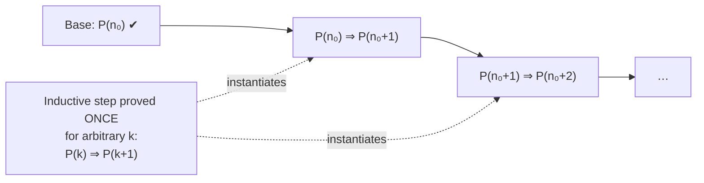

# DM-09 Mathematical Induction

> [!info] Topic card
> **Unit:** U2 Proof · **Time:** 5 h · **Use the rubric** in [[DM-05 Direct Proof, Contrapositive and Contradiction]] §12 to self-mark · **CS link:** [[PY-07 Recursion]] (recursive correctness = induction)

## 1. Learning objectives
1. **State** the principle of mathematical induction, and **explain** why it's valid.
2. **Write** complete induction proofs (base case, inductive hypothesis, inductive step, conclusion) for summation formulas, inequalities and divisibility.
3. **Use** strong induction when the step needs more than the previous case.
4. **Detect** flawed induction arguments (a missing or wrong base case, a step that fails for small k).
5. **Apply** induction to prove the correctness of recursive algorithms and loop invariants.

## 2. Why it matters
Infinitely many cases can't be checked by computer or by hand. Induction proves a statement for **all** natural numbers with a finite argument. It's the formal basis of recursion, loop invariants ([[PY-05 Loops and Iteration]] §5.6) and the recurrence solutions in [[DM-14 Recurrence Relations]].

## 3. Prerequisites
[[DM-05 Direct Proof, Contrapositive and Contradiction]] (proof writing), [[DM-08 Sequences and Summations]] (Σ manipulation).

## 4. Intuition
**Dominoes.** If (1) the first domino falls (**base case**), and (2) whenever any domino falls, the next one falls too (**inductive step**), then **all** the dominoes fall. You never push each one individually. The step is a *conditional* promise: "if domino k falls, then domino k+1 falls". You don't assume all of them fall. That would be circular.

## 5. Rigorous explanation

### 5.1 The principle (weak induction)
Let $P(n)$ be a statement about integers $n \ge n_0$. If
1. **Base case:** $P(n_0)$ is true, and
2. **Inductive step:** for every $k \ge n_0$, $P(k) \to P(k+1)$,

then $P(n)$ is true for all $n \ge n_0$.
In logic: $\big[P(n_0) \land \forall k \ge n_0\,(P(k)\to P(k+1))\big] \to \forall n \ge n_0\, P(n)$.

**Why it's valid (via the well-ordering principle, which says every non-empty set of natural numbers has a least element).** Suppose the conditions hold but some $P(n)$ is false. Let $m$ be the **least** $n \ge n_0$ with $P(n)$ false. Then $m \ne n_0$ (the base case holds), so $m - 1 \ge n_0$ and $P(m-1)$ is true (because $m$ is the least counterexample). The step gives $P(m)$, a contradiction. ∎

### 5.2 Template (write it exactly like this in exams)
> **Claim.** For all integers $n \ge n_0$, $P(n)$.
> **Base case** ($n = n_0$): *[verify both sides]*.
> **Inductive hypothesis (IH):** assume $P(k)$ holds for some arbitrary $k \ge n_0$.
> **Inductive step:** we show $P(k+1)$. *[Start from one side of $P(k+1)$, use the IH explicitly, and reach the other side.]*
> **Conclusion:** by the principle of mathematical induction, $P(n)$ holds for all $n \ge n_0$. ∎

### 5.3 Strong induction
The step may assume **all** of $P(n_0), \dots, P(k)$ in order to prove $P(k+1)$. You may need **several base cases** if the step reaches back more than one step. Strong and weak induction are equally powerful (each can simulate the other). Strong induction is just more convenient when $P(k+1)$ depends on cases further back, e.g. Fibonacci, or factorisation into primes.

### 5.4 Structural induction (preview)
For recursively defined structures (lists, trees, formulas): prove the property for the base objects, then show that every construction rule preserves it. This was used in [[DM-02 Logical Equivalence and Laws of Logic]] practice 9, and it's how you prove things about trees ([[DM-16 Trees and Spanning Trees]]).

## 6. Terminology
| Term | Meaning |
|---|---|
| Base case | The first value(s) checked directly |
| Inductive hypothesis (IH) | The assumption P(k) (or P(n₀..k) for strong induction) |
| Inductive step | The proof that P(k) ⇒ P(k+1) |
| Well-ordering principle | Every non-empty subset of ℕ has a least element |
| Strong induction | The IH covers all previous cases |
| Structural induction | Induction over recursively defined objects |

## 7. Step-by-step: $\sum_{i=1}^{n} i = \frac{n(n+1)}{2}$ for all $n \ge 1$
**Base case** $n = 1$: LHS = 1, RHS = $\frac{1\cdot2}{2} = 1$ ✔.
**IH:** assume $\sum_{i=1}^{k} i = \frac{k(k+1)}{2}$ for some $k \ge 1$.
**Step:** we show that $\sum_{i=1}^{k+1} i = \frac{(k+1)(k+2)}{2}$.
$$\sum_{i=1}^{k+1} i = \underbrace{\sum_{i=1}^{k} i}_{\text{use IH}} + (k+1) = \frac{k(k+1)}{2} + (k+1) = \frac{k(k+1) + 2(k+1)}{2} = \frac{(k+1)(k+2)}{2}.$$
**Conclusion:** by induction, the formula holds for all $n\ge1$. ∎
*Key move:* **split off the last term** so that the IH can be applied to the rest.

## 8. Diagram: anatomy of an induction proof

*Text version: you prove the base case once, and the step once for an arbitrary k. The step then applies to every successive pair, so the truth propagates up the whole chain.*

## 9. Worked examples

### Example 1 (basic): geometric sum
**Claim:** $\sum_{i=0}^{n} 2^i = 2^{n+1} - 1$ for $n \ge 0$.
Base $n=0$: $2^0 = 1 = 2^1 - 1$ ✔. IH: $\sum_{i=0}^{k} 2^i = 2^{k+1}-1$.
Step: $\sum_{i=0}^{k+1} 2^i = (2^{k+1} - 1) + 2^{k+1} = 2\cdot2^{k+1} - 1 = 2^{k+2} - 1$ ✔. ∎

### Example 2 (intermediate): divisibility
**Claim:** $3 \mid (n^3 + 2n)$ for all $n \ge 0$.
Base $n=0$: $0 = 3\cdot0$ ✔. IH: $k^3 + 2k = 3m$ for some integer $m$.
Step: $(k+1)^3 + 2(k+1) = k^3 + 3k^2 + 3k + 1 + 2k + 2 = (k^3 + 2k) + 3k^2 + 3k + 3 = 3m + 3(k^2 + k + 1) = 3(m + k^2 + k + 1)$, which is divisible by 3 ✔. ∎
*Strategy for divisibility:* expand $P(k+1)$, **find the IH expression inside it**, and show that the remainder is a multiple of the divisor.

### Example 3 (challenging): an inequality with a later base case
**Claim:** $2^n > n^2$ for all $n \ge 5$.
Base $n=5$: $32 > 25$ ✔. (For $n = 2, 3, 4$ it's false: $4 > 4$? No. So the base case must be 5.)
IH: $2^k > k^2$ for some $k \ge 5$.
Step: $2^{k+1} = 2\cdot2^k > 2k^2$ (IH). We need $2k^2 \ge (k+1)^2 = k^2 + 2k + 1$, i.e. $k^2 - 2k - 1 \ge 0$, i.e. $(k-1)^2 \ge 2$, which is true for $k \ge 3$ (in particular for $k\ge5$). So $2^{k+1} > 2k^2 \ge (k+1)^2$ ✔. ∎
*Inequality strategy:* use the IH, then prove an auxiliary inequality valid for all $k$ in the range.

### Example 4 (strong induction): postage
**Claim:** every amount $n \ge 12$ can be made from 4-unit and 5-unit stamps.
Base cases: $12 = 4+4+4$, $13 = 4+4+5$, $14 = 4+5+5$, $15 = 5+5+5$ ✔.
Strong IH: every amount from 12 to $k$ can be made, for some $k \ge 15$.
Step: $k+1 - 4 = k - 3 \ge 12$, so $k-3$ can be made (IH). Add one 4-stamp to get $k+1$ ✔. ∎
(Four base cases are needed because the step reaches back 4.)

### Example 5 (strong induction): prime factorisation exists
**Claim:** every integer $n \ge 2$ is a product of primes.
Base $n = 2$: prime ✔. Strong IH: every integer $2 \le m \le k$ is a product of primes.
Step: if $k+1$ is prime, we're done. Otherwise $k+1 = ab$ with $2 \le a, b \le k$. By the IH, $a$ and $b$ are products of primes, so $ab$ is too ✔. ∎

### Example 6 (flawed proof): "all horses are the same colour"
"Claim: any set of $n$ horses is all one colour. Base $n=1$ ✔. Step: given $k+1$ horses, remove horse A. The remaining $k$ are one colour (IH). Remove horse B instead, and the remaining $k$ are one colour. The two groups overlap, so all $k+1$ are one colour."
**The flaw:** for $k = 1$ (going from 1 to 2 horses), removing A leaves {B} and removing B leaves {A}. The groups **don't overlap**, so the step fails at $k = 1 \to 2$. The step must work for **every** $k \ge n_0$.

## 10. Application: proving a recursive function correct
```python
def power(x, n):          # n >= 0
    if n == 0:
        return 1
    return x * power(x, n - 1)
```
**Claim:** `power(x, n)` returns $x^n$ for all $n \ge 0$. Base: `power(x, 0)` returns $1 = x^0$ ✔. IH: `power(x, k)` returns $x^k$. Step: `power(x, k+1)` returns `x * power(x, k)` = $x\cdot x^k = x^{k+1}$ ✔. ∎ This is exactly the "leap of faith" in [[PY-07 Recursion]], made rigorous.

## 11. Common mistakes
| Mistake | Fix |
|---|---|
| Omitting the base case | The step alone proves nothing (e.g. "n = n + 1" would "follow" from itself) |
| Assuming P(k+1) in the step | Start from P(k+1)'s expression and *derive* it |
| Not using the IH | If the IH isn't used, it's not an induction proof (or the step is wrong) |
| Wrong base value | Check the smallest n where the claim is meant to hold (Example 3) |
| Step fails for small k | Test the step's logic at k = n₀ (Example 6) |
| Too few base cases in strong induction | One per "look-back" distance |
| Writing "assume true for all n" | That's the conclusion. Assume it for **some** k. |

## 12. Comparison
| Technique | Assumes | Use when |
|---|---|---|
| Weak induction | P(k) | P(k+1) depends on P(k) alone |
| Strong induction | P(n₀), …, P(k) | It depends on earlier cases (factorisation, Fibonacci) |
| Structural induction | Property for the sub-structures | Trees, lists, formulas |
| Loop invariant | Holds before each iteration | Iterative code (the same logic) |

## 13. Practice
**L1** 1. What are the two parts of an induction proof? 2. Why does Example 3 start at n = 5?

**L2** 3. Prove $\sum_{i=1}^{n}(2i - 1) = n^2$. 4. Prove $\sum_{i=1}^{n} i^2 = \frac{n(n+1)(2n+1)}{6}$.

**L3** 5. Prove $6 \mid (n^3 - n)$ for all $n \ge 0$. 6. Prove $n! > 2^n$ for all $n \ge 4$.

**L4** 7. Fibonacci: $F_0 = 0$, $F_1 = 1$, $F_{n} = F_{n-1} + F_{n-2}$. Prove by strong induction that $F_n < 2^n$ for all $n \ge 0$. 8. Prove $\sum_{i=0}^{n} F_i = F_{n+2} - 1$.

**L5** 9. Prove by induction on the number of discs that the recursive Towers of Hanoi algorithm ([[PY-07 Recursion]]) makes exactly $2^n - 1$ moves, **and** that no smaller number of moves is possible. *(Hint for the lower bound: the largest disc must move at least once, and before its first move all the other discs must be on the third peg.)*

## 14. Hints
> [!tip]- Hints
> 3: add $(2(k+1) - 1) = 2k+1$ to $k^2$. 5: $(k+1)^3 - (k+1) = (k^3 - k) + 3k(k+1)$, and $k(k+1)$ is even. 6: $(k+1)! = (k+1)k! > (k+1)2^k \ge 2\cdot2^k$. 7: two base cases, n = 0 and 1. 9: lower bound $L(n) \ge 2L(n-1) + 1$.

## 15. Worked solutions
> [!success]- Solutions 1–2
> 1. The base case and the inductive step (then the conclusion). 2. The inequality is false for n = 2, 3, 4 (and true for n = 0, 1 but the step fails from there), so the chain must start at the first n where both the claim and the step's auxiliary inequality hold.

> [!success]- Solution 3
> Base $n=1$: $1 = 1^2$ ✔. IH: $\sum_{i=1}^{k}(2i-1) = k^2$. Step: $\sum_{i=1}^{k+1}(2i-1) = k^2 + 2k + 1 = (k+1)^2$ ✔. ∎

> [!success]- Solution 4
> Base $n=1$: $1 = \frac{1\cdot2\cdot3}{6}$ ✔. Step: $\frac{k(k+1)(2k+1)}{6} + (k+1)^2 = \frac{(k+1)[k(2k+1) + 6(k+1)]}{6} = \frac{(k+1)(2k^2+7k+6)}{6} = \frac{(k+1)(k+2)(2k+3)}{6}$, which is the formula with n = k+1 ✔. ∎

> [!success]- Solution 5
> Base $n=0$: $0$ ✔. IH: $k^3 - k = 6m$. Step: $(k+1)^3 - (k+1) = k^3 + 3k^2 + 3k + 1 - k - 1 = (k^3 - k) + 3k(k+1) = 6m + 3k(k+1)$. Since $k(k+1)$ is a product of consecutive integers, it's even, say $2t$, so $3k(k+1) = 6t$, and the total is $6(m + t)$ ✔. ∎

> [!success]- Solution 6
> Base $n=4$: $24 > 16$ ✔. IH: $k! > 2^k$ for some $k\ge4$. Step: $(k+1)! = (k+1)\cdot k! > (k+1)2^k \ge 2\cdot2^k = 2^{k+1}$ (since $k+1 \ge 5 > 2$) ✔. ∎

> [!success]- Solution 7
> Bases: $F_0 = 0 < 1$ and $F_1 = 1 < 2$ ✔. Strong IH: $F_j < 2^j$ for all $0 \le j \le k$ (with $k\ge1$). Step: $F_{k+1} = F_k + F_{k-1} < 2^k + 2^{k-1} < 2^k + 2^k = 2^{k+1}$ ✔. ∎

> [!success]- Solution 8
> Base $n=0$: $F_0 = 0 = F_2 - 1 = 1 - 1$ ✔. Step: $\sum_{i=0}^{k+1}F_i = (F_{k+2} - 1) + F_{k+1} = F_{k+3} - 1$ ✔ (by the Fibonacci rule). ∎

> [!success]- Solution 9
> **Upper bound (the algorithm's count).** Let $M(n)$ be the number of moves the algorithm makes. $M(0) = 0$ and $M(n) = 2M(n-1) + 1$. Claim $M(n) = 2^n - 1$. Base: $M(0) = 0 = 2^0 - 1$ ✔. Step: $M(k+1) = 2(2^k - 1) + 1 = 2^{k+1} - 1$ ✔.
> **Lower bound (optimality).** Let $L(n)$ be the minimum possible number of moves. Claim $L(n) \ge 2^n - 1$. Base $L(0) = 0$ ✔. Step: in any solution for $k+1$ discs, the largest disc must move at least once. Just before its first move, the other $k$ discs must all sit on the third peg (no smaller disc can be on the source peg or the target peg), which takes at least $L(k)$ moves. After its last move, the $k$ discs must be moved onto it, which takes at least $L(k)$ more. So $L(k+1) \ge 2L(k) + 1 \ge 2(2^k-1)+1 = 2^{k+1} - 1$ ✔.
> Together: the algorithm is **optimal**, with exactly $2^n - 1$ moves. ∎

## 16. Self-test (pass ≥ 4/5)
1. Write the logical form of the principle. 2. What's wrong with "Assume P(n) for all n"? 3. How many base cases does a step using P(k) and P(k−1) need? 4. What makes the horse proof fail? 5. Which ℕ property justifies induction?
> [!success]- Answers
> 1. $[P(n_0)\land\forall k\ge n_0(P(k)\to P(k+1))]\to\forall n\ge n_0 P(n)$. 2. It assumes the conclusion. Assume P(k) for an arbitrary but fixed k. 3. Two. 4. The step fails from k = 1 to k = 2 (the groups don't overlap). 5. Well-ordering.

## 17. Flashcards
#flashcards/discrete-math
Two parts of an induction proof?::Base case P(n₀) and inductive step P(k) ⇒ P(k+1) for arbitrary k ≥ n₀.
Key move in summation induction proofs?::Split off the last term so the inductive hypothesis applies to the rest.
When use strong induction?::When P(k+1) depends on cases earlier than P(k) (e.g. factorisation, Fibonacci).
Why is induction valid?::Well-ordering: a least counterexample would contradict the base case or the step.
Flaw in "all horses same colour"?::The inductive step fails going from 1 to 2 horses (no overlap).
Induction vs recursion?::A recursive function's correctness proof is an induction on the input size.

## 18. Blank-page recall
Write the template (§5.2) and prove $\sum_{i=0}^{n}2^i = 2^{n+1}-1$ from memory, then mark it with the rubric.

## 19. Revision summary
- Base case + inductive step (for an **arbitrary** k), then conclude.
- Split off the last term and use the IH explicitly.
- Strong induction assumes all previous cases. Use enough base cases.
- Check that the step works from the base value onwards (the horses).
- Induction is the mathematics behind recursion and loop invariants.

## 20. Links
Prev: [[DM-08 Sequences and Summations]] · Next: [[DM-10 Relations, Equivalence Relations and Partial Orders]] · Uses: [[DM-13 Binomial Theorem and Pascal's Triangle]], [[DM-14 Recurrence Relations]], [[DM-16 Trees and Spanning Trees]] · Code: [[PY-07 Recursion]]

## 21. Sources
- Rosen (2019), §5.1–5.3 (induction, strong induction, structural induction).
- Levin, *Discrete Mathematics: An Open Introduction*, §2.5 (induction): https://discrete.openmathbooks.org/
- Pólya, G., *Induction and Analogy in Mathematics*, Princeton University Press, 1954 (the horse paradox is classical folklore and is widely attributed to Pólya).

## 22. Mastery checklist
- [ ] Practice 3–6 proved, each ≥ 8/10 on the rubric
- [ ] I can explain exactly where a flawed induction fails
- [ ] Hanoi optimality (practice 9) understood · reviews scheduled
