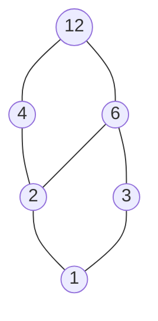
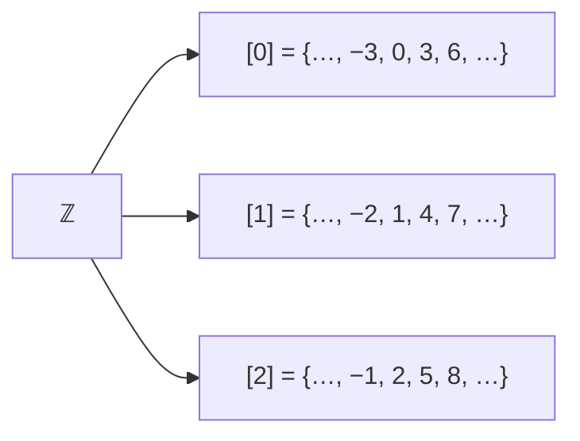

# DM-10 Relations, Equivalence Relations and Partial Orders

> [!info] Topic card
> **Unit:** U3 · **Time:** 5 h · **Verify with:** `is_reflexive`, `is_symmetric`, `is_antisymmetric`, `is_transitive`, `equivalence_classes` in [[DM Python Toolkit]]

## 1. Learning objectives
1. **Define** a binary relation on a set, and **represent** it as a set of pairs, a 0–1 matrix and a directed graph.
2. **Test and prove** reflexivity, symmetry, antisymmetry and transitivity, with counterexamples when a property fails.
3. **Identify** equivalence relations, **compute** equivalence classes, and **relate** them to partitions (including congruence mod n).
4. **Identify** partial orders, **draw** Hasse diagrams, and **find** minimal/maximal elements and a topological order.
5. **Compute** reflexive, symmetric and transitive closures, and **connect** relations to databases and dependency graphs.

## 2. Why it matters
Relations are everywhere in computing. Database tables *are* relations (that's where the name "relational database" comes from). "Same department", "same hash bucket" and "congruent mod 12" are **equivalence relations** that group data. "Prerequisite of", "depends on" and "is a subset of" are **partial orders** that schedule work: course plans ([[DM 01 Curriculum Map]]), build systems and project networks ([[PM-05 Activity Sequencing, Network Diagrams and Gantt Charts]]).

## 3. Prerequisites
[[DM-06 Sets, Set Operations, Power Sets and Cartesian Products]] (Cartesian products, partitions), [[DM-07 Functions]] (a function is a special relation).

## 4. Intuition
A relation is a **who-is-connected-to-whom list**. "Is a classmate of", "is less than" and "divides" each say which pairs belong together. The properties ask simple questions:
- **Reflexive:** is everyone related to themselves?
- **Symmetric:** whenever a is related to b, is b related to a?
- **Antisymmetric:** do two *different* things never relate both ways?
- **Transitive:** if a relates to b and b relates to c, does a relate to c?

## 5. Rigorous explanation

### 5.1 Definitions and representations
A **binary relation** $R$ from $A$ to $B$ is a subset $R\subseteq A\times B$. We write $aRb$ for $(a,b)\in R$. A relation **on** $A$ is a subset of $A\times A$. There are $2^{|A|^2}$ relations on $A$ (subsets of $A\times A$, by [[DM-06 Sets, Set Operations, Power Sets and Cartesian Products]]).
Representations of $R = \{(1,1),(1,2),(2,3)\}$ on $\{1,2,3\}$:
- **Matrix** $M_R$ (row a, column b, 1 if aRb): rows `[1 1 0]`, `[0 0 1]`, `[0 0 0]`.
- **Digraph:** vertices 1, 2, 3, with arrows 1→1 (a loop), 1→2 and 2→3.

### 5.2 Properties of a relation R on A
| Property | Definition | Matrix view | Digraph view |
|---|---|---|---|
| Reflexive | $\forall a\; aRa$ | all diagonal entries 1 | a loop at every vertex |
| Irreflexive | $\forall a\; \lnot aRa$ | diagonal all 0 | no loops |
| Symmetric | $\forall a,b\; aRb \to bRa$ | $M = M^T$ | every arrow has a reverse arrow |
| Antisymmetric | $\forall a,b\; (aRb \land bRa)\to a=b$ | no 1s mirrored across the diagonal (off-diagonal) | no pair of opposite arrows between distinct vertices |
| Transitive | $\forall a,b,c\; (aRb\land bRc)\to aRc$ | $M^2 \le M$ (Boolean product) | every two-step path has a direct shortcut |
Symmetric and antisymmetric are **not** opposites: "=" is both, and some relations are neither.

### 5.3 Equivalence relations
$R$ is an **equivalence relation** iff it is reflexive, symmetric and transitive. The **equivalence class** of $a$ is $[a] = \{x \in A \mid xRa\}$.
**Theorem.** The equivalence classes of $R$ form a **partition** of $A$ (they're non-empty, pairwise disjoint, and their union is $A$). Conversely, every partition defines an equivalence relation ("same block").
**Congruence mod n:** $a \equiv b \pmod n$ iff $n \mid (a-b)$. It's an equivalence relation on ℤ with exactly $n$ classes $[0], [1], \dots, [n-1]$. These are the residues, the arithmetic of clocks, hashing and cryptography ([[CS-07 Public-Key Cryptography, Signatures and Key Management]]).

### 5.4 Partial orders
$R$ is a **partial order** iff it is reflexive, **antisymmetric** and transitive. $(A, R)$ is a **poset**, and we write $a \preceq b$.
- **Comparable:** $a\preceq b$ or $b\preceq a$. A **total (linear) order** has every pair comparable.
- **Hasse diagram:** draw $a$ below $b$ with a line if $a \prec b$ and nothing lies strictly in between (a *cover*). Omit loops, and omit the edges implied by transitivity.
- **Minimal/maximal elements:** nothing is strictly below/above them. **Least/greatest:** below/above *everything* (unique if it exists).
- **Topological sort:** a total order compatible with the partial order. It exists for every finite poset, and it's how you order tasks so that prerequisites come first.

### 5.5 Closures
The **closure** of $R$ with respect to a property is the smallest relation containing $R$ that has the property.
- Reflexive closure: $R \cup \{(a,a)\mid a\in A\}$.
- Symmetric closure: $R \cup R^{-1}$, where $R^{-1} = \{(b,a)\mid (a,b)\in R\}$.
- Transitive closure $R^+$: add pairs $(a,c)$ whenever there's a path from a to c. Compute it with **Warshall's algorithm**, $O(n^3)$.

### 5.6 n-ary relations and databases
An n-ary relation is a subset of $A_1\times\dots\times A_n$. The table `students(student_id, name, programme)` is a 3-ary relation. A primary key is a set of attributes on which the relation is a **function** (it determines the row uniquely, [[DM-07 Functions]]).

## 6. Terminology
| Term | Meaning |
|---|---|
| Relation on A | Subset of A × A |
| Inverse relation $R^{-1}$ | The pairs reversed |
| Equivalence relation / class | Reflexive + symmetric + transitive / set of elements related to a |
| Partition | Disjoint non-empty blocks covering A |
| Partial order / poset | Reflexive + antisymmetric + transitive / set with such an order |
| Hasse diagram | Picture of a poset showing only covering relations, drawn upward |
| Topological sort | A linear order extending a partial order |
| Transitive closure | All pairs connected by a path |

## 7. Step-by-step: checking the properties of a relation
$A = \{1,2,3\}$, $R = \{(1,1),(2,2),(3,3),(1,2),(2,1),(2,3)\}$.
1. **Reflexive?** (1,1), (2,2), (3,3) are all present ✔.
2. **Symmetric?** (2,3) ∈ R but (3,2) ∉ R ✘. That's the counterexample.
3. **Antisymmetric?** (1,2) and (2,1) are both present with 1 ≠ 2 ✘.
4. **Transitive?** (1,2) and (2,3) are present but (1,3) is not ✘.
So it's reflexive only: neither an equivalence relation nor a partial order.

## 8. Diagrams

### 8.1 Hasse diagram of divisibility on {1, 2, 3, 4, 6, 12}

*Text version (bottom to top): 1 is below 2 and 3. 2 is below 4 and 6, and 3 is below 6. Both 4 and 6 are below 12. The edge 1–12 is omitted because it's implied by transitivity. 1 is the least element and 12 the greatest. 4 and 6 are incomparable, so the order is partial, not total.*

### 8.2 Equivalence classes mod 3 partition ℤ


## 9. Worked examples

### Example 1 (basic): which relations on ℤ are equivalence relations?
| Relation | Refl | Sym | Trans | Equivalence? |
|---|---|---|---|---|
| $a = b$ | ✔ | ✔ | ✔ | Yes (the classes are singletons) |
| $a \le b$ | ✔ | ✘ (1 ≤ 2, not 2 ≤ 1) | ✔ | No (it's a partial order, even a total one) |
| $a \equiv b \pmod 4$ | ✔ | ✔ | ✔ | Yes (4 classes) |
| $\lvert a - b\rvert \le 1$ | ✔ | ✔ | ✘ (0~1, 1~2, but 0≁2) | No ("close to" isn't transitive!) |

### Example 2 (intermediate): prove that congruence mod n is an equivalence relation
**Reflexive:** $a - a = 0 = n\cdot0$, so $n \mid (a-a)$ ✔.
**Symmetric:** if $n \mid (a-b)$, then $a - b = nk$, so $b - a = n(-k)$, and $n \mid (b-a)$ ✔.
**Transitive:** if $a - b = nk$ and $b - c = nl$, then $a - c = (a-b) + (b-c) = n(k+l)$ ✔. ∎

### Example 3 (challenging): transitive closure of course prerequisites
Direct prerequisites: PY-05 → PY-06, PY-06 → PY-10, PY-10 → PY-11, PY-06 → PY-13 (a → b means "a is needed for b").
Transitive closure: add PY-05 → PY-10, PY-05 → PY-11, PY-05 → PY-13, PY-06 → PY-11. "Everything you must have done before PY-11" = all x with x → PY-11 in the closure = {PY-05, PY-06, PY-10}. A **topological order**: PY-05, PY-06, PY-10, PY-13, PY-11 (PY-13 may also go anywhere after PY-06). This is the computation behind [[PY 01 Curriculum Map]], and behind CPM scheduling ([[PM-06 Critical Path Method and Float]]).

### Example 4 (counting): how many relations on a 3-element set are reflexive?
The 3 diagonal pairs are forced in, and the other $9 - 3 = 6$ pairs are free: $2^6 = 64$ (out of $2^9 = 512$ relations in total). In general, there are $2^{n^2 - n}$ reflexive relations.

## 10. Application: grouping and ordering data
- **Grouping** (`GROUP BY department`, or `defaultdict(list)` in [[PY-11 Dictionaries, Sets and Comprehensions]]) partitions rows by the equivalence relation "same department".
- **Hash tables** partition keys by "same bucket" ($h(a) = h(b)$), an equivalence relation induced by a function. *Every function induces an equivalence relation on its domain*: $a \sim b \iff f(a) = f(b)$.
- **Build systems and installers** compute a topological order of the dependency poset, and refuse cyclic dependencies (a cycle violates antisymmetry). That's `has_cycle` in [[PY-21 Data Structures and Algorithm Design]].

## 11. Common mistakes
| Mistake | Fix |
|---|---|
| Thinking symmetric and antisymmetric are opposites | They're independent properties ("=" has both) |
| Checking transitivity only on "obvious" triples | Check every pair (a,b),(b,c), or find one counterexample |
| Reflexive "because some (a,a) are present" | It needs **every** a in A |
| Drawing transitive edges in a Hasse diagram | Draw cover relations only |
| Confusing minimal with least | Least is below everything (unique). Minimal: nothing is below it (there can be several). |
| "Close to" treated as an equivalence | Not transitive |

## 12. Comparison
| | Equivalence relation | Partial order | Function |
|---|---|---|---|
| Properties | Refl, Sym, Trans | Refl, Antisym, Trans | Each a has exactly one b |
| Captures | "Same kind" | "Comes before / is contained in" | "Is mapped to" |
| Structure | Partition into classes | Hasse diagram | Arrow diagram |
| CS example | Same hash bucket | Task dependencies | Lookup table |

## 13. Practice
**L1** 1. Define reflexive, symmetric, antisymmetric and transitive. 2. Give the matrix of $R = \{(1,2),(2,1),(1,1)\}$ on $\{1,2,3\}$.

**L2** 3. For each relation on {1, 2, 3, 4}, list its properties: (a) $\{(a,b)\mid a < b\}$ (b) $\{(a,b)\mid a+b \text{ even}\}$ (c) $\{(1,1),(2,2),(3,3),(4,4)\}$. 4. List the equivalence classes of "has the same remainder mod 3" on {0, …, 10}.

**L3** 5. Draw the Hasse diagram of $(\mathcal{P}(\{a,b,c\}), \subseteq)$, and identify the least and greatest elements. 6. Prove that $R$ on ℤ defined by $aRb \iff a - b$ is even is an equivalence relation, and describe its classes.

**L4** 7. Is $aRb \iff a \mid b$ a partial order on ℤ (including negatives)? On ℤ⁺? Justify. 8. Compute the transitive closure of $\{(1,2),(2,3),(3,4),(4,2)\}$ on {1, 2, 3, 4}. Does the closure contain a pair (a, a)? What does that tell you about cycles?

**L5** 9. A university records "module X must be taken before module Y". (a) Which properties must this relation (after reflexive and transitive closure) have for a valid study plan to exist? (b) Design an algorithm that either outputs a valid semester-by-semester plan (at most k modules per semester) or reports a cycle. (c) Explain the connection to [[PM-05 Activity Sequencing, Network Diagrams and Gantt Charts]].

## 14. Hints
> [!tip]- Hints
> 3(b): a + b is even iff a and b have the same parity. 5: a cube shape, with 8 elements. 7: on ℤ, consider 2 | −2 and −2 | 2. 8: the cycle 2 → 3 → 4 → 2. 9: antisymmetry, i.e. no cycles. Use layered topological sorting (Kahn's algorithm).

## 15. Worked solutions
> [!success]- Solutions 1–2
> 1. See §5.2. 2. Rows: [1 1 0], [1 0 0], [0 0 0].

> [!success]- Solution 3
> (a) Irreflexive, antisymmetric (vacuously: never both a < b and b < a) and transitive. Not reflexive, not symmetric. It's a *strict* order.
> (b) Reflexive (a + a is even), symmetric, transitive (same parity): an **equivalence relation** with the classes {1, 3} and {2, 4}.
> (c) The identity relation: reflexive, symmetric, antisymmetric and transitive. It's both an equivalence relation and a partial order.

> [!success]- Solution 4
> [0] = {0, 3, 6, 9}, [1] = {1, 4, 7, 10}, [2] = {2, 5, 8}.

> [!success]- Solution 5
> Levels from bottom to top: ∅; {a}, {b}, {c}; {a,b}, {a,c}, {b,c}; {a,b,c}. Each set is joined to the sets one element larger that contain it (12 edges, the shape of a cube). Least: ∅. Greatest: {a,b,c}.
> ```mermaid
> graph BT
>     E["∅"] --- A["{a}"]
>     E --- B["{b}"]
>     E --- C["{c}"]
>     A --- AB["{a,b}"]
>     A --- AC["{a,c}"]
>     B --- AB
>     B --- BC["{b,c}"]
>     C --- AC
>     C --- BC
>     AB --- ABC["{a,b,c}"]
>     AC --- ABC
>     BC --- ABC
> ```

> [!success]- Solution 6
> Reflexive: $a - a = 0$ is even. Symmetric: if $a - b = 2k$ then $b - a = 2(-k)$. Transitive: $(a-b) + (b-c) = a - c$, and a sum of evens is even. The classes are the evens and the odds (congruence mod 2). ∎

> [!success]- Solution 7
> On **ℤ⁺**: reflexive ($a\mid a$), antisymmetric (if $a \mid b$ and $b\mid a$ with positive $a, b$, then $a \le b \le a$, so $a = b$), transitive (DM-05 Example 1). **A partial order** ✔.
> On **ℤ**: antisymmetry fails, since $2 \mid -2$ and $-2 \mid 2$ but $2 \ne -2$. So it's not a partial order. (Also, $0 \mid b$ only holds for b = 0, which is fine with the convention $0 \mid 0$.)

> [!success]- Solution 8
> Paths: 1→2→3→4→2…, so 1 reaches 2, 3 and 4. And 2, 3, 4 each reach all of {2, 3, 4} (including themselves, around the cycle). Closure = {(1,2),(1,3),(1,4)} ∪ {(x,y) | x, y ∈ {2,3,4}}, which is 3 + 9 = 12 pairs. It contains (2,2), (3,3) and (4,4): **a pair (a, a) in the transitive closure of an irreflexive relation means a lies on a cycle.** That's a quick cycle test.

> [!success]- Solution 9
> (a) After closure it must be a **partial order**, i.e. antisymmetric, which means no cycles (the reflexive and transitive parts are added by the closure).
> (b) **Kahn's algorithm, layered:** compute each module's number of unmet prerequisites (its in-degree). Each semester, pick up to k modules with in-degree 0 (by some priority, e.g. the longest dependency chain first), "complete" them, and decrement their dependants' in-degrees. If modules remain but none has in-degree 0, there's a **cycle**: report the remaining modules. Complexity $O(V + E)$, plus the priority ordering.
> (c) It's the same structure as a project network: activities with precedence constraints. A semester capacity of k corresponds to **resource levelling** ([[PM-08 Resource Allocation and Levelling]]), and the longest prerequisite chain gives the minimum number of semesters, which is the critical path ([[PM-06 Critical Path Method and Float]]).

## 16. Self-test (pass ≥ 4/5)
1. The three properties of an equivalence relation? 2. Of a partial order? 3. How many classes does mod 5 have? 4. Is "is a friend of" transitive? 5. What does a Hasse diagram omit?
> [!success]- Answers
> 1. Reflexive, symmetric, transitive. 2. Reflexive, antisymmetric, transitive. 3. 5. 4. Not in general. 5. Loops and the edges implied by transitivity (it also leaves out the arrowheads, since it's drawn upward).

## 17. Flashcards
#flashcards/discrete-math
Equivalence relation?::Reflexive, symmetric and transitive.
Partial order?::Reflexive, antisymmetric and transitive.
Antisymmetric definition?::aRb and bRa imply a = b.
Equivalence classes form…?::A partition of the set.
a ≡ b (mod n) means?::n divides a − b.
How many relations on an n-element set?::2^(n²)
Transitive closure contains (a,a) for an irreflexive relation means?::a lies on a cycle.

## 18. Blank-page recall
Draw the property table (§5.2) with the matrix and digraph views, and the Hasse diagram of the divisors of 12.

## 19. Revision summary
- A relation is a set of pairs, shown as a matrix or a digraph.
- Equivalence (R, S, T) gives partitions into classes (mod n, same bucket, same group).
- Partial order (R, A, T) gives Hasse diagrams and topological sorts (dependencies, schedules).
- Closures add the missing pairs. A transitive closure with (a, a) reveals a cycle.

## 20. Links
Prev: [[DM-09 Mathematical Induction]] · Next: [[DM-11 Counting Principles, Permutations and Combinations]] · Graphs: [[DM-15 Graphs, Representations, Paths and Connectivity]] · Applied: [[PY-22 SQL and Database Integration]], [[PM-05 Activity Sequencing, Network Diagrams and Gantt Charts]], [[X-02 Graph Theory in Algorithms, Networks and Scheduling]]

## 21. Sources
- Rosen (2019), ch. 9 "Relations" (§9.1 properties, §9.4 closures and Warshall, §9.5 equivalence, §9.6 partial orderings).
- Codd, E. F., "A relational model of data for large shared data banks", *Communications of the ACM*, 13(6), 1970, pp. 377–387.
- Kahn, A. B., "Topological sorting of large networks", *Communications of the ACM*, 5(11), 1962, pp. 558–562.

## 22. Mastery checklist
- [ ] I can test all four properties and give counterexamples quickly
- [ ] Equivalence classes and Hasse diagrams drawn correctly
- [ ] Practice 9 algorithm written in pseudocode · reviews scheduled
