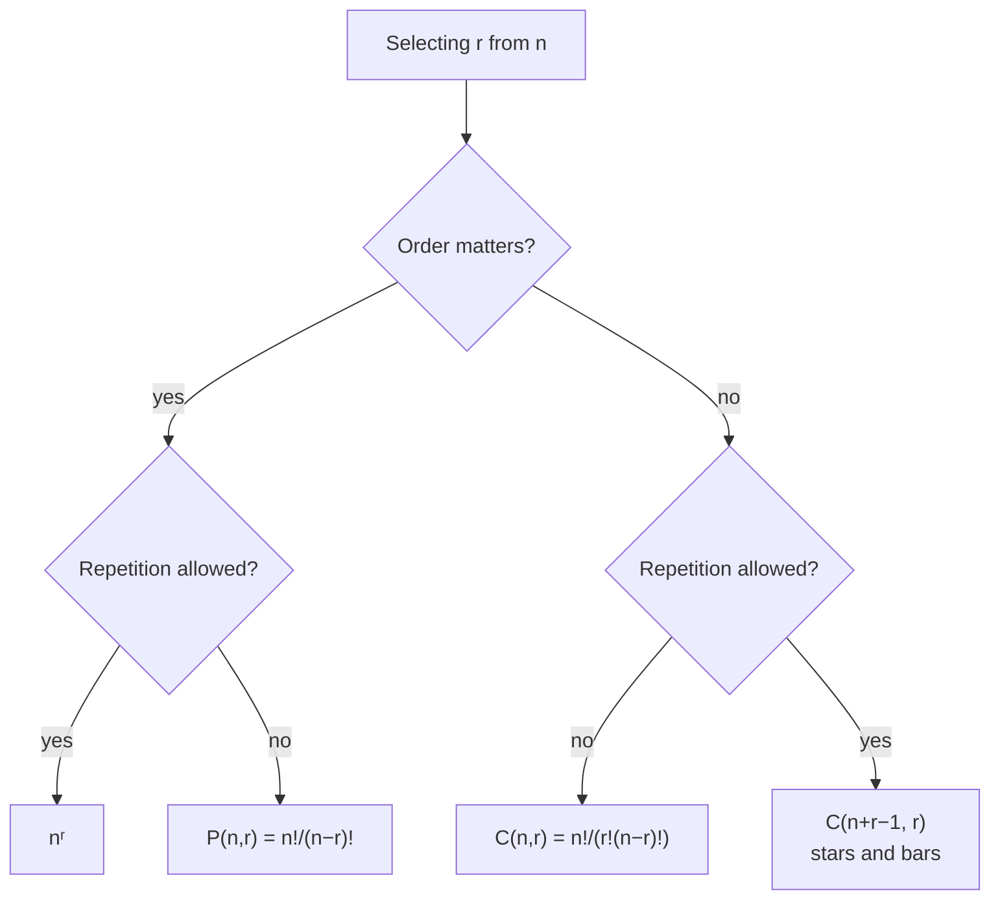

# DM-11 Counting Principles, Permutations and Combinations

> [!info] Topic card
> **Unit:** U4 Counting · **Time:** 5 h · **Verify with:** `perm`, `comb`, `multiset_perm`, `combinations_with_repetition` in [[DM Python Toolkit]] (or `itertools` to enumerate small cases)

## 1. Learning objectives
1. **Apply** the sum, product, subtraction (complement) and division rules, and **choose** between them using a tree or stage diagram.
2. **Count** permutations $P(n,r) = \frac{n!}{(n-r)!}$ and combinations $\binom{n}{r} = \frac{n!}{r!(n-r)!}$, and **decide** whether order matters.
3. **Count** arrangements with repetition, permutations of multisets, combinations with repetition (stars and bars), and circular arrangements.
4. **Solve** multi-step problems with restrictions ("at least one", "not adjacent", "must include").
5. **Apply** counting to password spaces and brute-force estimates.

## 2. Why it matters
Counting answers "how many?": how many passwords an attacker must try ([[CS-08 Password Storage and Authentication Security]]), how many test cases cover all combinations ([[SD-14 Software Testing, Verification and Validation]]), how many subsets a brute-force algorithm visits ([[PY-12 Searching, Sorting and Complexity]]), and how big an ID space must be ([[DM-07 Functions]]). It's also the basis of probability ([[DM-18 Introductory Discrete Probability]]).

## 3. Prerequisites
[[DM-06 Sets, Set Operations, Power Sets and Cartesian Products]] ($|A\times B|$, $|\mathcal{P}(A)|$). Factorials: $n! = n(n-1)\cdots1$, with $0! = 1$.

## 4. Intuition
- **Product rule:** a choice made in stages ("choose a shirt, then trousers") multiplies the options.
- **Sum rule:** a choice of *one* option from separate, non-overlapping groups ("lunch from the café or the canteen") adds the options.
- **Order matters?** Arranging people in a queue (order matters) is a *permutation*. Picking a committee (order doesn't matter) is a *combination*. A combination counts each group once instead of $r!$ times.

## 5. Rigorous explanation

### 5.1 Basic rules
| Rule | Statement | Set form |
|---|---|---|
| Product | A procedure with stages having $n_1, n_2, \dots, n_k$ options (the count at each stage doesn't depend on the earlier choices) has $n_1 n_2\cdots n_k$ outcomes | $\lvert A_1\times\dots\times A_k\rvert = \prod\lvert A_i\rvert$ |
| Sum | If the tasks are mutually exclusive: $n_1 + \dots + n_k$ ways | $\lvert A\cup B\rvert = \lvert A\rvert+\lvert B\rvert$ when disjoint |
| Subtraction (complement) | #(with property) = #(total) − #(without) | $\lvert A\rvert = \lvert U\rvert - \lvert\overline{A}\rvert$ |
| Division | If each outcome is counted exactly $d$ times: total ÷ $d$ | |

### 5.2 Permutations and combinations
| Situation | Order matters? | Repetition? | Count |
|---|---|---|---|
| Sequences of length r from n symbols | Yes | Yes | $n^r$ |
| r-permutations of n distinct objects | Yes | No | $P(n,r) = \dfrac{n!}{(n-r)!}$ |
| All arrangements of n distinct objects | Yes | No | $n!$ |
| r-combinations (subsets of size r) | No | No | $\dbinom{n}{r} = \dfrac{n!}{r!\,(n-r)!}$ |
| Multisets of size r from n kinds | No | Yes | $\dbinom{n+r-1}{r}$ (stars and bars) |
| Arrangements of a multiset ($n_1$ of type 1, …, $n_k$ of type k) | Yes | — | $\dfrac{n!}{n_1!\,n_2!\cdots n_k!}$ |
| Circular arrangements of n distinct objects | Up to rotation | No | $(n-1)!$ |

**Why $\binom{n}{r} = P(n,r)/r!$:** every r-subset can be ordered in $r!$ ways (the division rule). **Symmetry:** $\binom{n}{r} = \binom{n}{n-r}$ (choosing who's *in* is the same as choosing who's *out*).

### 5.3 Stars and bars
Distributing $r$ identical items into $n$ distinct boxes (equivalently, choosing a multiset of size $r$ from $n$ kinds): write the items as $r$ stars, separated into $n$ groups by $n-1$ bars. Every arrangement of $r$ stars and $n-1$ bars is one distribution, so there are $\binom{r+n-1}{n-1} = \binom{n+r-1}{r}$.
*Example:* the non-negative integer solutions of $x_1 + x_2 + x_3 = 5$ number $\binom{7}{2} = 21$.

## 6. Terminology
| Term | Meaning |
|---|---|
| Factorial $n!$ | $n(n-1)\cdots 1$, with $0! = 1$ |
| Permutation | Ordered arrangement |
| Combination | Unordered selection (a subset) |
| Multiset | A collection with repeats where order doesn't matter |
| "At least one" | Usually easiest by complement |
| Keyspace | Number of possible keys or passwords |

## 7. Step-by-step: the decision procedure
1. **What is one outcome?** Write one concrete example (e.g. "A-B-C" or {A, B, C}).
2. **Does order matter?** Swap two parts of the example. Is it a *different* outcome? If yes, order matters.
3. **Is repetition allowed?**
4. **Restrictions?** Handle them first (place restricted items first), or count the complement.
5. **Stages or cases?** Stages multiply. Disjoint cases add.
6. **Sanity-check** with a tiny version you can list by hand (or with `itertools`).

## 8. Diagram: choosing the formula

## 9. Worked examples

### Example 1 (basic): product and sum rules
(a) A class code is 3 uppercase letters followed by 5 digits (like CST06102): $26^3\cdot10^5 = 17\,576 \times 100\,000 = 1\,757\,600\,000$.
(b) A student chooses **one** elective from 4 IT electives or 3 business electives (no overlap): $4 + 3 = 7$.
(c) Bit strings of length 8 that start with 1 **or** end with 00. Start with 1: $2^7 = 128$. End with 00: $2^6 = 64$. Both: $2^5 = 32$. So $|A\cup B| = 128 + 64 - 32 = 160$. (They overlap, so the plain sum rule would overcount. This is inclusion–exclusion, [[DM-12 Pigeonhole Principle and Inclusion-Exclusion]].)

### Example 2 (intermediate): order matters or not?
From 10 students:
- Choose a chair, secretary and treasurer (distinct roles): $P(10,3) = 10\cdot9\cdot8 = 720$.
- Choose a 3-person committee: $\binom{10}{3} = 120 = 720/3!$ ✔.
- A committee of 3 that must include Amina: fix Amina, then choose 2 of the other 9: $\binom{9}{2} = 36$.
- A committee of 3 with **at least one** of the 4 women: total minus all-men $= \binom{10}{3} - \binom{6}{3} = 120 - 20 = 100$.

### Example 3 (challenging): arrangements with repeats and restrictions
(a) Distinct arrangements of the letters of **MISSISSIPPI** (M×1, I×4, S×4, P×2): $\frac{11!}{1!\,4!\,4!\,2!} = 34\,650$.
(b) Arrangements of **BANANA** in which the two N's are **not adjacent**. Total: $\frac{6!}{3!\,2!\,1!} = 60$. With the N's adjacent, glue them into one block "NN": arrange B, A, A, A, [NN] in $\frac{5!}{3!} = 20$ ways. Not adjacent: $60 - 20 = 40$.
(c) Seating 6 people at a round table: $(6-1)! = 120$. If two particular people must sit together: glue them (giving 5 units in a circle, $4! = 24$) × 2 internal orders = 48.

### Example 4 (CS): password keyspace and brute-force time
Passwords of exactly 8 characters from 94 printable ASCII symbols: $94^8 \approx 6.1\times10^{15}$. At a hypothetical $10^{10}$ guesses per second (a fast offline attack on an *unsalted fast hash*), that's about $6.1\times10^5$ s, roughly **7 days** to exhaust. A 12-character password: $94^{12} \approx 4.8\times10^{23}$, about $1.5$ million years at the same rate. **Length beats complexity:** each extra character multiplies the work by 94. *(The guessing rate is an illustrative assumption. Real rates depend on the hash: a slow KDF cuts them by orders of magnitude, which is the point of [[CS-08 Password Storage and Authentication Security]]. Human-chosen passwords are far from uniformly random, so dictionary attacks succeed much faster than brute force.)*

## 10. Application: combinatorial testing
A web form has 4 fields with 3, 4, 2 and 5 options: $3\cdot4\cdot2\cdot5 = 120$ combinations. Exhaustive testing needs 120 cases. **Pairwise testing** covers every pair of values of any two fields with far fewer cases (at least $4\cdot5 = 20$, the product of the two largest fields), because most defects involve just one or two factors ([[SD-14 Software Testing, Verification and Validation]]).

## 11. Common mistakes
| Mistake | Fix |
|---|---|
| Using permutations when order doesn't matter (or vice versa) | Swap test: does swapping produce a new outcome? |
| Adding overlapping cases | Use disjoint cases, or inclusion–exclusion |
| Multiplying dependent stages without care | Count the stages so that each count doesn't depend on the earlier *values* (choose the restricted positions first) |
| "At least one" counted directly with overcounting | Use the complement: total − none |
| Forgetting $0! = 1$ | $\binom{n}{0} = \binom{n}{n} = 1$ |
| Treating identical objects as distinct | Divide by the factorials of the repeats |

## 12. Comparison
| Problem | Formula | Example (n = 5, r = 3) |
|---|---|---|
| Ordered, with repetition | $n^r$ | 125 |
| Ordered, no repetition | $P(n,r)$ | 60 |
| Unordered, no repetition | $\binom{n}{r}$ | 10 |
| Unordered, with repetition | $\binom{n+r-1}{r}$ | 35 |

## 13. Practice
**L1** 1. Compute $5!$, $P(7,3)$, $\binom{8}{3}$ and $\binom{8}{5}$. 2. State the difference between a permutation and a combination in one sentence.

**L2** 3. How many 4-digit PINs are there? How many have no repeated digit? 4. How many ways can a 5-member project team be chosen from 12 students?

**L3** 5. A team of 5 is chosen from 7 programmers and 5 designers, with at least 2 designers. How many teams? 6. How many arrangements of the letters of SUCCESS are there? How many begin with S?

**L4** 7. How many non-negative integer solutions does $x_1 + x_2 + x_3 + x_4 = 10$ have? How many with every $x_i \ge 1$? 8. How many 8-bit strings contain exactly three 1s? At least three 1s?

**L5** 9. A hostel allocates 12 students to 4 rooms of 3 beds each (the rooms are distinct, the beds within a room are not). (a) Count the allocations. (b) Count them if two particular students must share a room. (c) A rule says no room may hold students from only one programme. With 6 CS and 6 IT students, explain how you'd count the valid allocations (set it up with complements), and verify the count by brute force in Python.

## 14. Hints
> [!tip]- Hints
> 5: the cases 2, 3, 4 and 5 designers, or the complement (0 or 1 designers). 6: S×3, C×2, U×1, E×1. Fixing the first S leaves S×2, C×2, U, E. 7: substitute $y_i = x_i - 1$. 9(a): $\binom{12}{3}\binom{9}{3}\binom{6}{3}\binom{3}{3}$. (b) Choose the room for the pair and their third roommate first.

## 15. Worked solutions
> [!success]- Solutions 1–2
> 1. 120, 210, 56, 56 (symmetry). 2. A permutation is an ordered arrangement, while a combination is an unordered selection.

> [!success]- Solutions 3–4
> 3. $10^4 = 10\,000$. No repeat: $10\cdot9\cdot8\cdot7 = 5\,040$. 4. $\binom{12}{5} = 792$.

> [!success]- Solution 5
> Complement: total $\binom{12}{5} = 792$, minus 0 designers $\binom{7}{5} = 21$, minus 1 designer $\binom{5}{1}\binom{7}{4} = 5\cdot35 = 175$, giving $792 - 21 - 175 = 596$.
> Direct check: 2 designers $\binom52\binom73 = 350$, 3 designers $\binom53\binom72 = 210$, 4 designers $\binom54\binom71 = 35$, 5 designers $\binom55 = 1$. Total 596 ✔.

> [!success]- Solution 6
> $\frac{7!}{3!\,2!} = \frac{5040}{12} = 420$. Starting with S: arrange the rest (S×2, C×2, U, E) in $\frac{6!}{2!\,2!} = 180$ ways.

> [!success]- Solution 7
> $\binom{10+4-1}{4-1} = \binom{13}{3} = 286$. With every $x_i\ge1$: $y_i = x_i - 1 \ge 0$ and $\sum y_i = 6$, so $\binom{9}{3} = 84$.

> [!success]- Solution 8
> Exactly three: $\binom{8}{3} = 56$. At least three: $2^8 - \binom80 - \binom81 - \binom82 = 256 - 1 - 8 - 28 = 219$.

> [!success]- Solution 9
> (a) $\binom{12}{3}\binom{9}{3}\binom{6}{3}\binom{3}{3} = 220\cdot84\cdot20\cdot1 = 369\,600$ (the rooms are distinct, so we don't divide by 4!).
> (b) Choose their room (4 ways) and their third roommate (10 ways), then allocate the remaining 9 students to the 3 other rooms: $\binom93\binom63\binom33 = 1680$. Total $4\cdot10\cdot1680 = 67\,200$. *Check:* the probability that they share is $67200/369600 = 2/11$, which matches the direct argument: student A's 2 roommates are among 11 others, so P(B is one of them) = 2/11 ✔.
> (c) **Set-up.** Each room must hold 1 or 2 CS students (0 or 3 would make it single-programme). Six CS students spread over 4 rooms, each getting 1 or 2, forces the CS counts to be a permutation of (2, 2, 1, 1). Choose which 2 rooms get 2 CS students: $\binom42 = 6$. Assign the CS students to those slots: $\frac{6!}{2!\,2!\,1!\,1!} = 180$. The IT students fill the remaining slots (1, 1, 2, 2): another $180$. **Valid allocations: $6\cdot180\cdot180 = 194\,400$**, which is $194400/369600 \approx 52.6\%$ of all allocations.
> A complement/inclusion–exclusion approach also works but is longer. **Verification:** a brute-force enumeration of all 369 600 allocations in `code/tests/test_dm_answers.py` gives 369 600 total, 194 400 valid, and 67 200 with the two given students together, confirming (a), (b) and (c). *(A draft of this solution stated a different figure, and the brute-force check caught the error. Always verify your counts on a computer when you can.)*

## 16. Self-test (pass ≥ 4/5)
1. $\binom{n}{r}$ formula? 2. Arrangements of the letters of LEVEL? 3. A 3-person committee from 8 people? 4. 5 people around a round table? 5. Non-negative solutions of $a + b + c = 4$?
> [!success]- Answers
> 1. $\frac{n!}{r!(n-r)!}$. 2. $\frac{5!}{2!\,2!} = 30$ (L×2, E×2, V). 3. 56. 4. $4! = 24$. 5. $\binom{6}{2} = 15$.

## 17. Flashcards
#flashcards/discrete-math
Product rule?::Stages with n₁, n₂, … options give n₁·n₂·… outcomes.
P(n, r)?::n!/(n−r)!, ordered selections without repetition.
C(n, r)?::n!/(r!(n−r)!), unordered selections (subsets).
Stars and bars count?::C(n+r−1, r) multisets of size r from n kinds.
Arrangements of a word with repeated letters?::n!/(n₁!·n₂!·…)
Circular arrangements of n distinct objects?::(n−1)!
Best method for "at least one"?::Complement: total minus "none".

## 18. Blank-page recall
Draw the formula decision tree (§8) and solve BANANA (not adjacent) and the committee "at least one woman" problems from memory.

## 19. Revision summary
- Stages multiply, disjoint cases add, complements subtract, and repeated counting divides.
- Order matters → permutations. It doesn't → combinations. Repetition allowed → $n^r$ or stars and bars.
- Handle restrictions first, or count the complement.
- Keyspaces grow exponentially with length, which is the security lesson.

## 20. Links
Prev: [[DM-10 Relations, Equivalence Relations and Partial Orders]] · Next: [[DM-12 Pigeonhole Principle and Inclusion-Exclusion]] · Related: [[DM-13 Binomial Theorem and Pascal's Triangle]], [[DM-18 Introductory Discrete Probability]], [[CS-08 Password Storage and Authentication Security]], [[LAB-CS-01 Password Strength and Secure Password Storage]]

## 21. Sources
- Rosen (2019), ch. 6 "Counting" (§6.1 basics, §6.3 permutations and combinations, §6.5 generalised permutations and combinations).
- Levin, *Discrete Mathematics: An Open Introduction*, ch. 1 (counting): https://discrete.openmathbooks.org/
- Kuhn, D. R., Kacker, R. N. & Lei, Y., *Introduction to Combinatorial Testing*, CRC Press, 2013.

## 22. Mastery checklist
- [ ] I apply the swap test and the decision tree correctly
- [ ] Restricted-arrangement problems solved two ways (direct and complement)
- [ ] Practice 9 verified by brute force · reviews scheduled
