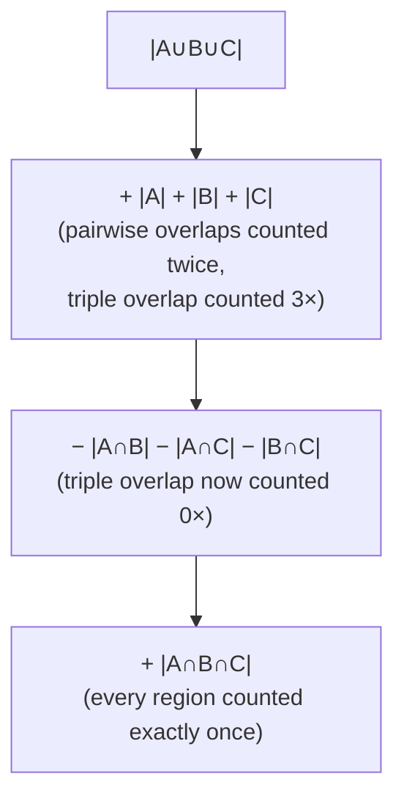

# DM-12 Pigeonhole Principle and Inclusion–Exclusion

> [!info] Topic card
> **Unit:** U4 · **Time:** 4 h · **Verify with:** `count_divisible`, `derangements`, `count_functions` in [[DM Python Toolkit]] (all the numbers in this lesson were computed before writing)

## 1. Learning objectives
1. **State and apply** the pigeonhole principle and its generalised form ($\lceil N/k\rceil$).
2. **Identify** the "pigeons" and the "holes" in disguised problems, including existence proofs in computing (hash collisions, compression limits).
3. **Apply** inclusion–exclusion for 2, 3 and $n$ sets.
4. **Count** derangements, surjections and "divisible by none of" problems using inclusion–exclusion.
5. **Use** these principles to justify claims in security and data structures.

## 2. Why it matters
The pigeonhole principle **proves things exist without finding them**: collisions in every hash function, files that no lossless compressor can shrink, duplicate birthdays in a big enough group. Inclusion–exclusion fixes the overcounting that happens when categories overlap: survey statistics, "at least one" probabilities, and counting valid configurations.

## 3. Prerequisites
[[DM-11 Counting Principles, Permutations and Combinations]] (combinations, complements), [[DM-06 Sets, Set Operations, Power Sets and Cartesian Products]] (unions and intersections), [[DM-07 Functions]] (injective functions).

## 4. Intuition
- **Pigeonhole:** if 13 people are in a room, two of them share a birth month. There are only 12 months, so someone has to double up.
- **Inclusion–exclusion:** to count the students taking Python *or* Cyber Security, add the two class lists, then **subtract** the students you counted twice.

## 5. Rigorous explanation

### 5.1 Pigeonhole principle
**Basic form.** If $N$ objects are placed into $k$ boxes and $N > k$, then some box contains at least 2 objects.
*Proof (contrapositive).* If every box held at most 1 object, there would be at most $k$ objects in total. ∎
**Function form.** If $|A| > |B|$, no function $f: A\to B$ is injective ([[DM-07 Functions]]).
**Generalised form.** If $N$ objects are placed into $k$ boxes, some box contains at least $\lceil N/k\rceil$ objects.
*Proof.* If every box held at most $\lceil N/k\rceil - 1$ objects, the total would be at most $k(\lceil N/k\rceil - 1) < k\cdot\frac{N}{k} = N$, since $\lceil N/k\rceil < N/k + 1$. That's a contradiction. ∎

### 5.2 Inclusion–exclusion
$$|A\cup B| = |A| + |B| - |A\cap B|$$
$$|A\cup B\cup C| = |A|+|B|+|C| - |A\cap B| - |A\cap C| - |B\cap C| + |A\cap B\cap C|$$
**General form:** $\left|\bigcup_{i=1}^{n} A_i\right| = \sum_i |A_i| - \sum_{i<j}|A_i\cap A_j| + \sum_{i<j<k}|A_i\cap A_j\cap A_k| - \dots + (-1)^{n+1}|A_1\cap\dots\cap A_n|$.
*Why it works:* an element lying in exactly $m \ge 1$ of the sets is counted $\binom{m}{1} - \binom{m}{2} + \binom{m}{3} - \dots = 1$ time (by the binomial theorem, $\sum_{j=0}^{m}(-1)^j\binom{m}{j} = 0$, see [[DM-13 Binomial Theorem and Pascal's Triangle]]).
**Complement form:** the number with **none** of the properties is $|U| - |\bigcup A_i|$.

### 5.3 Two classic applications
- **Derangements** (permutations with no fixed point, "nobody gets their own hat"):
  $D_n = n!\left(1 - \frac{1}{1!} + \frac{1}{2!} - \dots + \frac{(-1)^n}{n!}\right)$. So $D_1..D_6 = 0, 1, 2, 9, 44, 265$, and $D_n/n! \to 1/e \approx 0.3679$.
- **Surjections** from an $m$-set onto an $n$-set: $\sum_{k=0}^{n}(-1)^k\binom{n}{k}(n-k)^m$. E.g. 5 tasks onto 3 workers, with everyone getting at least one task: $3^5 - 3\cdot2^5 + 3\cdot1^5 = 243 - 96 + 3 = 150$.

## 6. Terminology
| Term | Meaning |
|---|---|
| Pigeons / holes | The objects / the categories they fall into |
| $\lceil x\rceil$ | Ceiling (the smallest integer ≥ x) |
| Collision | Two inputs with the same output |
| Inclusion–exclusion | Alternating sum correcting overlaps |
| Derangement | Permutation with no element in its original position |
| Surjection | Onto function (every box non-empty) |

## 7. Step-by-step: a pigeonhole problem
*"Show that among any 5 integers, two have the same remainder mod 4."*
1. **Pigeons:** the 5 integers.
2. **Holes:** the possible remainders 0, 1, 2, 3, which is 4 holes.
3. 5 > 4, so two integers share a remainder (and their difference is divisible by 4). ∎
**Tip:** the art is choosing the holes. Ask "what property must two of the objects share?" and make the holes the possible values of that property.

## 8. Diagram: three-set inclusion–exclusion regions

*Text version: adding the three sets counts the pairwise-only regions twice and the triple region three times. Subtracting the three pairwise intersections removes too much from the triple region (3 − 3 = 0), so you add it back once.*

## 9. Worked examples

### Example 1 (basic): generalised pigeonhole
A lecturer has 100 students and 12 tutorial slots. Some slot must hold at least $\lceil 100/12\rceil = 9$ students. (Check: with at most 8 per slot, 12 slots hold at most 96 < 100.)

### Example 2 (intermediate): a hidden pigeonhole
*"Choose any 6 numbers from {1, …, 10}. Prove that two of them sum to 11."*
Holes are the pairs that sum to 11: {1,10}, {2,9}, {3,8}, {4,7}, {5,6}, which is 5 holes. Each number belongs to exactly one pair. Six numbers in 5 holes means two share a pair, and that pair sums to 11. ∎
Is 6 the minimum? Yes: {1, 2, 3, 4, 5} has 5 numbers and no pair summing to 11.

### Example 3 (intermediate): a survey with three categories
60 students: 30 take Python (P), 25 Cyber (C), 20 Discrete Math (D). 10 take P and C, 8 take P and D, 6 take C and D, and 3 take all three.
$|P\cup C\cup D| = 30 + 25 + 20 - 10 - 8 - 6 + 3 = 54$, so **6** students take none of the three.
Exactly two subjects: $(10 - 3) + (8 - 3) + (6 - 3) = 15$. Exactly one: $54 - 15 - 3 = 36$.

### Example 4 (challenging): divisibility counting
How many integers in $1..1000$ are divisible by **none** of 2, 3, 5?
Let $A_d$ be the multiples of $d$: $|A_2| = 500$, $|A_3| = 333$, $|A_5| = 200$, $|A_6| = 166$, $|A_{10}| = 100$, $|A_{15}| = 66$, $|A_{30}| = 33$.
$|A_2\cup A_3\cup A_5| = 500 + 333 + 200 - 166 - 100 - 66 + 33 = 734$. None: $1000 - 734 = 266$.
(Intersections use the **lcm**, here products, because the numbers are coprime. Toolkit: `count_divisible(1000, [2, 3, 5])` → 734.)

### Example 5 (CS): no compressor shrinks every file
There are $2^n$ files of exactly $n$ bits, but only $2^0 + 2^1 + \dots + 2^{n-1} = 2^n - 1$ files *shorter* than $n$ bits. A lossless compressor must be injective (otherwise decompression would be ambiguous), so by pigeonhole it can't map all $2^n$ files into the $2^n - 1$ shorter ones. **Some file doesn't get shorter.** Compression only works on *structured* data.

## 10. Application: hash collisions are unavoidable
A hash table with $m$ buckets storing $n > m$ keys **must** have a bucket with at least $\lceil n/m\rceil$ keys. SHA-256 maps an infinite set of messages into $2^{256}$ digests, so collisions exist. Its security claim is that **finding** one is computationally infeasible, not that none exist ([[CS-06 Hashes, MACs and Integrity]]). The *birthday paradox* ([[DM-18 Introductory Discrete Probability]]) shows that collisions appear much sooner than $m$ items, at about $\sqrt{m}$.

## 11. Common mistakes
| Mistake | Fix |
|---|---|
| Choosing the wrong holes | Holes = the possible values of the property that two pigeons must share |
| Using $N/k$ without the ceiling | $\lceil N/k\rceil$ |
| Pigeonhole "proves" a box has *exactly* two | It guarantees **at least** two |
| Adding overlapping sets | Subtract the intersections |
| Forgetting to add back the triple intersection | The signs alternate: + − + |
| Using products for non-coprime divisors | The intersection of multiples of a and b is the multiples of lcm(a, b) |

## 12. Comparison
| Tool | Answers | Typical phrase |
|---|---|---|
| Pigeonhole | "Must there be…?" (existence) | "show that two…", "at least" |
| Inclusion–exclusion | "How many in the union?" | "at least one of", "none of" |
| Complement | "How many without…?" | "at least one" |
| Product/sum rule | "How many in total?" | "how many ways" |

## 13. Practice
**L1** 1. State the generalised pigeonhole principle. 2. Write the 3-set inclusion–exclusion formula.

**L2** 3. How many people are needed to guarantee that 3 share a birth month? 4. In a group of 40, 22 use WhatsApp, 18 use Telegram, and 7 use both. How many use neither?

**L3** 5. How many integers in 1..100 are divisible by none of 2, 3, 5, 7? Interpret the answer. 6. Prove that among any $n + 1$ integers, two differ by a multiple of $n$.

**L4** 7. Five students swap their assignment papers for peer marking. In how many ways can the papers be redistributed so that nobody marks their own? Give the probability for a random redistribution. 8. Prove that in any group of 6 people, where every pair are either friends or strangers, there are 3 mutual friends or 3 mutual strangers. *(The classic Ramsey result $R(3,3) = 6$.)*

**L5** 9. A system assigns 5 support tickets to 3 technicians at random. (a) How many assignments give every technician at least one ticket? (b) A manager claims "with 5 tickets and 3 technicians, someone always gets at least 2". Prove it, and state the strongest guarantee of this kind. (c) Explain why an attacker who can submit many keys might force collisions in a simple hash table, and what defences exist (randomised hashing). Link this to [[CS-14 Malware and Defensive Detection]] or to denial-of-service considerations in [[CS-09 Network Security and Secure Communication]].

## 14. Hints
> [!tip]- Hints
> 3: generalised pigeonhole with k = 12, wanting at least 3 in some box. 5: inclusion–exclusion with 4 sets, or count 1 and the primes. 6: remainders mod n. 8: fix one person A, who has at least 3 friends or at least 3 strangers among the other 5 (pigeonhole with $\lceil 5/2\rceil = 3$). 9(a): surjections.

## 15. Worked solutions
> [!success]- Solutions 1–2
> See §5.1 and §5.2.

> [!success]- Solution 3
> We need $\lceil N/12\rceil \ge 3$, i.e. $N > 24$, so $N = 25$. (24 people can be 2 per month.)

> [!success]- Solution 4
> $|W\cup T| = 22 + 18 - 7 = 33$, so 7 use neither.

> [!success]- Solution 5
> The answer is **22**. Those are 1 and the 21 primes from 11 to 97. Any composite $n \le 100$ has a prime factor $\le \sqrt{100} = 10$, i.e. one of 2, 3, 5, 7. This is exactly the sieve of Eratosthenes ([[PY-05 Loops and Iteration]]) seen as inclusion–exclusion. (Toolkit: `100 - count_divisible(100, [2, 3, 5, 7])` = 22.)

> [!success]- Solution 6
> The pigeons are the $n + 1$ integers, and the holes are the $n$ possible remainders mod n. Two integers share a remainder $r$: $a = qn + r$ and $b = pn + r$, so $a - b = (q - p)n$. ∎

> [!success]- Solution 7
> $D_5 = 5!\left(1 - 1 + \frac12 - \frac16 + \frac1{24} - \frac1{120}\right) = 120 - 120 + 60 - 20 + 5 - 1 = 44$. The probability is $44/120 = 11/30 \approx 0.367$, close to $1/e$.

> [!success]- Solution 8
> Pick a person A. Among the other 5, by pigeonhole ($\lceil5/2\rceil = 3$), A has at least 3 friends or at least 3 strangers. WLOG 3 friends: B, C, D. If any two of B, C, D are friends, they form a friendly triangle with A. Otherwise B, C, D are mutual strangers. Either way we're done. ∎ (With 5 people it can fail: arrange them in a pentagon, with friends adjacent and strangers non-adjacent.)

> [!success]- Solution 9
> (a) Surjections from 5 tickets onto 3 technicians: $3^5 - \binom31 2^5 + \binom32 1^5 = 243 - 96 + 3 = 150$ (out of 243 assignments).
> (b) Pigeonhole: 5 tickets in 3 boxes gives a box with at least $\lceil 5/3\rceil = 2$. The strongest guarantee is exactly 2. The assignment (2, 2, 1) shows nobody is *guaranteed* 3.
> (c) If an attacker knows the hash function, they can craft many keys with the same hash. Every insert and lookup then degrades to $O(n)$, slowing the server (algorithmic-complexity denial of service). **Defences:** keyed or randomised hash functions with a secret seed per process (Python randomises `str` hashing by default; see `PYTHONHASHSEED` in the docs), limits on the input size, and data structures with worst-case guarantees (balanced trees).

## 16. Self-test (pass ≥ 4/5)
1. Minimum number of people to guarantee two share a birthday (366 possible days)? 2. $|A\cup B|$ if |A| = 10, |B| = 8, |A∩B| = 3? 3. $D_4$? 4. Why must every hash function have collisions? 5. Divisible by 2 or 3 in 1..60?
> [!success]- Answers
> 1. 367. 2. 15. 3. 9. 4. Its domain is larger than its codomain (pigeonhole: no injective function exists). 5. 30 + 20 − 10 = 40.

## 17. Flashcards
#flashcards/discrete-math
Generalised pigeonhole?::N objects in k boxes put at least ⌈N/k⌉ in some box.
|A∪B∪C|?::|A|+|B|+|C| − |A∩B| − |A∩C| − |B∩C| + |A∩B∩C|
Derangements D₄ and D₅?::9 and 44
Surjections from an m-set onto an n-set?::Σ_{k=0}^{n} (−1)^k C(n,k) (n−k)^m
Why can't a compressor shrink every file?::Pigeonhole: 2ⁿ files of length n but only 2ⁿ−1 shorter files; lossless needs injectivity.
How to count "divisible by none of"?::Total minus inclusion–exclusion over the multiples (intersections via lcm).

## 18. Blank-page recall
Write both pigeonhole forms with proofs, the 3-set formula, and the derangement formula, then redo Example 4.

## 19. Revision summary
- Pigeonhole: more objects than boxes forces a shared box. In general, $\lceil N/k\rceil$.
- The art is choosing the holes (remainders, pairs, categories).
- Inclusion–exclusion: alternating sums of intersections. "None" = total − union.
- Derangements, surjections and sieves are all inclusion–exclusion.
- It's the foundation for hash collisions and compression limits.

## 20. Links
Prev: [[DM-11 Counting Principles, Permutations and Combinations]] · Next: [[DM-13 Binomial Theorem and Pascal's Triangle]] · Related: [[DM-18 Introductory Discrete Probability]] (birthday problem), [[CS-06 Hashes, MACs and Integrity]], [[PY-21 Data Structures and Algorithm Design]]

## 21. Sources
- Rosen (2019), §6.2 "The Pigeonhole Principle" and §8.5–8.6 "Inclusion–Exclusion" and its applications.
- Levin, *Discrete Mathematics: An Open Introduction*, §1.6 (PIE) and §1.7 (derangements): https://discrete.openmathbooks.org/
- Python docs, `PYTHONHASHSEED` / hash randomisation: https://docs.python.org/3/using/cmdline.html#envvar-PYTHONHASHSEED

## 22. Mastery checklist
- [ ] I can identify the pigeons and holes in disguised problems
- [ ] I apply inclusion–exclusion with 3–4 sets without sign errors
- [ ] Ramsey $R(3,3)$ proof reproduced · reviews scheduled
