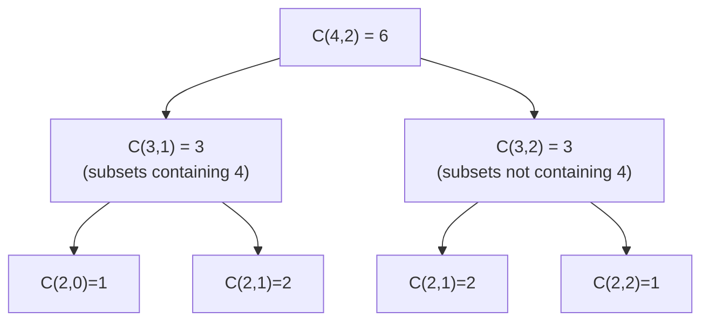

# DM-13 Binomial Theorem and Pascal's Triangle

> [!info] Topic card
> **Unit:** U4 · **Time:** 3–4 h · **Verify with:** `binomial_coefficients(n)` in [[DM Python Toolkit]] and `math.comb`

## 1. Learning objectives
1. **State** the binomial theorem, and **explain** it combinatorially (choosing terms from factors).
2. **Find** specific coefficients and terms in expansions such as $(ax + b)^n$ and $(x^p + c\,x^{-q})^n$.
3. **Construct** Pascal's triangle, and **prove** Pascal's identity both algebraically and combinatorially.
4. **Derive** standard identities: $\sum\binom{n}{k} = 2^n$, the alternating sum, Vandermonde, and the hockey stick.
5. **Apply** binomial coefficients to approximation, probability and counting proofs.

## 2. Why it matters
Binomial coefficients count subsets, bit strings with $k$ ones, lattice paths and binomial-probability outcomes ([[DM-18 Introductory Discrete Probability]]). The theorem explains why inclusion–exclusion works ([[DM-12 Pigeonhole Principle and Inclusion-Exclusion]]), and it lets you approximate growth such as $(1+r)^n$ in finance ([[PM-09 Cost Estimation and Budgeting]]).

## 3. Prerequisites
[[DM-11 Counting Principles, Permutations and Combinations]] ($\binom{n}{k}$), [[DM-09 Mathematical Induction]] (for one of the proofs).

## 4. Intuition
Expanding $(x + y)^3 = (x+y)(x+y)(x+y)$ means **choosing either x or y from each bracket** and multiplying. You get $x^2y$ whenever you pick y from exactly 1 of the 3 brackets, and there are $\binom{3}{1} = 3$ ways to do that. So the coefficient of $x^{n-k}y^k$ is just "how many ways to choose which k brackets give y".

## 5. Rigorous explanation

### 5.1 The binomial theorem
For any $x, y$ and integer $n \ge 0$:
$$(x+y)^n = \sum_{k=0}^{n}\binom{n}{k}x^{n-k}y^{k}$$
- **General term:** $T_{k+1} = \binom{n}{k}x^{n-k}y^k$ (the $(k+1)$-th term, counting from $k = 0$).
- There are $n + 1$ terms. The exponents of x and y sum to $n$ in every term.
**Combinatorial proof.** In the product of $n$ factors $(x+y)$, a term $x^{n-k}y^k$ arises from each choice of which $k$ factors contribute $y$. There are $\binom{n}{k}$ such choices. ∎

### 5.2 Pascal's triangle and identity
$$\binom{n}{k} = \binom{n-1}{k-1} + \binom{n-1}{k}\qquad (1\le k\le n-1)$$
**Combinatorial proof.** Count the k-subsets of $\{1,\dots,n\}$ by whether they contain $n$. Those containing $n$: choose the other $k-1$ elements from $n-1$. Those not containing it: choose all $k$ from $n-1$. ∎
**Algebraic proof.** $\frac{(n-1)!}{(k-1)!(n-k)!} + \frac{(n-1)!}{k!(n-1-k)!} = \frac{(n-1)!}{k!(n-k)!}[k + (n-k)] = \frac{n!}{k!(n-k)!}$. ∎
```text
n=0:            1
n=1:          1   1
n=2:        1   2   1
n=3:      1   3   3   1
n=4:    1   4   6   4   1
n=5:  1   5  10  10   5   1
```
Each entry is the sum of the two entries above it. Row $n$ gives the coefficients of $(x+y)^n$.

### 5.3 Identities
| Identity | Proof idea |
|---|---|
| $\sum_{k=0}^{n}\binom{n}{k} = 2^n$ | Put $x = y = 1$, or count all subsets |
| $\sum_{k=0}^{n}(-1)^k\binom{n}{k} = 0$ for $n\ge1$ | Put $x = 1, y = -1$. The even-sized subsets equal the odd-sized ones in number. |
| $\binom{n}{k} = \binom{n}{n-k}$ | Choosing who is in = choosing who is out |
| Vandermonde: $\binom{m+n}{r} = \sum_{k}\binom{m}{k}\binom{n}{r-k}$ | Choose r people from m men and n women, sorted by the number of men k |
| Hockey stick: $\sum_{i=r}^{n}\binom{i}{r} = \binom{n+1}{r+1}$ | Sort the (r+1)-subsets of $\{0..n\}$ by their largest element |

## 6. Terminology
| Term | Meaning |
|---|---|
| Binomial | A two-term expression, e.g. $x + y$ |
| Binomial coefficient | $\binom{n}{k}$ |
| General term | $\binom{n}{k}x^{n-k}y^k$ |
| Combinatorial (double-counting) proof | Proving an identity by counting one set in two ways |
| Pascal's identity | $\binom{n}{k}=\binom{n-1}{k-1}+\binom{n-1}{k}$ |

## 7. Step-by-step: find the coefficient of $x^5$ in $(2x - 3)^8$
1. Identify the parts: $x\to 2x$, $y \to -3$, $n = 8$.
2. General term: $\binom{8}{k}(2x)^{8-k}(-3)^k$.
3. The power of x is $8 - k = 5$, so $k = 3$.
4. Coefficient: $\binom{8}{3}\cdot 2^5\cdot(-3)^3 = 56 \cdot 32 \cdot (-27) = -48\,384$.
**Common errors:** forgetting the 2 inside $(2x)^5$, or dropping the sign of $(-3)^3$.

## 8. Diagram: Pascal's identity as a recursion

*Text version: C(4,2) splits into C(3,1) + C(3,2), and each of those splits again. This is exactly a recursive function, and memoising it builds Pascal's triangle ([[PY-07 Recursion]]).*

## 9. Worked examples

### Example 1 (basic): full expansion
$(a + b)^5 = a^5 + 5a^4b + 10a^3b^2 + 10a^2b^3 + 5ab^4 + b^5$ (row 5 of the triangle).
$(x + 2)^6$: the coefficient of $x^3$ is $\binom63 2^3 = 20\cdot8 = 160$.

### Example 2 (intermediate): constant terms and negative powers
**Constant term** of $\left(x + \frac{1}{x}\right)^{10}$: the general term is $\binom{10}{k}x^{10-k}x^{-k} = \binom{10}{k}x^{10-2k}$. Constant means $10 - 2k = 0$, so $k = 5$, giving $\binom{10}{5} = 252$.
**Coefficient of $x^4$** in $\left(x^2 - \frac{2}{x}\right)^8$: the term is $\binom8k(x^2)^{8-k}(-2)^k x^{-k} = \binom8k(-2)^k x^{16-3k}$. Setting $16 - 3k = 4$ gives $k = 4$, so the coefficient is $\binom84 \cdot 16 = 70\cdot16 = 1120$.

### Example 3 (challenging): approximation and an exact computation
(a) $1.02^{10} = (1 + 0.02)^{10} \approx 1 + 10(0.02) + 45(0.02)^2 = 1 + 0.2 + 0.018 = 1.218$. The true value is 1.21899…, so three terms give 3 correct decimal places. (Useful for estimating compound growth in your head.)
(b) $101^4 = (100 + 1)^4 = 100^4 + 4\cdot100^3 + 6\cdot100^2 + 4\cdot100 + 1 = 104\,060\,401$. You can read the digits straight off row 4 (1, 4, 6, 4, 1) because no "carries" occur.

### Example 4 (proof): $\sum_{k} k\binom{n}{k} = n2^{n-1}$
**Combinatorial proof.** Count the pairs (committee, chair) from n people. Way 1: choose a committee of size k ($\binom nk$ ways) and a chair from it (k ways), then sum over k. Way 2: choose the chair first (n ways), then any subset of the remaining $n - 1$ people to join ($2^{n-1}$). Both count the same set. ∎ *Check n = 3:* $1\cdot3 + 2\cdot3 + 3\cdot1 = 12 = 3\cdot4$ ✔.

## 10. Application: bit strings and probability
The number of 8-bit strings with exactly $k$ ones is $\binom8k$. Summing over $k$ gives 256 = $2^8$ ✔. If each bit is 1 with probability $p$ independently, then $P(\text{exactly } k \text{ ones}) = \binom{n}{k}p^k(1-p)^{n-k}$, the binomial distribution. With $p = 0.5$ and $n = 8$, $P(k = 4) = 70/256 \approx 0.273$. This is used to reason about error rates in transmissions and about test-suite pass probabilities ([[DM-18 Introductory Discrete Probability]]).

## 11. Common mistakes
| Mistake | Fix |
|---|---|
| $(x + y)^n = x^n + y^n$ | That's false for $n\ge2$ (there are cross terms) |
| Forgetting the coefficient inside, e.g. $(2x)^5 = 2x^5$ | $(2x)^5 = 32x^5$ |
| Losing negative signs | Write $(-3)^k$ explicitly |
| Off by one on the "k-th term" | The $(k+1)$-th term uses $\binom{n}{k}$ |
| Exponents not summing to n | Check that every term has total degree n |

## 12. Comparison
| Proof style | Example | Strength |
|---|---|---|
| Algebraic | Pascal via factorials | Mechanical |
| Combinatorial (double counting) | $k\binom nk = n\binom{n-1}{k-1}$ | Explains *why* |
| Induction | the binomial theorem itself (practice 9) | Rigorous for all n |
| Substitution into the theorem | $x = y = 1$ gives $2^n$ | Quick |

## 13. Practice
**L1** 1. Write row 6 of Pascal's triangle. 2. How many terms does $(a + b)^{12}$ have?

**L2** 3. Expand $(x - 1)^4$. 4. Find the coefficient of $x^{3}$ in $(1 + 2x)^7$.

**L3** 5. Find the constant term of $\left(2x - \frac{1}{x^2}\right)^6$. 6. Use the binomial theorem to estimate $0.99^{20}$ to 3 decimal places, and compare it with a calculator.

**L4** 7. Prove $\sum_{k=0}^{n}\binom{n}{k}2^k = 3^n$ in two ways (substitution, and combinatorially using strings over {0, 1, 2}). 8. Prove Vandermonde's identity combinatorially, and use it to show that $\sum_{k}\binom{n}{k}^2 = \binom{2n}{n}$.

**L5** 9. Prove the binomial theorem by induction on $n$, using Pascal's identity in the inductive step.

## 14. Hints
> [!tip]- Hints
> 4: the term is $\binom7k(2x)^k$, with k = 3. 5: the term is $\binom6k(2x)^{6-k}(-x^{-2})^k$, so the power is $6 - 3k$. 6: $(1 - 0.01)^{20}$. 7: each position is 0, or one of two "non-zero" symbols. 8: take $m = n$, $r = n$, and use symmetry. 9: multiply $(x+y)^k$ by $(x+y)$, collect the coefficient of $x^{k+1-j}y^j$, and apply Pascal.

## 15. Worked solutions
> [!success]- Solutions 1–2
> 1. 1, 6, 15, 20, 15, 6, 1. 2. 13.

> [!success]- Solution 3
> $x^4 - 4x^3 + 6x^2 - 4x + 1$.

> [!success]- Solution 4
> $\binom73 2^3 = 35\cdot8 = 280$.

> [!success]- Solution 5
> The term is $\binom6k 2^{6-k}x^{6-k}(-1)^k x^{-2k} = \binom6k2^{6-k}(-1)^kx^{6-3k}$. Constant means $k = 2$: $\binom62\cdot2^4\cdot1 = 15\cdot16 = 240$.

> [!success]- Solution 6
> $(1 - 0.01)^{20} \approx 1 - 20(0.01) + 190(0.0001) - 1140(0.000001) = 1 - 0.2 + 0.019 - 0.00114 = 0.81786$, i.e. **0.818**. A calculator gives $0.99^{20} = 0.81791\ldots$ ✔.

> [!success]- Solution 7
> (i) Put $x = 1$, $y = 2$ in the theorem: $(1 + 2)^n = \sum\binom nk 1^{n-k}2^k$. (ii) Count strings of length n over {0, 1, 2}: directly, there are $3^n$. Alternatively, choose the set of k non-zero positions ($\binom nk$ ways), then fill each with 1 or 2 ($2^k$ ways), and sum over k. ∎

> [!success]- Solution 8
> Vandermonde: a group has m men and n women. Choosing r people sorted by the number of men $k$ gives $\binom{m}{k}\binom{n}{r-k}$ for each k, and summing over k gives all $\binom{m+n}{r}$ choices. With $m = n = r$: $\binom{2n}{n} = \sum_k\binom nk\binom n{n-k} = \sum_k\binom nk^2$ (by symmetry). ∎

> [!success]- Solution 9
> **Base** $n = 0$: $(x+y)^0 = 1 = \binom00x^0y^0$ ✔. **IH:** $(x+y)^k = \sum_{j=0}^{k}\binom kj x^{k-j}y^j$. **Step:** $(x+y)^{k+1} = (x+y)\sum_j\binom kjx^{k-j}y^j = \sum_j\binom kjx^{k+1-j}y^j + \sum_j\binom kjx^{k-j}y^{j+1}$. Re-index the second sum with $j \to j - 1$: $\sum_{j=1}^{k+1}\binom k{j-1}x^{k+1-j}y^j$. The coefficient of $x^{k+1-j}y^j$ is then $\binom kj + \binom k{j-1} = \binom{k+1}{j}$ by Pascal (and the end terms are 1). So $(x+y)^{k+1} = \sum_{j=0}^{k+1}\binom{k+1}jx^{k+1-j}y^j$ ✔. ∎

## 16. Self-test (pass ≥ 4/5)
1. The general term of $(x+y)^n$? 2. $\sum_k\binom{10}{k}$? 3. Coefficient of $x^2y^3$ in $(x+y)^5$? 4. State Pascal's identity. 5. The constant term of $(x + 1/x)^4$?
> [!success]- Answers
> 1. $\binom nk x^{n-k}y^k$. 2. 1024. 3. 10. 4. $\binom nk = \binom{n-1}{k-1}+\binom{n-1}k$. 5. $\binom42 = 6$.

## 17. Flashcards
#flashcards/discrete-math
Binomial theorem?::(x+y)ⁿ = Σ_{k=0}^{n} C(n,k) x^{n−k} y^k
Pascal's identity?::C(n,k) = C(n−1,k−1) + C(n−1,k)
Sum of row n of Pascal's triangle?::2ⁿ
Alternating sum of row n (n ≥ 1)?::0
Vandermonde's identity?::C(m+n, r) = Σ_k C(m,k) C(n, r−k)
Hockey-stick identity?::Σ_{i=r}^{n} C(i, r) = C(n+1, r+1)

## 18. Blank-page recall
Write rows 0–6 of Pascal's triangle, prove Pascal's identity combinatorially, and solve the $(2x - 3)^8$ coefficient problem.

## 19. Revision summary
- $(x+y)^n = \sum\binom nkx^{n-k}y^k$, because coefficients count the choices of brackets.
- To find a term: write the general term, set the exponent, solve for k, and watch the signs and inner coefficients.
- Pascal's identity builds the triangle. The row sum is $2^n$ and the alternating sum is 0.
- Double counting proves identities by counting one set two ways.

## 20. Links
Prev: [[DM-12 Pigeonhole Principle and Inclusion-Exclusion]] · Next: [[DM-14 Recurrence Relations]] · Related: [[DM-18 Introductory Discrete Probability]], [[DM-08 Sequences and Summations]] (hockey stick in loop counting), [[PY-07 Recursion]]

## 21. Sources
- Rosen (2019), §6.4 "Binomial Coefficients and Identities".
- Benjamin, A. T. & Quinn, J. J., *Proofs that Really Count: The Art of Combinatorial Proof*, MAA, 2003.
- Levin, *Discrete Mathematics: An Open Introduction*, §1.4 (combinatorial proofs): https://discrete.openmathbooks.org/

## 22. Mastery checklist
- [ ] Coefficient problems with negative powers done correctly (Example 2, practice 5)
- [ ] Two combinatorial proofs written
- [ ] Induction proof of the theorem (practice 9) · reviews scheduled
