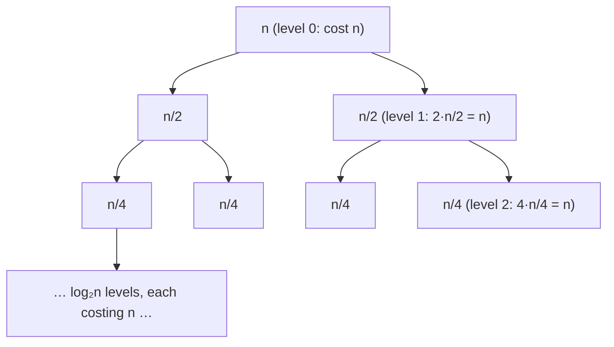

# DM-14 Recurrence Relations

> [!info] Topic card
> **Unit:** U4 · **Time:** 5–6 h · **Verify with:** `iterate_recurrence(coeffs, initial, n, f)` in [[DM Python Toolkit]]. Always compare your closed form with the first 10 iterated terms.

## 1. Learning objectives
1. **Model** counting and algorithm-cost problems as recurrence relations with initial conditions.
2. **Solve** first-order recurrences by iteration (backward substitution).
3. **Solve** linear homogeneous recurrences with constant coefficients (distinct and repeated roots) using the characteristic equation.
4. **Solve** simple non-homogeneous recurrences (constant or polynomial forcing) with a particular solution.
5. **Analyse** divide-and-conquer recurrences ($T(n) = aT(n/b) + f(n)$) by recursion trees and the simplified master theorem, and **verify** every solution by induction.

## 2. Why it matters
Recursive algorithms have recursive costs: merge sort $T(n) = 2T(n/2) + n$, binary search $T(n) = T(n/2) + 1$, Hanoi $M(n) = 2M(n-1) + 1$ ([[PY-07 Recursion]], [[PY-12 Searching, Sorting and Complexity]]). Recurrences also count structures (bit strings without "11"), and they model growth (loans, populations). Solving them turns "it calls itself" into "it costs $\Theta(n\log n)$".

## 3. Prerequisites
[[DM-08 Sequences and Summations]] (geometric sums), [[DM-09 Mathematical Induction]] (verifying the solutions), and solving quadratic equations.

## 4. Intuition
A recurrence is a **recipe for the next term from the previous ones**, plus a starting point. Solving it means finding a **shortcut formula** that jumps straight to term n without computing all the earlier ones.

## 5. Rigorous explanation

### 5.1 Definitions
A **recurrence relation** for $\{a_n\}$ expresses $a_n$ in terms of earlier terms. Together with enough **initial conditions** it determines the sequence uniquely. A **solution** (closed form) is an explicit formula for $a_n$.

### 5.2 Iteration (backward substitution)
For $a_n = r\,a_{n-1} + c$: substitute repeatedly to get $a_n = r^n a_0 + c(r^{n-1} + \dots + r + 1) = r^n a_0 + c\frac{r^n - 1}{r - 1}$ (for $r\ne1$).

### 5.3 Linear homogeneous recurrences with constant coefficients (degree 2)
$a_n = c_1a_{n-1} + c_2a_{n-2}$. Try $a_n = x^n$: dividing by $x^{n-2}$ gives the **characteristic equation** $x^2 - c_1x - c_2 = 0$.
| Roots | General solution |
|---|---|
| Distinct $r_1 \ne r_2$ | $a_n = \alpha r_1^n + \beta r_2^n$ |
| Repeated $r$ | $a_n = (\alpha + \beta n) r^n$ |
Find $\alpha, \beta$ from the initial conditions $a_0, a_1$. *Why does this work?* Linear combinations of solutions are solutions, and two initial values fix the two constants.

### 5.4 Non-homogeneous: $a_n = c_1a_{n-1} + c_2a_{n-2} + f(n)$
General solution = homogeneous solution + **one particular solution** $p_n$. Guess $p_n$ of the same form as $f(n)$:
| $f(n)$ | Try $p_n$ = |
|---|---|
| constant $d$ | constant $A$ |
| polynomial of degree $k$ | polynomial of degree $k$ |
| $s^n$ (s not a root) | $A s^n$ |
| $s^n$ (s a root of multiplicity m) | $A n^m s^n$ |
Substitute to find the coefficients, then apply the initial conditions to the **total** solution.

### 5.5 Divide-and-conquer recurrences
$T(n) = aT(n/b) + f(n)$: a problem splits into $a$ subproblems of size $n/b$, with extra work $f(n)$.
**Simplified master theorem** (for $f(n) = \Theta(n^d)$, $a \ge 1$, $b > 1$):
| Case | Condition | $T(n)$ | Example |
|---|---|---|---|
| 1 | $a < b^d$ | $\Theta(n^d)$ | $T(n) = T(n/2) + n \Rightarrow \Theta(n)$ |
| 2 | $a = b^d$ | $\Theta(n^d\log n)$ | merge sort: $2T(n/2)+n \Rightarrow \Theta(n\log n)$; binary search: $T(n/2)+1 \Rightarrow \Theta(\log n)$ |
| 3 | $a > b^d$ | $\Theta(n^{\log_b a})$ | $4T(n/2)+n \Rightarrow \Theta(n^2)$ |
**Recursion-tree intuition:** level $i$ has $a^i$ nodes, each costing $f(n/b^i)$. Compare how the total cost per level changes: shrinking (case 1), constant (case 2) or growing (case 3).

## 6. Terminology
| Term | Meaning |
|---|---|
| Order (degree) | How far back the recurrence reaches |
| Linear / homogeneous | Terms appear to the first power / no extra $f(n)$ term |
| Characteristic equation | Polynomial obtained by trying $a_n = x^n$ |
| Particular solution | Any one solution of the non-homogeneous recurrence |
| Closed form | Explicit formula in n |
| Recursion tree | A tree of subproblem costs used to sum the work |

## 7. Step-by-step: solve $a_n = 5a_{n-1} - 6a_{n-2}$, $a_0 = 1$, $a_1 = 4$
1. Characteristic equation: $x^2 - 5x + 6 = 0$, i.e. $(x-2)(x-3) = 0$, so $r_1 = 2$ and $r_2 = 3$.
2. General solution: $a_n = \alpha2^n + \beta3^n$.
3. Initial conditions: $n=0$: $\alpha + \beta = 1$. $n=1$: $2\alpha + 3\beta = 4$. Subtracting twice the first equation gives $\beta = 2$, so $\alpha = -1$.
4. **Solution:** $a_n = 2\cdot3^n - 2^n$.
5. **Check:** the recurrence gives $a_2 = 5\cdot4 - 6\cdot1 = 14$, and the formula gives $18 - 4 = 14$ ✔. Likewise $a_3 = 5\cdot14 - 6\cdot4 = 46$, and $54 - 8 = 46$ ✔.

## 8. Diagram: recursion tree for $T(n) = 2T(n/2) + n$

*Text version: every level of the tree costs n in total, and there are log₂ n levels (plus the leaves), so T(n) = Θ(n log n). That's master-theorem case 2, the merge sort analysis in [[PY-12 Searching, Sorting and Complexity]].*

## 9. Worked examples

### Example 1 (basic): iteration
$a_n = 3a_{n-1} + 2$, $a_0 = 1$.
$a_n = 3a_{n-1} + 2 = 3(3a_{n-2} + 2) + 2 = 3^2a_{n-2} + 2(3 + 1) = \dots = 3^na_0 + 2(3^{n-1} + \dots + 1) = 3^n + 2\cdot\frac{3^n - 1}{2} = 2\cdot3^n - 1$.
Check: $a_1 = 5$ ✔ ($2\cdot3 - 1$), $a_2 = 17$ ✔ ($18 - 1$).

### Example 2 (intermediate): modelling bit strings without "11"
Let $b_n$ be the number of length-$n$ bit strings with no two consecutive 1s. Split by the **last** bit:
- ends in 0: any valid string of length $n-1$, followed by 0, gives $b_{n-1}$;
- ends in 1: the previous bit must be 0, so it's a valid string of length $n-2$ followed by "01", giving $b_{n-2}$.
So $b_n = b_{n-1} + b_{n-2}$ with $b_1 = 2$ ("0", "1") and $b_2 = 3$ ("00", "01", "10"). These are the Fibonacci numbers shifted: $b_n = F_{n+2}$. For example $b_5 = F_7 = 13$. *Modelling recipe: split on the last step and reuse smaller cases.*

### Example 3 (challenging): repeated root
$a_n = 4a_{n-1} - 4a_{n-2}$, $a_0 = 1$, $a_1 = 6$.
$x^2 - 4x + 4 = (x-2)^2$, so there's a double root $r = 2$, and $a_n = (\alpha + \beta n)2^n$.
$a_0 = \alpha = 1$. $a_1 = 2(1 + \beta) = 6$, so $\beta = 2$. **Solution** $a_n = (1 + 2n)2^n$.
Check: $a_2 = 4\cdot6 - 4\cdot1 = 20$, and the formula gives $5\cdot4 = 20$ ✔.

### Example 4 (challenging): non-homogeneous with polynomial forcing
$a_n = 2a_{n-1} + n$, $a_0 = 1$.
Homogeneous part: $A\cdot2^n$. Particular solution: try $p_n = cn + d$. Then $cn + d = 2(c(n-1) + d) + n = (2c + 1)n + (2d - 2c)$. Matching coefficients: $c = 2c + 1$, so $c = -1$. And $d = 2d - 2c$, so $d = 2c = -2$. So $p_n = -n - 2$.
General: $a_n = A2^n - n - 2$. With $a_0 = 1$: $A - 2 = 1$, so $A = 3$. **Solution** $a_n = 3\cdot2^n - n - 2$.
Check: $a_1 = 2 + 1 = 3$ ✔ ($6 - 3$), $a_2 = 6 + 2 = 8$ ✔ ($12 - 4$).

### Example 5 (Fibonacci): Binet's formula
$F_n = F_{n-1} + F_{n-2}$, $F_0 = 0$, $F_1 = 1$. The equation $x^2 - x - 1 = 0$ has roots $\varphi = \frac{1+\sqrt5}{2}$ and $\psi = \frac{1-\sqrt5}{2}$. Solving gives $F_n = \frac{\varphi^n - \psi^n}{\sqrt5}$. Since $|\psi| < 1$, $F_n$ is the nearest integer to $\varphi^n/\sqrt5$, so Fibonacci grows like $1.618^n$, which explains why the naive recursive `fib` is exponential ([[PY-07 Recursion]]).

## 10. Application: loan balance
A student loan of 2 000 000 TZS accrues 1% interest per month, and 100 000 TZS is repaid each month: $B_n = 1.01B_{n-1} - 100\,000$, $B_0 = 2\,000\,000$. Iteration gives $B_n = 1.01^nB_0 - 100\,000\cdot\frac{1.01^n - 1}{0.01}$. Setting $B_n \le 0$ and solving gives $1.01^n \ge \frac{10\,000\,000}{8\,000\,000} = 1.25$, so $n \ge \frac{\ln 1.25}{\ln 1.01} \approx 22.4$. The loan is cleared in the **23rd month** (that month's payment is smaller). (The figures are illustrative.)

## 11. Common mistakes
| Mistake | Fix |
|---|---|
| Forgetting the initial conditions | A recurrence alone has infinitely many solutions |
| Using $\alpha r^n + \beta r^n$ for a repeated root | Use $(\alpha + \beta n)r^n$ |
| Applying the initial conditions to the homogeneous part only | Apply them to homogeneous + particular |
| A particular-solution guess that matches a homogeneous root | Multiply by $n$ (or by $n^m$) |
| Master theorem with $f(n) = n\log n$ (not a pure power) | The simplified version doesn't apply. Use a recursion tree. |
| Not checking the solution | Always compare the first few terms with iteration |

## 12. Comparison of methods
| Method | Works for | Effort |
|---|---|---|
| Iteration / substitution | First order, simple forcing | Low |
| Characteristic equation | Linear, constant coefficients | Medium |
| Recursion tree | Divide and conquer | Medium, visual |
| Master theorem | $aT(n/b) + \Theta(n^d)$ | Instant |
| Guess + induction | Anything, if you can guess | Variable |

## 13. Practice
**L1** 1. Compute the first five terms of $a_n = 2a_{n-1} + 1$, $a_0 = 0$. 2. Write the characteristic equation of $a_n = 6a_{n-1} - 9a_{n-2}$.

**L2** 3. Solve $a_n = 2a_{n-1} + 1$, $a_0 = 0$ by iteration, and interpret it (Hanoi). 4. Solve $a_n = a_{n-1} + 6a_{n-2}$, $a_0 = 3$, $a_1 = 6$.

**L3** 5. Solve $a_n = 6a_{n-1} - 9a_{n-2}$, $a_0 = 2$, $a_1 = 9$. 6. Solve $a_n = 3a_{n-1} + 4$, $a_0 = 1$, and verify by induction.

**L4** 7. Find a recurrence for the number of ways to climb $n$ stairs taking 1 or 2 steps at a time, and give the answer for $n = 10$. 8. Use the master theorem on: (a) $T(n) = 3T(n/2) + n$ (b) $T(n) = 2T(n/2) + n^2$ (c) $T(n) = 8T(n/2) + n^2$.

**L5** 9. Karatsuba multiplication splits n-digit numbers into halves and makes 3 recursive multiplications plus linear work: $T(n) = 3T(n/2) + cn$. (a) Find its growth rate and compare it with schoolbook $\Theta(n^2)$. (b) For $n = 2^{10}$ digits, estimate the ratio of the work, ignoring constants. (c) Explain why, below some size, implementations switch to the schoolbook method anyway.

## 14. Hints
> [!tip]- Hints
> 3: the same pattern as Example 1. 4: $x^2 - x - 6 = (x-3)(x+2)$. 5: a double root at 3. 6: the particular solution is a constant $A = 3A + 4$, so $A = -2$. 7: the last move was 1 step or 2 steps. 8: compare a with $b^d$. 9(a): $\log_2 3 \approx 1.585$.

## 15. Worked solutions
> [!success]- Solutions 1–2
> 1. 0, 1, 3, 7, 15. 2. $x^2 - 6x + 9 = 0$.

> [!success]- Solution 3
> $a_n = 2^na_0 + (2^{n-1} + \dots + 1) = 2^n - 1$. This is the Hanoi move count ([[PY-07 Recursion]], [[DM-09 Mathematical Induction]] practice 9).

> [!success]- Solution 4
> Roots 3 and −2: $a_n = \alpha3^n + \beta(-2)^n$. From $\alpha + \beta = 3$ and $3\alpha - 2\beta = 6$, we get $5\alpha = 12$, so $\alpha = 12/5$ and $\beta = 3/5$. So $a_n = \frac{12\cdot3^n + 3(-2)^n}{5}$. Check: $a_2 = 6 + 18 = 24$, and the formula gives $(108 + 12)/5 = 24$ ✔.

> [!success]- Solution 5
> A double root at 3: $a_n = (\alpha + \beta n)3^n$. $a_0 = \alpha = 2$. $a_1 = 3(2 + \beta) = 9$, so $\beta = 1$. So $a_n = (2 + n)3^n$. Check: $a_2 = 6\cdot9 - 9\cdot2 = 36$, and $4\cdot9 = 36$ ✔.

> [!success]- Solution 6
> $a_n = A3^n - 2$. With $a_0 = 1$: $A = 3$, so $a_n = 3^{n+1} - 2$. **Induction:** base $a_0 = 3 - 2 = 1$ ✔. Step: $a_{k+1} = 3a_k + 4 = 3(3^{k+1} - 2) + 4 = 3^{k+2} - 2$ ✔. ∎

> [!success]- Solution 7
> $s_n = s_{n-1} + s_{n-2}$ (the last move was 1 step from $n-1$, or 2 steps from $n-2$), with $s_1 = 1$ and $s_2 = 2$. So $s_n = F_{n+1}$, and $s_{10} = F_{11} = 89$.

> [!success]- Solution 8
> (a) $a = 3$, $b^d = 2^1 = 2$, so $a > b^d$ (case 3): $\Theta(n^{\log_2 3}) \approx \Theta(n^{1.585})$. (b) $a = 2$, $b^d = 4$, so case 1: $\Theta(n^2)$. (c) $a = 8$, $b^d = 4$, so case 3: $\Theta(n^{\log_2 8}) = \Theta(n^3)$.

> [!success]- Solution 9
> (a) $\Theta(n^{\log_23}) \approx \Theta(n^{1.585})$, which beats $\Theta(n^2)$. (b) $n^2 = 2^{20}$ and $n^{1.585} = 2^{15.85}$, so the ratio is $\approx 2^{4.15} \approx 18$ times less work (asymptotically, ignoring constants). (c) The recursion overhead and the extra additions give larger constants, so for small n the simple method is faster. Libraries switch to the schoolbook method below a tuned threshold. Asymptotic analysis describes large-n behaviour only.

## 16. Self-test (pass ≥ 4/5)
1. General solution for distinct roots $r_1, r_2$? 2. For a repeated root? 3. Master theorem for $T(n) = 2T(n/2) + n$? 4. Closed form of $a_n = 2a_{n-1}$, $a_0 = 5$? 5. Why check the first terms?
> [!success]- Answers
> 1. $\alpha r_1^n + \beta r_2^n$. 2. $(\alpha + \beta n)r^n$. 3. $\Theta(n\log n)$. 4. $5\cdot2^n$. 5. To catch algebra mistakes in the constants or the particular solution.

## 17. Flashcards
#flashcards/discrete-math
Characteristic equation of a_n = c₁a_{n−1} + c₂a_{n−2}?::x² − c₁x − c₂ = 0
Solution with repeated root r?::a_n = (α + βn) rⁿ
Non-homogeneous recurrence solution structure?::Homogeneous general solution + one particular solution; then apply initial conditions.
Master theorem case a = b^d?::T(n) = Θ(n^d log n)
Merge sort recurrence and solution?::T(n) = 2T(n/2) + Θ(n) ⇒ Θ(n log n)
Bit strings of length n without "11"?::b_n = b_{n−1} + b_{n−2}, giving F_{n+2}.

## 18. Blank-page recall
Solve the §7 example and Example 4 again from scratch, then state the master theorem with an example for each case.

## 19. Revision summary
- Model by splitting on the last step. Always include the initial conditions.
- First order: iterate, which gives geometric sums.
- Linear homogeneous: the characteristic equation, with $(\alpha + \beta n)r^n$ for repeated roots.
- Non-homogeneous: homogeneous + particular, with the initial conditions applied last.
- Divide and conquer: recursion trees or the master theorem. Verify by induction or iteration.

## 20. Links
Prev: [[DM-13 Binomial Theorem and Pascal's Triangle]] · Next: [[DM-15 Graphs, Representations, Paths and Connectivity]] · Applied: [[PY-07 Recursion]], [[PY-12 Searching, Sorting and Complexity]], [[PY-21 Data Structures and Algorithm Design]]

## 21. Sources
- Rosen (2019), §8.1–8.3 (applications of recurrences, solving linear recurrences, divide-and-conquer and the master theorem).
- Cormen et al., *Introduction to Algorithms*, 4th ed., 2022, ch. 4 (recurrences, the master method).
- Karatsuba, A. & Ofman, Yu., "Multiplication of many-digital numbers by automatic computers", *Proceedings of the USSR Academy of Sciences*, 145, 1962, pp. 293–294.

## 22. Mastery checklist
- [ ] I solve distinct-root, repeated-root and non-homogeneous recurrences correctly
- [ ] Every solution is checked against iterated terms (toolkit)
- [ ] Master theorem applied to 3+ recurrences · reviews scheduled
