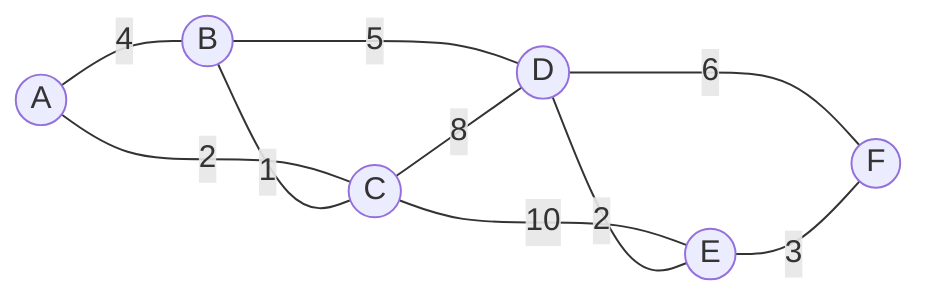
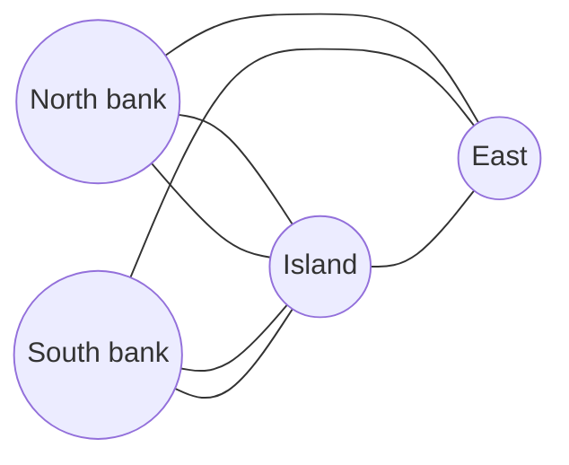

# DM-15 Graphs, Representations, Paths and Connectivity

> [!info] Topic card
> **Unit:** U5 Graphs · **Time:** 5–6 h · **Verify with:** `degrees`, `is_connected`, `euler_status` in [[DM Python Toolkit]]. Implementations: [[PY-21 Data Structures and Algorithm Design]] (BFS, DFS, Dijkstra).

## 1. Learning objectives
1. **Use** graph terminology precisely: vertex, edge, degree, simple/multi/directed graphs, special graphs ($K_n$, $C_n$, bipartite, $K_{m,n}$).
2. **Apply** the handshaking lemma and its corollaries.
3. **Represent** graphs as adjacency lists and matrices, and **choose** between them.
4. **Determine** connectivity, components, and the existence of Euler circuits and paths (degree criteria). **Recognise** that Hamilton problems are hard.
5. **Compute** shortest paths by hand with Dijkstra's algorithm, and **solve** colouring problems (timetabling), testing bipartiteness.

## 2. Why it matters
Computer networks, road maps, social networks, web links, dependency graphs, state machines and project networks are all graphs. Many problems become standard once modelled as one: "shortest route" (Dijkstra), "can we visit every link once" (Euler), "minimum number of exam slots" (colouring), "is the network connected" (BFS).

## 3. Prerequisites
[[DM-10 Relations, Equivalence Relations and Partial Orders]] (a directed graph is a relation, and connectivity is an equivalence relation), [[DM-06 Sets, Set Operations, Power Sets and Cartesian Products]].

## 4. Intuition
A graph is **dots and lines**: dots (vertices) are things, and lines (edges) say which things are connected. All that matters is *who connects to whom*. Positions, lengths and curves in a drawing are irrelevant, unless edges carry weights.

## 5. Rigorous explanation

### 5.1 Definitions
A **graph** $G = (V, E)$ has a set of vertices $V$ and a set $E$ of edges.
| Type | Edges | Notes |
|---|---|---|
| Simple graph | Unordered pairs $\{u,v\}$, $u\ne v$ | No loops, no parallel edges |
| Multigraph | Parallel edges allowed | Königsberg bridges |
| Pseudograph | Loops allowed | |
| Directed graph (digraph) | Ordered pairs $(u,v)$ | One-way links, dependencies |
| Weighted graph | Each edge has a weight | Distances, costs, times |
**Degree** $\deg(v)$: the number of edges incident to $v$ (a loop counts 2). In digraphs there's an in-degree and an out-degree.

### 5.2 The handshaking lemma
$$\sum_{v\in V}\deg(v) = 2|E|$$
*Proof.* Each edge contributes exactly 2 to the degree sum (1 to each endpoint, or 2 for a loop). ∎
**Corollary:** every graph has an **even** number of odd-degree vertices (the sum is even, and the even-degree terms contribute an even amount).

### 5.3 Special graphs
| Graph | Description | $\lvert E\rvert$ |
|---|---|---|
| $K_n$ (complete) | Every pair adjacent | $\binom n2 = \frac{n(n-1)}{2}$ |
| $C_n$ (cycle) | $n \ge 3$ vertices in a ring | $n$ |
| $P_n$ (path) | $n$ vertices in a line | $n - 1$ |
| Bipartite | $V = X \cup Y$, with every edge between X and Y | |
| $K_{m,n}$ | Complete bipartite | $mn$ |
**Theorem:** a graph is bipartite **iff** it has no odd-length cycle. Test it by 2-colouring with BFS.

### 5.4 Representations
| | Adjacency list | Adjacency matrix |
|---|---|---|
| Memory | $O(V + E)$ | $O(V^2)$ |
| "Is (u,v) an edge?" | $O(\deg u)$ | $O(1)$ |
| Iterate over neighbours | $O(\deg u)$ | $O(V)$ |
| Best for | Sparse graphs (most real networks) | Dense graphs, matrix algorithms |
Python: `{"A": ["B", "C"], ...}` (a list) or a list of lists of 0/1 (a matrix).

### 5.5 Walks, paths, cycles, connectivity
- **Walk:** a sequence of vertices with consecutive ones adjacent. **Trail:** no repeated edges. **Path:** no repeated vertices. **Cycle:** a closed path of length ≥ 3.
- **Connected:** there's a path between every pair of vertices. "Is connected to" is an equivalence relation whose classes are the **connected components**.
- **Cut vertex / bridge:** a vertex or edge whose removal increases the number of components. These are single points of failure in networks.

### 5.6 Euler and Hamilton
- **Euler circuit:** a closed trail using **every edge** exactly once. **Euler path:** the same, but not necessarily closed.
- **Theorem (Euler):** a connected (multi)graph has an Euler circuit **iff** every vertex has even degree, and an Euler path (but not a circuit) **iff** exactly two vertices have odd degree (the path starts at one of them and ends at the other).
- **Hamilton cycle:** visits every **vertex** exactly once. There's **no** known efficient test (the problem is NP-complete). Sufficient conditions exist, e.g. Dirac: if $n \ge 3$ and every degree is ≥ n/2, a Hamilton cycle exists.

### 5.7 Shortest paths (Dijkstra, non-negative weights)
Keep the tentative distances. Repeatedly **settle** the unsettled vertex with the smallest tentative distance, and relax its edges: $d(v) \leftarrow \min(d(v), d(u) + w(u,v))$. The implementation is in [[PY-21 Data Structures and Algorithm Design]].

### 5.8 Colouring
A **proper colouring** gives adjacent vertices different colours. The **chromatic number** $\chi(G)$ is the minimum number of colours. For example $\chi(K_n) = n$, $\chi(C_n) = 2$ for even n and 3 for odd n, $\chi(\text{bipartite}) \le 2$. A graph containing a triangle needs ≥ 3 colours. Computing $\chi$ is hard in general, but a greedy colouring gives an upper bound.

## 6. Terminology
| Term | Meaning |
|---|---|
| Adjacent / incident | Joined by an edge / an edge touches a vertex |
| Degree | Number of incident edges |
| Isomorphic graphs | The same structure under some relabelling |
| Subgraph | Subsets of the vertices and edges |
| Component | Maximal connected subgraph |
| Euler / Hamilton | Every edge once / every vertex once |
| Chromatic number | Minimum colours for a proper colouring |

## 7. Step-by-step: Dijkstra by hand
Undirected weighted graph: A–B 4, A–C 2, B–C 1, B–D 5, C–D 8, C–E 10, D–E 2, D–F 6, E–F 3. Source A.
| Step | Settle | Distances after relaxing (A, B, C, D, E, F) | Previous-vertex updates |
|---|---|---|---|
| 0 | — | 0, ∞, ∞, ∞, ∞, ∞ | |
| 1 | A (0) | 0, **4**, **2**, ∞, ∞, ∞ | B←A, C←A |
| 2 | C (2) | 0, **3**, 2, **10**, **12**, ∞ | B←C (2+1 < 4), D←C, E←C |
| 3 | B (3) | 0, 3, 2, **8**, 12, ∞ | D←B (3+5 < 10) |
| 4 | D (8) | 0, 3, 2, 8, **10**, **14** | E←D (8+2 < 12), F←D |
| 5 | E (10) | 0, 3, 2, 8, 10, **13** | F←E (10+3 < 14) |
| 6 | F (13) | final | |
The shortest A→F path is **A–C–B–D–E–F, with length 13**. Read it backwards through the "previous" pointers. (Verified with the toolkit implementation.)

## 8. Diagrams

### 8.1 The weighted graph above

### 8.2 Königsberg as a multigraph

*Text version: the island has degree 5, and the north bank, south bank and east land have degree 3 each. Four vertices have odd degree, so there's no Euler path or circuit. You can't walk across every bridge exactly once (Euler, 1736).*

## 9. Worked examples

### Example 1 (basic): the handshaking lemma
A graph has degrees 3, 3, 2, 2, 2. Then $|E| = (3+3+2+2+2)/2 = 6$. Can a graph have degrees 3, 3, 3, 2? The sum is 11, which is odd, so **impossible**.

### Example 2 (intermediate): Euler path or circuit?
Edges: A–B, B–C, C–D, D–A, A–C. Degrees: A 3, B 2, C 3, D 2. Exactly two vertices are odd (A and C), so there's an **Euler path** from A to C but no circuit. One path: A–B–C–A–D–C (5 edges, each used once ✔).

### Example 3 (challenging): exam timetabling by colouring
Courses with students in common can't share an exam slot. Enrolments: PY{S1,S2,S3}, DM{S2,S4}, CS{S1,S4}, PM{S3,S5}, SD{S5,S6}, FYP{S6,S2}. Conflict edges: PY–DM, PY–CS, PY–PM, PY–FYP, DM–CS, DM–FYP, PM–SD, SD–FYP.
- PY, DM and CS form a **triangle**, so at least 3 slots are needed.
- A 3-colouring: slot 1 = {PY, SD}, slot 2 = {DM, PM}, slot 3 = {CS, FYP}. Check each pair in a slot: PY–SD is not an edge ✔, DM–PM ✔, CS–FYP ✔.
So $\chi = 3$, and **3 exam slots suffice and are necessary**. (Verified by brute force in the toolkit tests.)

### Example 4 (proof): $K_{3,3}$ is bipartite, and $C_5$ is not
$C_5$: try a 2-colouring around the cycle: 1, 2, 1, 2, and the 5th vertex is adjacent to both the 1st (colour 1) and the 4th (colour 2), so no colour works. An odd cycle isn't 2-colourable, hence not bipartite. ✔ ($K_{3,3}$ is bipartite by definition.)

## 10. Application: network reliability
In a campus network modelled as a graph (switches = vertices, links = edges), a **bridge** edge or a **cut vertex** is a single point of failure. Designers add redundant links so that the graph stays connected after any single failure (2-edge-connectivity), a security and availability requirement ([[CS-09 Network Security and Secure Communication]], [[CS-01 Security Foundations - CIA, Threats, Vulnerabilities and Risk]]). BFS from every vertex after removing each edge detects bridges in $O(E(V+E))$. Tarjan's algorithm does it in $O(V+E)$.

## 11. Common mistakes
| Mistake | Fix |
|---|---|
| Counting a loop as degree 1 | A loop adds 2 |
| Confusing Euler (edges) with Hamilton (vertices) | **E**uler = **E**dges |
| Applying the Euler criterion to a disconnected graph | Connectivity (of the non-isolated vertices) is required |
| Dijkstra with negative weights | Use Bellman–Ford instead |
| Treating different drawings as different graphs | Isomorphism depends on structure only |
| Using an adjacency matrix for huge sparse graphs | Use lists: $O(V+E)$ memory |

## 12. Comparison
| Problem | Easy test or algorithm? |
|---|---|
| Connectivity | Yes: BFS/DFS, $O(V+E)$ |
| Euler circuit | Yes: degree parity + connectivity |
| Hamilton cycle | No known efficient algorithm (NP-complete) |
| Shortest path (non-negative weights) | Yes: Dijkstra |
| 2-colourable | Yes: BFS 2-colouring |
| 3-colourable | NP-complete in general |

## 13. Practice
**L1** 1. How many edges does $K_7$ have? 2. Can a simple graph have degrees 4, 3, 3, 2, 1? Justify.

**L2** 3. Draw the adjacency matrix and adjacency list of $C_4$. 4. Decide Euler circuit/path for $K_4$ and $K_5$.

**L3** 5. Run Dijkstra from S: S–A 7, S–B 2, B–A 3, A–C 1, B–C 8, C–T 2, B–T 10. Give all the distances and the path to T. 6. Show that $C_6$ is bipartite and $C_7$ is not.

**L4** 7. A security patrol must walk every corridor of a building exactly once and return to the start. The corridor graph has degrees 2, 4, 3, 3, 2, 4. Is that possible? If not, what is the minimum number of corridors walked twice? 8. Prove that in any simple graph with $n \ge 2$ vertices, two vertices have the same degree.

**L5** 9. Model the five lab sessions of the LabBook system ([[SD-CASE LabBook Running Case Study]]), with tutors T1–T4 who can't be in two places at once, as a graph-colouring problem. Choose your own sample tutor assignments, find the minimum number of time slots, and explain why a greedy colouring might use more slots than necessary.

## 14. Hints
> [!tip]- Hints
> 2: count the odd degrees. 5: settle in the order S, B, A, C, T. 7: odd-degree vertices need pairing, so duplicate the edges along a path between them (the Chinese postman problem). 8: pigeonhole, since the possible degrees are 0..n−1, but 0 and n−1 can't both occur.

## 15. Worked solutions
> [!success]- Solutions 1–2
> 1. $\binom72 = 21$. 2. The sum is 13, which is odd, so **no**.

> [!success]- Solution 3
> Vertices 1–2–3–4–1. Matrix rows: [0 1 0 1], [1 0 1 0], [0 1 0 1], [1 0 1 0]. List: 1:[2,4], 2:[1,3], 3:[2,4], 4:[3,1].

> [!success]- Solution 4
> $K_4$: every degree is 3 (odd), with four odd vertices, so **neither** a path nor a circuit. $K_5$: every degree is 4 (even), and it's connected, so it has an **Euler circuit**.

> [!success]- Solution 5
> Settle S(0), then B(2), relaxing A → 5 (via B, which beats 7), C → 10, T → 12. Settle A(5), relaxing C → 6. Settle C(6), relaxing T → 8. Settle T(8). Distances: S 0, B 2, A 5, C 6, T 8. Path **S–B–A–C–T**.

> [!success]- Solution 6
> $C_6$: alternate colours 1, 2, 1, 2, 1, 2. The 6th vertex (colour 2) is adjacent to the 1st (colour 1) ✔, so it's bipartite. $C_7$ is an odd cycle, so the alternation clashes at the 7th vertex (adjacent to the 1st, and both get colour 1). Not bipartite.

> [!success]- Solution 7
> Two vertices have odd degree (3, 3), so there's no Euler circuit (only an Euler path between those two). To return to the start, the patrol must re-walk the corridors along a shortest path between the two odd vertices. If they're adjacent, the minimum is **1** corridor walked twice. In general it's the length of the shortest path between them.

> [!success]- Solution 8
> The possible degrees are 0, 1, …, n−1 (n values). But 0 and n−1 can't both occur: a vertex of degree n−1 is adjacent to all the others, so no vertex has degree 0. So the n vertices take at most n−1 distinct degree values, and by pigeonhole two vertices share a degree. ∎

> [!success]- Solution 9 (model answer outline)
> **Vertices:** the sessions L1–L5. **Edges:** between sessions sharing a tutor. A sample assignment: T1 {L1, L2}, T2 {L2, L3}, T3 {L3, L4}, T4 {L4, L5, L1}. The edges are L1–L2, L2–L3, L3–L4, L4–L5, L5–L1 and L1–L4. This contains the triangle L1–L4–L5 (every pair shares T4), so at least 3 slots are needed. A valid 3-colouring: slot 1 = {L1, L3}, slot 2 = {L2, L4}, slot 3 = {L5} (check that every edge joins different slots). **Greedy pitfall:** greedy colouring assigns each vertex the smallest colour unused by its neighbours, *in a fixed order*. A bad order can force extra colours. For some bipartite graphs, an unlucky order makes greedy use many colours, while 2 suffice. Ordering by decreasing degree often helps, but it isn't optimal in general.

## 16. Self-test (pass ≥ 4/5)
1. State the handshaking lemma. 2. The criterion for an Euler circuit? 3. Which graphs are bipartite? 4. Adjacency list or matrix for a sparse graph? 5. $\chi(C_9)$?
> [!success]- Answers
> 1. The sum of the degrees is 2|E|. 2. Connected, with every vertex of even degree. 3. Exactly those with no odd cycle. 4. A list. 5. 3.

## 17. Flashcards
#flashcards/discrete-math
Handshaking lemma?::Σ deg(v) = 2|E|; hence an even number of odd-degree vertices.
Euler circuit condition?::Connected and every vertex has even degree.
Euler path (not circuit) condition?::Connected and exactly two odd-degree vertices (start and end).
Bipartite characterisation?::No odd-length cycles (2-colourable).
Edges in K_n?::n(n−1)/2
Euler vs Hamilton?::Euler uses every edge once; Hamilton visits every vertex once.

## 18. Blank-page recall
Draw Königsberg as a multigraph and explain why it fails, then run Dijkstra on the §7 graph from memory.

## 19. Revision summary
- Graphs model connections, and the degree sum is 2|E|.
- Lists for sparse graphs, matrices for dense ones.
- Euler is easy (degree parity + connectivity), and Hamilton is hard.
- Dijkstra for non-negative weighted shortest paths. Colouring for conflicts. Bipartite means no odd cycle.

## 20. Links
Prev: [[DM-14 Recurrence Relations]] · Next: [[DM-16 Trees and Spanning Trees]] · Implementation: [[PY-21 Data Structures and Algorithm Design]] · Integration: [[X-02 Graph Theory in Algorithms, Networks and Scheduling]] · PM: [[PM-05 Activity Sequencing, Network Diagrams and Gantt Charts]]

## 21. Sources
- Rosen (2019), ch. 10 "Graphs" (terminology, representations, connectivity, Euler and Hamilton paths, shortest paths, colouring).
- Euler, L., "Solutio problematis ad geometriam situs pertinentis", *Commentarii academiae scientiarum Petropolitanae*, 8, 1741, pp. 128–140 (Königsberg, presented 1736).
- Dijkstra, E. W., "A note on two problems in connexion with graphs", *Numerische Mathematik*, 1, 1959, pp. 269–271.

## 22. Mastery checklist
- [ ] Handshake and Euler questions answered instantly
- [ ] Dijkstra run by hand with a correct table
- [ ] A colouring application solved and justified (lower bound + construction) · reviews scheduled
