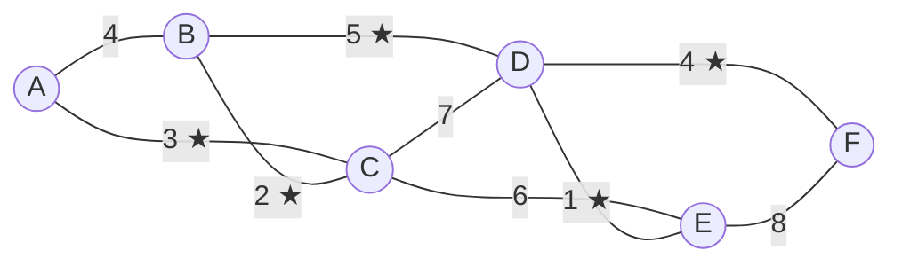
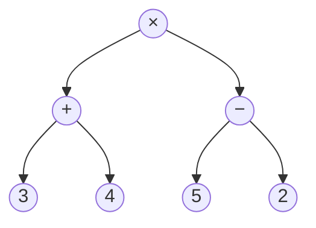

# DM-16 Trees and Spanning Trees

> [!info] Topic card
> **Unit:** U5 · **Time:** 5 h · **Verify with:** `kruskal(vertices, weighted_edges)` in [[DM Python Toolkit]]. Implementations: BST and traversals in [[PY-21 Data Structures and Algorithm Design]].

## 1. Learning objectives
1. **Define** trees and **use** their equivalent characterisations, including $|E| = |V| - 1$ (proved by induction).
2. **Use** rooted-tree terminology (root, parent, child, leaf, internal vertex, level, height), and the counting results for m-ary trees.
3. **Perform** pre-order, in-order and post-order traversals, and **relate** them to expression trees (prefix, infix and postfix notation).
4. **Construct** spanning trees with BFS/DFS, and **compute** minimum spanning trees with Kruskal's and Prim's algorithms by hand.
5. **Apply** trees to computing: file systems, BSTs, decision trees, network design.

## 2. Why it matters
Trees are the most common structure in computing: directory hierarchies, HTML/XML documents, parse trees in compilers, database indexes (B-trees), decision trees and organisation charts. Minimum spanning trees design the cheapest network that connects every site, e.g. campus cabling or rural electrification.

## 3. Prerequisites
[[DM-15 Graphs, Representations, Paths and Connectivity]] (paths, cycles, connectivity), [[DM-09 Mathematical Induction]] (proofs about trees).

## 4. Intuition
A tree is a graph that's **connected with no wasted edges**: there's exactly one route between any two vertices. Add any edge and you create a loop. Remove any edge and it falls into two pieces.

## 5. Rigorous explanation

### 5.1 Definition and characterisations
A **tree** is a connected undirected graph with no cycles (it's *acyclic*). A **forest** is an acyclic graph (a disjoint union of trees).
**Theorem.** For a simple graph $G$ with $n$ vertices, the following are equivalent:
1. $G$ is a tree.
2. There's a **unique** path between every pair of vertices.
3. $G$ is connected and has $n - 1$ edges.
4. $G$ is acyclic and has $n - 1$ edges.
5. $G$ is connected, and removing any edge disconnects it (every edge is a bridge).

**Proof that a tree with n vertices has n − 1 edges** (induction on n). Base n = 1: 0 edges ✔. Step: let T have $k + 1 \ge 2$ vertices. T has a **leaf** (a vertex of degree 1). Follow a longest path: its endpoint can't have another neighbour, because that would extend the path or create a cycle. Removing the leaf and its edge leaves a tree with k vertices, which has $k - 1$ edges by the IH. So T has $k$ edges ✔. ∎

### 5.2 Rooted trees
Choose a **root**. Then every vertex except the root has a unique **parent**. The terms are: **children**, **siblings**, **ancestors/descendants**, **leaf** (no children), **internal vertex** (has children), **level** (distance from the root), **height** $h$ (the maximum level).
**m-ary tree:** each internal vertex has at most m children. It's **full** if every internal vertex has exactly m children.
| Result (full m-ary tree, i internal vertices) | Formula |
|---|---|
| Total vertices | $n = mi + 1$ |
| Leaves | $\ell = (m-1)i + 1$ |
| Maximum leaves at height h | $\ell \le m^h$, so $h \ge \lceil\log_m \ell\rceil$ |
*Why $n = mi + 1$:* every vertex except the root is the child of exactly one internal vertex, and each internal vertex has m children, so $n - 1 = mi$.

### 5.3 Traversals
| Order | Rule | Expression-tree output |
|---|---|---|
| Pre-order | node, then left, then right | **prefix** (Polish) notation |
| In-order (binary trees) | left, then node, then right | **infix** (needs parentheses) |
| Post-order | left, then right, then node | **postfix** (Reverse Polish), evaluated with a stack ([[PY-21 Data Structures and Algorithm Design]]) |

### 5.4 Spanning trees
A **spanning tree** of a connected graph G is a subgraph that is a tree containing **all** of G's vertices. Every connected graph has one: BFS or DFS from any vertex builds one (the tree edges). $K_n$ has $n^{n-2}$ spanning trees (Cayley's formula), e.g. 16 for $K_4$.

### 5.5 Minimum spanning trees (MST)
In a connected weighted graph, an MST is a spanning tree with the minimum total weight.
- **Kruskal:** sort the edges by weight, and add each edge that **doesn't create a cycle** (use union–find to check), until you have n − 1 edges.
- **Prim:** start from any vertex, and repeatedly add the **cheapest edge leaving the tree**.
Both are **greedy and provably optimal**, because of the *cut property*: the lightest edge crossing any cut belongs to some MST. Contrast this with greedy coin change, which isn't always optimal ([[PY-08 Algorithmic Thinking, Pseudocode, Flowcharts and Tracing]]).

## 6. Terminology
| Term | Meaning |
|---|---|
| Tree / forest | Connected acyclic / acyclic |
| Leaf / internal vertex | Degree 1 (or no children) / has children |
| Level / height | Distance from the root / maximum level |
| m-ary / full / complete | At most m children / exactly m or 0 / all levels full except the last, filled left to right |
| Spanning tree | Tree containing all the vertices of a graph |
| MST | Spanning tree with minimum total weight |
| Union–find | Data structure tracking components for Kruskal |

## 7. Step-by-step: Kruskal by hand
Edges: A–B 4, A–C 3, B–C 2, B–D 5, C–D 7, C–E 6, D–E 1, D–F 4, E–F 8.
| Edge (sorted) | Weight | Creates a cycle? | Action | Components after |
|---|---|---|---|---|
| D–E | 1 | no | add | {D,E}, A, B, C, F |
| B–C | 2 | no | add | {D,E}, {B,C}, A, F |
| A–C | 3 | no | add | {D,E}, {A,B,C}, F |
| A–B | 4 | **yes** (A, B already joined via C) | skip | |
| D–F | 4 | no | add | {D,E,F}, {A,B,C} |
| B–D | 5 | no | add | {A,B,C,D,E,F} done (5 = n − 1 edges) |
**MST weight = 1 + 2 + 3 + 4 + 5 = 15.** Prim from A gives the same weight: A–C 3, C–B 2, B–D 5, D–E 1, D–F 4 = 15 (both verified with code).

## 8. Diagrams

### 8.1 The weighted graph, with the MST edges marked ★

### 8.2 Expression tree for (3 + 4) × (5 − 2)

*Pre-order: × + 3 4 − 5 2. In-order: (3 + 4) × (5 − 2). Post-order: 3 4 + 5 2 − ×, which evaluates to 7 × 3 = 21.*

## 9. Worked examples

### Example 1 (basic): tree facts
A tree has 12 vertices, so it has **11** edges. A connected graph with 12 vertices and 11 edges must be a tree (characterisation 3). A graph with 12 vertices and 12 edges can't be a tree.

### Example 2 (intermediate): full m-ary tree counting
A chain letter: each person who receives it sends it to 4 new people, and some stop. If 100 people sent it (internal vertices) and the tree is full 4-ary, then the total number of people is $n = 4\cdot100 + 1 = 401$, and the number who received it but didn't send it is $\ell = 3\cdot100 + 1 = 301$.
**A binary decision tree** distinguishing 1000 outcomes needs height $\ge\lceil\log_2 1000\rceil = 10$, so at least 10 yes/no questions in the worst case. (This is the same argument as the $\Omega(n\log n)$ sorting bound in [[PY-12 Searching, Sorting and Complexity]].)

### Example 3 (challenging): traversals of a BST
Insert 50, 30, 70, 20, 40, 60, 80 (the same tree as in [[PY-21 Data Structures and Algorithm Design]] §8.1).
Pre-order: 50 30 20 40 70 60 80. In-order: 20 30 40 50 60 70 80 (**sorted**, as it always is for a BST). Post-order: 20 40 30 60 80 70 50.
**Reconstruction:** a BST is determined by its pre-order sequence alone (the first element is the root, smaller elements form the left subtree, and larger ones the right).

## 10. Application: campus network design
Six buildings, with costs (in millions of TZS) to lay fibre between pairs given by the §7 graph. An MST connects all six buildings at the minimum cost of 15. **Caveat:** an MST has no redundancy, because every link is a bridge ([[DM-15 Graphs, Representations, Paths and Connectivity]] §10). For availability, engineers often add the cheapest extra links that remove the single points of failure. That's a cost-vs-resilience trade-off, of the kind analysed in [[PM-11 Risk Management]].

## 11. Common mistakes
| Mistake | Fix |
|---|---|
| Kruskal adding an edge between already-connected vertices | Track the components. Skip edges inside one component. |
| Prim choosing the cheapest edge overall, not the cheapest leaving the tree | Only consider edges with exactly one endpoint in the tree |
| Thinking the MST also gives shortest paths | No. Shortest paths come from Dijkstra. An MST minimises the *total* weight. |
| In-order traversal on non-binary trees | In-order is defined for binary trees |
| Counting n edges in a tree | n − 1 |

## 12. Comparison
| Algorithm | Strategy | Complexity (typical) | Good when |
|---|---|---|---|
| Kruskal | Sort edges, union–find | $O(E\log E)$ | Sparse graphs, edge lists |
| Prim (heap) | Grow a single tree | $O(E\log V)$ | Dense graphs, adjacency lists |
| BFS/DFS spanning tree | Any spanning tree | $O(V+E)$ | Unweighted |

## 13. Practice
**L1** 1. How many edges does a tree with 25 vertices have? 2. Give the pre-, in- and post-order traversals of the expression tree for $a + b\times c$.

**L2** 3. A full binary tree has 15 internal vertices. How many leaves and how many vertices does it have? 4. Is a connected graph with 8 vertices and 8 edges a tree? Explain.

**L3** 5. Run Prim from A on the §7 graph and list the edges in the order they're added. 6. Draw all the spanning trees of $C_4$, and of $K_4$ minus one edge.

**L4** 7. Prove that every tree with $n \ge 2$ vertices has at least two leaves. 8. Find an MST of this graph by Kruskal, showing the cycle checks: P–Q 7, P–R 5, Q–R 8, Q–S 9, Q–T 7, R–T 5, S–T 8, S–U 5, T–U 6, T–V 9, U–V 11.

**L5** 9. Prove the **cut property**: for any partition of V into $S$ and $V - S$, if $e$ is a strictly lightest edge crossing the cut, then $e$ belongs to every MST. Use the proof to explain why Kruskal's greedy choice is safe.

## 14. Hints
> [!tip]- Hints
> 2: the root is +, and its right child is ×. 3: $\ell = (m-1)i + 1$. 4: n − 1 = 7 ≠ 8. 7: consider a longest path, whose endpoints are leaves. 8: sort the edges: 5, 5, 5, 6, 7, 7, 8, 8, 9, 9, 11. 9: exchange argument. Suppose an MST T avoids e, add e to create a cycle, which must cross the cut on some other edge f, then swap them.

## 15. Worked solutions
> [!success]- Solutions 1–2
> 1. 24. 2. Pre: + a × b c. In: a + b × c. Post: a b c × +.

> [!success]- Solution 3
> $\ell = 15 + 1 = 16$ leaves, and $n = 2\cdot15 + 1 = 31$ vertices.

> [!success]- Solution 4
> No. A tree on 8 vertices has 7 edges, and a connected graph with 8 edges therefore contains exactly one cycle.

> [!success]- Solution 5
> Start at A. The cheapest edge out is A–C 3. From {A, C} the edges are A–B 4, C–B 2, C–D 7, C–E 6, so add **C–B 2**. From {A, B, C} the edges are B–D 5, C–D 7, C–E 6 (A–B is now internal), so add **B–D 5**. From {A, B, C, D}: D–E 1, D–F 4, C–E 6, so add **D–E 1**. Then **D–F 4**. Total 3 + 2 + 5 + 1 + 4 = 15 ✔.

> [!success]- Solution 6
> $C_4$ (edges 1–2, 2–3, 3–4, 4–1): remove any one edge, giving **4** spanning trees. $K_4$ minus one edge (say 1–2 removed) has 5 edges, and its spanning trees have 3 edges each. Of the $\binom53 = 10$ triples, the 2 that form triangles are rejected (1–3, 3–4, 4–1 and 2–3, 3–4, 4–2), leaving **8** spanning trees. (Check: $K_4$ has 16 spanning trees, and each of its 6 edges lies in 16·3/6 = 8 of them, so removing one edge leaves 16 − 8 = 8 ✔.)

> [!success]- Solution 7
> Let $P = v_0v_1\dots v_k$ be a longest path ($k \ge 1$ since there are at least 2 vertices and the tree is connected). If $v_0$ had a neighbour other than $v_1$, either that neighbour is on P (creating a cycle, which is impossible in a tree) or it isn't (extending P, contradicting maximality). So $\deg v_0 = 1$, and likewise $\deg v_k = 1$. That gives two leaves. ∎

> [!success]- Solution 8
> Sorted: P–R 5, R–T 5, S–U 5, T–U 6, P–Q 7, Q–T 7, R–Q 8, S–T 8, Q–S 9, T–V 9, U–V 11.
> Add P–R 5 ✔, R–T 5 ✔, S–U 5 ✔, T–U 6 ✔ (joining {P,R,T} with {S,U}), P–Q 7 ✔. Q–T 7 would make a cycle (Q–P–R–T), so skip it. Q–R 8: cycle, skip. S–T 8: cycle, skip. Q–S 9: cycle, skip. T–V 9 ✔ (6 edges = n − 1 for 7 vertices). **MST weight = 5 + 5 + 5 + 6 + 7 + 9 = 37.** (Swapping P–Q for Q–T, both weight 7, gives another MST of the same weight: MSTs need not be unique when weights tie.)

> [!success]- Solution 9
> Suppose an MST $T$ doesn't contain $e = \{u,v\}$, where $u\in S$ and $v\notin S$. Adding $e$ to $T$ creates a cycle (by uniqueness of paths in T). That cycle goes from $u$ to $v$, so besides $e$ it must cross the cut on some edge $f$. Then $T' = T + e - f$ is a spanning tree (connected, with n − 1 edges), and $w(T') = w(T) + w(e) - w(f) < w(T)$, since $e$ is strictly lighter. That contradicts the minimality of $T$. So $e$ is in every MST. ∎
> **Kruskal:** when it adds edge $e$ joining components $C_1$ and $C_2$, take the cut $S = C_1$. Every lighter edge has already been considered, and none of them crossed this cut (otherwise those components would already be joined), so $e$ is a lightest crossing edge. The cut property says it's safe. (With ties, "some MST" replaces "every MST".)

## 16. Self-test (pass ≥ 4/5)
1. How many edges in a tree with n vertices? 2. Which traversal of a BST gives sorted order? 3. Kruskal's rule for skipping an edge? 4. Vertices in a full 3-ary tree with 10 internal vertices? 5. Does an MST give shortest paths?
> [!success]- Answers
> 1. n − 1. 2. In-order. 3. Skip it if both endpoints are already in the same component (it would create a cycle). 4. 31. 5. No.

## 17. Flashcards
#flashcards/discrete-math
Tree definition?::Connected acyclic graph; equivalently unique path between every pair; n vertices and n−1 edges.
Full m-ary tree with i internal vertices has how many vertices?::mi + 1
Leaves in a full m-ary tree with i internal vertices?::(m−1)i + 1
Post-order of an expression tree gives?::Postfix (Reverse Polish) notation.
Kruskal's algorithm?::Add edges in increasing weight unless they create a cycle.
Prim's algorithm?::Grow a tree by repeatedly adding the cheapest edge leaving it.
Cayley's formula?::K_n has nⁿ⁻² spanning trees.

## 18. Blank-page recall
Prove $|E| = n - 1$ by induction, then run Kruskal on the §7 graph from memory with the component table.

## 19. Revision summary
- Tree = connected + acyclic = unique paths = n − 1 edges and connected.
- Rooted m-ary counting: $n = mi + 1$ and $\ell = (m-1)i + 1$. Height ≥ $\log_m$ (leaves).
- Traversals: pre (prefix), in (infix, sorted for a BST), post (postfix).
- MST: Kruskal (sort + cycle check) or Prim (grow the cheapest frontier). The cut property guarantees optimality.

## 20. Links
Prev: [[DM-15 Graphs, Representations, Paths and Connectivity]] · Next: [[DM-17 Boolean Algebra and Logic Circuits]] · Implementation: [[PY-21 Data Structures and Algorithm Design]] · Integration: [[X-02 Graph Theory in Algorithms, Networks and Scheduling]]

## 21. Sources
- Rosen (2019), ch. 11 "Trees" (properties, traversal, spanning trees, minimum spanning trees).
- Kruskal, J. B., "On the shortest spanning subtree of a graph and the traveling salesman problem", *Proceedings of the AMS*, 7(1), 1956, pp. 48–50.
- Prim, R. C., "Shortest connection networks and some generalizations", *Bell System Technical Journal*, 36(6), 1957, pp. 1389–1401.

## 22. Mastery checklist
- [ ] Tree characterisations and the edge-count proof recalled
- [ ] Kruskal and Prim run by hand, with matching weights
- [ ] Cut-property proof understood (practice 9) · reviews scheduled
