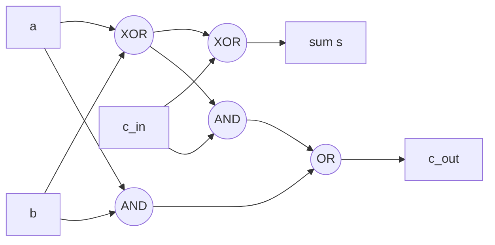

# DM-17 Boolean Algebra and Logic Circuits

> [!info] Topic card
> **Unit:** U6 · **Time:** 4–5 h · **Verify with:** `minterms(expr, vars)` and `equivalent(...)` in [[DM Python Toolkit]] (all the simplifications below were checked this way)

## 1. Learning objectives
1. **Use** Boolean algebra notation ($\overline{x}$, $+$, $\cdot$) and its identities, including **duality**.
2. **Express** any Boolean function in canonical sum-of-products (SOP, minterm) form, and in product-of-sums (POS) form.
3. **Simplify** functions of 2–4 variables with algebraic laws and **Karnaugh maps**.
4. **Draw and analyse** circuits built from AND, OR, NOT, NAND, NOR and XOR gates.
5. **Design** a half adder and a full adder, and **explain** how adders chain together to add binary numbers.

## 2. Why it matters
Every processor is built from logic gates. Simplifying a Boolean function means fewer gates: cheaper, faster, lower-power hardware. The same algebra simplifies software conditions ([[PY-04 Conditions and Branching]]) and search filters, and it's the foundation of bit manipulation (masks and permission flags, [[CS-10 Operating System Security and Hardening]]).

## 3. Prerequisites
[[DM-02 Logical Equivalence and Laws of Logic]]. Boolean algebra *is* propositional logic in arithmetic notation.

## 4. Intuition
Replace True/False with 1/0, "or" with +, "and" with ·, and "not" with a bar. Then $x + y$ means "at least one is 1" and $xy$ means "both are 1". A circuit is a physical formula: wires carry 0/1 and gates compute the connectives.

## 5. Rigorous explanation

### 5.1 Notation and correspondence
| Logic | Boolean algebra | Gate | Python bitwise |
|---|---|---|---|
| ¬p | $\overline{x}$ (or $x'$) | NOT | `~x & 1`, or `1 - x` |
| p ∧ q | $x\cdot y$ (or $xy$) | AND | `x & y` |
| p ∨ q | $x + y$ | OR | `x \| y` |
| p ⊕ q | $x \oplus y$ | XOR | `x ^ y` |
| ¬(p ∧ q) | $\overline{xy}$ | NAND | |
| ¬(p ∨ q) | $\overline{x+y}$ | NOR | |
Note that $1 + 1 = 1$ in Boolean algebra (OR), not 2.

### 5.2 Identities and duality
All the laws of [[DM-02 Logical Equivalence and Laws of Logic]] carry over: $x + 0 = x$, $x\cdot1 = x$, $x + \overline{x} = 1$, $x\overline{x} = 0$, $x + x = x$, $x + xy = x$ (absorption), $\overline{x+y} = \overline{x}\,\overline{y}$ (De Morgan), and $x + yz = (x+y)(x+z)$ (OR distributes over AND, unlike in ordinary arithmetic).
**Duality:** swapping + ↔ · and 0 ↔ 1 in any identity gives another valid identity. E.g. $x + 0 = x$ becomes $x\cdot1 = x$.
**Consensus theorem:** $xy + \overline{x}z + yz = xy + \overline{x}z$ (the term $yz$ is redundant).

### 5.3 Canonical forms
- A **minterm** of n variables is a product containing every variable exactly once (complemented or not). It equals 1 in exactly one row of the truth table. Index the rows as binary numbers: for (A, B, C), the minterm $A\overline{B}C$ is row 101, which is $m_5$.
- **SOP / DNF:** $f = \sum m(\text{rows where } f = 1)$. **POS / CNF:** a product of maxterms for the rows where $f = 0$.
- Every Boolean function has a unique canonical SOP. Simplification finds a *shorter* equivalent SOP.

### 5.4 Karnaugh maps
A grid of the truth table, arranged in **Gray-code order** (00, 01, 11, 10) so that adjacent cells differ in exactly one variable, **including wrap-around** from edge to edge.
**Rules:** circle groups of 1s of size 1, 2, 4 or 8 (powers of two), rectangular, as **large** as possible, using as **few** groups as possible. Overlapping groups are allowed. Each group gives the product of the variables that are **constant** across it.

### 5.5 Adders
- **Half adder** (adds bits a, b): sum $s = a\oplus b$, carry $c = ab$.
- **Full adder** (adds a, b and a carry-in $c_{in}$): $s = a\oplus b\oplus c_{in}$ and $c_{out} = ab + c_{in}(a\oplus b)$ (equivalently the majority function $ab + ac_{in} + bc_{in}$).
- A **ripple-carry adder** chains n full adders to add n-bit numbers. The carry ripples from the low bit to the high bit, so the delay grows with n.

## 6. Terminology
| Term | Meaning |
|---|---|
| Boolean function | $f:\{0,1\}^n\to\{0,1\}$ (there are $2^{2^n}$ of them) |
| Literal | A variable or its complement |
| Minterm / maxterm | Product true in one row / sum false in one row |
| SOP / POS | Sum of products / product of sums |
| Gray code | Ordering in which neighbours differ in one bit |
| Implicant / prime implicant | A product term that implies f / one that can't be enlarged |
| Gate / circuit | A hardware connective / a network of gates |

## 7. Step-by-step: simplify $f(A,B,C) = \sum m(1,3,4,5,7)$ with a K-map
Rows where f = 1: 001, 011, 100, 101, 111.

| A \ BC | 00 | 01 | 11 | 10 |
|---|---|---|---|---|
| **0** | 0 | **1** ($m_1$) | **1** ($m_3$) | 0 |
| **1** | **1** ($m_4$) | **1** ($m_5$) | **1** ($m_7$) | 0 |

1. **Group 1:** the four cells of the C = 1 columns (BC = 01 and 11, in both rows): $m_1, m_3, m_5, m_7$. Only C is constant, so this group gives **C**.
2. **Group 2:** $m_4, m_5$ (row A = 1, columns 00 and 01): A = 1 and B = 0 are constant, giving $A\overline{B}$.
3. **Result:** $f = C + A\overline{B}$. Check: the toolkit's `minterms("C or (A and not B)", ["A","B","C"])` returns [1, 3, 4, 5, 7] ✔. The circuit drops from 5 three-input AND gates plus a 5-input OR to one AND, one NOT and one OR.

## 8. Diagram: a full adder from gates

*Text version: the first XOR computes a⊕b. The second XOR combines it with c_in to give the sum. The carry out is 1 if both a and b are 1 (first AND), or if c_in is 1 and exactly one of a, b is 1 (second AND). The two ANDs are combined by an OR.*

## 9. Worked examples

### Example 1 (basic): algebraic simplification
$\overline{A}B + AB + A\overline{B} = B(\overline{A} + A) + A\overline{B} = B + A\overline{B} = (B + A)(B + \overline{B}) = A + B$.
(Distribute OR over AND: $B + A\overline{B} = (B + A)(B + \overline{B})$.)

### Example 2 (intermediate): a 4-variable K-map with wrap-around
$f(A,B,C,D) = \sum m(0,1,2,3,8,9,10,11,14,15)$.
| AB \ CD | 00 | 01 | 11 | 10 |
|---|---|---|---|---|
| **00** | 1 | 1 | 1 | 1 |
| **01** | 0 | 0 | 0 | 0 |
| **11** | 0 | 0 | 1 | 1 |
| **10** | 1 | 1 | 1 | 1 |
- Rows AB = 00 and AB = 10 are adjacent (top and bottom **wrap around**): an 8-cell group where only B = 0 is constant, giving $\overline{B}$.
- Cells $m_{10}, m_{11}, m_{14}, m_{15}$ (rows 11 and 10, columns 11 and 10): A = 1 and C = 1 are constant, giving $AC$.
- **Result:** $f = \overline{B} + AC$ (verified with the toolkit).

### Example 3 (challenging): the consensus theorem in practice
$f = A\overline{C} + \overline{A}B + B\overline{C}$. The term $B\overline{C}$ is the consensus of $A\overline{C}$ and $\overline{A}B$ (with x = A, y = $\overline{C}$, z = B), so $f = A\overline{C} + \overline{A}B$. That saves one AND gate. Check: both expressions give the minterms [2, 3, 4, 6] ✔.
*(In real hardware, designers sometimes **keep** a consensus term deliberately, to prevent a "hazard", a momentary glitch when inputs change. Simplest isn't always best.)*

### Example 4 (design): a majority voter
Three sensors each report 1 = "fire". The alarm should sound if at least two report fire. The truth table gives 1 in rows 011, 101, 110, 111, i.e. $\sum m(3,5,6,7)$. K-map grouping gives $f = AB + AC + BC$. That's the same function as $c_{out}$ of a full adder, and the majority function of [[DM-02 Logical Equivalence and Laws of Logic]] Example 4. **Triple modular redundancy**, used in safety-critical systems, votes over three copies with exactly this circuit.

## 10. Application: bit masks and permissions
Unix permissions `rwx` are 3 bits: read = 4 (100), write = 2 (010), execute = 1 (001). For `mode = 0b110` (rw-): "can write?" is `mode & 0b010 != 0`, "grant execute" is `mode | 0b001`, "revoke write" is `mode & ~0b010`. These are Boolean operations applied bitwise ([[CS-10 Operating System Security and Hardening]], [[LAB-CS-04 File Permission Audit]]).

## 11. Common mistakes
| Mistake | Fix |
|---|---|
| $1 + 1 = 2$ | In Boolean algebra, $1 + 1 = 1$ |
| K-map columns in binary order 00, 01, 10, 11 | Use Gray order 00, 01, 11, 10 |
| Forgetting wrap-around adjacency | The edges of the map are adjacent |
| Groups of 3 or 6 | Only powers of two |
| Not making groups as large as possible | Larger groups give fewer literals |
| $\overline{AB} = \overline{A}\,\overline{B}$ | De Morgan: $\overline{AB} = \overline{A} + \overline{B}$ |

## 12. Comparison
| Method | Scales to | Pros | Cons |
|---|---|---|---|
| Algebra | Any size | Exact, explains | Needs insight |
| Karnaugh map | 2–4 (5) variables | Visual, quick | Impractical for large n |
| Quine–McCluskey | Larger | Systematic, programmable | Exponential worst case |
| SAT / logic-synthesis tools | Industrial | Automatic | Black box |

## 13. Practice
**L1** 1. Evaluate $\overline{1\cdot0} + 0$ and $1 + 1\cdot0$. 2. State the dual of $x + \overline{x}y = x + y$.

**L2** 3. Write the canonical SOP of the function that is 1 exactly when A = B. 4. Simplify algebraically: $AB + A\overline{B}C + A\overline{B}\,\overline{C}$.

**L3** 5. Simplify with a K-map: $f(A,B,C) = \sum m(0,2,4,5,6)$. 6. Simplify with a K-map: $f(A,B,C,D) = \sum m(0,2,5,7,8,10,13,15)$.

**L4** 7. Design a circuit (truth table, SOP, simplified form) for a 2-bit comparator output $G = 1$ iff $A_1A_0 > B_1B_0$ as binary numbers. 8. Show how to build NOT, AND and OR using only NAND gates, and count the gates in an XOR built from NANDs (4 is achievable).

**L5** 9. A 4-bit ripple-carry adder adds 0111 + 0101. Trace each full adder's inputs and outputs (a, b, c_in, s, c_out) from bit 0 upward, and state the 4-bit result and final carry. Then explain why carry-lookahead adders exist.

## 14. Hints
> [!tip]- Hints
> 3: the rows 00 and 11. 4: factor out A. 5: the cells 0, 2, 4, 6 form the C̄ group (wrap-around), and 4, 5 give AB̄. 6: the four corners, and the centre group. 7: G = A₁B̄₁ + (A₁ ⊙ B₁)A₀B̄₀, where ⊙ is XNOR. 9: 7 + 5 = 12.

## 15. Worked solutions
> [!success]- Solutions 1–2
> 1. $\overline{0} + 0 = 1$, and $1 + 0 = 1$. 2. $x\cdot(\overline{x} + y) = x\cdot y$.

> [!success]- Solution 3
> $\overline{A}\,\overline{B} + AB$ (that's XNOR: $\overline{A\oplus B}$).

> [!success]- Solution 4
> $AB + A\overline{B}(C + \overline{C}) = AB + A\overline{B} = A(B + \overline{B}) = A$.

> [!success]- Solution 5
> The 1s are at 000, 010, 100, 101, 110. Group the cells with C = 0 (0, 2, 4, 6: both rows, columns BC = 00 and 10, adjacent by wrap-around) to get $\overline{C}$. Group 4 and 5 (A = 1, B = 0) to get $A\overline{B}$. **$f = \overline{C} + A\overline{B}$.**

> [!success]- Solution 6
> The 1s: 0 (0000), 2 (0010), 8 (1000), 10 (1010), the **four corners**, where B = 0 and D = 0, giving $\overline{B}\,\overline{D}$. And 5 (0101), 7 (0111), 13 (1101), 15 (1111), a centre 2×2 block where B = 1 and D = 1, giving $BD$. **$f = \overline{B}\,\overline{D} + BD = \overline{B\oplus D}$** (the XNOR of B and D).

> [!success]- Solution 7
> $G = 1$ when $A_1 = 1, B_1 = 0$, or when $A_1 = B_1$ and $A_0 = 1, B_0 = 0$. So $G = A_1\overline{B_1} + \overline{(A_1\oplus B_1)}\,A_0\overline{B_0}$. Expanded and simplified, $G = A_1\overline{B_1} + A_1A_0\overline{B_0} + \overline{B_1}A_0\overline{B_0}$ (6 of the 16 rows are true: 01>00, 10>00, 10>01, 11>00, 11>01, 11>10).

> [!success]- Solution 8
> NOT $x = x\uparrow x$. AND $= (x\uparrow y)\uparrow(x\uparrow y)$. OR $= (x\uparrow x)\uparrow(y\uparrow y)$. **XOR with 4 NANDs:** $n_1 = x\uparrow y$, then $x\oplus y = (x\uparrow n_1)\uparrow(y\uparrow n_1)$.

> [!success]- Solution 9
> 0111 (7) + 0101 (5):
> | bit | a | b | c_in | s | c_out |
> |---|---|---|---|---|---|
> | 0 | 1 | 1 | 0 | 0 | 1 |
> | 1 | 1 | 0 | 1 | 0 | 1 |
> | 2 | 1 | 1 | 1 | 1 | 1 |
> | 3 | 0 | 0 | 1 | 1 | 0 |
> Result **1100** = 12, with final carry 0 ✔. **Carry-lookahead:** each bit waits for the carry from the bit below, so the delay grows linearly with the word size (64 stages for 64-bit numbers). Lookahead adders compute the carries in parallel from "generate" ($a_ib_i$) and "propagate" ($a_i\oplus b_i$) signals, giving logarithmic delay at the cost of more gates.

## 16. Self-test (pass ≥ 4/5)
1. What's $x + x\cdot y$? 2. What order do K-map axes use? 3. The sum and carry of a half adder? 4. How many Boolean functions of 2 variables are there? 5. Is NOR functionally complete?
> [!success]- Answers
> 1. $x$ (absorption). 2. Gray code: 00, 01, 11, 10. 3. $s = a\oplus b$, $c = ab$. 4. $2^{2^2} = 16$. 5. Yes.

## 17. Flashcards
#flashcards/discrete-math
Boolean 1 + 1?::1 (OR)
Duality principle?::Swap + ↔ · and 0 ↔ 1 in an identity to get another identity.
K-map grouping rules?::Rectangular groups of 1, 2, 4, 8 cells, as large and few as possible, wrap-around allowed.
Full adder outputs?::s = a⊕b⊕c_in, c_out = ab + c_in(a⊕b)
Consensus theorem?::xy + x̄z + yz = xy + x̄z
Minterm index of A B̄ C?::Binary 101, which is m₅.

## 18. Blank-page recall
Draw a 3-variable K-map with its Gray-code axes, simplify Σm(1,3,4,5,7), and draw a full adder from gates.

## 19. Revision summary
- Boolean algebra is logic in 0/1 arithmetic notation, and the laws carry over (plus duality).
- Canonical SOP comes from the 1-rows (minterms).
- K-maps use Gray order and wrap-around, with power-of-two groups that are as large as possible.
- Gates implement the connectives. NAND/NOR alone are complete. Adders = XOR + majority.

## 20. Links
Prev: [[DM-16 Trees and Spanning Trees]] · Next: [[DM-18 Introductory Discrete Probability]] · Related: [[DM-01 Propositions, Connectives and Truth Tables]], [[DM-02 Logical Equivalence and Laws of Logic]], [[PY-02 Variables, Types, Expressions and Operators]] (bitwise operators), [[CS-10 Operating System Security and Hardening]]

## 21. Sources
- Rosen (2019), ch. 12 "Boolean Algebra" (functions, representing functions, logic gates, minimisation with K-maps).
- Mano, M. M. & Ciletti, M. D., *Digital Design*, 6th ed., Pearson, 2018 (adders, K-maps, hazards).
- Karnaugh, M., "The map method for synthesis of combinational logic circuits", *Transactions of the AIEE, Part I*, 72(5), 1953, pp. 593–599.

## 22. Mastery checklist
- [ ] K-maps with 3 and 4 variables simplified correctly (checked with the toolkit)
- [ ] Full adder designed and traced
- [ ] NAND-only constructions reproduced · reviews scheduled
