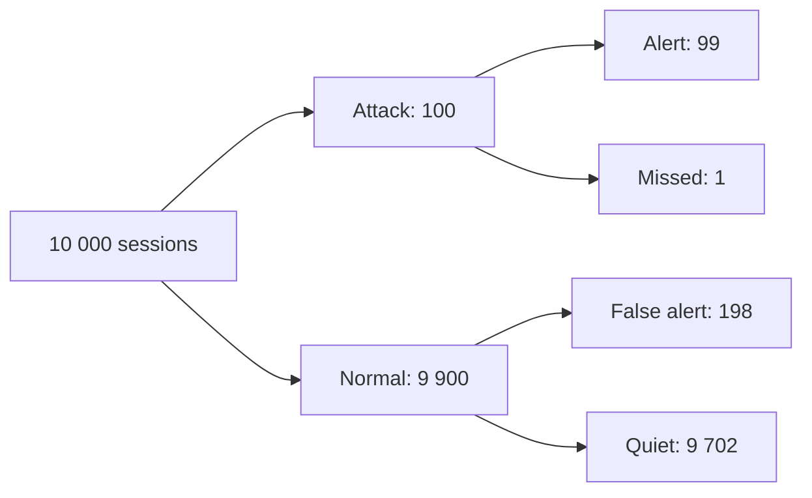

# DM-18 Introductory Discrete Probability

> [!info] Topic card
> **Unit:** U4 · **Status:** *supplementary* (often included in discrete mathematics courses, but check your syllabus) · **Time:** 4 h · All the figures below were computed with Python before being written.

## 1. Learning objectives
1. **Define** sample spaces, events and probability for equally likely outcomes, and **use** the complement and union rules.
2. **Compute** conditional probabilities, and **test** independence.
3. **Apply** Bayes' theorem, including the **base-rate** effect (e.g. intrusion-detection alerts).
4. **Define** random variables and expectation, and **use** the linearity of expectation.
5. **Use** the binomial distribution and the birthday problem to reason about failures and hash collisions.

## 2. Why it matters
Security alerts, spam filters, test reliability, network packet loss, hash collisions and project risk ([[PM-11 Risk Management]]) are all probability questions. Misjudging base rates is one of the most common reasoning errors in security operations ([[CS-15 Logging, Monitoring, Incident Response and Recovery]]).

## 3. Prerequisites
[[DM-11 Counting Principles, Permutations and Combinations]] (counting outcomes), [[DM-12 Pigeonhole Principle and Inclusion-Exclusion]] (unions), [[DM-13 Binomial Theorem and Pascal's Triangle]] ($\binom nk$).

## 4. Intuition
Probability is **counting with a ratio**. When all outcomes are equally likely, $P(\text{event}) = \frac{\text{favourable outcomes}}{\text{all outcomes}}$. Conditional probability means **shrinking the world** to the outcomes where the condition holds, then counting again.

## 5. Rigorous explanation

### 5.1 Basics
- **Sample space** $S$: the set of all outcomes. **Event** $E\subseteq S$.
- Equally likely outcomes: $P(E) = |E|/|S|$.
- **Axioms** (general case): $0 \le P(E) \le 1$, $P(S) = 1$, and for disjoint events $P(E\cup F) = P(E) + P(F)$.
- **Complement:** $P(\overline{E}) = 1 - P(E)$, the best tool for "at least one".
- **Union:** $P(E\cup F) = P(E) + P(F) - P(E\cap F)$ (inclusion–exclusion).

### 5.2 Conditional probability and independence
$$P(E\mid F) = \frac{P(E\cap F)}{P(F)},\quad P(F) > 0$$
Multiplication rule: $P(E\cap F) = P(E\mid F)P(F)$.
$E$ and $F$ are **independent** iff $P(E\cap F) = P(E)P(F)$ (equivalently, $P(E\mid F) = P(E)$). Disjoint events with positive probability are **not** independent: if one happens, the other can't.

### 5.3 Bayes' theorem
$$P(A\mid B) = \frac{P(B\mid A)\,P(A)}{P(B)},\qquad P(B) = P(B\mid A)P(A) + P(B\mid\overline{A})P(\overline{A})$$
(law of total probability in the denominator).

### 5.4 Random variables and expectation
A **random variable** $X: S\to\mathbb{R}$. **Expectation** $E[X] = \sum_x x\,P(X = x)$.
**Linearity:** $E[X + Y] = E[X] + E[Y]$ **always**, even for dependent variables. Write a count as a sum of 0/1 indicator variables, then add their probabilities.
**Binomial distribution:** in $n$ independent trials, each succeeding with probability $p$, $P(X = k) = \binom nkp^k(1-p)^{n-k}$, with $E[X] = np$.

### 5.5 The birthday problem (collisions)
For $n$ people and $m$ equally likely birthdays, $P(\text{no shared birthday}) = \prod_{i=0}^{n-1}\left(1 - \frac im\right)$. With $m = 365$: $n = 23$ gives $P(\text{shared}) \approx 0.507$, and $n = 50$ gives $\approx 0.970$. In general a collision becomes likely at $n \approx 1.1774\sqrt{m}$. For a 32-bit hash ($m = 2^{32}$) that's about **77 000** items (77 164 computed exactly), far fewer than $2^{32} \approx 4.3$ billion. This is why hash outputs must be long ([[CS-06 Hashes, MACs and Integrity]]).

## 6. Terminology
| Term | Meaning |
|---|---|
| Outcome / sample space / event | Single result / all results / set of results |
| Mutually exclusive | Can't both happen ($E\cap F = \varnothing$) |
| Independent | $P(E\cap F) = P(E)P(F)$ |
| Conditional probability | Probability given that another event occurred |
| Base rate (prior) | $P(A)$ before any evidence |
| Expected value | Probability-weighted average |
| Indicator variable | 1 if an event occurs, else 0 |

## 7. Step-by-step: Bayes for an intrusion-detection alert
An IDS flags 99% of real attacks (sensitivity) and falsely flags 2% of normal sessions. 1% of sessions are attacks. **Given an alert, what's the probability it's a real attack?**
1. Prior: $P(A) = 0.01$ and $P(\overline{A}) = 0.99$.
2. Likelihoods: $P(\text{alert}\mid A) = 0.99$ and $P(\text{alert}\mid\overline{A}) = 0.02$.
3. Total: $P(\text{alert}) = 0.99\cdot0.01 + 0.02\cdot0.99 = 0.0099 + 0.0198 = 0.0297$.
4. Posterior: $P(A\mid\text{alert}) = 0.0099/0.0297 = \mathbf{1/3}$.
**Two out of three alerts are false alarms**, despite "99% accuracy". If attacks are rarer (0.1%), it drops to about **4.7%**. Hence alert fatigue, and the need for triage and correlation in a security operations centre.

## 8. Diagram: probability tree for §7 (per 10 000 sessions)

*Text version: of 10 000 sessions, 100 are attacks (99 alerted, 1 missed) and 9 900 normal (198 false alerts). Alerts total 99 + 198 = 297, of which 99 are real: 99/297 = 1/3. Thinking in natural frequencies like this makes Bayes intuitive.*

## 9. Worked examples

### Example 1 (basic): dice and complements
Two fair dice: $|S| = 36$. $P(\text{sum} = 7) = 6/36 = 1/6$. $P(\text{at least one six}) = 1 - P(\text{no six}) = 1 - 25/36 = 11/36$.

### Example 2 (intermediate): cards without replacement
$P(\text{two aces when drawing 2 cards}) = \frac{4}{52}\cdot\frac{3}{51} = \frac{1}{221}$. Equivalently by counting, $\binom42/\binom{52}{2} = 6/1326 = 1/221$ ✔.

### Example 3 (intermediate): binomial reliability
A deployment script contacts 10 servers, and each fails independently with probability 0.1. $P(\text{at least one failure}) = 1 - 0.9^{10} \approx 0.651$. $P(\text{exactly 2 failures}) = \binom{10}{2}0.1^2\,0.9^8 \approx 0.194$. Expected failures: $E = np = 1$. **Lesson:** "rare per component" becomes "likely overall" at scale, so design for failure ([[PY-15 Exceptions and Defensive Programming]] retries, [[SD-17 Secure and Reliable Software Design]]).

### Example 4 (challenging): linearity of expectation
In the 5-student peer-marking shuffle ([[DM-12 Pigeonhole Principle and Inclusion-Exclusion]] practice 7), what is the **expected** number of students who get their own paper? Let $X_i = 1$ if student $i$ gets their own. Then $P(X_i = 1) = 1/5$, so $E[X] = \sum E[X_i] = 5\cdot\frac15 = 1$. This holds for **any** n, even though the $X_i$ are dependent. You never need the full distribution.

### Example 5 (exam strategy): guessing a multiple-choice test
10 questions with 4 options each, all guessed at random: $P(\ge 5\text{ correct}) = \sum_{k=5}^{10}\binom{10}{k}0.25^k0.75^{10-k} \approx 0.078$. Expected score: $10\cdot0.25 = 2.5$. Guessing isn't a strategy.

## 10. Application: password guessing
A 4-digit PIN with 3 attempts before lockout: $P(\text{attacker succeeds}) = 3/10\,000 = 0.0003$ (if PINs are chosen uniformly, which humans don't do!). Without lockout, the attacker succeeds with probability 1 after at most 10 000 tries, with an expected $\approx 5000$. **Rate limiting turns certainty into a tiny probability**, a quantitative argument for lockout policies ([[CS-08 Password Storage and Authentication Security]]).

## 11. Common mistakes
| Mistake | Fix |
|---|---|
| Treating disjoint as independent | Disjoint events (positive probability) are dependent |
| $P(A\mid B) = P(B\mid A)$ (prosecutor's fallacy) | Use Bayes. The base rate matters. |
| Adding the probabilities of overlapping events | Subtract the intersection |
| "At least one" computed directly | Complement |
| Assuming independence without justification | State and justify it |
| Thinking 23 people means a 23/365 chance | Count *pairs*: $\binom{23}{2} = 253$ opportunities |

## 12. Comparison
| Concept | Formula | Use |
|---|---|---|
| Complement | $1 - P(E)$ | "at least one" |
| Union | $P(E)+P(F)-P(E\cap F)$ | "E or F" |
| Conditional | $P(E\cap F)/P(F)$ | "given that" |
| Bayes | $P(B\mid A)P(A)/P(B)$ | Reverse the conditioning |
| Expectation | $\sum xP(x)$, linear | Average outcome |

## 13. Practice
**L1** 1. A fair coin is tossed 3 times. Find $P(\text{exactly two heads})$. 2. Are "the die shows 1" and "the die shows 2" independent?

**L2** 3. A card is drawn: find $P(\text{heart or king})$. 4. Find $P(\text{at least one head in 5 tosses})$.

**L3** 5. In a class, 60% study Python and 40% study Cyber Security, and 25% study both. Given a student studies Cyber Security, what's the probability they study Python? Are the two independent? 6. 8 bits are each flipped independently with probability 0.01 during transmission. Find P(no error) and P(at most one error).

**L4** 7. A spam filter flags 95% of spam and 3% of legitimate mail. 20% of mail is spam. Find P(spam | flagged) and P(legitimate | not flagged). 8. How many people are needed for $P(\text{shared birthday}) > 0.5$? Verify with a short Python loop, and explain the result using pair counting.

**L5** 9. A team stores session IDs as random 64-bit values. (a) Estimate the number of sessions at which a collision becomes 50% likely. (b) Is this a security problem for a site with 10 million active sessions? (c) Recommend an ID length and justify it. (Use $n\approx1.1774\sqrt{m}$.)

## 14. Hints
> [!tip]- Hints
> 3: inclusion–exclusion: 13/52 + 4/52 − 1/52. 5: P(P | C) = P(P ∩ C)/P(C). 6: $0.99^8$, plus $8\cdot0.01\cdot0.99^7$. 7: use a natural-frequency table of 1000 emails. 9: $\sqrt{2^{64}} = 2^{32}$.

## 15. Worked solutions
> [!success]- Solutions 1–2
> 1. $\binom32/8 = 3/8$. 2. No: they're disjoint, so $P(\text{both}) = 0 \ne \frac16\cdot\frac16$.

> [!success]- Solutions 3–4
> 3. $16/52 = 4/13$. 4. $1 - (1/2)^5 = 31/32$.

> [!success]- Solution 5
> $P(P\mid C) = 0.25/0.40 = 0.625$. Independence would require $P(P\cap C) = 0.6\cdot0.4 = 0.24$, but it's 0.25. Not independent (though close).

> [!success]- Solution 6
> $P(\text{no error}) = 0.99^8 \approx 0.9227$. $P(\le1) = 0.99^8 + 8(0.01)(0.99^7) \approx 0.9227 + 0.0746 = 0.9973$.

> [!success]- Solution 7
> Per 1000 emails: 200 spam (190 flagged, 10 not flagged) and 800 legitimate (24 flagged, 776 not). $P(\text{spam}\mid\text{flagged}) = 190/214 \approx 0.888$. $P(\text{legit}\mid\text{not flagged}) = 776/786 \approx 0.987$.

> [!success]- Solution 8
> **23** (P ≈ 0.507, versus 0.476 for 22).
> ```python
> p, n = 1.0, 0
> while 1 - p <= 0.5:
>     p *= (365 - n) / 365
>     n += 1
> print(n)   # 23
> ```
> With 23 people there are $\binom{23}{2} = 253$ pairs, each sharing a birthday with probability 1/365. Many opportunities make a match likely.

> [!success]- Solution 9
> (a) $n \approx 1.1774\cdot2^{32} \approx 5.06\times10^9$ sessions. (b) With $10^7$ sessions the collision probability is $\approx\frac{n^2}{2m} = \frac{10^{14}}{2\cdot1.8\times10^{19}} \approx 2.7\times10^{-6}$, which is small. **But** the bigger risk is *guessing*: an attacker trying random IDs succeeds with probability $10^7/2^{64} \approx 5.4\times10^{-13}$ per guess. That's fine with rate limiting, but there's little margin for very high guess volumes. (c) Use ≥ 128 bits from `secrets.token_urlsafe(16)` or more ([[PY-24 Secure Programming and Input Validation]]). This is OWASP's guidance for session-ID entropy, and both collisions and guessing become astronomically unlikely.

## 16. Self-test (pass ≥ 4/5)
1. $P(\overline{E})$? 2. Definition of independence? 3. Why is P(attack | alert) low in §7? 4. $E[X]$ for a binomial distribution? 5. Roughly when is a collision likely among $m$ hash values?
> [!success]- Answers
> 1. $1 - P(E)$. 2. $P(E\cap F) = P(E)P(F)$. 3. The base rate of attacks is low, so false positives from the large normal population outnumber the true positives. 4. $np$. 5. At around $\sqrt{m}$ items ($\approx 1.18\sqrt m$ for 50%).

## 17. Flashcards
#flashcards/discrete-math
Conditional probability?::P(E|F) = P(E∩F)/P(F)
Bayes' theorem?::P(A|B) = P(B|A)P(A)/P(B)
Independent events?::P(E∩F) = P(E)·P(F)
Linearity of expectation?::E[X+Y] = E[X] + E[Y], always (even if dependent).
Binomial P(X = k)?::C(n,k) pᵏ (1−p)ⁿ⁻ᵏ
Birthday bound?::Collisions become likely after ~√m items (≈1.18√m for 50%).
Base-rate fallacy?::Ignoring the prior; rare events make most positive alerts false alarms.

## 18. Blank-page recall
Redo the IDS Bayes calculation as a frequency tree, and state the birthday result with its security implication.

## 19. Revision summary
- Probability = favourable/total (equally likely outcomes). Use the complement for "at least one".
- Conditional probability shrinks the world. Independence: the product rule holds.
- Bayes combines the prior with the evidence, and base rates dominate for rare events.
- Linearity of expectation with indicators. Binomial for repeated independent trials.
- The birthday bound says hashes and IDs need long outputs.

## 20. Links
Prev: [[DM-17 Boolean Algebra and Logic Circuits]] · Next: [[MOCK-DM-01 Discrete Mathematics Mock Examination]] · Applied: [[CS-06 Hashes, MACs and Integrity]], [[CS-15 Logging, Monitoring, Incident Response and Recovery]], [[PM-11 Risk Management]], [[PM-07 PERT and Schedule Estimation]]

## 21. Sources
- Rosen (2019), ch. 7 "Discrete Probability" (probability theory, Bayes' theorem, expected value).
- Gigerenzer, G., *Calculated Risks*, Simon & Schuster, 2002 (natural frequencies, base-rate errors).
- Axelsson, S., "The base-rate fallacy and the difficulty of intrusion detection", *ACM Transactions on Information and System Security*, 3(3), 2000, pp. 186–205.
- OWASP *Session Management Cheat Sheet* (session ID entropy): https://cheatsheetseries.owasp.org/

## 22. Mastery checklist
- [ ] I solve Bayes problems with frequency trees
- [ ] I use linearity of expectation with indicators
- [ ] Practice 9 answered with justification · reviews scheduled
