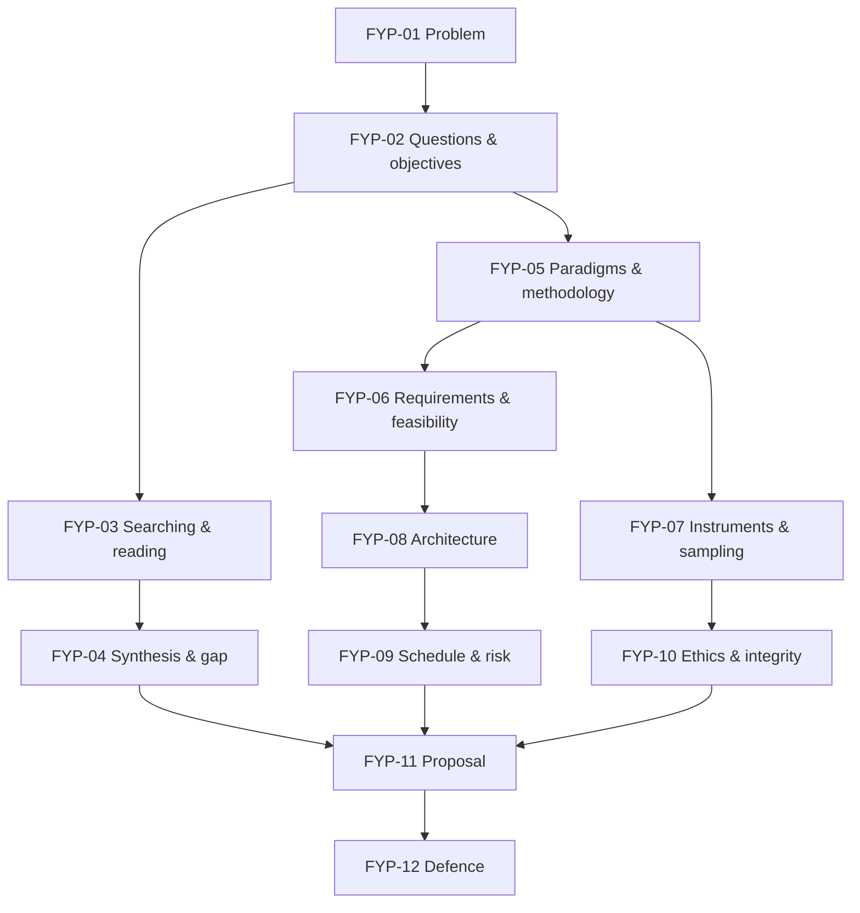

# Final Year Project I: Curriculum Map

Back to [[FYP 00 Dashboard]]

## 1. Units
| Unit | Lessons | Proposal chapter it feeds |
|---|---|---|
| U1 Problem definition | FYP-01, FYP-02 | Ch. 1 Introduction (background, problem, questions, objectives, scope, significance) |
| U2 Literature | FYP-03, FYP-04 | Ch. 2 Literature review (themes, related systems, gap) |
| U3 Methodology | FYP-05, FYP-06, FYP-07 | Ch. 3 Methodology (paradigm, design, requirements, data collection, evaluation) |
| U4 Planning | FYP-08, FYP-09 | Ch. 3/4 System design plan; work plan and risks |
| U5 Integrity | FYP-10 | Ethics section; references |
| U6 Proposal | FYP-11, FYP-12 | The whole proposal; the defence |

(The chapter structure varies by department; follow your handbook.)

## 2. Prerequisite graph

*Text version: the problem leads to questions and objectives. They drive both the literature work (searching, then synthesis and gap) and the methodology (requirements, instruments). Architecture leads to the schedule. Ethics follows the instruments. Everything comes together in the proposal and the defence.*

## 3. Review alerts
| Before… | Review | Why |
|---|---|---|
| FYP-06 | [[SD-03 Requirements Engineering]], [[SD-04 Use Cases, User Stories and Traceability]] | Elicitation, requirement quality |
| FYP-07 | [[DM-18 Introductory Discrete Probability]] | Sampling, the normal approximation |
| FYP-08 | [[SD-05 Software Architecture and Architectural Styles]], [[SD-09 Data Modeling and Interface Design]] | Architecture, ERD |
| FYP-09 | [[PM-04 Scope Management, Requirements Traceability and WBS]], [[PM-06 Critical Path Method and Float]], [[PM-11 Risk Management]] | WBS, CPM, risk |
| FYP-10 | [[CS-19 Cloud Security and Privacy]] | Personal data, pseudonymisation |

## 4. Cross-module links
[[X-06 Research Methodology Applied to the Final Year Project]] · [[X-07 Scheduling Your Own Semester with CPM]] · [[X-CAPSTONE Hostel Maintenance System Full Lifecycle]]
