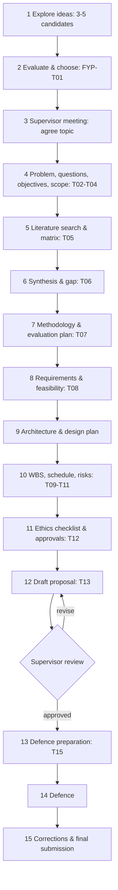

# FYP 02 Idea-to-Defense Workflow

> [!warning] Dates
> No official deadlines were supplied. The weeks below are a **suggested** 15-week plan. Replace them with your department's real submission and presentation dates as soon as you have them.

## 1. The pathway

## 2. Suggested 15-week plan
| Week | Activity | Output | Lesson |
|---|---|---|---|
| 1 | Explore 3–5 ideas; read the handbook | Idea list | [[FYP-01 Identifying and Narrowing a Research Problem]] |
| 2 | Evaluate the ideas; first supervisor meeting | [[FYP-T01 Project Idea Evaluation]] | FYP-01 |
| 3 | Problem statement, questions, objectives, scope | [[FYP-T02 Problem Statement]], [[FYP-T03 Research Questions]], [[FYP-T04 Objectives and Scope]] | [[FYP-02 Problem Statements, Research Questions, Objectives and Scope]] |
| 4–5 | Systematic search; read and record | [[FYP-T05 Literature Matrix]] (≥ 20 verified sources) | [[FYP-03 Literature Searching and Critical Reading]] |
| 6 | Synthesis, related systems, gap | [[FYP-T06 Research Gap Analysis]] | [[FYP-04 Literature Review Synthesis, Research Gaps and Contribution]] |
| 7 | Methodology and evaluation design | [[FYP-T07 Methodology]] | [[FYP-05 Research Paradigms and Methodology]], [[FYP-07 Data Collection Instruments, Sampling and Evaluation Planning]] |
| 8 | Requirements elicitation and feasibility | [[FYP-T08 Requirements Specification]] | [[FYP-06 Requirements Gathering, Stakeholder and Feasibility Analysis]] |
| 9 | Architecture and design plan | C4 diagrams, ERD | [[FYP-08 Technical Architecture and Design Planning]] |
| 10 | WBS, schedule, risks | [[FYP-T09 Work Breakdown Structure]], [[FYP-T10 Project Schedule]], [[FYP-T11 Risk Register]] | [[FYP-09 Project Scheduling, Milestones and Risk Assessment]] |
| 10 | Ethics review; consent forms | [[FYP-T12 Ethics Checklist]] | [[FYP-10 Research Ethics, Privacy, Academic Integrity and Citation]] |
| 11–12 | Full draft proposal | [[FYP-T13 Proposal Structure]] | [[FYP-11 Writing the Research Proposal]] |
| 13 | Revisions from feedback; progress report | [[FYP-T14 Progress Report]] | FYP-11 |
| 14 | Defence preparation and rehearsal | [[FYP-T15 Presentation and Defense Preparation]] | [[FYP-12 Presentation, Defense and Working with Supervisor Feedback]] |
| 15 | Defence; corrections; submission | Final proposal | FYP-12 |

## 3. Supervisor meetings
- Before each meeting, send a short progress report: done, problems, questions, next steps ([[FYP-T14 Progress Report]]).
- After each meeting, send the agreed actions in writing within 24 hours.
- Bring **specific questions** ("Is objective 3 within scope?"), not "Is this OK?".

## 4. Quality gates (check before moving on)
| Gate | Pass when… |
|---|---|
| Topic | The supervisor agrees; the problem is real and feasible in the time; the data/users are accessible |
| Questions | Each question maps to at least one objective and one method; the scope is explicit |
| Literature | Every source has been read and verified; the gap follows from the evidence |
| Methodology | The choice is justified; the instruments are drafted; the evaluation criteria are measurable |
| Plan | The critical path is identified; the risks have responses; there's buffer before the deadline |
| Ethics | Approvals are obtained or requested; consent and data protection are planned |
| Proposal | Consistent from problem → questions → methods → evaluation; references are complete and accurate |

## 5. Using CPM on your own plan
Treat the table above as a network (e.g. literature → gap → methodology). Apply [[PM-06 Critical Path Method and Float]] with your real dates, as in [[X-07 Scheduling Your Own Semester with CPM]]. The literature review and ethics approvals are usually on the critical path, because approvals can take weeks.

Back to [[FYP 00 Dashboard]]
