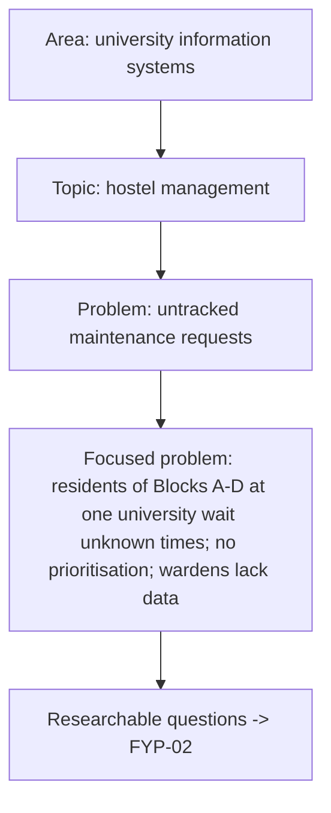

# FYP-01 Identifying and Narrowing a Research Problem

> [!info] Topic card
> **Unit:** U1 · **Time:** 3 h + idea exploration · **Template:** [[FYP-T01 Project Idea Evaluation]] · **Workflow:** [[FYP 02 Idea-to-Defense Workflow]] weeks 1–2

## 1. Learning objectives
1. **Distinguish** a research problem from a topic, a solution or a mere task.
2. **Generate** candidate problems from practice, literature, technology trends and stakeholder pain points.
3. **Narrow** a broad area into a focused, feasible problem (who, where, what, when).
4. **Evaluate** candidate ideas against significance, feasibility, novelty or contribution, data/user access, ethics, and fit with your skills.
5. **Prepare** for the first supervisor meeting with an evaluated shortlist.

## 2. Why it matters
The topic decides the whole year. A vague or infeasible problem leads to rewriting the proposal three times. A solution looking for a problem ("an app using blockchain") leads to a weak defence. A good problem is **real, specific, researchable and doable in the time you have**.

## 3. Prerequisites
None. It helps to have read [[SD-01 Software Engineering Fundamentals]] (stakeholders) and [[PM-01 Project Fundamentals and Organizational Context]] (constraints).

## 4. Intuition
A research problem is a **gap between what is and what should be**, which matters to someone and can be investigated. "Hostel maintenance" is a *topic*. "An app for hostel maintenance" is a *solution*. "Students at [university] wait an unknown and often long time for maintenance requests to be resolved, because requests are paper-based and untracked, which affects safety and wellbeing" is a *problem*.

## 5. Rigorous explanation

### 5.1 Sources of problems
- **Practice:** observed inefficiencies in organisations (registration queues, paper forms, lost requests).
- **Stakeholders:** interviews with potential users or clients (a warden, a clinic manager, a shop owner).
- **Literature:** "future work" sections of recent papers; reviews that identify gaps.
- **Technology:** new capabilities applied to a real context (mobile money APIs, offline-first apps) only if there's a problem to solve.
- **Policy and society:** national digital strategies, data-protection requirements, accessibility.

### 5.2 Narrowing
Use the **PICO-like framing** for IS: **P**opulation or context (whose problem, where), **I**ntervention (what kind of artefact or study), **C**omparison (against what: the current practice, other systems), **O**utcome (what changes, measurably). Or narrow by scope dimensions: users, location, function, time, technology.

| Too broad | Narrower | Focused |
|---|---|---|
| E-health | Patient records in clinics | Appointment and record retrieval at small private clinics in one district, which use paper files |
| University systems | Hostel management | Tracking and prioritising maintenance requests in university hostels |
| AI in agriculture | Crop advice | SMS-based advice for maize farmers with feature phones in one region (then check feasibility!) |

### 5.3 Criteria for a good FYP problem
1. **Significant:** real people are affected; there's evidence (an interview, an observation, a document, a cited study).
2. **Feasible:** the time (one academic year), your skills, data/user access, hardware and cost are all within reach.
3. **Researchable:** questions can be answered with evidence (requirements, a prototype, an evaluation).
4. **Contribution:** a new artefact for a context, an adaptation, a comparison, or an evaluation. An undergraduate contribution can be modest but must be clear.
5. **Ethical:** the risks to participants and data are manageable ([[FYP-10 Research Ethics, Privacy, Academic Integrity and Citation]]).
6. **Supervisable:** it fits the department's areas and a supervisor's expertise.

### 5.4 Red flags
- A solution in search of a problem.
- No access to the users or the data.
- Requiring proprietary systems you can't get.
- Duplicating an existing, free, well-known system without a new angle.
- Scope that needs a team of ten.
- Medical or safety-critical decisions without expert involvement.

## 6. Terminology
| Term | Meaning |
|---|---|
| Research area / topic | A broad field / a subject within it |
| Research problem | A specific, evidenced gap or issue worth investigating |
| Context | Where and for whom the problem exists |
| Contribution | What your project adds (an artefact, knowledge, an evaluation) |
| Feasibility | Whether it can be done with the time, skills and resources available |
| Gatekeeper | A person who controls access to the participants or data (e.g. the dean of students) |

## 7. Step-by-step: from idea to evaluated shortlist
1. List 5 ideas from different sources (practice, stakeholders, literature).
2. Write one sentence per idea in the form "**[Who]** in **[where]** experience **[what problem]** because **[cause]**, resulting in **[impact]**."
3. Gather **quick evidence** for each: one conversation, an observation, or a credible source you've actually read.
4. Score each with [[FYP-T01 Project Idea Evaluation]] (significance, feasibility, access, contribution, ethics, interest and skills; 1–5 each, weighted).
5. Pick the top 2, and prepare a one-page summary for each, for your supervisor.

## 8. Diagram: narrowing funnel

## 9. Worked examples

### Example 1 (basic): topic, solution or problem?
| Statement | Type |
|---|---|
| "Mobile money" | Topic |
| "Build a USSD app for school fees" | Solution |
| "Parents in rural schools travel to banks to pay fees, which causes delays and lost receipts" | Problem (it needs evidence) |
| "Machine learning" | Area |

### Example 2 (intermediate): narrowing the running example
- Idea: "Hostel maintenance app."
- Reframed: "Residents report faults on paper slips at the warden's office. Wardens can't track them or set priorities, and there's no record of resolution times (evidence: an informal conversation with a warden and 5 residents; a photo of the paper log)."
- Focus: one university, the undergraduate hostels, maintenance requests only (not room allocation or fees).
- Contribution: a request-tracking system with prioritisation, designed and evaluated with the wardens and residents.

### Example 3 (challenging): rescuing an infeasible idea
Idea: "A national AI system to predict exam performance for all Tanzanian students." Problems: there's no access to national data; it needs serious privacy and ethics approvals; the scope is national; and the stakes for students are high. **Narrow and reframe:** "An early-warning dashboard for lecturers in one course, using anonymised assignment-submission data that the department agrees to share, evaluated with lecturers for usefulness." That's still challenging (ethics, consent, data access), but feasible if the department agrees.

## 10. Application: preparing the first supervisor meeting
Bring:
- your top 2 ideas, each with a one-sentence problem;
- the evidence;
- who the users are and how you'll reach them;
- what you'll build or study;
- the risks;
- your questions.

Ask: "Which idea is more feasible here? Who can I contact about access? What scope do you expect for FYP I vs FYP II?"

## 11. Common mistakes
| Mistake | Fix |
|---|---|
| Starting with a technology | Start with a problem and its users |
| Problems without evidence | Collect quick evidence early (a conversation, an observation, a source) |
| Too broad | Narrow by users, place, function and time |
| Ignoring access | Confirm the gatekeepers and data access before committing |
| Copying a past project unchanged | Find a new context, angle or evaluation, and acknowledge the prior work |

## 12. Comparison: good vs weak problem statements
| Weak | Good |
|---|---|
| "Hostels have problems" | "Residents in Blocks A–D report faults on paper slips; requests are untracked and unprioritised" |
| "There's no app" | "Wardens lack data on resolution times, so urgent safety faults wait behind cosmetic ones" |
| "Using AI to improve education" | "Lecturers in course X can't identify struggling students before the mid-semester test" |

## 13. Practice
**L1** 1. Define a research problem. 2. List three sources of FYP ideas.

**L2** 3. Rewrite three topics as problem sentences using the who/where/what/because/impact template. 4. Identify the red flags in: "A blockchain-based national ID system."

**L3** 5. Narrow "e-commerce for small businesses" into a feasible FYP problem. 6. Evaluate two of your own ideas with [[FYP-T01 Project Idea Evaluation]].

**L4** 7. Gather real preliminary evidence for your top idea (an interview, an observation or a document), and summarise it in 200 words. 8. Write the one-page supervisor brief for your top idea.

**L5** 9. Present your shortlist to a peer, receive critique, and revise. Record what changed and why.

## 14. Hints
> [!tip]- Hints
> 4: national scope, access to government systems, a solution-first framing, security and legal complexity. 5: one type of business (e.g. small hardware shops), one need (stock and sales), one place.

## 15. Worked solutions
> [!success]- Solutions 1–2
> 1. A specific, evidenced gap between the current and the desired state that matters to identifiable people, and that can be investigated within the project. 2. Practice and stakeholders, the literature (future work, reviews), technology applied to a real context, policy needs.

> [!success]- Solution 3 (sample)
> - "Small hardware shop owners in Dodoma record sales in notebooks, because affordable POS options aren't known or trusted, resulting in stock-outs and about 2 hours a day of reconciliation" (link to [[PM-CASE-03 Small Business Point-of-Sale Software]]).
> - "First-year students at [university] miss course registration deadlines because information is scattered across notice boards, resulting in late fees."
> - "Clinic receptionists at small private clinics can't quickly retrieve paper patient files, causing waits of over 20 minutes." (Every figure needs evidence that you collect yourself.)

> [!success]- Solution 4
> - The national scope is infeasible for an FYP.
> - There's no access to national ID systems or data.
> - It's solution-first (why blockchain? what problem does it solve better than existing databases?).
> - There are very high legal, security and privacy stakes.
> - It can't be evaluated with real users.
>
> **Reframe:** a narrow, accessible problem, e.g. verifying student ID cards at exam halls, studied with one faculty.

> [!success]- Solution 5
> "Owners of small hardware shops in one town lack an affordable way to track stock levels and sales, leading to stock-outs and slow daily reconciliation. The project will elicit their requirements, build a low-cost POS prototype that integrates mobile-money receipts, and evaluate its usability with 5 shops." The scope: stock and sales only; one town; no accounting or tax modules.

## 16. Self-test (pass ≥ 4/5)
1. Is "an app for X" a problem? 2. Name four criteria for a good FYP problem. 3. What's a gatekeeper? 4. Why collect evidence early? 5. What's the PICO-like framing for?
> [!success]- Answers
> 1. No: it's a solution. 2. Significant, feasible, researchable, a contribution, ethical, supervisable (any four). 3. Someone who controls access to the participants or data. 4. To show the problem is real, and to shape the scope before you commit. 5. To narrow a problem by population/context, intervention, comparison and outcome.

## 17. Flashcards
#flashcards/fyp
Topic vs problem vs solution?::A subject area / an evidenced gap affecting people / a proposed fix.
Problem sentence template?::[Who] in [where] experience [what] because [cause], resulting in [impact].
FYP problem criteria?::Significant, feasible, researchable, contribution, ethical, supervisable.
Biggest feasibility risk often overlooked?::Access to users and data.

## 18. Blank-page recall
Write the narrowing funnel for your own idea from memory, from area to focused problem.

## 19. Revision summary
- Start from a real, evidenced problem, not a technology.
- Narrow by users, place, function and time.
- Evaluate ideas for significance, feasibility (especially access), contribution, ethics and fit.
- Arrive at the first supervisor meeting with an evaluated shortlist and specific questions.

## 20. Links
Next: [[FYP-02 Problem Statements, Research Questions, Objectives and Scope]] · Template: [[FYP-T01 Project Idea Evaluation]] · Related: [[SD-03 Requirements Engineering]], [[X-06 Research Methodology Applied to the Final Year Project]]

## 21. Sources
- Creswell, J. W. & Creswell, J. D., *Research Design: Qualitative, Quantitative, and Mixed Methods Approaches*, 5th ed., SAGE, 2018 (selecting a problem and topic).
- Oates, B. J., Griffiths, M. & McLean, R., *Researching Information Systems and Computing*, 2nd ed., SAGE, 2022.
- Your department's FYP handbook (the authoritative source for your requirements).
- *(Not checked online during the build, because there was no network access. Verify the editions in your library.)*

## 22. Mastery checklist
- [ ] I can tell a problem from a topic or a solution
- [ ] I narrowed my idea and gathered preliminary evidence
- [ ] I scored at least two ideas, and prepared a supervisor brief
- [ ] Reviews scheduled
