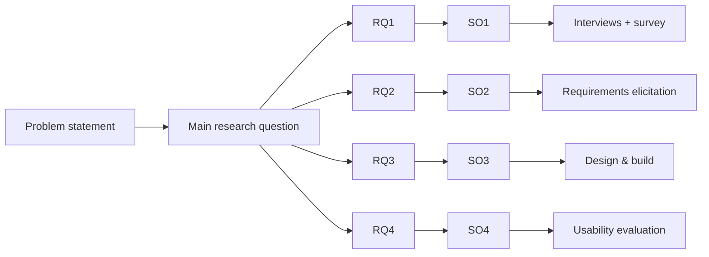

# FYP-02 Problem Statements, Research Questions, Objectives and Scope

> [!info] Topic card
> **Unit:** U1 · **Time:** 4 h · **Templates:** [[FYP-T02 Problem Statement]], [[FYP-T03 Research Questions]], [[FYP-T04 Objectives and Scope]]

## 1. Learning objectives
1. **Write** a problem statement that describes the current situation, the gap, the evidence, the consequences and who is affected.
2. **Formulate** a main research question and sub-questions that are answerable, focused and aligned with the problem.
3. **Derive** SMART general and specific objectives, mapped one-to-one with the questions.
4. **Define** the scope and delimitations, limitations and assumptions explicitly.
5. **Check alignment** across the problem → questions → objectives → methods → evaluation chain.

## 2. Why it matters
Examiners read the problem statement and objectives first, and judge the rest against them. Misalignment (objectives that don't answer the problem, methods that don't meet the objectives) is the most common weakness in FYP proposals, and it's easy to fix early.

## 3. Prerequisites
[[FYP-01 Identifying and Narrowing a Research Problem]] · [[SD-03 Requirements Engineering]] (measurable criteria) · [[PM-04 Scope Management, Requirements Traceability and WBS]] (scope and exclusions).

## 4. Intuition
- The problem statement answers **"what's wrong, for whom, and why does it matter?"**
- The research questions ask **"what do we need to find out or build to address it?"**
- The objectives say **"what will I do to answer each question?"**
- The scope says **"what's in, and what's out?"**

If you can draw a straight line from the problem to each objective and on to its evaluation, the proposal holds together.

## 5. Rigorous explanation

### 5.1 Problem statement (one to three paragraphs)
1. **Context and the ideal:** what should happen ("maintenance faults should be reported, prioritised and resolved promptly, with accountability").
2. **Current reality:** what actually happens, with evidence ("requests are recorded on paper; wardens report losing slips; no resolution times are recorded").
3. **Gap and causes:** why the gap exists (no tracking system; no prioritisation rules).
4. **Consequences:** for whom, and how serious (safety risks from electrical faults; dissatisfaction; no data for planning).
5. **Purpose:** "This project therefore aims to…"

Use evidence you've collected or read. Never invent statistics. If the evidence is preliminary ("in an informal discussion, two wardens reported…"), say so.

### 5.2 Research questions
- **Main question:** e.g. "How can maintenance requests in university hostels be reported, prioritised and tracked effectively?"
- **Sub-questions:** each answerable by one part of the work:
  - RQ1: What are the current processes and the challenges of reporting and handling maintenance requests at [university]?
  - RQ2: What requirements must a request-tracking system meet for residents, wardens and technicians?
  - RQ3: How can a system satisfying these requirements be designed and implemented?
  - RQ4: How usable and useful do residents and wardens find the developed system?

**Good questions** are clear, focused, answerable with your methods, and not yes/no. Avoid "Is it possible to build…?" (yes).

### 5.3 Objectives
- **General objective:** "To develop and evaluate a web-based maintenance request tracking system for university hostels."
- **Specific objectives** (SMART: specific, measurable, achievable, relevant, time-bound), mapped to the RQs:
  - SO1: To analyse the current maintenance-request process through interviews with at least 3 wardens and a survey of residents (RQ1) by week 6.
  - SO2: To specify the functional and non-functional requirements of the system (RQ2) by week 8.
  - SO3: To design and implement a prototype that meets the Must requirements (RQ3) by the end of FYP II, week X.
  - SO4: To evaluate the prototype's usability (SUS ≥ 68) and usefulness with at least 10 residents and 3 wardens (RQ4).

The verbs matter: analyse, identify, design, develop, implement, evaluate, compare. Avoid "understand", "learn about" and "know".

### 5.4 Scope, delimitations, limitations, assumptions
- **Scope:** the users, functions, places and technology included.
- **Delimitations:** boundaries *you choose* (one university; undergraduate hostels; maintenance requests only; web, not a native app).
- **Limitations:** constraints outside your control that affect the findings (a small sample; a single site; short evaluation time).
- **Assumptions:** what you take as given (residents have smartphone or computer access; wardens will take part).

### 5.5 Alignment matrix
| Problem element | RQ | Objective | Method | Evidence / evaluation |
|---|---|---|---|---|
| Unknown current process | RQ1 | SO1 | Interviews, survey | Thematic summary; descriptive statistics |
| Unclear needs | RQ2 | SO2 | Requirements elicitation | SRS reviewed by the wardens |
| No tracking tool | RQ3 | SO3 | Design science build | Requirements → tests passing |
| Unknown acceptability | RQ4 | SO4 | Usability test, SUS, interviews | SUS score, task success, feedback |

## 6. Terminology
| Term | Meaning |
|---|---|
| Problem statement | A concise description of the problem, with evidence and consequences |
| Research question (RQ) | A question the study will answer |
| General / specific objectives | The overall aim / concrete steps that answer each RQ |
| SMART | Specific, measurable, achievable, relevant, time-bound |
| Delimitation | A scope boundary you set deliberately |
| Limitation | A constraint that affects the generalisability or strength of the findings |
| Significance | Why answering the questions matters, and to whom |

## 7. Step-by-step: writing the chain
1. Draft the problem statement with the 5 elements (§5.1).
2. Write the main question from the purpose sentence.
3. Break it into 3–5 sub-questions following the project flow: understand → specify → build → evaluate.
4. Turn each RQ into one SMART objective with a method and a measure.
5. Write the scope (in and out), delimitations, limitations and assumptions.
6. Fill in the alignment matrix. Any empty cell shows a gap to fix.
7. Ask a peer to read only the problem and the objectives: can they predict your methods?

## 8. Diagram: the alignment chain

## 9. Worked examples

### Example 1 (basic): fix the objectives
| Weak | Improved |
|---|---|
| "To learn about hostel maintenance" | "To analyse the current maintenance-request process through interviews with 3 wardens and a survey of 100 residents" |
| "To create a good system" | "To implement a prototype that meets all Must requirements in the SRS, verified by the test cases" |
| "To make students happy" | "To evaluate the usability of the prototype with at least 10 residents, using the SUS (target ≥ 68) and task success rates" |

### Example 2 (intermediate): a problem statement (running example)
> "University hostels should provide safe and functional living conditions, with faults reported and repaired promptly. At [University X], residents currently report maintenance faults on paper slips submitted to the warden's office. In preliminary conversations (n = 2 wardens, 5 residents; week 1), wardens reported that slips are sometimes lost, that there's no record of when faults are resolved, and that urgent electrical faults can't be distinguished from minor ones. Residents reported repeating requests several times. Without a tracking and prioritisation mechanism, safety-critical faults risk delay, residents lose trust in the process, and management lacks data to plan maintenance resources. This project therefore aims to develop and evaluate a web-based system for reporting, prioritising and tracking hostel maintenance requests."

Note how the evidence is attributed and qualified: no invented percentages.

### Example 3 (challenging): spotting misalignment
A draft has RQ: "What factors affect students' satisfaction with hostel services?" But its objectives are all about building an app, and its evaluation is a SUS score. **Diagnosis:** the RQ is a broad satisfaction study (survey research), while the project is design science. The SUS evaluates the app's usability, not the "factors" of satisfaction. **Fix:** narrow the RQs to the maintenance process and system requirements, and evaluate *the artefact* (usability, usefulness, time to resolution in a pilot).

## 10. Application: significance statement
Who benefits?
- **Residents:** faster, more transparent repairs.
- **Wardens:** prioritisation and accountability.
- **Management:** data for budgeting.
- **The field:** an evaluated design for low-resource university settings.

Keep it honest and proportional for an undergraduate project.

## 11. Common mistakes
| Mistake | Fix |
|---|---|
| A problem statement that describes the solution | Describe the current situation, gap and consequences first |
| Yes/no questions | "How / what / to what extent…" |
| Objectives that don't map to the RQs | One SO per RQ, with a matrix |
| Unmeasurable objectives | Name the method, the target and the time |
| No exclusions | State explicitly what's out of scope |
| Confusing limitations and delimitations | Chosen boundaries vs constraints you can't control |

## 12. Comparison: research questions vs objectives vs requirements
| | Research question | Objective | Requirement |
|---|---|---|---|
| Form | A question | An action to take | A "shall" statement about the system |
| Answers | What must be found out or built | What you'll do | What the system must do |
| Example | RQ2: what requirements must the system meet? | SO2: specify the requirements by week 8 | FR-03: the system shall let a warden set a request's priority |

## 13. Practice
**L1** 1. List the 5 elements of a problem statement. 2. What does SMART stand for?

**L2** 3. Rewrite 3 weak objectives of your own project as SMART ones. 4. Write delimitations and limitations for the running example.

**L3** 5. Write the main question and 4 sub-questions for your project. 6. Build the alignment matrix for your project.

**L4** 7. Critique a classmate's (or a past) proposal's problem statement for evidence, specificity and consequences. 8. Convert a survey-research question into a design-science one, and explain the change.

**L5** 9. Produce the full Chapter 1 skeleton (background, problem statement, questions, objectives, scope, significance) for your project, and ask your supervisor for feedback.

## 14. Hints
> [!tip]- Hints
> 4: delimitations are the boundaries you chose; limitations are things like the sample size. 8: "What factors…" becomes "How can a system be designed to…, and how effective is it?"

## 15. Worked solutions
> [!success]- Solutions 1–2
> 1. Context and the ideal; the current reality with evidence; the gap and its causes; the consequences; the purpose. 2. Specific, measurable, achievable, relevant, time-bound.

> [!success]- Solution 4
> **Delimitations:** one university; undergraduate hostels only; maintenance requests (not room allocation or fees); web application; English and Kiswahili interface. **Limitations:** a small, non-random evaluation sample; a short evaluation period (a few weeks), so long-term effects aren't measured; results may not generalise to other universities; self-reported satisfaction.

> [!success]- Solution 8
> Survey RQ: "What factors influence students' satisfaction with hostel maintenance?" (a survey with a regression). Design-science RQ: "How can a request-tracking and prioritisation system be designed for university hostels, and how usable and useful is it for residents and wardens?" The change: the contribution becomes an **evaluated artefact**, not a statistical model of factors. The methods change from a large survey to requirements elicitation, building, and artefact evaluation.

## 16. Self-test (pass ≥ 4/5)
1. Should the problem statement mention the solution technology? 2. Why avoid yes/no RQs? 3. Delimitation or limitation: "only one university"? 4. What does an alignment matrix check? 5. Give a good objective verb.
> [!success]- Answers
> 1. Not in the problem description. The purpose sentence may state the type of solution. 2. They don't guide investigation (the answer is usually "yes"). 3. A delimitation (if you chose it); it's also a limitation for generalisability. 4. That each problem element has an RQ, an objective, a method and an evaluation. 5. Analyse, design, implement, evaluate, compare (any one).

## 17. Flashcards
#flashcards/fyp
Problem statement elements?::Ideal, current reality with evidence, gap and causes, consequences, purpose.
Typical design-science RQ sequence?::Understand the current situation → requirements → design and build → evaluate.
SMART objective example?::Evaluate usability with ≥ 10 residents using the SUS (target ≥ 68) by week X.
Delimitation vs limitation?::A boundary you chose vs a constraint affecting the findings.

## 18. Blank-page recall
Write your project's problem → RQ → SO → method → evaluation chain from memory.

## 19. Revision summary
- Problem statement: ideal, reality, gap, consequences, purpose, with honest evidence.
- RQs: a main question plus 3–5 answerable sub-questions; SMART objectives one-to-one.
- Scope with delimitations, limitations and assumptions.
- The alignment matrix keeps the whole proposal coherent.

## 20. Links
Prev: [[FYP-01 Identifying and Narrowing a Research Problem]] · Next: [[FYP-03 Literature Searching and Critical Reading]] · Templates: [[FYP-T02 Problem Statement]], [[FYP-T03 Research Questions]], [[FYP-T04 Objectives and Scope]] · Related: [[SD-03 Requirements Engineering]]

## 21. Sources
- Creswell, J. W. & Creswell, J. D., *Research Design*, 5th ed., SAGE, 2018 (purpose statements and research questions).
- Oates, B. J., Griffiths, M. & McLean, R., *Researching Information Systems and Computing*, 2nd ed., SAGE, 2022.
- Brooke, J., "SUS: a 'quick and dirty' usability scale", in Jordan, P. W. et al. (eds), *Usability Evaluation in Industry*, Taylor & Francis, 1996, pp. 189–194 (the SUS used in SO4; 68 is the commonly quoted average benchmark).
- *(Not checked online during the build, because there was no network access.)*

## 22. Mastery checklist
- [ ] My problem statement has all 5 elements and honest evidence
- [ ] My RQs and SMART objectives are aligned in a matrix
- [ ] My scope, delimitations, limitations and assumptions are explicit
- [ ] Reviews scheduled
