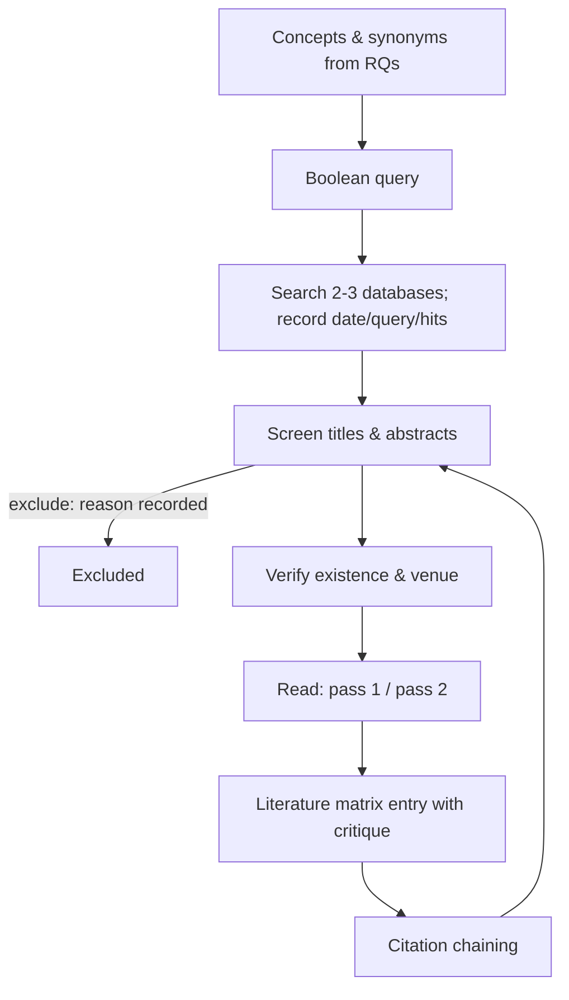

# FYP-03 Literature Searching and Critical Reading

> [!info] Topic card
> **Unit:** U2 · **Time:** 4 h + 2 weeks of searching and reading · **Template:** [[FYP-T05 Literature Matrix]] · **Code:** `boolean_query` and `looks_like_doi` in `code/fyp_tools.py` (tested). A DOI syntax check **doesn't** prove a paper exists: always resolve it and read the paper.

> [!danger] Never cite what you haven't verified
> AI chatbots and some websites produce **plausible but non-existent references** (wrong authors, invented titles, fake DOIs). Citing them is academic misconduct, even if unintentional. For every source: find it in a database or on the publisher's site, open it, read at least the relevant parts, and check that it says what you claim.

## 1. Learning objectives
1. **Plan** a search strategy: concepts, synonyms, Boolean operators, databases, inclusion and exclusion criteria.
2. **Use** academic databases and techniques (citation chaining, alerts) efficiently, and **record** the search for reproducibility.
3. **Evaluate** sources for credibility (peer review, venue, author, evidence, currency), and **detect** predatory or fake sources.
4. **Read** papers efficiently (a multi-pass approach) and critically: claims, evidence, methods, limitations.
5. **Record** each source in a literature matrix, with your own critical notes.

## 2. Why it matters
The literature review shows examiners that you know what's already been done, that your problem matters, and that your approach is informed. A review built on random Google results, unread papers or unverifiable sources undermines the whole proposal. Good searching saves weeks.

## 3. Prerequisites
[[FYP-02 Problem Statements, Research Questions, Objectives and Scope]] (your RQs define the search concepts) · Boolean logic from [[DM-01 Propositions, Connectives and Truth Tables]] (AND, OR, NOT are exactly the logical connectives).

## 4. Intuition
Searching is **fishing with a well-designed net**. The concepts are the mesh, the synonyms widen the net, AND makes it more precise, and the databases are the waters you fish in. Reading is **interrogation**: what does this paper claim, how does it know, and should I believe it?

## 5. Rigorous explanation

### 5.1 Search strategy
1. **Concepts** from the RQs: e.g. (maintenance requests) × (university housing) × (information system).
2. **Synonyms and variants** for each concept: maintenance request / facility management / work order / fault reporting; university / hostel / student housing / campus; system / application / mobile / web.
3. **Boolean:** OR within a concept, AND between concepts, NOT sparingly. Quote phrases, and use truncation (`manag*`). `boolean_query` builds this:
   ```text
   ("maintenance request" OR "facility management" OR "work order") AND (university OR hostel OR "student housing") AND (system OR application OR mobile)
   ```
4. **Databases:** IEEE Xplore and ACM Digital Library (computing); Scopus and Web of Science (multidisciplinary, if your library subscribes); Google Scholar (broad, but noisy); African Journals Online (AJOL) for regional journals; your university library's discovery service; institutional repositories (theses).
5. **Criteria:** a publication-year range; language; peer-reviewed; relevance to the RQs. Record the inclusions and exclusions.
6. **Citation chaining:** backward (the references of a key paper) and forward ("cited by").
7. **Record the search:** the date, database, query and number of results, so it's reproducible and reportable.

### 5.2 Source evaluation
| Check | Question |
|---|---|
| Existence | Can I find it in a database or on the publisher's site? Does the DOI resolve to *this* paper? |
| Venue | A peer-reviewed journal or conference? A recognised publisher? Is it in an indexing database? |
| Authors | Affiliation, expertise, conflicts of interest |
| Evidence | What data, method and sample? Are the claims supported? |
| Currency | Recent enough for a fast-moving technology topic? Older sources are fine for foundational theory |
| Bias | Funding, vendor white papers, selective reporting |

**Predatory journals:** charge fees without real peer review. Signs include:
- aggressive emails;
- very fast acceptance;
- vague scope;
- fake impact metrics;
- a missing or unverifiable editorial board.

Check the venue in recognised indexes, and ask your librarian. The CRAAP test (currency, relevance, authority, accuracy, purpose) is a simple checklist for web sources.

### 5.3 Reading efficiently
A three-pass approach (adapted from Keshav, 2007):
1. **Pass 1 (5–10 min):** title, abstract, introduction, headings, conclusions. Decide whether it's relevant.
2. **Pass 2 (about 1 h):** figures, methods, results. Note the key claims and evidence.
3. **Pass 3 (deep):** for the few core papers. Could you reconstruct their argument? What would you challenge?

**Critical questions:**
- What problem? What contribution?
- What method?
- What evidence, from whom?
- What limitations do the authors admit, and which do they miss?
- How does it relate to *my* RQs?

### 5.4 Grey literature and standards
Government reports, standards (ISO, NIST), vendor documentation and theses can be valuable, especially for local context, but evaluate them carefully, and label them as such.

## 6. Terminology
| Term | Meaning |
|---|---|
| Peer review | Evaluation by independent experts before publication |
| Boolean operators | AND (all), OR (any), NOT (exclude) |
| Truncation / wildcard | `manag*` matches manage, management, manager |
| Backward / forward chaining | Following a paper's references / the papers citing it |
| DOI | Digital Object Identifier, resolvable at doi.org |
| Grey literature | Reports, theses and documents outside commercial publishing |
| Predatory journal | A pay-to-publish venue without genuine peer review |

## 7. Step-by-step: one search session
1. Write the 3 concept groups with their synonyms.
2. Build the query (`boolean_query`).
3. Run it in 2–3 databases, applying the filters (years, peer-reviewed). Record the date, database, query and hit count.
4. Screen titles and abstracts; tag each as include, exclude (with a reason) or maybe.
5. Pass-1 the "include" pile; pass-2 the relevant ones.
6. For each kept source, **verify** it (open it at the publisher, check the DOI resolves) and enter it in [[FYP-T05 Literature Matrix]]: the full reference, aim, method, findings, limitations, relevance to the RQs, and your critique.
7. Chain backward and forward from the 3 most relevant papers.

## 8. Diagram: search and screening flow


## 9. Worked examples

### Example 1 (basic): Boolean logic
`(hostel OR "student housing") AND maintenance AND NOT hotel` finds hostel *or* student-housing documents that mention maintenance, and excludes hotel management papers. Remember that NOT can remove relevant documents that merely mention hotels, so use it sparingly.

### Example 2 (intermediate): evaluating three sources
| Source (descriptive, not real) | Verdict |
|---|---|
| A journal article in an indexed IS journal, with a clear method and 200 survey respondents | Strong; check the sample's relevance to your context |
| A vendor white paper claiming "90% faster repairs" with no method | Weak evidence; at most, cite it as a vendor claim, never as fact |
| A "paper" in an unknown journal accepted within 3 days, with a broken DOI | Don't use it; possibly predatory or fake |

### Example 3 (challenging): a reference from a chatbot
A chatbot gives you: "Mwakalinga, J. (2019). *Smart hostel maintenance in East African universities*. Journal of African IT, 12(3), 45–60." Before using it:
1. Search the title in Google Scholar, the library and AJOL.
2. Search for the journal itself: does it exist, and is volume 12 from 2019?
3. Resolve any DOI.

If you can't find it, **it doesn't exist for your purposes**. Don't cite it, and don't "adjust" the details. (This example reference is deliberately fictional.)

## 10. Application: the search log
| Date | Database | Query | Filters | Hits | Screened in |
|---|---|---|---|---|---|
| (date) | IEEE Xplore | (query above) | 2015–2025, journals and conferences | (n) | (n) |
| (date) | Google Scholar | … | … | … | … |

Report a summary in your methodology or literature chapter ("Searches in IEEE Xplore, ACM DL and AJOL between [dates] using [query] returned N records…"). This is good practice even for a non-systematic review.

## 11. Common mistakes
| Mistake | Fix |
|---|---|
| One search in Google only | Several scholarly databases, plus chaining |
| Citing unread or abstract-only sources | Read the relevant sections; verify the claims |
| Citing AI-generated references | Verify existence and content yourself |
| No record of searches | Keep a search log |
| Summaries without critique | Note the limitations and relevance in the matrix |
| Only very old or only very new sources | Foundations plus recent work, with justification |

## 12. Comparison: source types
| Type | Credibility | Use for |
|---|---|---|
| Peer-reviewed journal | High (venue-dependent) | Core evidence, theory |
| Peer-reviewed conference (computing) | High in CS (venue-dependent) | Recent technical work |
| Thesis or dissertation | Medium (check the institution) | Local context, methods |
| Standards (ISO, NIST) | Authoritative for their scope | Requirements, definitions |
| Government or NGO report | Medium–high | Context, statistics (cite the edition) |
| Vendor white paper or blog | Low (biased) | Product features, labelled as claims |

## 13. Practice
**L1** 1. What does OR do in a search? 2. List three checks for a source's credibility.

**L2** 3. Build a Boolean query for your project with `boolean_query`. 4. Explain backward and forward chaining.

**L3** 5. Run your query in 2 databases and log the results. 6. Do pass-1 on 10 papers, and pass-2 on 3 of them.

**L4** 7. Verify 5 references from a draft (yours or a peer's): do they exist, and do they support the claims made? 8. Identify a possibly predatory venue in your results, and explain how you judged it.

**L5** 9. Complete a literature matrix with at least 20 verified sources, organised by theme, for your project.

## 14. Hints
> [!tip]- Hints
> 1: it widens the search (any of the terms). 3: three concept groups from your RQs. 7: Google Scholar, the publisher's site, doi.org. Check the quoted claim in the actual text.

## 15. Worked solutions
> [!success]- Solutions 1–2
> 1. OR retrieves documents containing **any** of the terms: it broadens a concept with synonyms. 2. Existence (findable; the DOI resolves to it), venue (peer-reviewed, indexed), authors (expertise, conflicts), evidence (method and data), currency.

> [!success]- Solution 4
> **Backward:** read the reference list of a key paper to find the earlier work it builds on. **Forward:** use "cited by" (Google Scholar, Scopus) to find later work that builds on it, including newer findings and criticism.

## 16. Self-test (pass ≥ 4/5)
1. Does a well-formed DOI prove a paper exists? 2. Why record searches? 3. What happens in pass 1? 4. Give two signs of a predatory journal. 5. How should you treat a vendor white paper?
> [!success]- Answers
> 1. No: resolve it and check that it points to the claimed paper. 2. For reproducibility and transparency, and to report your method. 3. A quick skim of the title, abstract, introduction, headings and conclusion to judge relevance. 4. Very fast acceptance, aggressive solicitation, fake metrics, an unverifiable editorial board (any two). 5. As a biased claim, not independent evidence.

## 17. Flashcards
#flashcards/fyp
Boolean rule for search?::OR within a concept (synonyms), AND between concepts.
Three-pass reading?::Skim for relevance; read the figures, methods and results; deep-read the key papers.
First check for any reference?::Existence: find it and open it; check that the DOI resolves to it.
Citation chaining?::Backward (its references) and forward (papers citing it).

## 18. Blank-page recall
Write your project's concept table and Boolean query from memory, and the five source-evaluation checks.

## 19. Revision summary
- Plan the search: concepts → synonyms → Boolean → databases → criteria → chaining → log.
- Evaluate sources: existence, venue, authors, evidence, currency, bias. Avoid predatory and fake sources.
- Read in passes, and note the claims, evidence, limitations and relevance.
- **Never cite a source you haven't verified and read.**

## 20. Links
Prev: [[FYP-02 Problem Statements, Research Questions, Objectives and Scope]] · Next: [[FYP-04 Literature Review Synthesis, Research Gaps and Contribution]] · Template: [[FYP-T05 Literature Matrix]] · Related: [[FYP-10 Research Ethics, Privacy, Academic Integrity and Citation]], [[Source Register]], [[Citation Conventions]]

## 21. Sources
- Keshav, S., "How to read a paper", *ACM SIGCOMM Computer Communication Review*, 37(3), 2007, pp. 83–84.
- Webster, J. & Watson, R. T., "Analyzing the past to prepare for the future: writing a literature review", *MIS Quarterly*, 26(2), 2002, pp. xiii–xxiii.
- Kitchenham, B. & Charters, S., *Guidelines for performing Systematic Literature Reviews in Software Engineering*, EBSE Technical Report EBSE-2007-01, Keele University and Durham University, 2007.
- Your university library's guides to databases and referencing.
- *(Not checked online during the build, because there was no network access. Verify these yourself, as this lesson teaches.)*

## 22. Mastery checklist
- [ ] I built and logged searches in at least two databases
- [ ] I can evaluate sources and detect fake or predatory ones
- [ ] I read efficiently and recorded critical notes in the matrix
- [ ] Reviews scheduled
