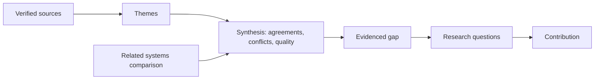

# FYP-04 Literature Review Synthesis, Research Gaps and Contribution

> [!info] Topic card
> **Unit:** U2 · **Time:** 4 h + writing · **Template:** [[FYP-T06 Research Gap Analysis]] · **Input:** your verified [[FYP-T05 Literature Matrix]]

## 1. Learning objectives
1. **Distinguish** synthesis (comparing and integrating sources around themes) from summary (one source at a time).
2. **Organise** a review by themes or concepts, using a synthesis (concept) matrix.
3. **Review** related or existing systems with explicit comparison criteria.
4. **Identify** and **justify** a research gap (contextual, methodological, empirical, practical or theoretical).
5. **State** your contribution precisely and modestly, and **link** it back to the RQs.

## 2. Why it matters
Examiners ask: "What's already been done, and what does your project add?" A review that lists summaries ("Smith (2020) did X. Jones (2021) did Y.") can't answer that. Synthesis shows patterns, agreements, contradictions and gaps, and the gap justifies your project.

## 3. Prerequisites
[[FYP-03 Literature Searching and Critical Reading]] · [[FYP-02 Problem Statements, Research Questions, Objectives and Scope]].

## 4. Intuition
Summaries are **a pile of bricks**. Synthesis is **a wall**: the bricks arranged by theme, so you can see where the wall has a hole. That hole is your gap, and your project is the brick that fills it.

## 5. Rigorous explanation

### 5.1 Structure of a review chapter
1. **Introduction:** the scope of the review and how the sources were found (a short search summary from FYP-03).
2. **Conceptual and theoretical background:** key concepts (e.g. facility-management information systems, usability, technology acceptance) and any theory used. For acceptance studies, models like TAM or UTAUT are common. Use one only if your RQs need it.
3. **Thematic review:** 3–5 themes drawn from your RQs, e.g. (a) digitising maintenance and work-order processes; (b) prioritisation and SLA approaches; (c) mobile and web reporting in low-resource settings; (d) evaluation of such systems.
4. **Review of related systems:** existing tools compared against criteria.
5. **Synthesis and gap:** what is known, what is contested, what is missing for your context.
6. **Conclusion:** how the gap leads to your RQs and approach.

### 5.2 The synthesis matrix
Rows are sources; columns are themes or concepts. Cells hold the key finding on that theme (or blank). Reading down a column shows what the literature says about the theme, which is what you write about. Reading across a row reminds you of each source's full contribution.

### 5.3 Types of gap
| Gap type | Meaning | Example (running case) |
|---|---|---|
| Contextual | Studied elsewhere, not in your setting | Work-order systems are studied in hospitals and hotels, rarely in university hostels in low-bandwidth settings |
| Empirical | Little evidence or data | Few evaluations report resolution times before and after |
| Methodological | Weak or inappropriate methods in prior work | Prior studies report features but no user evaluation |
| Practical | Existing tools don't meet a real need | Commercial tools are costly and lack SMS or Kiswahili support |
| Theoretical | Theory doesn't explain a phenomenon | (Less common at undergraduate level) |

**A gap must be evidenced** from the literature you reviewed ("none of the N reviewed studies evaluated…"), not asserted ("no one has ever done this"). Be careful with absolute claims. Say "in the literature reviewed".

### 5.4 Contribution
Contributions for an undergraduate IS project are typically:
- an artefact (a system or prototype) designed for an under-served context;
- requirements and design knowledge (what such a system needs);
- an evaluation (usability, usefulness, effect on process measures).

State it in one or two sentences, and keep it proportional.

### 5.5 Writing techniques
- **Topic sentence** for each paragraph states the theme's point.
- **Compare:** "Both A and B report…, whereas C found…".
- **Evaluate:** "However, B's sample of 12 limits…".
- **Connect:** "This suggests that, for hostels, …".
- Cite every claim, and cite multiple sources when they agree.
- Your own voice comes through in the comparisons and evaluations.

## 6. Terminology
| Term | Meaning |
|---|---|
| Synthesis | Integrating multiple sources around themes to reveal patterns |
| Synthesis (concept) matrix | Sources × themes, with the findings in the cells |
| Research gap | Something not adequately addressed in the literature reviewed, relevant to your problem |
| Related-systems review | A structured comparison of existing solutions |
| Contribution | What your project adds |
| Theoretical framework | A theory that guides the study's constructs and analysis |

## 7. Step-by-step: from matrix to gap
1. From the literature matrix (FYP-03), assign each source to 1–3 themes.
2. Build the synthesis matrix (sources × themes).
3. For each theme column, write: what most sources agree on; disagreements; quality of evidence; what's missing.
4. Compare related systems against criteria (§9, Example 2).
5. Combine the "missing" notes across themes into a gap statement. Check that it's evidenced.
6. Write the contribution statement, and map it to the RQs.

## 8. Diagram: from sources to contribution

## 9. Worked examples

### Example 1 (basic): summary vs synthesis
- **Summary:** "Author A (year) built a work-order system for a hospital. Author B (year) evaluated a mobile reporting app for a city council."
- **Synthesis:** "Studies of digital fault reporting in hospitals (A) and municipal services (B) report faster response times after introducing tracking and prioritisation, though both relied on staff-reported times rather than system logs. Neither addressed residential student housing, where the reporters are transient residents and mobile data costs constrain access."

(The authors are placeholders. Replace them with real, verified sources from your own matrix.)

### Example 2 (intermediate): related systems comparison
| Criterion | Generic helpdesk tool (category) | Commercial CMMS (category) | Paper slips (current) | Proposed system |
|---|---|---|---|---|
| Cost to the university | Low–medium (subscription) | High | Very low | Low (in-house) |
| Prioritisation by safety | Partial (manual) | Yes | No | Yes (rules) |
| Low-bandwidth / SMS | Rarely | Rarely | n/a | Yes (planned) |
| Kiswahili interface | Rarely | Rarely | n/a | Yes |
| Resolution analytics | Yes | Yes | No | Yes |

Compare **categories** or real named products that you have actually examined (cite their documentation, with the date accessed). Never invent product features.

### Example 3 (challenging): a well-evidenced gap statement
> "Across the 24 studies reviewed (Section 2.2), digital work-order systems improved the visibility and timeliness of repairs in hospitals, hotels and municipal settings. However, (i) only 3 evaluated their systems with end users, and none used standardised usability measures; (ii) none addressed student residential housing, where requests come from a large, rotating population with limited mobile data; and (iii) commercial computerised maintenance management systems reviewed in Section 2.4 lack SMS reporting and Kiswahili interfaces, and their licence costs exceed typical hostel budgets. This project addresses these gaps by designing a low-bandwidth, bilingual request-tracking system for university hostels, and evaluating it with residents and wardens using the SUS and task-based measures."

(The numbers 24 and 3 are illustrative. Use the real counts from your own matrix.)

## 10. Application: how the gap justifies your methods
- Gap (i), no user evaluation, leads to RQ4 and a usability evaluation.
- Gap (ii), the hostel context, leads to RQ1 and RQ2 (elicitation with residents and wardens).
- Gap (iii), cost, SMS and language, leads to the design requirements (FR/NFR) in FYP-06.

Each part of your method should trace back to a gap or an RQ.

## 11. Common mistakes
| Mistake | Fix |
|---|---|
| Source-by-source summaries | Organise by theme; compare and evaluate |
| "No research exists on X" | "In the N studies reviewed, none…" |
| A gap unrelated to the RQs | Derive the RQs from the gap |
| Reviewing only technology, not context | Include the domain, the users and the evaluation literature |
| Invented features in the systems comparison | Only what you verified, with sources and dates |
| An inflated contribution | A precise, modest, testable claim |

## 12. Comparison: narrative vs systematic review
| | Narrative (typical FYP) | Systematic (SLR) |
|---|---|---|
| Search | Purposeful, documented | A predefined protocol, exhaustive |
| Selection | Judgement, with criteria | Explicit inclusion/exclusion, often two reviewers |
| Synthesis | Thematic | Structured (sometimes meta-analysis) |
| Effort | Moderate | High |
| When | Most FYPs | When the review itself is the contribution |

## 13. Practice
**L1** 1. Define synthesis. 2. Name four gap types.

**L2** 3. Rewrite two summary paragraphs from your notes as synthesis. 4. Choose 4 themes for your review from your RQs.

**L3** 5. Build a synthesis matrix with at least 12 sources × 4 themes. 6. Compare 3 related systems or categories against 5 criteria, using verified information.

**L4** 7. Write your gap statement with evidence counts from your own matrix. 8. Critique a gap statement from a past proposal: is it evidenced? Is it absolute?

**L5** 9. Write a full draft of the literature review chapter (3,000–5,000 words, or as your handbook specifies), with synthesis, a systems comparison, the gap and the contribution.

## 14. Hints
> [!tip]- Hints
> 2: contextual, empirical, methodological, practical (and theoretical). 7: count from the matrix ("k of N studies…"). 8: look for "no study has…" without a scope.

## 15. Worked solutions
> [!success]- Solutions 1–2
> 1. Integrating findings from several sources around a theme: comparing, contrasting and evaluating them, to reveal patterns and gaps. 2. Contextual, empirical, methodological, practical (theoretical too).

> [!success]- Solution 8 (guidance)
> A weak example: "No research has been done on hostel management systems in Tanzania." Problems: an absolute claim (can't be proven); no scope (which databases? years?); and it confuses "not found by me" with "doesn't exist". Better: "Searches of IEEE Xplore, ACM DL and AJOL (2015–2025, [query]) returned no studies evaluating maintenance-request systems in Tanzanian university hostels; the closest work (k studies) addressed…"

## 16. Self-test (pass ≥ 4/5)
1. What does a synthesis matrix show? 2. Why avoid "no one has ever…"? 3. Name a contextual gap for your project. 4. What should the related-systems comparison be based on? 5. How does the gap connect to the methodology?
> [!success]- Answers
> 1. What each theme's sources say, so you can write by theme. 2. It's unprovable; scope the claim to the literature reviewed. 3. (Your answer: a setting not yet studied.) 4. Explicit criteria, and verified information about each system. 5. Each gap motivates an RQ, and hence a method (e.g. no user evaluation leads to a usability study).

## 17. Flashcards
#flashcards/fyp
Summary vs synthesis?::One source at a time vs integrating sources by theme.
Gap statement must be?::Evidenced from the reviewed literature, and scoped (not absolute).
Contribution of a typical IS FYP?::An evaluated artefact for an under-served context, plus requirements and design knowledge.
Synthesis matrix?::Sources × themes, with the key findings in the cells.

## 18. Blank-page recall
Draw the sources → themes → synthesis → gap → RQs → contribution chain for your project.

## 19. Revision summary
- Write by theme, not by source: compare, contrast, evaluate.
- Use a synthesis matrix and a criteria-based related-systems comparison.
- Gaps are contextual, empirical, methodological, practical or theoretical, and they must be evidenced and scoped.
- The gap justifies the RQs and methods. State the contribution modestly and precisely.

## 20. Links
Prev: [[FYP-03 Literature Searching and Critical Reading]] · Next: [[FYP-05 Research Paradigms and Methodology]] · Template: [[FYP-T06 Research Gap Analysis]] · Related: [[X-06 Research Methodology Applied to the Final Year Project]]

## 21. Sources
- Webster, J. & Watson, R. T., "Analyzing the past to prepare for the future: writing a literature review", *MIS Quarterly*, 26(2), 2002, pp. xiii–xxiii (the concept matrix).
- Kitchenham, B. & Charters, S., *Guidelines for performing Systematic Literature Reviews in Software Engineering*, EBSE-2007-01, 2007.
- Davis, F. D., "Perceived usefulness, perceived ease of use, and user acceptance of information technology", *MIS Quarterly*, 13(3), 1989, pp. 319–340 (TAM, if relevant to your RQs).
- Venkatesh, V., Morris, M. G., Davis, G. B. & Davis, F. D., "User acceptance of information technology: toward a unified view", *MIS Quarterly*, 27(3), 2003, pp. 425–478 (UTAUT).
- *(Not checked online during the build, because there was no network access. Verify them before citing.)*

## 22. Mastery checklist
- [ ] My review is organised by themes, with synthesis
- [ ] I compared related systems with verified information
- [ ] My gap is evidenced and scoped, and leads to my RQs
- [ ] Reviews scheduled
