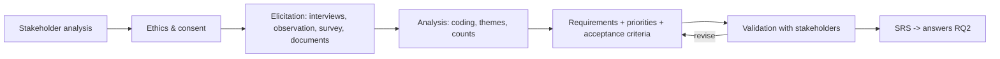

# FYP-06 Requirements Gathering, Stakeholder and Feasibility Analysis

> [!info] Topic card
> **Unit:** U3 · **Time:** 4 h + elicitation sessions · **Template:** [[FYP-T08 Requirements Specification]] · **Depth on techniques:** [[SD-03 Requirements Engineering]], [[SD-04 Use Cases, User Stories and Traceability]] · **Checker:** `requirement_smells` in `07 - Software Design and Development/code/sd_tools.py`

## 1. Learning objectives
1. **Identify** and **analyse** your project's stakeholders (users, clients, gatekeepers, affected parties).
2. **Plan** and **conduct** requirements elicitation as research activities (interviews, observation, document analysis, surveys, prototypes), with ethics in place.
3. **Analyse** elicited data into prioritised functional and non-functional requirements, use cases and acceptance criteria.
4. **Assess** feasibility: technical, economic, legal, operational, schedule (TELOS).
5. **Present** the requirements in a way that's traceable to RQ2 and to the evaluation in RQ4.

## 2. Why it matters
In a DSR FYP, RQ2 ("what requirements must the system meet?") is a research question. Its answer must come from evidence (the stakeholders), not from your imagination. Feasibility analysis shows the examiners you've checked the project can actually be done.

## 3. Prerequisites
[[FYP-05 Research Paradigms and Methodology]] · [[SD-03 Requirements Engineering]] · [[SD-04 Use Cases, User Stories and Traceability]] · [[PM-12 Stakeholder and Communication Management]].

## 4. Intuition
Requirements gathering for an FYP is **SD-03 done as research**: you plan it, get consent, collect data systematically, analyse it, and report how each requirement arose ("R7 came from 3 of the 4 warden interviews").

## 5. Rigorous explanation

### 5.1 Stakeholders for the running example
| Stakeholder | Role | Involvement |
|---|---|---|
| Residents | End users (report faults) | Survey (n per FYP-07), 1–2 focus groups, usability test |
| Wardens | End users (prioritise, assign) | Interviews (3–4), observation of the office |
| Technicians | End users (update status) | Interviews (2) |
| Dean of students | Gatekeeper, client | Approval, a scope meeting |
| ICT unit | Hosting, single sign-on | A feasibility consultation |
| Supervisor | Academic guidance | Reviews |

### 5.2 Elicitation as research
- **Plan:** objectives; participants and recruitment; an interview guide; consent forms; recording permission; data storage ([[FYP-10 Research Ethics, Privacy, Academic Integrity and Citation]]).
- **Conduct:** semi-structured interviews (30–45 min); observe the warden's office for a morning (with permission); analyse the paper slips (anonymised); a short survey for residents.
- **Analyse:** code the interview notes into themes (pain points, needs); count frequencies; derive candidate requirements; prioritise them with MoSCoW with the stakeholders.
- **Validate:** review the draft SRS with the wardens; walk through a clickable prototype (paper or Figma-like) with residents.

### 5.3 From data to requirements (traceable)
| Evidence | Theme | Requirement |
|---|---|---|
| 3 of 4 wardens: "We can't tell urgent from minor" | Prioritisation | FR-04: The system shall allow a warden to set the priority (urgent/high/normal/low) for each request |
| Survey: most residents prefer reporting by phone | Access | NFR-02: The request form shall be usable on a phone screen of 360 px width |
| Observation: slips lost | Tracking | FR-02: The system shall record every request with a unique ID and timestamp |
| Technician interview: no feedback loop | Status | FR-06: The system shall let a technician update status and add a note |

(The counts are illustrative; report your real ones.) Write each requirement in SD-03 style, and check it with `requirement_smells`.

### 5.4 Feasibility (TELOS)
| Dimension | Questions | Running example |
|---|---|---|
| Technical | Do the skills, tools and infrastructure exist? | Python/Flask or similar, SQLite or PostgreSQL; a university server or low-cost hosting; you've done similar projects (e.g. [[PRJ-PY-05 Hostel Maintenance System]]) |
| Economic | Are the costs affordable? | Open-source tools; hosting about TZS X/month (check real prices); no licences |
| Legal | Data protection, policy, IP | Residents' personal data, so consent, minimisation and protection ([[CS-19 Cloud Security and Privacy]]); a university ICT policy |
| Operational | Will people use it? Who maintains it? | Wardens supportive in interviews; a handover plan to ICT is needed for real use |
| Schedule | Can it be done in time? | The CPM plan in FYP-09 shows the critical path fits within FYP I + II |

## 6. Terminology
| Term | Meaning |
|---|---|
| Elicitation | Discovering requirements from stakeholders and artefacts |
| Interview guide | Planned questions and prompts for semi-structured interviews |
| Coding | Labelling segments of qualitative data with themes |
| SRS | Software requirements specification |
| TELOS | Technical, economic, legal, operational, schedule feasibility |
| Requirements validation | Confirming with stakeholders that the requirements reflect their needs |

## 7. Step-by-step
1. Stakeholder analysis (table §5.1); confirm access with the gatekeepers.
2. Ethics: consent forms and approval (FYP-10) **before** collecting data.
3. Draft the interview guide (10–12 open questions, from RQ1 and RQ2).
4. Conduct the sessions, take notes, and transcribe or summarise them within 24 hours.
5. Code the data into themes; build the evidence → requirement table.
6. Write the SRS ([[FYP-T08 Requirements Specification]]): FRs, NFRs, use cases, acceptance criteria, priorities.
7. Validate it with the stakeholders; revise.
8. Write the feasibility section (TELOS).

## 8. Diagram: requirements as research

## 9. Worked examples

### Example 1 (basic): sample interview questions (wardens)
1. Walk me through what happens when a resident reports a fault.
2. Which faults are most common? Which are most urgent?
3. How do you decide which fault goes first?
4. What problems do you face with the current process?
5. How do you communicate with technicians and residents?
6. What would an ideal process look like?
7. What would worry you about a new system?

They're open, non-leading and process-focused.

### Example 2 (intermediate): MoSCoW from the evidence
- **Must:** submit a request; a unique ID and tracking; warden prioritisation; technician status updates; resident notifications.
- **Should:** photo upload; dashboard statistics.
- **Could:** SMS reporting; Kiswahili interface. (A Could here, but the gap analysis in FYP-04 made it part of the contribution. Discuss that tension with your supervisor.)
- **Won't (this project):** integration with the finance system.

### Example 3 (challenging): an infeasibility discovered
ICT says university single sign-on integration needs a formal request and about 8 weeks. **Options:** (a) start the request now (it's on the critical path); (b) design for a local login in the prototype, with SSO as future work; (c) both. Record the decision in the feasibility section and the risk register ([[FYP-T11 Risk Register]]).

## 10. Application: what goes in the proposal
- Methodology: how you'll elicit the requirements (participants, methods, ethics).
- Initial requirements: preliminary findings, if you've already done a pilot, clearly labelled.
- Feasibility: TELOS.

Full requirements may belong in FYP II or later chapters, depending on your handbook.

## 11. Common mistakes
| Mistake | Fix |
|---|---|
| Requirements invented, not elicited | Collect evidence; trace each requirement to its source |
| Collecting data before ethics approval | Approval and consent first |
| Leading questions ("Wouldn't an app help?") | Open, neutral questions |
| No validation | Review the draft requirements with the stakeholders |
| A feasibility section of generic sentences | Specific checks, with evidence (quotes, prices, approvals) |

## 12. Comparison: elicitation methods for FYPs
| Method | Effort | Depth | Best for |
|---|---|---|---|
| Semi-structured interviews | Medium | High | Process, pain points (wardens) |
| Survey | Medium | Low–medium | Many users' preferences (residents) |
| Observation | Medium | High | Real workflow, tacit steps |
| Document analysis | Low | Medium | Current records, forms |
| Prototype walkthrough | Medium | High | Validating the UI and flows |

## 13. Practice
**L1** 1. What does TELOS stand for? 2. Why should requirements be traceable to evidence?

**L2** 3. Write a stakeholder table for your project. 4. Draft 8 interview questions for your primary users.

**L3** 5. Turn 4 hypothetical interview findings into FRs/NFRs, and check them with `requirement_smells`. 6. Write the TELOS feasibility section for your project.

**L4** 7. Plan an elicitation schedule (sessions, dates, participants) and put it into your Gantt chart. 8. Design a requirements validation session.

**L5** 9. Conduct a real (ethically approved) interview, code it, and derive at least 5 traced requirements.

## 14. Hints
> [!tip]- Hints
> 2: examiners ask "where did this requirement come from?" 5: actor + "shall" + measurable condition. 8: walk through the use cases with the stakeholders; ask them to rank the requirements; record the changes.

## 15. Worked solutions
> [!success]- Solutions 1–2
> 1. Technical, economic, legal, operational, schedule. 2. To show that the requirements answer RQ2 with evidence, rather than the developer's assumptions, and to support validation and evaluation (RQ4 can test whether the needs were met).

> [!success]- Solution 5 (sample)
> - Finding: "Technicians don't know which room a fault is in." Requirement: "FR-07: The system shall display the block, room number and description of each assigned request to the technician."
> - Finding: "Residents forget to follow up." Requirement: "FR-08: The system shall notify the resident when their request's status changes."
> - Finding: "Data is costly." Requirement: "NFR-03: The request form page shall transfer at most 200 KB on first load."
> - Finding: "Wardens need reports." Requirement: "FR-09: The system shall produce a monthly report of requests by category and median resolution time."

## 16. Self-test (pass ≥ 4/5)
1. Is RQ2 answered by the developer's ideas or by evidence? 2. What comes before elicitation? 3. Give a non-leading question. 4. Which feasibility dimension covers data protection? 5. How do you validate requirements?
> [!success]- Answers
> 1. By evidence from the stakeholders (plus the literature). 2. Stakeholder analysis, ethics approval and consent. 3. "Walk me through what happens when…". 4. Legal. 5. Review them with the stakeholders, walk through use cases or prototypes, and get their agreement and ranking.

## 17. Flashcards
#flashcards/fyp
TELOS?::Technical, economic, legal, operational, schedule feasibility.
Evidence → requirement trace?::A table linking each requirement to its interview, survey or observation source.
Interview style for elicitation?::Semi-structured, open, non-leading questions.
Before collecting data?::Ethics approval and informed consent.

## 18. Blank-page recall
Draw the requirements-as-research flow, and write your TELOS table.

## 19. Revision summary
- Identify the stakeholders and gatekeepers; get ethics approval first.
- Elicit with several methods; analyse by coding; derive traced requirements; validate them.
- Prioritise with MoSCoW, and connect to the gap and the contribution.
- Assess TELOS feasibility with specific evidence.

## 20. Links
Prev: [[FYP-05 Research Paradigms and Methodology]] · Next: [[FYP-07 Data Collection Instruments, Sampling and Evaluation Planning]] · Template: [[FYP-T08 Requirements Specification]] · Related: [[SD-03 Requirements Engineering]], [[SD-04 Use Cases, User Stories and Traceability]], [[PM-03 Project Initiation, Business Case and Charter]]

## 21. Sources
- Sommerville, I., *Software Engineering*, 10th ed., Pearson, 2016, chapter 4 (requirements engineering).
- Braun, V. & Clarke, V., "Using thematic analysis in psychology", *Qualitative Research in Psychology*, 3(2), 2006, pp. 77–101 (coding interview data).
- Oates, B. J., Griffiths, M. & McLean, R., *Researching Information Systems and Computing*, 2nd ed., SAGE, 2022 (interviews, observation, documents).
- *(Not checked online during the build, because there was no network access. Verify them before citing.)*

## 22. Mastery checklist
- [ ] I analysed my stakeholders and secured access
- [ ] I planned ethical elicitation and derived traced requirements
- [ ] I wrote a TELOS feasibility analysis
- [ ] Reviews scheduled
