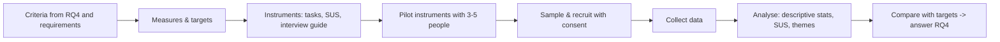

# FYP-07 Data Collection Instruments, Sampling and Evaluation Planning

> [!info] Topic card
> **Unit:** U3 · **Time:** 5 h · **Calculator:** `cochran_n0`, `finite_correction`, `yamane`, `adjust_for_response_rate`, `cronbach_alpha`, `likert_summary` and `sus_score` in `code/fyp_tools.py`. Every number below is asserted in `tests/test_fyp_tools.py`. The population figure (2,400 residents) is a **hypothetical** example: use your institution's real figure.

## 1. Learning objectives
1. **Design** instruments (questionnaires, interview guides, observation sheets, usability test scripts) that measure what the RQs need.
2. **Choose** a sampling strategy (probability vs non-probability), and **calculate** and **justify** sample sizes.
3. **Assess** validity and reliability (content validity, piloting, Cronbach's alpha).
4. **Plan** an artefact evaluation: criteria, measures (SUS, task success, time, errors), participants, procedure and analysis.
5. **Plan** the analysis: descriptive statistics for Likert data, thematic analysis for interviews.

## 2. Why it matters
Weak instruments give meaningless data. A sample size pulled out of the air invites the examiner's question "why 50?". An evaluation without criteria can't show that your artefact works. Planning these in FYP I makes FYP II straightforward.

## 3. Prerequisites
[[FYP-05 Research Paradigms and Methodology]] · [[DM-18 Introductory Discrete Probability]] (proportions, the normal distribution) · [[SD-14 Software Testing, Verification and Validation]] (verification vs validation).

## 4. Intuition
An instrument is a **measuring tool**. It must point at the right thing (validity) and give consistent readings (reliability). A sample is a **spoonful of soup**: if it's stirred well (random sampling) and big enough, it tells you about the whole pot.

## 5. Rigorous explanation

### 5.1 Instruments
- **Questionnaire:** closed items (Likert 1–5, multiple choice) plus a few open items. Rules:
  - one idea per item (no double-barrelled items);
  - neutral wording;
  - balanced scales;
  - avoid jargon;
  - translate and back-translate if bilingual (English/Kiswahili);
  - keep it short (under 10 minutes).
- **Interview guide** (semi-structured): open questions, prompts, an introduction and consent script (FYP-06 Example 1).
- **Observation sheet:** what to record (time, activity, problems), with no personal identifiers.
- **Usability test script:** realistic tasks ("Report a broken window in room B-210 with a photo"), success criteria, think-aloud instructions, a post-test questionnaire (SUS) and a short interview.

### 5.2 Sampling
| Type | Method | Use |
|---|---|---|
| Probability | Simple random, stratified (e.g. by hostel block), systematic, cluster | Surveys whose results are to be generalised |
| Non-probability | Purposive (chosen for relevance), convenience, snowball, quota | Interviews and usability tests; hard-to-reach groups |

**Sample size for a proportion** (Cochran): $n_0 = \dfrac{z^2 p(1-p)}{e^2}$. With 95% confidence (z ≈ 1.96), p = 0.5 (the most conservative) and e = ±5%, $n_0 \approx 384$. With the **finite population correction**, $n = \dfrac{n_0}{1 + (n_0 - 1)/N}$.

**Yamane's** simplified formula, $n = N/(1 + N e^2)$, is common in East African theses. It's a convenient approximation. Say which one you used, and why.

**Qualitative samples** are justified by purpose and **saturation** (when new interviews stop adding new themes), not by formulas. Often 5–15 interviews.

**Usability tests:** the classic Nielsen & Landauer model suggests that small groups (around 5 users per round) uncover many usability problems, under the model's assumptions. Several rounds of 5 are better than one round of 15. For *reporting* SUS scores credibly, aim for more participants (10–20+), and state the limitation.

### 5.3 Validity and reliability
- **Content validity:** the items cover the construct. Have experts or your supervisor review them.
- **Face validity:** participants understand the items. Pilot with 3–5 people.
- **Construct validity:** use validated scales where possible (SUS for usability; TAM-derived items for perceived usefulness).
- **Reliability:** Cronbach's alpha for multi-item scales. Values around **0.7 or above** are commonly treated as acceptable, but interpret them in context, and don't "fish" for alpha by deleting items without a reason.
- **Qualitative trustworthiness:** credibility (member checking), transferability (thick description), dependability (an audit trail), confirmability (reflexivity).

### 5.4 Evaluation planning (DSR activity 5)
| Criterion | Measure | Target | Instrument | Participants |
|---|---|---|---|---|
| Effectiveness | Task success rate on 5 core tasks | ≥ 90% | Usability test script | 10 residents, 3 wardens |
| Efficiency | Time to submit a request | ≤ 2 min (median) | Timed observation | Same |
| Satisfaction / usability | SUS score | ≥ 68 (above the commonly quoted average) | SUS questionnaire | Same |
| Usefulness | Perceived usefulness items (Likert) | Median ≥ 4/5 | Post-test questionnaire | Same |
| Functional correctness | Requirements test cases passed | 100% of Musts | Test plan (SD-14) | Developer |
| (Pilot) process effect | Median time from report to resolution | Lower than the paper baseline | System logs vs a baseline sample | Pilot block |

### 5.5 Analysis plan
- **Likert items:** report the **median**, mode and % agree (ordinal data); the mean and SD only with caution.
- **SUS:** a 0–100 score per participant, then the mean with a confidence interval.
- **Interviews:** thematic analysis (Braun & Clarke's six phases: familiarise, code, generate themes, review, define and name, write up).
- **Integration:** compare the qualitative and quantitative findings (mixed methods).

## 6. Terminology
| Term | Meaning |
|---|---|
| Population / sampling frame | The whole group / a list from which the sample is drawn |
| Margin of error (e) | The acceptable difference between the sample estimate and the population value |
| Confidence level | The probability that the interval method captures the true value (e.g. 95%) |
| Stratified sample | Random sampling within subgroups (strata) |
| Saturation | The point where new data adds no new themes |
| Cronbach's alpha | Internal-consistency reliability of a multi-item scale |
| SUS | System Usability Scale: 10 items giving a 0–100 score |

## 7. Step-by-step: the survey sample for the running example
1. **Population:** say N = 2,400 residents (hypothetical; get the real number from the dean's office).
2. **Cochran:** $n_0$ = 384.1 (z = 1.95996, p = 0.5, e = 0.05). With the finite correction for N = 2,400: **n = 332**.
3. **Yamane** for comparison: 2,400/(1 + 2,400 × 0.0025) = **343**.
4. **Expected response rate** 50%, so invite **664** residents (`adjust_for_response_rate(332, 0.5)`).
5. **Strata:** sample proportionally by hostel block (e.g. a block with 25% of residents gives 25% of the sample).
6. If 332 is infeasible, accept e = ±10%: **n = 93**. State the wider margin as a limitation.

## 8. Diagram: evaluation plan flow

## 9. Worked examples

### Example 1 (basic): fix the questionnaire items
| Poor item | Problem | Better |
|---|---|---|
| "The system is fast and easy to use." | Double-barrelled | Two items: "Pages loaded quickly." and "The system was easy to use." |
| "Don't you agree the old process is bad?" | Leading | "How satisfied are you with the current reporting process?" (1–5) |
| "Rate the UX of the CRUD interface." | Jargon | "How easy was it to submit and check your request?" |

### Example 2 (intermediate): reliability and a Likert summary (tested)
A 4-item "perceived usefulness" scale piloted with 8 people (data in the test file) gives **Cronbach's α = 0.938**: high internal consistency (very high values can also mean redundant items, so check the wording). One item's 12 responses, [5, 4, 4, 3, 5, 2, 4, 4, 5, 1, 4, 3], give a **median of 4**, a mode of 4, **66.7% agree** (4 or 5), and a mean of 3.67 (SD 1.23). Report "median 4 (agree); 66.7% agreed".

### Example 3 (challenging): scoring SUS
One participant's answers to the 10 SUS items: 4, 2, 4, 1, 5, 2, 4, 2, 4, 3.
- Odd items contribute (answer − 1): 3 + 3 + 4 + 3 + 3 = 16.
- Even items contribute (5 − answer): 3 + 4 + 3 + 3 + 2 = 15.
- Total 31 × 2.5 = **77.5**, above the commonly cited average of 68.

`sus_score` gives the same result. All 3s (neutral) gives exactly **50**. Remember the alternating positive and negative wording of the SUS items; scoring them all the same way is a common error.

## 10. Application: the methodology chapter's instrument section
For each instrument:
- purpose (the RQ);
- structure (sections, items, scale);
- source (adapted from the SUS by Brooke, 1996, or self-developed);
- validation (expert review, pilot);
- administration (online form or paper, language);
- analysis.

Attach the instruments as appendices, along with the consent forms (FYP-10).

## 11. Common mistakes
| Mistake | Fix |
|---|---|
| A sample size with no justification | A formula plus assumptions, or a saturation argument |
| Convenience samples generalised to the population | State the limitation; use stratified random sampling for generalisation |
| Double-barrelled or leading items | One idea per item, neutral wording; pilot it |
| Means of Likert items as if they were interval data | Medians and % agree; or use validated multi-item scales |
| Evaluation without targets | Criteria, measures and targets before testing |
| Scoring SUS incorrectly | Alternate the item scoring; ×2.5 |

## 12. Comparison: probability vs non-probability sampling
| | Probability | Non-probability |
|---|---|---|
| Selection | Known chance for every member | Researcher judgement or availability |
| Generalisation | Statistical | Analytical / limited |
| Needs | A sampling frame (a list) | Access to relevant people |
| FYP use | Resident survey | Warden interviews, usability tests |

## 13. Practice
**L1** 1. What's a double-barrelled question? 2. State Cochran's formula.

**L2** 3. Compute n for N = 800 at 95% and ±5% (Cochran + FPC), and with Yamane. 4. Score the SUS answers 5, 1, 5, 1, 5, 1, 5, 1, 5, 1.

**L3** 5. Write a 10-item questionnaire for your RQ1, and pilot it with 3 people. 6. Write a usability test script with 5 tasks and success criteria.

**L4** 7. Justify a qualitative sample of 8 interviews using saturation. 8. Design the full evaluation plan table (§5.4) for your project.

**L5** 9. Pilot your instruments, compute Cronbach's alpha for your multi-item scale, revise the items, and report what changed.

## 14. Hints
> [!tip]- Hints
> 3: `finite_correction(cochran_n0(), 800)` and `yamane(800)`. 4: the best possible answers. 7: describe how you'll detect saturation (new codes per interview).

## 15. Worked solutions
> [!success]- Solutions 1–2
> 1. One question that asks about two things at once (e.g. "fast and easy"), so the answer is ambiguous. 2. $n_0 = z^2 p(1-p)/e^2$.

> [!success]- Solution 3
> Cochran + FPC: `finite_correction(cochran_n0(), 800)` gives **260**. Yamane: 800/(1 + 800 × 0.0025) = 800/3 = 266.7, so **267**. Report which one you used.

> [!success]- Solution 4
> Odd items: (5 − 1) × 5 = 20. Even items: (5 − 1) × 5 = 20. Total 40 × 2.5 = **100**, the maximum score.

> [!success]- Solution 7
> "Interviews will continue until thematic saturation: two consecutive interviews producing no new codes. Based on similar small, homogeneous groups (wardens and technicians share closely related roles and processes), we expect saturation by about 8 interviews. The code list will be updated after each interview, and the number of new codes per interview reported as evidence." (Cite methodological literature on saturation that you have read.)

## 16. Self-test (pass ≥ 4/5)
1. Which p gives the largest sample size? 2. What does FPC do? 3. Is α = 0.938 good? 4. SUS for all 3s? 5. Which sampling suits warden interviews?
> [!success]- Answers
> 1. p = 0.5. 2. It reduces the required n when the population is small. 3. High consistency (also check for redundant items). 4. 50. 5. Purposive.

## 17. Flashcards
#flashcards/fyp
Cochran n0 at 95%, ±5%, p = 0.5?::About 384.
Finite population correction?::n = n0 / (1 + (n0 − 1)/N).
Yamane formula?::n = N / (1 + N e²).
SUS scoring?::Odd items (x − 1), even items (5 − x); sum × 2.5.
Likert reporting?::Median, mode, % agree; be cautious with means.
Qualitative sample justification?::Purpose and saturation.

## 18. Blank-page recall
Redo the running example's sample size (332, Yamane 343, 664 invitations) and the SUS example (77.5) by hand.

## 19. Revision summary
- Instruments: aligned with the RQs, neutral, one idea per item, piloted, validated scales where possible.
- Sampling: probability for generalisation, purposive for depth. Justify n by formula (Cochran + FPC or Yamane) or by saturation.
- Reliability: Cronbach's α (about ≥ 0.7, interpreted carefully). Validity: expert review and piloting.
- Evaluation plan: criteria → measures → targets → instruments → participants → analysis.

## 20. Links
Prev: [[FYP-06 Requirements Gathering, Stakeholder and Feasibility Analysis]] · Next: [[FYP-08 Technical Architecture and Design Planning]] · Related: [[FYP-T07 Methodology]], [[SD-14 Software Testing, Verification and Validation]], [[DM-18 Introductory Discrete Probability]]

## 21. Sources
- Cochran, W. G., *Sampling Techniques*, 3rd ed., Wiley, 1977.
- Yamane, T., *Statistics: An Introductory Analysis*, 2nd ed., Harper & Row, 1967.
- Brooke, J., "SUS: a 'quick and dirty' usability scale", in Jordan, P. W. et al. (eds), *Usability Evaluation in Industry*, Taylor & Francis, 1996, pp. 189–194.
- Nielsen, J. & Landauer, T. K., "A mathematical model of the finding of usability problems", *Proceedings of INTERCHI '93*, ACM, 1993, pp. 206–213.
- Cronbach, L. J., "Coefficient alpha and the internal structure of tests", *Psychometrika*, 16(3), 1951, pp. 297–334.
- Braun, V. & Clarke, V., "Using thematic analysis in psychology", *Qualitative Research in Psychology*, 3(2), 2006, pp. 77–101.
- *(Not checked online during the build, because there was no network access. Verify them before citing.)*

## 22. Mastery checklist
- [ ] I designed and piloted instruments aligned with my RQs
- [ ] I calculated and justified my sample sizes
- [ ] I can compute and interpret alpha, Likert summaries and SUS
- [ ] My evaluation plan has criteria, measures and targets · reviews scheduled
