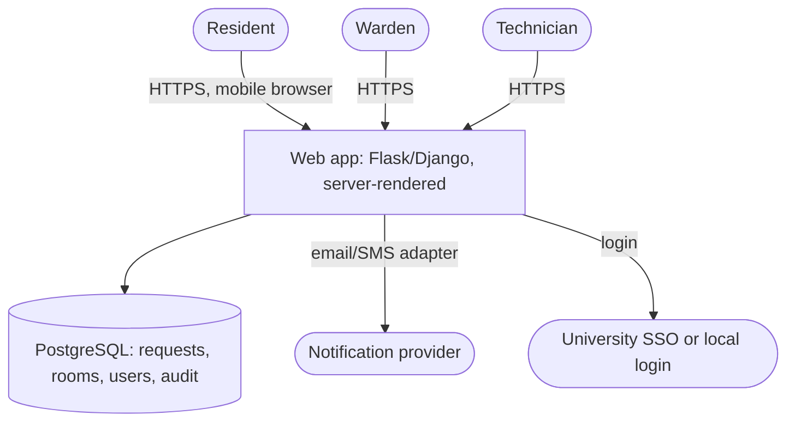
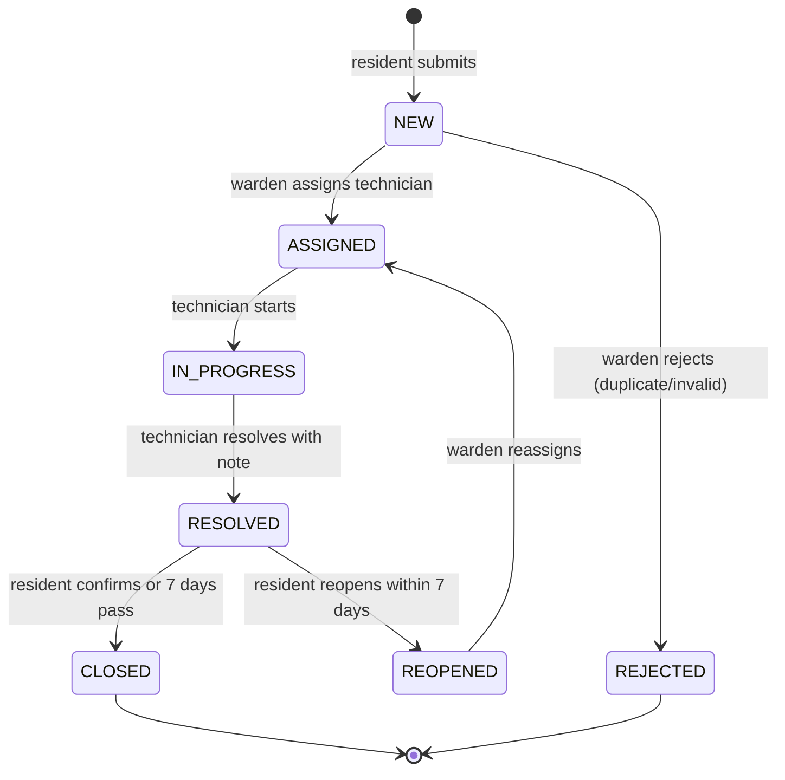

# FYP-08 Technical Architecture and Design Planning

> [!info] Topic card
> **Unit:** U4 · **Time:** 4 h · **Depth:** [[SD-05 Software Architecture and Architectural Styles]], [[SD-07 UML Class Diagrams]], [[SD-08 UML Sequence, Activity and State Diagrams]], [[SD-09 Data Modeling and Interface Design]], [[SD-17 Secure and Reliable Software Design]] · **Worked reference:** the LabBook case ([[SD-CASE LabBook Running Case Study]]) and [[PRJ-PY-05 Hostel Maintenance System]]

## 1. Learning objectives
1. **Derive** architecture drivers (key quality attributes and constraints) from your requirements.
2. **Propose** an architecture (style, components, deployment) with C4 diagrams, and **justify** it with at least one rejected alternative.
3. **Select** technologies with explicit criteria (fit, skills, cost, hosting, support, licences).
4. **Plan** the key design models (use cases, class/ERD, a sequence for the main use case, the state of the core entity), and security and privacy measures.
5. **Present** the design plan proportionately in the proposal (enough to show feasibility).

## 2. Why it matters
The proposal must convince examiners that you **can** build the system. A clear, justified architecture and technology choice, linked to the requirements, shows feasibility. "I will use React, Node, MongoDB and Kubernetes" with no reasons raises doubts.

## 3. Prerequisites
[[FYP-06 Requirements Gathering, Stakeholder and Feasibility Analysis]] · the SD lessons above.

## 4. Intuition
Design planning answers: **"What are the main parts, how do they talk, where do they run, and why is this the simplest structure that meets the requirements?"** You'll refine the details in FYP II. Now you need a sound, defensible skeleton.

## 5. Rigorous explanation

### 5.1 Drivers
Pick the 3–5 requirements that shape the architecture most. For the running example:
- **Low bandwidth and mobile:** NFR-02, NFR-03.
- **Privacy** of residents' data (legal).
- **Reliability:** no lost requests.
- **Maintainability:** handover to ICT.
- **Constraint:** a small budget, and a single developer.

### 5.2 Architecture proposal
- **Style:** a layered/hexagonal **modular monolith** (SD-05 ADR-001 reasoning): one deployable web app, with server-rendered pages for low bandwidth.
- **Components:**
  - a web adapter;
  - request service (use cases);
  - domain (Request, its status state machine);
  - prioritisation rules (Strategy);
  - repository (database);
  - notification adapter (email/SMS).
- **Data:** a relational database (PostgreSQL or SQLite for the prototype) with constraints (SD-09).
- **Deployment:** a university server or low-cost hosting; HTTPS; backups.
- **Rejected alternative:** a native mobile app plus a REST API. Higher cost and bandwidth needs, and app-store issues. A responsive web app meets the needs.

### 5.3 Technology selection
| Criterion | Weight | Option A: Python + Flask/Django + PostgreSQL | Option B: Node + React SPA + MongoDB |
|---|---|---|---|
| Fit to requirements (server-rendered, relational data) | 0.30 | 5 | 3 |
| Your skills | 0.25 | 5 (Python module, PRJ-PY-05) | 3 |
| Hosting availability at the university | 0.20 | 4 | 3 |
| Cost and licences (open source) | 0.10 | 5 | 5 |
| Community and support | 0.15 | 5 | 5 |
| **Weighted total** | 1.0 | **4.80** | **3.50** |

(The scores are illustrative judgements. Use your own, and explain them.)

### 5.4 Design models to include (proportionately)
1. A **use-case diagram** (actors: resident, warden, technician).
2. A **C4 context and container** diagram.
3. An **ERD** for the core entities (Resident, Room, Block, Request, StatusChange, Comment).
4. A **state diagram** for Request (NEW → ASSIGNED → IN_PROGRESS → RESOLVED → CLOSED; REJECTED; REOPENED).
5. A **sequence diagram** for "submit request".
6. **Security and privacy:** authentication, role-based authorisation, data minimisation, encryption in transit, backups, audit logs ([[SD-17 Secure and Reliable Software Design]]).

## 6. Terminology
| Term | Meaning |
|---|---|
| Architecture driver | A requirement that strongly shapes the architecture |
| C4 context/container | A system-in-environment view / the deployable units |
| Technology stack | The languages, frameworks, database and hosting chosen |
| ADR | Architecture decision record (context, decision, consequences) |
| Prototype fidelity | Low (paper) to high (working code) |

## 7. Step-by-step
1. List the drivers from the SRS.
2. Sketch 2 candidate architectures; walk the drivers through each (SD-05 §5.4).
3. Choose one, and write ADR-001 with the rejected alternative.
4. Score the technology options with weights.
5. Draw the C4 context and container diagrams, and the ERD.
6. Draw the Request state machine and the "submit request" sequence.
7. List the security and privacy measures, mapped to the risks.

## 8. Diagram: C4 container view (running example)


## 9. Worked examples

### Example 1 (basic): state diagram for Request

Implement it as a transition table, with tests generated from it (SD-08 §7).

### Example 2 (intermediate): ADR-001 for the FYP
```text
ADR-001: Responsive server-rendered web app (modular monolith)
Context: residents on mobile data, single developer, university server, privacy constraints.
Decision: Flask (or Django) with server-rendered templates, PostgreSQL, layered modules.
Alternatives: native Android app + REST API (rejected: cost, app distribution, bandwidth, time).
Consequences: + light pages, one codebase, simple deployment; - no offline mode (SMS fallback as future work).
```

### Example 3 (challenging): security and privacy plan mapped to risks
| Risk | Measure |
|---|---|
| A resident sees other residents' requests (IDOR) | Object-level authorisation tests (CS-04, CS-11) |
| Leaked phone numbers | Data minimisation (phone optional); access by role; encryption in transit; backups encrypted |
| Password attacks | SSO, or Argon2id/scrypt hashing (CS-08); rate limiting |
| A lost or corrupted database | Daily backups, with a restore test (CS-15) |
| Photo uploads carrying malware or personal content | Type checks, re-encoding, metadata stripping, size limits (CS-14) |

## 10. Application: how much design goes into the proposal?
Typically:
- the architecture (one C4 diagram plus the ADR summary);
- the technology table;
- the ERD;
- one use-case diagram.

Detailed class and sequence diagrams often belong in FYP II's design chapter. Check your handbook. The goal at the proposal stage is to show **feasibility and alignment**.

## 11. Common mistakes
| Mistake | Fix |
|---|---|
| A technology list without reasons | Criteria-based selection, plus your skills and hosting constraints |
| Fashionable but heavy stacks | The simplest architecture that meets the drivers |
| Diagrams unrelated to the requirements | Trace the components to the FRs and NFRs |
| No security or privacy in the design | Map the risks to measures |
| Over-designing in FYP I | Proportionate: the skeleton now, the details later |

## 12. Comparison: web app vs native app for FYPs
| | Responsive web app | Native mobile app |
|---|---|---|
| Reach | Any browser | Per platform |
| Bandwidth | Low with server rendering | The app download is large; updates too |
| Development time | Lower (one codebase) | Higher |
| Offline | Limited (PWA possible) | Good |
| FYP fit | Most information systems | When device features or offline use are essential |

## 13. Practice
**L1** 1. What's an architecture driver? 2. Name the C4 levels used in proposals.

**L2** 3. List the 4 drivers for your project. 4. Draw the state diagram for your core entity.

**L3** 5. Score 2 technology stacks for your project with weights. 6. Write your ADR-001.

**L4** 7. Map 5 security and privacy risks to design measures. 8. Draw the ERD and check it against 3NF (SD-09).

**L5** 9. Produce the design-plan section for your proposal (2–3 pages, with diagrams), and review it with your supervisor.

## 14. Hints
> [!tip]- Hints
> 1: a requirement or constraint that strongly shapes the structure. 4: use SD-08's notation, with events and guards. 8: check for transitive dependencies (block → building name).

## 15. Worked solutions
> [!success]- Solutions 1–2
> 1. A quality attribute, requirement or constraint that significantly influences the architecture (e.g. low bandwidth, privacy, a single developer). 2. Context and Containers (and Components if needed).

> [!success]- Solution 5 (method)
> Copy the table in §5.3, replace the criteria with your drivers, score each option from 1 to 5 with a one-line justification per score, multiply by the weights, and sum. Check the totals (PM-03's weighted-scoring tip: always re-add). Option A in the example: 0.30·5 + 0.25·5 + 0.20·4 + 0.10·5 + 0.15·5 = 1.5 + 1.25 + 0.8 + 0.5 + 0.75 = **4.80**. Option B: 0.9 + 0.75 + 0.6 + 0.5 + 0.75 = **3.50**.

## 16. Self-test (pass ≥ 4/5)
1. Why include a rejected alternative? 2. Which diagram shows the deployable units? 3. Where do security measures come from? 4. Is a microservice architecture usually right for an FYP? 5. How do you test a state machine?
> [!success]- Answers
> 1. To show the decision was reasoned, not by default. 2. The C4 container diagram. 3. A threat/risk analysis mapped to the requirements. 4. Rarely: a modular monolith is simpler (SD-05 §5.5). 5. A test for each allowed transition and for the key disallowed ones.

## 17. Flashcards
#flashcards/fyp
Proposal design essentials?::Drivers, a C4 context/container view, an ADR with an alternative, a technology table, an ERD, the security plan.
Technology choice method?::Weighted criteria: fit, skills, hosting, cost, support.
Typical FYP architecture?::A layered modular monolith web app with a relational database.

## 18. Blank-page recall
Draw the C4 container view and the Request state machine for your project.

## 19. Revision summary
- Derive the drivers; propose the simplest fitting architecture; record an ADR with a rejected alternative.
- Choose technologies by weighted criteria, including your skills and hosting constraints.
- Include the C4 view, ERD, state machine, key sequence diagram, and the security and privacy measures, in proportion.
- The aim is to demonstrate feasibility and alignment with the requirements.

## 20. Links
Prev: [[FYP-07 Data Collection Instruments, Sampling and Evaluation Planning]] · Next: [[FYP-09 Project Scheduling, Milestones and Risk Assessment]] · Related: [[SD-05 Software Architecture and Architectural Styles]], [[SD-17 Secure and Reliable Software Design]], [[X-03 Security Requirements in Software Architecture]]

## 21. Sources
- Bass, L., Clements, P. & Kazman, R., *Software Architecture in Practice*, 4th ed., Addison-Wesley, 2021.
- Brown, S., *The C4 model for visualising software architecture*: https://c4model.com/
- Nygard, M., "Documenting Architecture Decisions", 2011 (ADRs).
- *(Not checked online during the build, because there was no network access.)*

## 22. Mastery checklist
- [ ] I derived the drivers and proposed a justified architecture with an ADR
- [ ] I selected technologies with weighted criteria
- [ ] I planned the key diagrams and the security and privacy measures
- [ ] Reviews scheduled
