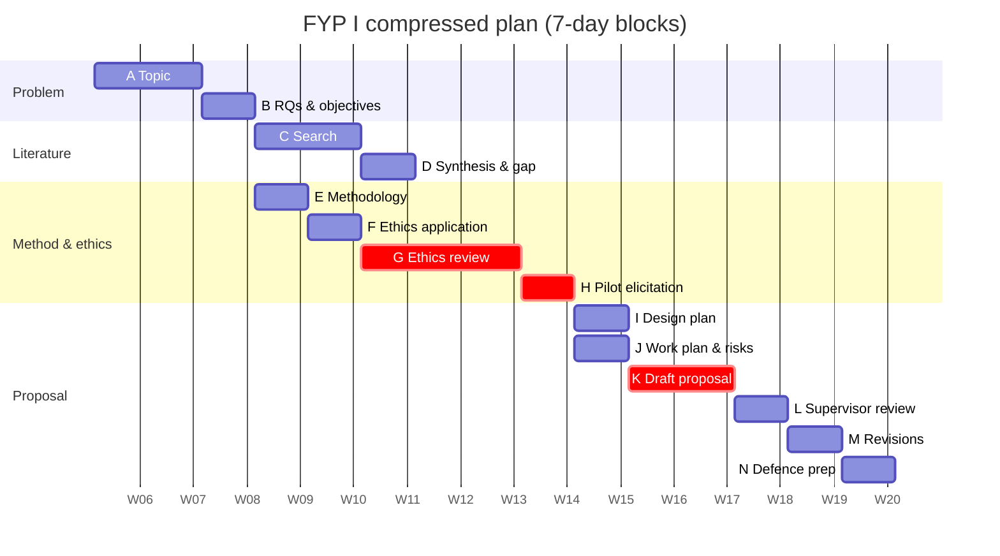

# FYP-09 Project Scheduling, Milestones and Risk Assessment

> [!info] Topic card
> **Unit:** U4 · **Time:** 3 h · **Templates:** [[FYP-T09 Work Breakdown Structure]], [[FYP-T10 Project Schedule]], [[FYP-T11 Risk Register]] · **Calculator:** `cpm` in `05 - Information System Project Management/code/pm_tools.py`. The example plan below is asserted in `test_fyp09_semester_plan`.

## 1. Learning objectives
1. **Build** a deliverable-oriented WBS for your project (the research deliverables *and* the software).
2. **Sequence** the activities, estimate durations, find the critical path, and **fit** the plan to your real deadlines.
3. **Set** milestones aligned with the department's submission points and supervisor meetings.
4. **Identify** and **assess** project risks (data access, ethics delays, technical, personal), with responses and triggers.
5. **Track** progress against the plan, and **report** it in progress reports.

## 2. Why it matters
Most FYPs that fail do so through time, not talent: ethics approval arrives late, interviews can't be scheduled, the build takes longer, other modules have deadlines. CPM and a risk register are the PM tools you've already learned. Apply them to yourself.

## 3. Prerequisites
[[PM-04 Scope Management, Requirements Traceability and WBS]] · [[PM-06 Critical Path Method and Float]] · [[PM-11 Risk Management]] · [[FYP 02 Idea-to-Defense Workflow]].

## 4. Intuition
Your FYP is a small project with **one critical resource: you**, and some **external dependencies** you don't control (ethics committees, gatekeepers, participants). The schedule must start those dependencies early, and protect your buffer.

## 5. Rigorous explanation

### 5.1 WBS for an FYP (deliverable-oriented)
1. Proposal: problem and objectives; literature review; methodology; design plan; work plan; ethics.
2. Approvals: supervisor sign-off; ethics approval; gatekeeper permission.
3. Data: interviews; survey; analysis.
4. Artefact: requirements; design; implementation (FYP II); testing.
5. Evaluation: instruments; sessions; analysis (FYP II).
6. Communication: progress reports; presentation; defence; final report.
7. Project management: the schedule, risk register and meeting notes.

### 5.2 Scheduling
- Activities with durations in weeks; dependencies (FS); your **real deadlines** as constraints.
- Include your **other modules' exam periods** as unavailable time (a resource calendar).
- Identify the critical path, and look for the **external dependencies** on it (ethics approval, gatekeepers).
- Add **buffer** before hard deadlines (10–20%).

### 5.3 Milestones
Zero-duration checkpoints:
- topic approved;
- literature review draft;
- ethics approval;
- proposal submission;
- defence.

Align them with the handbook's dates and supervisor meetings.

### 5.4 FYP risks (typical)
| Risk | P | I | Response |
|---|---|---|---|
| Ethics approval delayed | Medium | High | Apply early; submit complete forms; plan non-human-subject work meanwhile |
| Gatekeeper refuses access | Low–medium | High | Get written permission early; identify an alternative site |
| Few survey responses | Medium | Medium | Oversample (`adjust_for_response_rate`); reminders; the gatekeeper's endorsement |
| Technical difficulty (e.g. SMS integration) | Medium | Medium | Spike early; design a fallback (email); scope it as Could |
| Personal: illness, other deadlines | Medium | High | Buffer; communicate early with the supervisor |
| Data loss | Low | High | Version control (Git), with cloud backup |
| Supervisor unavailable | Low–medium | Medium | Schedule meetings in advance; written questions |

## 6. Terminology
| Term | Meaning |
|---|---|
| Milestone | A zero-duration checkpoint |
| Critical path | The longest chain; it determines the earliest finish |
| Buffer | Reserved time before a deadline |
| External dependency | An activity controlled by others (an ethics committee) |
| Resource calendar | When you're available (excluding exam weeks) |

## 7. Step-by-step: CPM on an FYP I plan (tested)
| ID | Activity | d (weeks) | Pred. |
|---|---|---|---|
| A | Topic exploration and approval | 2 | — |
| B | Problem, RQs, objectives | 1 | A |
| C | Literature search | 2 | B |
| D | Synthesis and gap | 1 | C |
| E | Methodology and instruments | 1 | B |
| F | Ethics application | 1 | E |
| G | Ethics review (waiting) | 3 | F |
| H | Requirements elicitation | 2 | G |
| I | Design plan | 2 | H, D |
| J | Work plan and risks | 1 | I |
| K | Draft proposal | 2 | J, D |
| L | Supervisor review | 1 | K |
| M | Revisions | 1 | L |
| N | Defence preparation | 1 | M |

`cpm` gives **18 weeks**, with critical path A-B-E-F-G-H-I-J-K-L-M-N. The literature work (C, D) has **4 weeks of float**. **The plan doesn't fit a 15-week semester.** If the ethics review takes 5 weeks instead of 3, the plan grows to 20 weeks.

**Compression** (agreed with the supervisor):
- in FYP I, elicitation is reduced to a 1-week pilot (H = 1), with the full elicitation moved to FYP II;
- the design plan is proportionate (I = 1);
- the work plan (J) runs in parallel with the design, after H.

Result: **15 weeks**, but with **zero buffer** on the critical path (and 3 weeks of float on C and D). **Lesson:** the ethics application is the single most important early action. Submit it in week 4, and prepare the instruments in week 3. Ask the supervisor whether the handbook allows elicitation to start under an approved generic protocol.

## 8. Diagram: Gantt sketch of the compressed plan (week 1 = semester week 1)

*The dates are placeholders. Replace them with your semester calendar.*

## 9. Worked examples

### Example 1 (basic): milestones
- M1 topic approved (end of week 2);
- M2 ethics submitted (week 4);
- M3 literature draft (week 6);
- M4 ethics approved (week 7, expected);
- M5 proposal submitted (week 13);
- M6 defence (week 14–15, according to the department's schedule).

### Example 2 (intermediate): a risk register entry
| ID | Risk (cause → event → effect) | P (1–5) | I (1–5) | Score | Response | Trigger | Owner |
|---|---|---|---|---|---|---|---|
| FR1 | The ethics committee meets monthly → approval may come after week 8 → elicitation and the design slip | 3 | 5 | 15 | Submit in week 4; a complete application checked by the supervisor; prepare literature and design work that doesn't need participants | No acknowledgement within 1 week | Student |

### Example 3 (challenging): exam weeks in the schedule
If weeks 9–10 are mid-semester exams for your other modules, treat them as **50% availability**. Activities on the critical path during those weeks (e.g. H and I) take about twice as long, so the plan slips. The fix: move non-critical work (C, D have float) into the exam weeks, and keep critical work outside them. That's resource levelling ([[PM-08 Resource Allocation and Levelling]]) applied to yourself.

## 10. Application: progress tracking
Every 2 weeks, update:
- the % complete per activity;
- the critical path status (any slip?);
- the risk scores.

Send [[FYP-T14 Progress Report]] to your supervisor. When the critical path slips by more than 1 week, discuss the options early: reduce the scope, or reorder the work.

## 11. Common mistakes
| Mistake | Fix |
|---|---|
| Planning without real deadlines | Get the handbook's dates first |
| Ignoring the ethics review time | Start the application early; it's often on the critical path |
| No buffer | 10–20% before hard deadlines |
| Ignoring other modules | A resource calendar with exam weeks |
| A risk register written once | Review it every two weeks |
| A Gantt chart with no dependencies | Network logic first, then the Gantt |

## 12. Comparison: schedule views for your proposal
| View | Shows | Include? |
|---|---|---|
| WBS | What you'll deliver | Yes (an appendix or a figure) |
| Activity table with dependencies | The logic, durations | Yes |
| Gantt chart | The timeline, milestones | Yes (most handbooks expect one) |
| Network/CPM | The critical path | Recommended, briefly |

## 13. Practice
**L1** 1. Why is ethics approval often critical? 2. Define a milestone.

**L2** 3. Build the WBS for your FYP. 4. List 6 risks with P and I scores.

**L3** 5. Enter your activities into `pm_tools` (`Activity(...)` objects) and find the critical path. 6. Draw your Gantt chart with milestones.

**L4** 7. Your plan needs 18 weeks but you have 15. Propose 3 compression options, with their risks. 8. Model your exam weeks as reduced availability, and re-plan.

**L5** 9. Produce your complete work plan (WBS, activity table, CPM result, Gantt chart, risk register), and review it with your supervisor.

## 14. Hints
> [!tip]- Hints
> 1: external; it may be monthly; participant work can't start without it. 7: fast-track (overlap), reduce the scope in FYP I, start external dependencies earlier.

## 15. Worked solutions
> [!success]- Solutions 1–2
> 1. It's controlled by others (the committee's schedule), it often takes weeks, and all participant-facing work (elicitation, surveys, evaluation) depends on it, so a delay pushes everything after it. 2. A significant event or checkpoint with zero duration (e.g. "ethics approved").

> [!success]- Solution 7
> 1. **Fast-track:** draft the methodology and the ethics forms while the literature search runs (they only depend on the RQs). Risk: rework if the review changes the RQs. 2. **Re-scope FYP I:** a pilot elicitation only, with the full elicitation in FYP II (as in the example). Risk: fewer validated requirements at the proposal stage. 3. **Start external dependencies earlier:** a provisional gatekeeper letter in week 2, and the ethics submission in week 4. Risk: forms submitted before the methods are final might need amendments. Agree any re-scoping with your supervisor.

## 16. Self-test (pass ≥ 4/5)
1. In the example, how much float did the literature work have? 2. What happened when the ethics review took 5 weeks? 3. How should exam weeks be handled? 4. How often should you update the risk register? 5. What should you do when the critical path slips?
> [!success]- Answers
> 1. 4 weeks (3 after compression). 2. The plan grew to 20 weeks. 3. As reduced availability (a resource calendar); move non-critical work into them. 4. Every progress cycle (e.g. every 2 weeks). 5. Discuss the options with the supervisor early: re-scope, reorder or compress.

## 17. Flashcards
#flashcards/fyp
Most common FYP critical-path external dependency?::Ethics approval (and gatekeeper access).
FYP buffer guideline?::10–20% before hard deadlines.
Compression options?::Fast-track independent work, re-scope with the supervisor, start external dependencies earlier.
Exam weeks in the plan?::Reduced availability: schedule non-critical work there.

## 18. Blank-page recall
Rebuild the example network, and explain why it needs 18 weeks and how it was compressed to 15.

## 19. Revision summary
- Make a WBS of the research and software deliverables; schedule with CPM against your real deadlines and availability.
- External dependencies (ethics, gatekeepers) usually drive the critical path: start them early.
- Milestones aligned with the handbook; buffers before deadlines.
- Keep an FYP risk register with responses and triggers; review progress every 2 weeks.

## 20. Links
Prev: [[FYP-08 Technical Architecture and Design Planning]] · Next: [[FYP-10 Research Ethics, Privacy, Academic Integrity and Citation]] · Templates: [[FYP-T09 Work Breakdown Structure]], [[FYP-T10 Project Schedule]], [[FYP-T11 Risk Register]] · Related: [[X-07 Scheduling Your Own Semester with CPM]], [[PM-06 Critical Path Method and Float]]

## 21. Sources
- PMI, *PMBOK® Guide*, 6th ed., 2017 (scheduling, risk).
- Dawson, C. W., *Projects in Computing and Information Systems: A Student's Guide*, 3rd ed., Pearson, 2015 (planning student projects).
- Your department's FYP handbook (deadlines, milestones).
- *(Not checked online during the build, because there was no network access.)*

## 22. Mastery checklist
- [ ] I built a WBS and a CPM schedule against real deadlines
- [ ] I set milestones and buffers, and planned around exam weeks
- [ ] I keep a reviewed risk register
- [ ] Reviews scheduled
