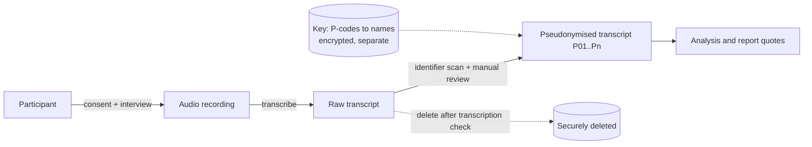

# FYP-10 Research Ethics, Privacy, Academic Integrity and Citation

> [!info] Topic card
> **Unit:** U5 · **Time:** 3 h · **Template:** [[FYP-T12 Ethics Checklist]] · **Calculators:** `citation_crosscheck` and `identifier_scan` in `04 - Final Year Project I/code/fyp_tools.py`. The examples below are asserted in `test_fyp10_citation_crosscheck` and `test_fyp10_identifier_scan`. The pseudonymisation helper is `pseudonymise` in `02 - Cyber Security/code/cs_examples.py`.

> [!warning] Your institution's rules come first
> No official ethics policy, approval form, plagiarism threshold or referencing style was supplied for this build. Everything here is general good practice. **Your department's handbook, your institution's research ethics committee, and the data-protection law that applies to you override this note.** Check which law applies with your supervisor: for example, Tanzania enacted a Personal Data Protection Act in 2022, but its exact obligations for student research weren't verified here (no network access during the build).

## 1. Learning objectives
1. **Identify** the ethical issues in your project (participants, data, deception, power relationships, harm).
2. **Design** informed consent, and data handling that minimises collection and protects identities.
3. **Prepare** an ethics application that a committee can approve the first time.
4. **Explain** plagiarism, self-plagiarism, fabrication, falsification and the misuse of AI tools, and avoid them.
5. **Cite** consistently in one referencing style, and **verify** that every source exists and says what you claim.

## 2. Why it matters
An ethics delay can wreck your schedule ([[FYP-09 Project Scheduling, Milestones and Risk Assessment]]). Mishandled personal data can hurt real people. An integrity violation can fail a project that is otherwise excellent. All three are avoidable with planning.

## 3. Prerequisites
[[FYP-07 Data Collection Instruments, Sampling and Evaluation Planning]] (what you'll collect) · [[CS-19 Cloud Security and Privacy]] (pseudonymisation, k-anonymity, retention) · [[FYP-03 Literature Searching and Critical Reading]] (finding and reading sources).

## 4. Intuition
Ethics asks: *would the people in my study agree to what I'm doing, if they fully understood it, and could anything I do harm them?* Integrity asks: *is every claim in my report honestly mine, or honestly credited, and true to what I actually did and found?*

## 5. Rigorous explanation

### 5.1 Core research-ethics principles
These are widely used principles (they appear, in varying words, in the Belmont Report and many institutional codes):
- **Respect for persons:** voluntary, informed participation; the right to withdraw without penalty.
- **Beneficence / non-maleficence:** minimise harm and risk (physical, psychological, social, legal, financial, reputational).
- **Justice:** fair selection of participants; don't burden one group for another's benefit.
- **Privacy and confidentiality:** collect the minimum; protect what you collect; say who will see it.

### 5.2 Informed consent: the elements
A participant information sheet and consent form normally cover:
1. who you are, and your supervisor and institution;
2. the purpose of the study, in plain language;
3. what participation involves (time, activities, recording);
4. risks and benefits (often "no direct benefit");
5. that participation is voluntary, and how to withdraw (and until when their data can be withdrawn);
6. how data will be stored, who sees it, how long it's kept, how it will be anonymised or pseudonymised, and how results will be published;
7. contact details for questions and complaints (including the ethics committee, if your institution requires it);
8. a consent statement with a signature or recorded agreement, and a separate tick-box for audio/video recording.

Special care is needed for: minors; people in a dependent relationship with you (classmates you grade, juniors, your employees); vulnerable groups; and studies where consent is collected online.

### 5.3 Power and coercion
If the head of the hostel tells students to attend your interviews, participation isn't truly voluntary. Recruit through neutral channels, say clearly that refusal has no consequences, and don't offer incentives large enough to pressure people.

### 5.4 Data protection in practice
- **Minimise:** don't collect names, room numbers or phone numbers unless the research needs them.
- **Separate:** keep any key linking pseudonyms (P01, P02…) to identities separate from the data, encrypted, with access limited to you (and your supervisor if required).
- **Scrub before sharing:** remove direct identifiers from transcripts. `identifier_scan` helps find emails, phone numbers, ID-like strings and known names, but a zero count is **not** proof of anonymity: combinations of quasi-identifiers (block + year + role) can still identify a person (see k-anonymity in [[CS-19 Cloud Security and Privacy]]).
- **Secure storage:** an encrypted, access-controlled location approved by your institution; not a personal chat app; not a public repository.
- **Retention and disposal:** keep data as long as your institution requires, then delete it securely. State the period in the consent form.
- **System test data:** use synthetic data during development. Never put real participants' data into a prototype you're debugging.

### 5.5 The ethics application
A complete application usually includes:
- a project summary and research questions;
- the methods and instruments (interview guide, questionnaire, evaluation tasks);
- recruitment and sampling;
- the information sheet and consent form;
- risks and mitigations;
- the data management plan;
- gatekeeper permission letters (e.g. from the hostel administration).

Submit early: it is often on the critical path. Treat the committee's questions as a review, not an obstacle.

### 5.6 Academic integrity
| Violation | What it is | Example |
|---|---|---|
| Plagiarism | Presenting someone else's words, ideas, code, figures or structure as yours | Paraphrasing a paper's argument without citing it |
| Self-plagiarism | Re-using your own previously assessed work without permission or acknowledgement | Submitting a previous module's report section unchanged |
| Fabrication | Inventing data, results, participants or sources | "Twenty users rated it 4.5/5", with no study done |
| Falsification | Manipulating data, methods or results | Dropping responses that don't fit, without disclosure |
| Collusion / contract cheating | Unauthorised collaboration; paying for work | Another student writing your literature review |
| Undisclosed AI use | Using generative AI against your institution's rules, or without disclosure where disclosure is required | A literature review drafted by a chatbot, with references nobody checked |

**On AI tools:** follow your institution's policy. Where AI use is permitted, the responsibility is yours: AI tools can produce references that don't exist, and attribute claims to papers that don't make them. **Never cite a source you haven't found and read yourself.**

### 5.7 Citing and referencing
- **One style, used consistently** (APA, IEEE or Harvard are common; your department may prescribe one).
- **Every in-text citation has a reference entry, and every reference entry is cited.** `citation_crosscheck` checks this consistency for author-year styles. It cannot check that the source exists.
- **Verify each source:** that it exists (find it in a database or library, and resolve its DOI at doi.org), that the bibliographic details are right, and that it actually says what you claim.
- **Quote rarely, paraphrase properly:** a real paraphrase changes the structure and words and still carries a citation. Patchwriting (swapping synonyms into the original sentence) is still plagiarism.
- **Code:** credit libraries, tutorials and snippets in comments and in the report; respect their licences.
- **Reference managers** (Zotero, Mendeley or similar) reduce errors, but check their output.

## 6. Terminology
| Term | Meaning |
|---|---|
| Informed consent | Voluntary agreement, based on adequate understanding |
| Anonymous | No one, including you, can link data to a person |
| Pseudonymous / confidential | You can link data to a person, but you protect that link and don't disclose it |
| Gatekeeper | A person or organisation that controls access to participants or a site |
| Data management plan | How data is collected, stored, protected, retained and destroyed |
| Quasi-identifier | An attribute that identifies someone when combined with others |
| Patchwriting | Copying sentence structure with substituted words |
| Fabrication | Inventing data, results or sources |

## 7. Step-by-step: preparing your ethics application
1. List every participant-facing activity (elicitation, survey, usability test).
2. For each one, list the data collected and why the research needs it; delete what isn't needed.
3. Identify the risks (harm, identification, coercion) and their mitigations.
4. Write the information sheet and consent form (§5.2), in plain language.
5. Write the data management plan (§5.4).
6. Get gatekeeper permission letters.
7. Ask your supervisor to review the whole package, then submit.
8. Record the submission, any questions and the approval in your project log; schedule around the expected decision.

## 8. Diagram: data flow with privacy controls

*Text version: the participant consents and is interviewed; the recording is transcribed; the raw transcript is scanned and manually reviewed, then pseudonymised. The raw material is securely deleted after checking (or retained as your institution requires). The key linking pseudonyms to names is stored separately and encrypted. Only the pseudonymised transcripts go into analysis and quoted extracts.*

## 9. Worked examples

### Example 1 (basic): what to collect
For the running example's usability evaluation of the hostel maintenance system, you need task success, completion time, SUS answers, and general demographics (e.g. year of study, if the analysis uses it). You **don't** need names, room numbers, phone numbers or registration numbers. Recruitment contact details are kept apart from the responses, and deleted after the sessions.

### Example 2 (intermediate): scanning a transcript (tested)
A raw transcript line (fictional):

> Interviewee Neema (neema.k@student.example, 0712 345 678, reg ABC/21/01234) said Neema's room leaks.

`identifier_scan(text, ["Neema"])` → `{"email": 1, "phone": 1, "student_id": 1, "known_names": 2}`. After pseudonymising, "P07 said the room in Block C leaks." scans clean (all zeros). But ask: how many students live in Block C and reported a leak? If it's one, the quote still identifies them. Generalise ("a resident said their room leaks") before publishing.

### Example 3 (intermediate): citation consistency (tested)
Draft text: "Maintenance requests are often lost (Mwakyusa, 2021). Smith and Jones (2019) found delays; Okafor et al. (2020) proposed a ticketing model…" with a reference list of Mwakyusa (2021), Smith & Jones (2019) and Lee (2018). These authors are **fictional placeholders**.

`citation_crosscheck` returns `missing_from_references: ["Okafor 2020"]` and `never_cited: ["Lee 2018"]`. Fix both: add the Okafor entry (after finding and reading the paper) and either cite Lee where it's relevant or remove it.

### Example 4 (challenging): the dependent-relationship problem
You're a class representative and want to survey your classmates about a system you built. Risks: they may feel pressure to participate and to rate it positively (a social-desirability bias, and coercion). Mitigations: recruit through a neutral announcement; collect responses anonymously, so you can't see who answered; state that taking part or not has no effect on anything; consider a facilitator other than you for usability sessions; and report the relationship as a limitation.

## 10. Application: your integrity routine
- Keep a **source log** (your literature matrix, [[FYP-T05 Literature Matrix]]): for each source, record how you found it, and that you read it.
- Cite **as you write**, not afterwards.
- Run `citation_crosscheck` (or your reference manager's check) before each submission.
- Keep your raw data, analysis scripts and notes, so that every number in your report can be traced back.
- Record any AI-tool use as your institution requires.

## 11. Common mistakes
| Mistake | Fix |
|---|---|
| Submitting the ethics application late | Plan it as an early critical activity |
| Collecting "everything, just in case" | Collect only what the research questions need |
| Calling pseudonymised data "anonymous" | Use the right term; you still hold the key |
| Storing recordings on a phone or public cloud folder | Use institution-approved encrypted storage |
| Copying references from another paper's list | Find and read each source yourself |
| Citing a reference an AI tool suggested, unchecked | Verify existence and content first |
| Mixed referencing styles | One style; use a reference manager, and check it |
| Real participant data in test fixtures | Synthetic data only |

## 12. Comparison: anonymous, pseudonymous and identified data
| | Anonymous | Pseudonymous | Identified |
|---|---|---|---|
| Can you link it to a person? | No | Yes, via the protected key | Yes, directly |
| Can a participant withdraw their data later? | Usually not (you can't find it) | Yes | Yes |
| Risk if leaked | Lowest (but check quasi-identifiers) | Medium | Highest |
| Typical FYP use | Anonymous surveys | Interviews, usability sessions | Only when essential, with explicit consent |

## 13. Practice
**L1** 1. List the eight elements of informed consent. 2. Distinguish anonymous from pseudonymous data.

**L2** 3. Classify: (a) copying a paragraph with a citation but without quotation marks; (b) re-running an analysis until $p < 0.05$ and only reporting that run; (c) citing a paper from another paper's reference list without reading it. 4. Write a data management plan for a 10-person interview study.

**L3** 5. Run `identifier_scan` on a fictional transcript you write with 3 planted identifiers; then pseudonymise it and scan again. 6. Run `citation_crosscheck` on a page of your own draft.

**L4** 7. A gatekeeper offers you the hostel's complaint log, with names and room numbers, "to save time". What do you do? 8. Your survey has 4 respondents from one small department. Can you report results by department?

**L5** 9. Prepare your full ethics package (information sheet, consent form, instruments, data management plan, risk table) using [[FYP-T12 Ethics Checklist]], and have your supervisor review it.

## 14. Hints
> [!tip]- Hints
> 3(a): the words are someone else's. 7: is the data needed? did those people consent to research use? does the committee know? 8: think k-anonymity.

## 15. Worked solutions
> [!success]- Solutions 1–3
> 1. Identity; purpose; what's involved; risks and benefits; voluntary participation and withdrawal; data handling (storage, access, retention, anonymisation, publication); contacts; a consent statement (with a separate recording consent). 2. Anonymous: no one can link the data to a person. Pseudonymous: the data uses codes, but a protected key can re-identify people. 3. (a) Plagiarism of wording: a verbatim copy needs quotation marks (or a real paraphrase). (b) Falsification by selective reporting (often called p-hacking): report all analyses, or pre-specify one. (c) A citation integrity failure: you're claiming knowledge of a source you didn't read; the claim may be wrong. Find and read the original, or cite it as cited in the secondary source if your style allows.

> [!success]- Solution 7
> Decline the identified log. The people in it didn't consent to research use, and you don't need their identities. Options: ask for an aggregated or de-identified extract (counts by category and month, with no names or rooms); describe the request in your ethics application; and get the committee's and the gatekeeper's written agreement for what you'll receive. Note the decision in your project log.

> [!success]- Solution 8
> Probably not. With 4 people from one department, a breakdown by department (especially with other attributes like year) can identify individuals, and their answers. Merge small groups ("other departments"), report only aggregated results, or suppress cells below a threshold your institution or supervisor accepts. It's the k-anonymity idea from [[CS-19 Cloud Security and Privacy]].

## 16. Self-test (pass ≥ 4/5)
1. Why can't participants usually withdraw their responses from an anonymous survey after submitting? 2. What does `citation_crosscheck` *not* prove? 3. Name two signs of coercion. 4. Is patchwriting plagiarism? 5. Where should the pseudonym key be stored?
> [!success]- Answers
> 1. Because you can't identify which response is theirs (say so in the information sheet). 2. That the sources exist or say what you claim. 3. Recruitment by someone with power over participants; large incentives; no clear statement that refusal has no consequences. 4. Yes. 5. Separately from the data, encrypted, with restricted access.

## 17. Flashcards
#flashcards/fyp
Pseudonymous vs anonymous?::Pseudonymous data can be re-linked using a protected key; anonymous data can't be linked to anyone.
Who overrides this vault on ethics?::Your institution's research ethics committee, your handbook, and applicable data-protection law.
Patchwriting?::Copying the source's sentence structure with swapped words: still plagiarism.
Fabrication vs falsification?::Fabrication invents data or sources; falsification manipulates real data, methods or results.
Rule for every citation?::Find it, read it, verify it says what you claim.
Does a zero identifier scan mean anonymous?::No: quasi-identifiers can still identify people.

## 18. Blank-page recall
List the consent elements, the data-protection practices (minimise, separate, scrub, secure, retain/dispose, synthetic test data), and the six integrity violations, from memory.

## 19. Revision summary
- Plan ethics early: it's usually on the critical path. Apply respect, beneficence, justice and privacy.
- Consent must be informed and voluntary; watch out for power relationships.
- Collect the minimum, pseudonymise, store securely, and state retention; use synthetic test data.
- Integrity: no plagiarism, fabrication, falsification, collusion or undisclosed AI use.
- One referencing style; every citation found, read and verified.

## 20. Links
Prev: [[FYP-09 Project Scheduling, Milestones and Risk Assessment]] · Next: [[FYP-11 Writing the Research Proposal]] · Template: [[FYP-T12 Ethics Checklist]] · Related: [[CS-19 Cloud Security and Privacy]], [[Citation Conventions]], [[X-06 Research Methodology Applied to the Final Year Project]]

## 21. Sources
- National Commission for the Protection of Human Subjects of Biomedical and Behavioral Research, *The Belmont Report*, 1979 (respect for persons, beneficence, justice).
- Oates, B. J., Griffiths, M. & McLean, R., *Researching Information Systems and Computing*, 2nd ed., SAGE, 2022 (ethics in IS research).
- Your institution's research ethics policy, academic integrity policy and AI-use policy; your department's referencing guide.
- *(Not checked online during the build, because there was no network access.)*

## 22. Mastery checklist
- [ ] I can list the elements of informed consent, and spot coercion
- [ ] I wrote a data management plan with minimisation and pseudonymisation
- [ ] I can classify integrity violations, and I verify every source I cite
- [ ] My draft passes a citation consistency check
- [ ] Reviews scheduled
