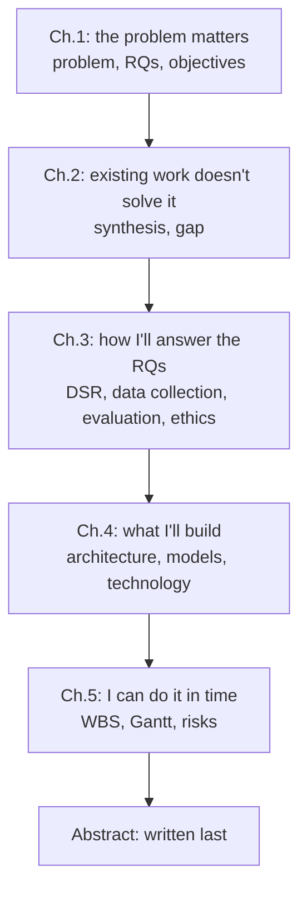

# FYP-11 Writing the Research Proposal

> [!info] Topic card
> **Unit:** U6 · **Time:** 4 h (plus weeks of drafting) · **Templates:** [[FYP-T13 Proposal Structure]], [[FYP-T14 Progress Report]] · **Calculators:** `alignment_gaps` and `word_budget` in `04 - Final Year Project I/code/fyp_tools.py`. The examples below are asserted in `test_fyp11_alignment_and_word_budget`.

> [!warning] Use your department's format
> No official proposal format, word limit or marking scheme was supplied. The chapter structure below is a common one for IS/computing proposals; the 8,000-word limit is a **hypothetical** example. Your handbook's structure, limits and formatting rules override it.

## 1. Learning objectives
1. **Assemble** the proposal from the outputs of FYP-01 to FYP-10, in a coherent structure.
2. **Check** alignment from problem to evaluation, and fix the gaps.
3. **Write** each chapter in a clear academic style: claims supported by evidence, tentative where appropriate, future tense for planned work.
4. **Plan** a word budget and a drafting and revision schedule.
5. **Self-assess** the draft against a marking-style checklist before submitting.

## 2. Why it matters
The proposal is how examiners decide whether your project is significant, feasible and well-designed. It's also your contract with yourself for FYP II: a vague proposal produces a vague project.

## 3. Prerequisites
All of [[FYP-01 Identifying and Narrowing a Research Problem]] to [[FYP-10 Research Ethics, Privacy, Academic Integrity and Citation]]. In particular, you need: the problem statement and RQs ([[FYP-T02 Problem Statement]], [[FYP-T03 Research Questions]]), the literature matrix and gap ([[FYP-T05 Literature Matrix]], [[FYP-T06 Research Gap Analysis]]), the methodology ([[FYP-T07 Methodology]]), the requirements ([[FYP-T08 Requirements Specification]]), the schedule and risks ([[FYP-T10 Project Schedule]], [[FYP-T11 Risk Register]]), and the ethics package ([[FYP-T12 Ethics Checklist]]).

## 4. Intuition
A proposal is an **argument**: *this problem matters (Ch. 1); what's known doesn't solve it (Ch. 2); this is how I'll solve it and know whether I have (Ch. 3–4); and I can do it in the time I have, ethically (Ch. 5 and appendices).* Every section should serve that argument.

## 5. Rigorous explanation

### 5.1 A common structure
| Part | Contents | Built from |
|---|---|---|
| Front matter | Title, declaration, abstract (150–300 words), contents, lists of figures and tables, abbreviations | Written last |
| Ch. 1 Introduction | Background; problem statement; main RQ and sub-RQs; general and specific objectives; scope, delimitations, limitations, assumptions; significance | FYP-01, FYP-02 |
| Ch. 2 Literature review | Themes; related systems compared; synthesis; the research gap; conceptual or theoretical framework | FYP-03, FYP-04 |
| Ch. 3 Methodology | Paradigm and strategy (e.g. DSR); requirements approach; data collection; sampling; instruments; analysis; evaluation plan; ethics | FYP-05, FYP-06, FYP-07, FYP-10 |
| Ch. 4 System design plan | Proposed architecture; key models (use cases, ERD, sequence diagrams); technology choices with justification | FYP-08 |
| Ch. 5 Work plan | WBS, schedule (Gantt), milestones, risks, resources and budget | FYP-09 |
| References | One style, every source verified | FYP-03, FYP-10 |
| Appendices | Instruments, information sheet and consent form, gatekeeper letters, detailed requirements | FYP-06, FYP-07, FYP-10 |

### 5.2 The alignment check
Before writing prose, check the matrix: each problem element → one RQ → one objective → a method → an evaluation. `alignment_gaps` reports empty cells, and RQs or objectives that appear in more than one row (often a sign of a merged or unclear question).

### 5.3 Academic style
- **Claims need support:** a citation, your own data (e.g. preliminary interviews), or explicit reasoning.
- **Hedge appropriately:** "suggests", "may", "in this context". Avoid "proves" and "always".
- **Tense:** past tense for what others found ("Smith (2019) found"), and for your preliminary work; future tense for planned work ("interviews will be conducted").
- **Precision:** "12 residents in two hostels" beats "many students".
- **Signposting:** start each chapter with what it covers, and end with a summary that links to the next one.
- **Figures and tables:** numbered, captioned, and referred to in the text.
- **No padding:** text that doesn't serve the argument costs marks and reading time.

### 5.4 Word budget
Divide the word limit in proportion to each chapter's weight, so the literature review doesn't consume everything. `word_budget` does this with largest-remainder rounding, so the parts add up exactly to the limit.

### 5.5 Drafting process
1. **Skeleton:** headings and bullet points for every section (one afternoon).
2. **Ugly first draft:** chapter by chapter, starting with whichever you know best (often Ch. 3), not necessarily Ch. 1.
3. **Supervisor review** of one chapter early, to calibrate expectations.
4. **Revision passes:** structure first (argument, alignment), then paragraphs, then sentences, then formatting and references.
5. **Final checks:** alignment, citation consistency (`citation_crosscheck`), figure and table numbering, the word count, the handbook's formatting rules, and the similarity report if your institution uses one.

### 5.6 The abstract
In 150–300 words: the context and problem; the aim; the methodology; the expected outputs and contribution. For a proposal, use future tense for the planned work. Write it last.

## 6. Terminology
| Term | Meaning |
|---|---|
| General objective | The overall aim (one sentence) |
| Specific objectives | The SMART steps that achieve the aim (one per RQ) |
| Conceptual framework | The concepts and relationships your study uses, drawn from the literature |
| Signposting | Telling the reader what comes next and why |
| Hedging | Expressing appropriate certainty |
| Similarity report | Software output showing text matching other sources (a tool for judgement, not a verdict) |

## 7. Step-by-step: from templates to a draft
1. Gather your completed templates (T02–T12).
2. Run `alignment_gaps` on your matrix; fix every gap.
3. Set the word budget with `word_budget` and the handbook's limit.
4. Build the skeleton using [[FYP-T13 Proposal Structure]].
5. Draft Ch. 3, then Ch. 1, Ch. 2, Ch. 4, Ch. 5.
6. Send one chapter to your supervisor; revise from the feedback.
7. Complete the draft; do the revision passes; write the abstract.
8. Run the final checks (§5.5), and submit before the deadline, with time to spare.

## 8. Diagram: how the proposal's argument flows

*Text version: Chapter 1 establishes that the problem matters; Chapter 2 that existing work doesn't solve it; Chapter 3 how the RQs will be answered; Chapter 4 what will be built; Chapter 5 that it's feasible in time. The abstract summarises it all, and is written last.*

## 9. Worked examples

### Example 1 (basic): a word budget (tested)
With a hypothetical 8,000-word limit and weights Ch. 1 15%, Ch. 2 30%, Ch. 3 30%, Ch. 4 15%, Ch. 5 10%: `word_budget` gives 1,200 / 2,400 / 2,400 / 1,200 / 800. With awkward weights (1 : 2 : 2 : 1 : 0.7 of 7,000 words), the parts are 1,045 / 2,090 / 2,089 / 1,045 / 731: still exactly 7,000.

### Example 2 (intermediate): an alignment check (tested)
A draft matrix for the running example has:
- RQ2 (requirements) with no evaluation;
- RQ3 used twice: once for "build the tool" and once for "acceptability", with the second row having no method.

`alignment_gaps` reports `["RQ2: no evaluation", "RQ3: no method", "RQ3: appears in 2 rows"]`. The fix: the acceptability row becomes RQ4, with the method "usability test, SUS, interviews" and the evaluation "SUS score, task success, feedback"; RQ2's evaluation becomes "SRS reviewed by the wardens" (the matrix in [[FYP-02 Problem Statements, Research Questions, Objectives and Scope]]).

### Example 3 (intermediate): improving a sentence
- **Weak:** "Many students suffer because the hostel maintenance system is very bad, and this system will solve the problem."
- **Better:** "In preliminary interviews, wardens reported that paper requests are sometimes lost and cannot be tracked (n = 2; see §1.2). This study will develop and evaluate a web-based system for reporting, prioritising and tracking maintenance requests."

The better version attributes evidence, quantifies it, avoids overclaiming ("solve"), and uses future tense for planned work.

### Example 4 (challenging): an abstract for the running example
> "Residents of [University X]'s hostels report maintenance faults on paper slips, which wardens report are sometimes lost and cannot be tracked or prioritised. This project aims to develop and evaluate a web-based system for reporting, prioritising and tracking hostel maintenance requests. Following a design science research approach, the current process and requirements will be established through interviews with wardens and maintenance staff and a survey of residents. A prototype will be designed and implemented, and evaluated through task-based usability testing with the System Usability Scale and follow-up interviews. Expected outputs are a validated requirements specification, a working prototype, and an evaluation of its usability and perceived usefulness in a low-resource university setting. The study is expected to give wardens a means of prioritising safety-critical faults, give residents visibility of request status, and give hostel management data for planning maintenance resources. It also contributes an evaluated design for maintenance request handling where existing commercial facilities-management tools may be unaffordable or poorly suited."

(161 words. It's fictional, with a placeholder institution; the numbers in your abstract must come from your own work.)

## 10. Application: a self-assessment rubric
Before you submit, rate each criterion 0–3 (0 missing, 1 weak, 2 adequate, 3 strong). *These are designed criteria, not an official marking scheme.*
| Criterion | What "strong" looks like |
|---|---|
| Problem and significance | Evidence-based, specific, consequences clear |
| RQs and objectives | Precise, answerable, aligned, SMART |
| Literature and gap | Thematic synthesis, critical, gap follows from the review |
| Methodology | Justified strategy; methods mapped to RQs; sampling and instruments explained |
| Design plan | Architecture and models consistent with requirements |
| Work plan and risks | Realistic schedule against real deadlines; risks with responses |
| Ethics | Consent, data handling and approvals addressed |
| Writing and referencing | Clear, concise, consistent style; every source verified |

Anything below 2 is your next revision task.

## 11. Common mistakes
| Mistake | Fix |
|---|---|
| Literature review as a list of summaries | Organise by theme; compare and synthesise |
| A gap that the review didn't show | Make the gap follow from the evidence in Ch. 2 |
| Methods not linked to RQs | A method-to-RQ table in Ch. 3 |
| Technology chosen before requirements | Justify the choices against the requirements |
| A schedule without ethics time | Include the review and its risk |
| Writing the abstract first | Write it last |
| Leaving formatting and references to the last night | Use a reference manager, and the template from day one |
| Ignoring supervisor feedback | Log every comment and how you addressed it |

## 12. Comparison: proposal vs final report
| | Proposal (FYP I) | Final report (FYP II) |
|---|---|---|
| Tense for your work | Future ("will") | Past ("was") |
| Results | None (maybe preliminary findings) | Full results and discussion |
| Design | Planned | As built, with changes explained |
| Evaluation | Planned | Conducted, analysed |
| Purpose | Convince examiners it's worth doing and feasible | Show what was done and found |

## 13. Practice
**L1** 1. List the five chapters and what each contributes to the argument. 2. Why is the abstract written last?

**L2** 3. Rewrite two weak sentences from your own draft (or invent some) using §5.3. 4. Compute a word budget for your handbook's limit with `word_budget`.

**L3** 5. Run `alignment_gaps` on your matrix, and fix the result. 6. Write your Ch. 3 skeleton.

**L4** 7. A reviewer says "the gap is asserted, not shown". Rewrite the end of Ch. 2 to fix it. 8. Your draft is 30% over the limit. Where do you cut, and how?

**L5** 9. Complete a full draft proposal, self-assess it with §10, revise, and submit it to your supervisor with a feedback log ([[FYP-T14 Progress Report]]).

## 14. Hints
> [!tip]- Hints
> 7: show the comparison (a table of existing systems against your criteria) and state what none of them do, with citations. 8: cut repeated content, long descriptions of tools and background that doesn't support the argument; move detail to appendices.

## 15. Worked solutions
> [!success]- Solutions 1–2
> 1. Ch. 1 the problem matters; Ch. 2 existing work doesn't solve it; Ch. 3 how the RQs will be answered; Ch. 4 what will be built; Ch. 5 it's feasible in time. 2. It summarises the whole proposal, which isn't final until the chapters are.

> [!success]- Solution 7
> End Ch. 2 with a synthesis: (a) a comparison table of the related systems you reviewed, against criteria from your problem (e.g. prioritisation, status tracking, low-bandwidth use, evaluation in a university setting), each cell supported by a citation; (b) a paragraph stating what the reviewed work collectively shows, and what none of it addresses; (c) the gap stated as that unaddressed combination; (d) a sentence linking the gap to your RQs. The gap then follows from the evidence instead of being asserted.

> [!success]- Solution 8
> First structure, then sentences: remove content that doesn't support the argument (general history of the web, long descriptions of every framework); merge repeated points (the problem often appears in three places); move detail to appendices (full instruments, long requirement lists) if your handbook excludes appendices from the count; tighten sentences ("in order to" → "to"). Recompute the budget and check each chapter against it.

## 16. Self-test (pass ≥ 4/5)
1. Which tense should you use for planned work? 2. What does `alignment_gaps` flag besides empty cells? 3. What's the purpose of Ch. 2's ending? 4. Name two final checks before submission. 5. What's wrong with "this system will solve the problem"?
> [!success]- Answers
> 1. Future tense. 2. An RQ or objective used in more than one row. 3. To show the gap that follows from the reviewed evidence, and link it to the RQs. 4. Any two of: alignment, citation consistency, figure and table numbering, word count, formatting rules, similarity report. 5. It overclaims; say what the study will develop and evaluate.

## 17. Flashcards
#flashcards/fyp
The proposal's argument in five chapters?::It matters; existing work doesn't solve it; how I'll answer the RQs; what I'll build; I can do it in time.
Tense for planned work in a proposal?::Future ("will be conducted").
When to write the abstract?::Last.
Why compute a word budget?::So no chapter (often the literature review) consumes the limit.
First revision pass?::Structure and argument (alignment), before sentences and formatting.

## 18. Blank-page recall
Write the proposal's chapter list from memory, with each chapter's role in the argument and the templates it's built from.

## 19. Revision summary
- The proposal is an argument: significance, gap, method, design, feasibility.
- Check alignment before writing; budget words by chapter.
- Academic style: supported claims, hedging, future tense for planned work, precision.
- Draft, get early feedback, then revise in passes from structure down to formatting.
- Self-assess against a rubric; your department's format overrides this one.

## 20. Links
Prev: [[FYP-10 Research Ethics, Privacy, Academic Integrity and Citation]] · Next: [[FYP-12 Presentation, Defense and Working with Supervisor Feedback]] · Templates: [[FYP-T13 Proposal Structure]], [[FYP-T14 Progress Report]] · Related: [[FYP 02 Idea-to-Defense Workflow]], [[X-06 Research Methodology Applied to the Final Year Project]]

## 21. Sources
- Dawson, C. W., *Projects in Computing and Information Systems: A Student's Guide*, 3rd ed., Pearson, 2015 (proposals and report writing).
- Oates, B. J., Griffiths, M. & McLean, R., *Researching Information Systems and Computing*, 2nd ed., SAGE, 2022.
- Your department's FYP handbook (structure, word limits, formatting, marking criteria).
- *(Not checked online during the build, because there was no network access.)*

## 22. Mastery checklist
- [ ] My matrix has no alignment gaps
- [ ] I have a word budget that matches my handbook's limit
- [ ] I've drafted every chapter, and revised it from supervisor feedback
- [ ] I've self-assessed the draft and fixed every criterion below 2
- [ ] Reviews scheduled
